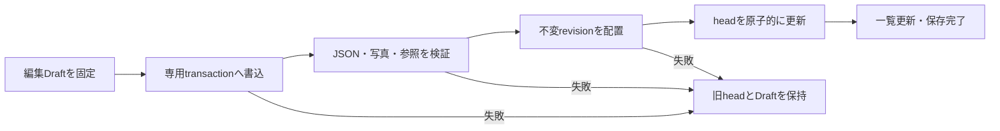

# NailNote：ChatGPT連携用の開発引き継ぎ

<!-- latest-status:start -->
## 最新状況サマリー

- 最終更新：2026-11-04 18:08 JST。識別子 `PlateCompletionGitCheckpoint-20261104`。第3次・第4次改善と作品内アイテム写真の完成状態をGitHubへ保存する作業。過去履歴保持。
- ユーザー実機確認済み：iPhone17eで新規プレート、4テンプレート、既存プレートへの写真追加、写真fallback、保存・再編集、掲載順変更、複製、4タブ。今回Codexによる実機操作・インストールなし。
- 完成内容：アプリ内デザインから写真差し替え、任意角度回転、右側アイテム編集、広告／メニュー／表示用語統一、軽量JPEG共有snapshot。schema1／renderer5、旧1〜4の表示と保存互換性を維持。詳細は各実装履歴参照。
- 今回の確認：全14ファイルの変更を確認。承認済み11Swift＋連携2文書を保存対象とする。project.pbxprojの既存IDE設定（LastUpgradeCheckとSTRING_CATALOG_GENERATE_SYMBOLS）は対象外でローカル保持。生成物・実機データ・秘密情報・不要な診断引数の混入なし。
- ビルド：今回の固定Debug（Simulator）／署名なしRelease（iOS）とも成功。アプリコード追加変更なし。以前の分離テスト結果を維持し、今回UIテストの再実行はしていない。
- Git：開始main a2b203ac3a200718f9a8dfa23356e8e736b83622、GitHub mainも同一。推奨メッセージで1回のcommit・通常pushを実施予定。確定ID／push結果は完了後追記し、その2文書は未コミットとして残す。追加commit／pushはしない。
- 容量：df -k /System/Volumes/Data、18:03:47→18:07:37ともAvailable304400000KiB＝311.7056GB、表示上増減0。固定キャッシュ再利用、削除なし。
- Google Drive：今回の保存結果記録後に既存単発同期を実行し、ローカル一致・クラウド本文を別々に確認する。直前の17:00同期は確認済み。
- 次：今回のGitHub保存完了後停止。GC・破損画像修復UI・関連付きItem削除導線は別件。VoiceOver、実機メモリピーク／FPS、全書体×構図網羅は未検証。Phase4・追加機能には進まない。

詳細：末尾「完成状態のGitHub保存・事前確認」。今回資料 `/private/tmp/NailNoteValidation/PlateGitCheckpoint/`。
<!-- latest-status:end -->


更新日：2026-10-26（日本時間）

## プロジェクト概要

### 目的・使用技術

NailNoteはネイル施術記録と所持用品を管理するiOSアプリ。写真、カテゴリ、カラー、自己評価、使用用品、購入情報を保存する。

- Swift／SwiftUI、CoreData、PhotosUI、UIKitを使用。
- Xcodeプロジェクト上のSwift言語モードは5.0、アプリターゲットの最低OSはiOS 18.6。今回の検証環境はXcode 27.1（27A9275）。
- NailNoteAppからRootViewを表示し、PersistenceControllerのviewContextを環境へ渡す。各画面がFetchRequestとCoreData保存を直接扱う構成。
- CoreDataにはNailEntry、NailProduct、NailEntryUsedItem、EntryAIScore、UsageQuotaの5エンティティがある。
- 写真はCoreData内ではなくDocuments配下のentry_photos／ProductPhotosに保存し、UUIDで参照する。
- フィルタ、並べ替え、お気に入り、テーマなどはAppStorageを使用。

### 現在の主要機能

- デザイン：記録の追加・編集・削除、写真、カテゴリ・カラー・キーワード絞り込み、日付・自己評価順ソート、0.5刻みの自己評価、使用用品の選択と順序保持。
- アイテム：用品の追加・編集・削除、10カテゴリ、SHOP・キーワード・お気に入り絞り込み、商品写真、サンプル写真、購入情報、使用回数表示、商品URLのリンク・共有。
- 設定：背景・デザインカード・アイテムカードのテーマ、アプリ情報、サポートリンク、アイコン候補プレビュー。
- AI：コードとデータ構造は保持するが、今回の実装で画面・導線・実行を休止。

### 現在の開発方針

AI評価を当面クローズし、ネイル記録・用品管理など基本機能の完成と安定化を優先する。通常表示は「デザイン／アイテム／設定」の3タブ。

## 今回の作業

### 実施内容

承認済みのdocs/AI_FEATURE_PAUSE_PLAN.mdに従い、指定された既存Swift 6ファイルだけを変更した。共通の固定フラグ`NailNoteFeatureFlags.aiEvaluationEnabled = false`を使用し、Debug／Release、APIキーの有無にかかわらずAIを休止する。ユーザーが設定画面から有効化する機構はない。

| 変更対象ファイル | 具体的な変更内容 |
|---|---|
| `NailNote/App/RootView.swift` | 共通フラグを定義。既存AIタブを条件分岐内に保持し、無効時はSimHomeViewを生成しない。残るタブ名と順序はデザイン／アイテム／設定 |
| `NailNote/Features/Sim/SimHomeView.swift` | bodyでもフラグを確認し、無効時はAI画面・シート・ハッシュ確認タスクを構築しない。AINailScoreErrorにfeaturePausedを追加。AINailScoreService.evaluateとperformRemoteEvaluationの先頭で休止エラーを返す |
| `NailNote/Features/Entries/EntryListView.swift` | 共通サムネイルのAIバッジを非表示。ソートメニューからAI項目を非表示。selectedSortFieldは保存値がAIなら停止期間中のみ日付を返し、保存値は書き換えない。記録削除確認はAIに言及しない文言へ切替 |
| `NailNote/Features/Entries/AddEntryView.swift` | 写真変更・削除確認の説明を基本機能向けへ切替。AI有効時の既存文言も分岐内に保持 |
| `NailNote/Features/Entries/EditEntryView.swift` | 写真変更・削除確認の説明を保存時に反映される旨へ切替。resetAIScoreなど既存の保存・整理処理は維持 |
| `NailNote/Features/Settings/SettingsView.swift` | AIを案内するサブスク欄とAIチャート設定を非表示。アプリ説明を写真・カテゴリ・自己評価・アイテム管理中心へ切替。既存文言・設定値・Bindingは保持 |

### 通信・評価処理の停止

従来の経路は「AIタブ → 生成／再評価ボタン → 確認ダイアログ → SimHomeView.evaluate → AINailScoreService.evaluate → performRemoteEvaluation → URLSession.data」。調査で確認できた実通信の経路はこれだけ。

今回、画面経路を閉じたうえで、サービスと実通信関数の両入口に共通フラグのguardを追加した。サービスのguardは写真読込、ハッシュ処理、利用枠作成、APIキー判定、モック生成、結果保存、回数更新のすべてより前にある。休止中は「AI評価機能は現在休止中です。」のエラーで終了する。

APIキーを消す方式ではなく、モック分岐を含めて入口で止める方式。用品URL・共有・サポートリンクの通信は停止対象外。すでに配布済みの旧版を遠隔停止する機能ではない。

### 変更しなかった関連箇所と理由

- CoreDataモデル、関連クラス、EntryAIScoreBridge、AIテーマ定義：再開と既存ストア互換性のため保持。エンティティ削除・再生成・移行はなし。
- 保存済みスコア・利用回数・AIテーマ値・AIソート値：一括削除・初期化なし。AIソートの実効値だけ日付へフォールバックする。
- 記録削除時のAIスコア削除、写真変更・削除時のresetAIScore：写真と評価の整合性維持のため継続。
- 用品管理、写真ストア、自己評価：今回の変更対象外。
- AI内部画面・サンプル・広告・通信・モック：既存コードを保持し、無効な分岐の内側に残す。
- Xcodeプロジェクト設定：変更なし。新規Swiftファイル・ターゲットの追加なし。
- AGENTS.md、ルートとアプリ配下のPROJECT_STATUS.md：今回の明示指示に従い変更なし。
- docs/AI_FEATURE_PAUSE_PLAN.md：承認前の計画履歴として変更なし。「未着手・承認待ち」という記載は当時の状態であり、実装後の最新状況は本書を参照する。

コミット・Pushは行っていない。開始時の未追跡.DS_Storeとdocs内の既存計画書を保持した。今回作成した引き継ぎ資料は本書のみ。

## 検証結果

### ビルド結果

| 構成 | 条件 | 結果 |
|---|---|---|
| Debug | generic/platform=iOS Simulator、CODE_SIGNING_ALLOWED=NO | BUILD SUCCEEDED、終了コード0 |
| Release | generic/platform=iOS Simulator、CODE_SIGNING_ALLOWED=NO | BUILD SUCCEEDED、終了コード0 |

使用したコマンドの形式：

```sh
xcodebuild -project NailNote.xcodeproj -scheme NailNote -configuration Debug -destination 'generic/platform=iOS Simulator' -derivedDataPath /tmp/NailNoteAIPause-Debug CODE_SIGNING_ALLOWED=NO build
xcodebuild -project NailNote.xcodeproj -scheme NailNote -configuration Release -destination 'generic/platform=iOS Simulator' -derivedDataPath /tmp/NailNoteAIPause-Release CODE_SIGNING_ALLOWED=NO build
```

両構成ともAppIntents.frameworkへの依存がないためメタデータ抽出を省略する警告があった。Swiftコンパイルエラーはなし。最初のサンドボックス内でのsimctl一覧取得はCoreSimulatorへのアクセスに失敗したため、許可後にサンドボックス外で再実行し、Simulatorを利用できた。

### テスト結果

| 検証項目 | 方法・確認範囲 | 結果 |
|---|---|---|
| サービス実行停止 | Debugビルドの実オブジェクトをリンクした一時Swiftハーネスを、iPhone 17e Simulator（iOS 27.0）上で実行。APIキーなし／テスト用ダミーキーありの両方を呼び出し | いずれもfeaturePausedの説明で終了 |
| 通信停止 | テストプロセスに外部送信を拒否するURLProtocolを登録し、リクエスト開始数を計測 | 両条件とも0件。実OpenAI APIへの送信なし |
| 既存AIデータ保持 | 実モデルからインメモリストアを作成し、スコア81点・写真ハッシュ・評価日時・利用回数2回・更新日時を設定して保存。サービス呼び出し前後を比較 | オブジェクトID、値、件数が不変。context.hasChangesはfalse |
| モック・新規保存・利用枠更新の停止 | スコア・利用枠がない別のインメモリ記録でもサービスを呼び出し。先頭guardの位置も確認 | 休止エラー。スコアと利用枠の件数0、未保存変更なし。モック分岐より前に終了 |
| 保存済みAIソートのフォールバック | 実ソースからフラグ・ソート列挙型・selectedSortFieldを抽出した一時Swiftテスト | aiScore→date、rating→rating、date→date、不明値→date。元の入力値を保持 |
| 既存保存・削除処理の保護 | HEADと対象関数の本文を比較。記録追加save、編集save／applyPhotoChange／resetAIScore、記録deleteEntries、比較処理、Bridge生成処理を確認 | 既存本文は一致 |
| AI表示箇所 | RootView、SimHomeView、バッジ、メニュー、確認文言、設定の条件分岐をソース確認し、両構成でコンパイル | 固定falseによる非表示の構造を確認。画面操作による確認は未実施 |
| 変更範囲・整形 | git status、変更ファイル一覧、git diff --check | 指定6ファイル以外の追跡済みファイルに変更なし。整形チェック成功 |

テスト用Swiftファイル・実行ファイル・ビルド生成物は/tmp配下のみ。リポジトリにテストファイルや設定を追加していない。ハーネスは既存アプリの起動エントリをリンク対象から外し、インメモリのテスト用データだけを使用した。ユーザーのアプリ内ストアを開いたり初期化したりしていない。

一時検証成果物（永続保存は保証されない）：

- `/tmp/NailNoteAIPause-Debug.log`、`/tmp/NailNoteAIPause-Release.log`：ビルドログ。
- `/tmp/NailNotePauseVerification.swift`、`/tmp/NailNotePauseVerification`：サービス・通信・インメモリ検証。
- `/tmp/NailNotePauseSortVerification.swift`：実ソースから抽出したソート検証。
- `/tmp/NailNotePauseHarnessBuild.log`：ハーネスのコンパイルログ。

### 未検証項目

- 実機でのビルド・実行・署名。今回のビルドはSimulator向けで署名を無効化した。
- アプリを画面操作して、3タブ、ソートメニュー、設定、各確認文言、既存スコア付きカードを見比べるUI検証。
- AppStorageを含むアプリ再起動を通したソート設定保持。抽出した実効値のロジックは検証済み。
- Releaseバイナリでのサービス実行テスト。Releaseはビルドと同一の先頭guard・固定フラグを確認し、ランタイムのハーネスはDebugの実コードを使用した。
- privateなperformRemoteEvaluationへの直接呼び出し。先頭guardは静的確認し、サービス経由の通信0件は実行確認した。
- ユーザーの既存SQLiteストアを使った起動前後のデータ比較。インメモリの保存済みテストデータでは不変を確認した。
- 記録・用品の追加編集削除、写真、自己評価、お気に入り、検索、通常テーマ、URL共有などの画面操作を伴う回帰テスト。
- モック関数への個別の呼び出し回数計測。サービスがその分岐に到達する前に休止エラーとなることは確認した。

### 既存機能への影響

意図した変更はAI表示・実行の休止と、AI順が保存されている場合の日付順フォールバックのみ。昇順／降順設定は維持する。デザイン・アイテム・設定の主要機能の内部処理は変更していない。ソース比較とビルドに加え、上記のサービス実行テストまで確認したが、基本機能の実機動作を成功扱いにはしない。

## 現在の問題点

以下は前回の全体調査で確認したコード上の問題・懸念。本作業で無関係な修正はせず、実機再現が未確認のものはその旨を記す。

| 問題・懸念 | 確認できた事実と現在の扱い |
|---|---|
| 関連データを持つ記録・用品の削除 | 中間エンティティへの削除規則がNullifyで、中間側のentry／productは必須。削除時の検証エラーや残存データの懸念。実機再現は未確認 |
| 写真とCoreData保存の整合性 | 旧写真をDB保存成功前に削除する経路がある。保存失敗時の復旧不足。実際のデータ消失再現は未確認 |
| 保存エラーの回復 | 記録・用品の保存失敗が主にprintで、画面通知や共有コンテキストのロールバックが不足 |
| 用品写真の掃除 | 用品一覧の削除処理に商品・サンプル画像ファイルの削除がない |
| 入力値の範囲検証 | 価格のInt32変換、AI点数のInt16変換に範囲確認が不足。AI側は今回停止。クラッシュ再現は未確認 |
| 設定画面の説明 | 複数端末アクセスを案内するが、確認できた保存実装はローカルNSPersistentContainer。認証・アプリとしてのクラウド同期は未実装。今回その文言は変更対象外 |
| サポートリンク | example.comの仮URL。公開前に実URLを用意する必要がある |
| 記録入力の検証 | 新規ではタイトル・デザイン・カラーを必須確認するが、編集時は同等のチェックがない |
| 保持中のAI実通信 | 写真のBase64を作成するが送信本文には写真データが含まれず、API応答全体を評価JSONとして直接デコードしている。今回修正せず休止で遮断 |
| 保持中のモックと実評価 | 乱数モックの識別情報がなく、比較・推移・回数に混在する設計。再開前に対処が必要 |
| 保持中のAIキー・利用枠 | アプリが直接キーを使用し、回数もローカルで管理する構成。製品化前に設計を確認する必要がある |
| コード・資料の重複 | New Groupの旧構成、Core/Modelの古いクラス、2つのPROJECT_STATUS.mdがある。誤ったターゲット追加や資料の取り違えに注意 |
| モデル生成方式 | 状態メモのManual/None説明と異なり、実モデルはcodeGenerationType="class"。今回のビルドでも自動生成クラスを使用した |
| 検証基盤 | 既存の自動テストターゲット・CIは見当たらない。今回のハーネスは一時検証で、リポジトリ内の継続テストではない |

過去のPROJECT_STATUS.mdには、2026-03-25時点のiPhone 17eのDeveloper Disk Imageマウント問題、Apple ID／Provisioningの問題が記録されている。その実機の現在の接続・署名状態は未確認。今回利用できたのはSimulatorであり、過去の実機問題の解決を意味しない。

## 次の開発候補

1. 今回の3タブ・非表示文言・既存データありの表示をSimulator／実機で確認し、基本機能の回帰確認を完了する。
2. 関連データを持つ記録・用品の削除を再現し、削除規則と中間データの整理を最小範囲で修正する。実機再現が未確認の段階から破損と断定しない。
3. 写真ファイル操作とCoreData保存の順序、保存失敗時の復旧・通知・コンテキスト管理を改善する。
4. 用品削除時の画像掃除、価格上限、記録追加／編集の入力検証を整える。
5. 保存・編集・削除・再起動後の復元に関する継続テストを整備する。
6. サポートURLとアカウント説明を実装に合わせ、アイコン候補など開発用表示の公開時の扱いを決める。
7. 写真・カードの小型画面、大きな文字、iPadでの表示とデータ件数増加時の性能を確認する。
8. 基本機能の安定後にバーコード連携、エクスポートなどの追加要件を選定する。AI再公開は別途承認と再検証を要する。

## 重要な開発方針

- AI評価は当面クローズ。基本機能の完成を優先し、既存機能への影響を最小化する。
- AI関連Swiftコード、CoreDataエンティティ、Bridge、保存データの構造は保持する。
- スコア・回数の一括削除・初期化はしない。ただし記録削除・写真変更に伴う既存スコア整理は継続する。
- 今回の変更はユーザーが指定した既存Swift 6ファイルと本書のみ。無関係な修正、リファクタリング、新機能追加は行っていない。
- **AGENTS.md／nailnote-devスキルの「4タブ固定」と、今回の承認済み「3タブ」は異なる。AI休止期間中は今回の明示指示による3タブを優先する。** 元文書は今回変更していない。
- **Swift変更時のPROJECT_STATUS.md更新規則にも、今回はユーザーの明示的な例外がある。** 両PROJECT_STATUS.mdは変更せず、最新状況は本書に記録する。
- `.xcodeproj`／project.pbxprojの直接編集、破壊的コマンド、旧構成の不用意な変更は避ける。ユーザーの既存変更を上書き・破棄しない。
- コミット・Pushは未実施。次回も、その時点のユーザー指示に従う。
- AIを再開する場合、フラグの切替だけで公開しない。画像送信・応答解析・モック区別・数値検証・保存・利用枠・キー管理を検証し、実行前確認ダイアログとBridge経由の保存方針を維持する。

## 2026-10-26追記：Premium Soft Glass 第1段階のUI調査

この節は上記のAI休止実装後に実施した文書調査の追記。以前の変更内容・検証結果・既知の問題は履歴として維持する。今回新たにSwiftや設定を変更したものではない。

### 決定したデザイン方針

- 対象はデザイン一覧の記録カード。コンセプトは「Premium Soft Glass」。可愛らしさを残し、細い光の縁・柔らかい奥行き・控えめな艶を目指す。
- 背景9種・デザインカード9種、レインボーの行ごとの色変化、既存テーマの設定値・初期値を維持する。
- 特定の色に依存せず、既存パレットの色と明暗を生かす。カードテーマの濃淡と端末のライト／ダーク設定は別々に検証する。
- 写真と文字を優先し、写真上に反射やぼかしを重ねない。機能・データ処理を変更しない。
- AIは休止を継続し、3タブ・非表示・サービスと通信の遮断を維持する。

### 確認した実装と改善案

- 主な対象はEntryListView.swift内のEntryRowView、EntryCardGlowLayer、EntryInfoTag、EntryThumbnailView。GlassCard、GlassTheme、GlassBackgroundView、StarRatingView、SettingsViewが関連する。
- 現在のカードは不透明のカスタム背景経路で、GlassCardのregularMaterial経路は使わない。外側・内側・写真枠に影と枠線が重なっている。
- 濃色テーマの明るいtagTextと白0.74の情報タグ、システム色のprimary／secondaryと固定RGB面の組合せに視認性の懸念がある。実機の測定・再現確認は未実施。
- レインボーはカード本体が行番号を参照する一方、写真枠・情報タグは既定の色番号0を参照する。行内で同じパレットを渡す案を記録した。
- 推奨候補AはEntryListView.swiftだけで、内側の影・枠の重複整理、控えめな方向性のある光、情報タグ・文字色・写真枠の調整を行う小規模な試作。既存の色面を保ち、実際の背景透過を追加したものとは区別する。
- 実透過や外影の変更が必要な場合だけ、候補BとしてGlassCardへ既定動作を変えない選択適用を検討する。GlassThemeの共通色変更はitemCardPalette経由で用品にも波及するため初回は避ける。

### 保存資料と調査状況

- 詳細計画：`docs/UI_REFINEMENT_PLAN.md`。現状の寸法・レイアウト・テーマ経路・共有範囲、具体的な試作初期値、検証表を記載。
- 今回は静的調査と文書保存のみ。UI実装、画面操作、スクリーンショット比較、明暗テーマ・文字サイズ・アクセシビリティ・性能の検証は未実施。
- 数値は提案段階で、見た目の確定値ではない。全テーマでの自然さや視認性改善は、実装後の比較が必要。
- 次は候補Aの試作範囲を承認したうえで、同一記録・テーマ・端末条件の変更前後を比較する。基本機能の既知の問題は本調査で修正していない。
- 今回の変更は新規UI計画書と本引き継ぎ資料への追記のみ。既存のAI休止実装・計画書、AGENTS.md、PROJECT_STATUS.md、モデル、Xcode設定は保持。コミット・Pushなし。

## 2026-10-26追記：Premium Soft Glass 候補A 第1弾の実装

### 変更内容

候補Aの試作承認に基づき、SwiftはEntryListView.swiftだけを変更した。以前のAI休止実装による未コミット変更は保持した。

- EntryCardGlowLayerの内側の影を除去し、内枠を1.0→0.65ptへ変更。光の縁は白の不透明度0.16→0.06→0、左上→右下、0.6ptとした。既存の角丸は維持し、装飾はタップ対象・読み上げ対象外。
- EntryInfoTagの白0.74背景を行パレットのglowFillTop→glowFillMidへ変更。文字は同じ行のtagTextを使用。日付もtagText、カラー名はtitleTextへ変更し、端末モードとカードの明暗が異なる場合に備えた。
- 写真枠を1.6→0.9ptへ細くし、枠側の小さい影を除去。写真全体の影は維持。
- EntryRowViewが解決したパレットを写真・情報タグへ渡す。レインボーの行色を揃え、引数なしの呼び出しには従来のテーマ解決を残した。
- カード寸法・角丸・写真サイズ・scaledToFill・読込・情報順序・テーマ9種ずつ・設定値・初期値は維持。実透過は未追加。GlassCard、GlassTheme、写真保存、CoreData、他画面、AI停止フラグと遮断処理は変更していない。

### ビルド・検証結果

- Xcode 27.1、Simulator向け・署名なしのDebug／Releaseビルドとも成功。Swiftエラーなし。AppIntentsのメタデータ抽出省略警告あり。
- Debugの実コードをリンクした一時ImageRendererハーネスをiPhone 17e Simulator（iOS 27.0）で実行。インメモリ記録、写真なし、9テーマ×ライト／ダーク条件の18枚を生成。レインボーは7行。UI変更前ビルドでも同じ条件の比較画像を生成した。
- ノワールシルバーの変更前後、変更後のローズシャンパンの両表示条件、ノワールゴールドのダーク条件、レインボー7色のライト条件を目視確認。日付・タグ・カラー名の可読性と行パレットの一致を確認した。全画像の詳細な目視確認や数値コントラスト測定とは区別する。
- 検索・並べ替え・編集遷移・削除・Bridge等の既存関数本文と写真サイズ・読込・AI非表示条件を作業前ソースと比較して維持を確認。git diff --check成功。
- 一時画像・ハーネス・ビルドログは/tmp/NailNoteGlassA-*および/tmp/NailNoteGlassPreview*。画像はリポジトリへ追加しておらず、一時保存のため消える可能性がある。ユーザーデータや実写真は使用していない。

### 未検証事項と次の候補

実アプリのタップ・スクロール・スワイプ削除・編集操作、実写真表示、実機、小型画面・iPad、大きな文字・VoiceOver、全背景との組合せ、Release描画は未検証。静止画の描画成功を操作・性能の検証済みとは扱わない。

次は実アプリのカード操作・写真・文字サイズを確認する。コントラスト比を測定し、既存のカテゴリアクセント色や星色がレインボー等で読み取りにくい場合は、別の承認範囲で改善する。共有部品・テーマ全体の変更や候補Bの透過実装は行っていない。

今回の資料更新はUI_REFINEMENT_PLAN.mdと本書への追記に加え、AGENTS.mdのSwift変更後ルールに基づくルートPROJECT_STATUS.mdへの要点追記。以前の「状態メモを更新しない」は当時のAI休止・文書調査の記録として残す。AI休止と3タブは継続。コミット・Pushなし。

## 2026-10-26追記：Premium Soft Glass 第2弾・レイアウト再設計の提案

### 現状の評価

ユーザーの実機確認では、第1弾は変化が小さく、期待したリッチ感に届いていない。第1弾の視認性改善・ビルド結果は履歴として保持するが、それをデザイン満足の確認済みとは扱わない。写真88pt、カード寸法・情報配置を維持したため、写真とタイトルの存在感を変えられていなかった点が再検討の中心。

今回は調査・デザイン提案のみ。Swift、CoreDataモデル、Xcode設定、既存のAI休止実装は変更していない。新しいビルド・実機操作・画像生成は行っていない。

### 3案と推奨

詳細はUI_REFINEMENT_PLAN.mdの「第2弾」節。以前の質感改善の候補A／Bと、以下のレイアウト3案は別分類。

| 案 | 基準幅360ptでの構成 | 特徴・懸念 |
|---|---|---|
| A：現行レイアウト強化型 | 写真112×112＋右情報200pt。カテゴリは全幅の下段。2行タイトル時の高さ約212pt | 変更が小さく一覧性が高い。再び印象差が小さくなる可能性 |
| B：写真主役型 | 写真領域336×196を上段、全幅タイトル・日付／評価・カテゴリを下段。高さ約374pt | 写真の存在感が最も大きい。全体表示を優先するため写真比率によって余白が出る。一覧が長くなり、画像解像度・負荷の確認が必要 |
| C：プレミアムカード型 | 全幅タイトル、中央に写真144×144＋情報168pt、下段カテゴリ。高さ約295pt | タイトル・写真・補助情報の階層が明確。小型幅・大きな文字への可変配置が必要 |

**推奨はCだが採用は未決定。ユーザーが選択するまでは実装を開始しない。** 写真とタイトルをともに引き立て、余白と面の境界で上品さを出し、Bより一覧性を残す狙い。Aは小変更・密度優先、Bは写真鑑賞優先の場合の選択肢。

### 全案の保持条件と実装範囲

- 背景9種・カード9種、設定値・初期値、レインボーの行ごとの7色を維持し、全領域へ行パレットを共有する。ピンク等の特定色へ固定しない。
- 写真・タイトル・日付・自己評価・デザイン／カラーの両カテゴリを残す。長文・タグは折り返しと高さ拡張で対応。タイトルを強く縮小して隠さない。
- 日付・自己評価は小ラベル＋値へ整理。星には既存ratingの数値を併記する案で、0は0.0として表示し、未評価と推測しない。これは表示仕様の提案で保存仕様は変えない。
- 実背景透過は初回試作に含めず、光の縁・影・既存パレットの面で質感を作る。写真・文字へ光やぼかしを重ねない。
- 主な実装対象はEntryListView.swift内のEntryRowViewと内部の部品。写真寸法等を任意指定にする場合も既定88pt・既存呼び出しを保護する。GlassCard・GlassTheme・StarRatingViewは初回変更を想定しない。
- CoreData・写真保存・検索・ソート・編集・削除は維持。AIは3タブ・非表示・サービス／通信遮断を継続。
- 大きい写真で現行サムネイルの解像度が十分かは未確認。特にBでは既存フル画像を使う必要性とメモリ負荷を実写真で評価する。写真編集・比率の保存など新機能は追加しない。

### 次の作業候補・未確認事項

1. ユーザーがA／B／Cを選択する。
2. 同じ実写真を使えるか確認し、選択案と現行の比較を行う。今回の提案値は未実装で、実写真を含む実機の優劣は未確認。
3. 小型幅・大きな文字・長いタイトルとタグ、写真なし・評価0等で情報が欠けないことを確認する。
4. 淡色・ノワール・レインボー、背景との明暗交差、文字コントラスト、実写真の鮮明さと切れ方を比較する。
5. 実装時にはタップ・スクロール・編集・削除・検索・ソート、読み上げ、性能、Debug／ReleaseとAI停止の保持を検証する。

今回変更したのはUI_REFINEMENT_PLAN.mdと本書への追記のみ。過去の記録・既存の未コミット変更を保持し、PROJECT_STATUS.mdは変更していない。コミット・Pushなし。

## 2026-10-26追記：第3弾・C案プレミアムカード型の実装

C案の選択と実装を承認されたため、デザイン一覧を「全幅タイトル／写真左・日付と自己評価右／カテゴリ下段」へ変更した。高級感70％・可愛らしさ30％はデザイン方針であり、達成率の計測値ではない。以前の「選択待ち」「未実装」は当時の履歴として残す。

### 変更ファイル・内容

- Swiftは`NailNote/Features/Entries/EntryListView.swift`だけ。
- 写真は表示144×144pt、既存の20pt角丸・loadThumbnail・scaledToFill・正方形トリミングを維持。size引数の既定値は88ptとして、保持中AI画面の呼び出しを保護した。
- 最大幅360pt・全周16pt、ブロック間16pt。タイトルは全幅title3／semibold、行数制限と縮小なし。カードは固定高さにせず内容で伸長する。
- 写真と情報の間は各12ptの間隔と0.75ptの縦線。Dynamic Type xxLarge以上では写真と情報を縦積みし、区切りも横線へ変更。写真を複数候補として同時に構築しない。
- 日付・自己評価は小見出し＋値。星は一覧専用のEntryCardRatingViewで単色ゴールド、13pt基準の拡大と数値併記。0も0.0として表示するが、保存値は変えない。通常ゴールドが弱いテーマでは濃いブロンズ／明るいゴールドへ補正する。
- カテゴリは同じ行パレットの落ち着いたカプセル。左右12・上下7pt、枠0.65pt、間隔8pt、幅不足時は縦2段・名称自体も折返し。未設定・未知のカテゴリ文字列も表示する。
- 一覧外装を同ファイル内の専用面へ変更。外枠0.65pt、外形15pt、影は黒0.12・radius 12・y 6。自然光の縁は同じ輪郭の0.6pt・白0.16→0.06→0。入れ子の二重枠やキラキラを外した。
- 写真の枠0.7pt、影は黒0.08・radius 8・y 4。写真・文字へ光やぼかしを重ねず、実背景透過は追加しない。

一覧の外枠を細くしても共有先へ波及させないため、EntryRowViewでは共有GlassCardを使用せず専用描画にした。星も共有StarRatingViewを変更せず一覧だけ切り替えた。これらは表示用コードの変更であり、GlassCard・GlassTheme・他画面のSwift自体は変更していない。

CoreData、写真保存・読込経路、記録の追加編集削除、検索・フィルタ・ソート、テーマの9種ずつ・キー・初期値、AI非表示・サービス／通信遮断は維持した。カード全体の既存NavigationLinkも維持。

### ビルド・テスト結果

- 最終版のDebug／ReleaseともXcode 27.1・Simulator向け・署名なしでビルド成功、終了コード0。Swiftエラーなし。AppIntentsメタデータ抽出省略の警告あり。
- 最終Debugの実コードをリンクした一時描画ハーネスをiPhone 17e Simulator（iOS 27.0）で実行し、全9カードテーマ×2表示条件を生成。通常、ノワール、レインボーの主要ケースを目視確認した。
- 390／320pt、長いタイトル・カテゴリ、評価4.5・0.0・0.5、写真なしの描画を確認。accessibility3とaccessibility1では縦積み・全情報の表示を確認した。
- 分離した一時ホームの合成テスト画像を既存PhotoStoreで保存・読込し、比率を保った中央トリミングを確認。ユーザーの実写真・実ストアは使用していない。描画前後のインメモリデータは未変更。
- 星とパレットの背景3端点の概算コントラストは、通常8配色＋レインボー7色の15配色で最小4.52。実画面ピクセルや全テキストの測定ではない。
- 作業前との関数本文比較で、削除・検索・ソート・編集導線・日付書式・Bridge・AI停止等の既存処理を保持していることを確認した。
- 一時画像とビルドログは`/tmp/NailNoteGlass3-*`。描画コードは`/tmp/NailNoteGlass3Preview.swift`／`/tmp/NailNoteGlass3Cases.swift`。リポジトリに検証用コード・設定・画像は追加していない。一時ファイルは消える可能性がある。

### 未検証・残る懸念・次の作業

実機、カードタップ遷移、スワイプ削除、スクロール性能、ユーザーのネイル実写真、iPad、全背景組合せ、VoiceOver操作、全文字サイズ、Release実行は未検証。操作ツールでSimulator GUIが利用できず、描画テストのみ実施した。ソースの遷移維持や静止画の表示成功を、タップ・性能の合格と扱わない。

長文・大きな文字では情報を省略せずカードが高くなるため、まず実機の写真入り一覧で印象と一覧性を確認する。次にタップ・スクロール、読み上げ、写真品質を確認し、必要な修正を一覧の表示部分に限定する。既知の保存・削除整合性の問題は今回修正していない。

UI_REFINEMENT_PLAN.mdには具体的な数値・検証範囲を追記し、ルートPROJECT_STATUS.mdもSwift変更後ルールに従って更新。過去情報と既存の未コミット変更を保持。コミット・Pushなし。

## 2026-10-27追記：第4弾・Premium Hybrid 試験実装

### 参考資料と方針

`docs/design-reference/NailNote_Premium_Hybrid_Reference.png`を実装前に開いて確認した。左のiPhone画面を主な視覚目標、右側を素材・テーマの参考とした。画像は変更せず、画像内の記録・説明パネル・写真をアプリへ追加していない。

方向性は「Premium Hybrid — Modern Luxury Beauty」、高級感80％・可愛らしさ20％。縦長C案から、写真左・情報右のコンパクトな横長カードへ再設計した。比率は方向性であり定量評価ではない。

### 変更ファイル・内容

- `NailNote/Features/Entries/EntryListView.swift`：写真108pt＋フレーム3pt（全体114pt）、padding 12pt、最小高さ148pt、最大幅360pt、角丸20pt。右側にタイトル・日付・星と数値・カテゴリの順で配置。長文は省略せず高さを伸ばし、xxLarge以上は縦積みへ切替。
- 同ファイルでカード・タグに、テーマ色を残したパール調の面、Material、上左のハイライト、1ptのメタリック外縁と内側0.65ptの縁を適用。濃色の面は白い光を弱める。Reduce Transparencyでは色面を不透明にする。
- 写真にテーマ由来の3色フレームと細い外縁を追加。写真自体のloadThumbnail・scaledToFill・正方形トリミングは保持。新しい光沢を写真上へ重ねていない。
- カプセルは小さく、独立した素材面と柔らかい影で浮遊感を追加。星は既存のテーマ対応ゴールド＋数値を維持。カード右端に非操作のchevronを加え、元のカード全体のNavigationLinkを維持。
- フィルタ・検索・ソート・昇降順・追加ボタンへ同じ素材表現を適用。追加ボタンは58ptのテーマ色メタリック円、プラスは白／黒をコントラストで選択。メニュー内容・Binding・アクションは維持。
- `NailNote/App/RootView.swift`：標準タブバーへregularMaterialと表示指定を2行追加。下部の素材統一のための表示変更であり、タブ数・ラベル・順序・遷移・AI停止条件を変えていない。

記録のお気に入り仕様はなく、確認できたお気に入りは用品のFavoriteProductIDsのみ。そのため参考画像のハートは追加せず、用品データも流用しなかった。標準タブバーの操作を守るため、画像の独自の浮遊形状・選択背景までの完全な置換はしていない。OSによる外形差は残る。

テーマ9種ずつ・キー・保存形式・初期値、CoreData、記録の保存編集削除、写真処理、用品管理、AI休止と3タブは保持。GlassCard・GlassTheme・アイテム／設定／編集画面のSwiftは今回変更していない。RootViewの意図した波及は共通タブバーの素材だけ。

### ビルド・検証結果

- 最終版のDebug／ReleaseはXcode 27.1・Simulator向け・署名なしで両方成功、終了コード0。Swiftエラーなし。AppIntents依存なしによるメタデータ抽出省略警告あり。
- iPhone 17e Simulator（iOS 27.0）で最終Debugの実コードをリンクした描画ハーネスを実行。全9テーマ×2条件の18枚を生成し、通常・ノワール・レインボーの主要ケースを目視確認。通常記録は約148ptの横長として描画できた。
- 390／320pt、長いタイトル・カテゴリ、写真なし、評価0.0・4.5・0.5、大きな文字を描画。分離した一時ホームの合成画像で写真あり・中央トリミングも確認。実写真・実ストアは使用しておらず、描画でインメモリ記録は変更なし。
- 既存の削除・検索・ソート・編集導線・Bridge・写真読込・トリミング・AI停止を作業前と比較して維持。フィルタ・ソートのアクション、検索Binding、追加シートの接続も維持。
- 操作部品とタブバーはソース確認・ビルド確認のみ。メニュー選択・検索入力・並べ替え・追加ボタン・タブ切替・カードタップ・スクロールの実操作は未検証。
- 一時成果物は`/tmp/NailNoteHybrid-*`、テストコードは`/tmp/NailNoteHybridPreview.swift`と`/tmp/NailNoteHybridCases.swift`。永続保存は保証しない。参考画像はリポジトリ内の元ファイルを保持。

### 未検証事項・次の候補

実機、ネイル実写真、実アプリのタップ・検索・ソート・追加・タブ切替、スクロール性能、タブバーの外形、全背景組合せ、VoiceOver、全文字サイズ、Release実行は未検証。Materialとハイライトを合成した今回の面について、以前のパレット端点コントラスト値を検証済みとして流用しない。

次は参考画像左側と実機の同テーマ・同記録を比較し、148〜165ptの密度、写真枠、光の強さ、文字と星、操作部品とタブバーを確認する。長文・大きな文字で高さが増えることは情報保持のための例外。必要な表示調整と、別件の保存・削除整合性問題を混ぜない。

UI_REFINEMENT_PLAN.mdと本書、Swift変更後ルールに基づくルートPROJECT_STATUS.mdを追記。既存変更・過去記録・参考画像を保持。コミット・Pushなし。

## 2026-10-27追記：第5弾・Premium Hybrid 差分分析と改善計画

### 比較資料・現在の評価

- 目標は`docs/design-reference/NailNote_Premium_Hybrid_Reference.png`（1199×1312px）。左のiPhone画面と右の素材例を開いて確認した。
- 実機の添付`codex-clipboard-81b5f78e-0d40-47dd-8685-754066db844b.jpg`（282×610px）も開いて比較した。一時パスは`/var/folders/6y/q_743fbd4pxbpjnh2t3wytp00000gn/T/codex-clipboard-81b5f78e-0d40-47dd-8685-754066db844b.jpg`。画像のコピー・編集は行っていない。一時ファイルの永続保存は保証されない。
- 横長カード、写真左・情報右、情報の順序は成立している。一方、参考は金属の帯・パール面・写真の額縁が別の奥行きを持つのに対し、添付は淡い面と細線・外影にまとまり、素材の差が小さい。
- 参考の暖色と実機の青系は異なるが、実機の正確なテーマrawValueは未確認。設定色の違いをすべて再現不良と断定しない。記録3件と1件の差、端末本体のベゼルや周囲のパールもアプリの素材差から分ける。
- 元の実機解像度、縮小条件、OS、表示倍率、アクセシビリティ設定、実機ビルド識別子は未確認。低解像度JPEGでは細線が弱まる可能性があるが、圧縮だけを原因にしない。

### 主な原因と改善優先順位

1. **P0：比較条件の固定。** 同じ記録・背景とカードテーマ・表示幅・文字サイズを用意する。
2. **P1：メタリックフレーム。** 現在は1ptと0.65ptの細線が主体で、幅方向の断面がない。約2.5〜3.5ptのリム面を既存余白内に作り、周方向の反射と幅方向の明暗を分ける。
3. **P2：ガラス・パールと奥行き。** Materialの上を0.94〜0.96の色面が覆い、光沢も同じ対角方向へ集中する。金属リム、安定したパール面、内周の陰影、局所的な反射帯を分離し、主光源を左上へ統一する。外影を濃くするだけにしない。
4. **P3：写真フレーム。** 既存3ptの領域を外縁・傾斜面・写真との接合部へ分け、額装感を作る。108ptの写真、合計114pt、読込・保存・トリミングは保持する。
5. **P4：操作部品。** カード全体の素材を小カプセルへ縮小流用せず、曲面に合わせた細長い反射と短い暗部を使う。追加ボタンはRadialGradient等で金属円盤の面と縁を分離し、既存の色設定とactionを保持する。

具体的なShape・Gradient・mask・内外の面構成、試作値、期待する変化、テーマ互換性、評価手順はUI_REFINEMENT_PLAN.mdの第5弾へ追記済み。数値は未実装の比較候補で、完成仕様ではない。

### 次の実装候補・制約

- 原則`NailNote/Features/Entries/EntryListView.swift`内の描画だけを候補とする。最初はEntryCardGlowLayer、次にEntryThumbnailViewの装飾、タグ・EntryHybridControlStyle・FloatingAddButtonを段階的に扱う。
- GlassThemeは参照のみ。既存パレットの色から明暗を導き、9背景・9カード・初期値・保存形式・レインボーの行色を維持する。金・ベージュへ固定せず、反射そのものを虹色にしない。
- 背景ファイルやRootViewの変更は初回では想定しない。標準タブバーの独自形状・選択色の再現は別の承認候補。参考の環境反射を得るために壁紙や記録写真を加工しない。
- 透明度の全面的な低下、影の増幅、全パーツへの複数Material・大きなぼかし・常時アニメーションを避ける。文字と実写真の視認性、スクロール負荷を優先する。
- 現在の横長配置・情報・操作、CoreData・写真・保存・検索・並べ替え、AI非表示・通信停止を保持する。

**今回は調査と資料追記のみ。Swiftを含むコード変更は未実施で、ユーザーの承認を待つ。** 新しいビルド・描画・実機操作・コントラスト測定も行っていない。過去の成功した描画・ビルドを、今回の改善案の検証済み結果とは扱わない。

更新対象はUI_REFINEMENT_PLAN.mdと本書のみ。過去本文・既存変更・PROJECT_STATUS.md・参考PNG・添付JPEGを保持し、コミット・Pushは行っていない。

## 2026-10-27追記：第6弾・Premium Hybrid マテリアル再設計

### 今回の決定・実装

コンパクトな横長レイアウトを正式採用し、素材描画のみを更新した。参考画像`docs/design-reference/NailNote_Premium_Hybrid_Reference.png`と現行実装、第5弾の分析を確認済み。Swift変更は`NailNote/Features/Entries/EntryListView.swift`のみ。

- EntryPremiumCardMaterial：外形20pt／内面17pt、既存余白内の3pt金属帯。既存パレットから導く9段階AngularGradientで明暗を配置し、外縁・内周の細いベベルで断面を作った。中央を抜いた金属マスクの内側へregularMaterialを1層置き、テーマ色0.94／0.88／0.92、左上のRadialGradientと縁限定の斜め反射、内側の陰影を重ねた。透明度低減設定ではテーマ色を不透明化する。
- EntryPremiumPhotoFrame：既存3ptの範囲を金属面・外縁・写真との接合部へ分離。写真108pt、配置、トリミング、クリップ、読込は維持。framePadding 0の従来呼出には新素材を適用しない。
- EntryPremiumTagMaterial：不透明なテーマ面＋小さな曲面反射と0.65ptエッジ。タグの個別Materialを外し、控えめな浮遊感を付けた。文字色・余白は保持。
- カード影は接地（黒0.09・radius 1.5・x 0.5／y 1）と拡散（黒0.10・radius 16・x 2／y 8）へ分離。写真枠とタグにも独立した短い影を配置。全体の主光源を左上方向へ合わせた。

カード最大幅360pt・最小高さ148pt・角丸20pt・padding 12pt、写真サイズ、タイトル／日付／評価／タグの位置・文字サイズ・順序、大きな文字の既存縦積みは維持。素材Viewは背景として配置し、写真・文字へ反射を被せず、タップや読み上げの対象にもしていない。

操作部品用の旧EntryCardGlowLayer／EntryHybridControlStyle／FloatingAddButtonは同一のまま残した。フィルタ・検索欄・並べ替え・追加ボタン・タブバー、共通GlassTheme・GlassCard、他画面、CoreData、記録操作、写真保存読込、用品、テーマの9種類ずつ・設定値／保存形式／初期値は変更なし。AI機能の非表示と実行・API遮断、通常3タブも維持。過去の4タブ固定の記述は休止前の方針であり、今回復旧していない。

### 検証結果と限界

- Xcode 27.1でSimulator向け・署名なしのDebug／Releaseビルド成功。AppIntents依存なしによるメタデータ抽出省略警告あり。
- iPhone 17e Simulator（iOS 27.0）で実コードをリンクした一時ImageRendererを実行。全9カード×ライト／ダークの18枚と、390／320pt・長文・長いタグ・大きな文字の4ケースを描画。ブルー系slateBlueSilver、ノワール、レインボーを中心に目視確認し、金属リムと写真枠の明暗差が変更前より明確になった。実機の正確なテーマrawValueは未確認。
- 写真なし、評価0.0／4.5／0.5、一時ホームの合成写真ありを確認。22枚すべて変更前とPNG出力寸法が一致。カードの配置・文字修飾子も作業前と一致。インメモリ記録はケース描画後に変更なし。実ストアやネイル実写真、実APIは使っていない。
- 検索・ソート・削除・編集導線・Bridge、写真読込、操作部品の実装は作業前との比較で維持。実アプリの操作テストに代わるものではない。
- 一時コード・成果物は`/tmp/NailNoteMaterial6*`、比較元は`/tmp/NailNoteHybrid-*`。永続保存の保証なし。リポジトリ内のテスト追加は行っていない。

実機の反射・透過・実写真、タップ・スクロール実操作、FPS／メモリ、全背景組合せ、VoiceOver、全文字サイズ、透明度低減／コントラスト増加時の実表示、合成後コントラスト測定、Release実行は未検証。ImageRendererでMaterialの実背景サンプリングまで保証できない。マスクやグラデーションは増えているため、Material層の削減だけで性能向上と判断しない。

### 次の作業候補・開発方針

1. 同テーマ・同記録・通常倍率の実機比較で、金属の帯の強さ、パール面、文字・星の可読性、写真との奥行きを評価する。参考画像との完全な素材一致は未達・未確認。
2. カードタップと長い一覧のスクロール性能を確認する。必要なら寸法・配置を固定したまま描画層を減らす。
3. 全背景組合せとアクセシビリティ設定を確認する。操作部品の再設計は今回実装せず、別途承認する候補として保持する。

AI評価は当面クローズし、関連コード・データを保持。基本機能の完成と安定化を優先する方針を継続。詳細な実装数値と検証範囲はUI_REFINEMENT_PLAN.md第6弾へ記録した。Swift変更後ルールによりルートPROJECT_STATUS.mdも追記。過去記録と既存未コミット変更を保持し、コミット・Pushなし。

## 2026-10-27追記：第7弾・Premium Hybrid — Refined Luxury

### 目的と参照資料

横長カードの正式採用済みレイアウトを固定し、背景・カード中央・標準タブバーの素材を左上光源で統一した。目標画像は`docs/design-reference/NailNote_Refined_Luxury_Reference.png`。旧Premium Hybrid参考画像も開き、現行コード・UI_REFINEMENT_PLAN.mdと比較した。今回の実機画像①として特定できる新規添付ファイルは確認できず、レイアウト基準には現行実装を用いた。画像①との直接比較は未確認。サンプル内の説明文・サンプルデータ・比較パネルは追加していない。

### 変更ファイルと実装

- `NailNote/Design/GlassBackgroundView.swift`：既定falseのrefined引数とRefinedSatinLayerを追加。新しい背景では従来の円形光に代え、左上の広いRadialGradient、緩やかな8段階の斜め反射、周辺の陰影を重ねる。既存9テーマのベース色を使い、ライト／濃色で強度を分ける。新背景はデザイン一覧のみで有効。他画面は従来の背景を保持する。
- `NailNote/Features/Entries/EntryListView.swift`：refined背景を有効化し、カード内面の色面を淡色0.90／0.80／0.90、濃色0.96／0.94／0.96に調整。regularMaterialの上へ背景と同じサテン反射を強度0.8で置く。透明度低減時は不透明面。金属リム・写真枠・タグ・外影・寸法・文字・配置・順序は第6弾から変更していない。写真・文字そのものへ光やぼかしを被せない。
- `NailNote/App/RootView.swift`：標準TabViewを維持し、ローカルなUIViewControllerRepresentableから公開UITabBarAppearanceを設定。半透明Material、テーマ色の面、静止グラデーション、0.5pt上辺ハイライト、テーマに調和する境界、柔らかな外影、薄い選択面を付与した。バーの形状・サイズ・位置・ラベル・アイコン・選択処理をシステムに任せる。テーマ色は背景設定から表示側で対応付け、保存値は書き換えない。全体に効くUIAppearance設定や非公開APIは使っていない。

タブバーのアイコン・文字は形状やフォントを保ってテーマ色を渡す。OSによって反映範囲は異なる。適用済みのバー・設定を保持して不要な画像再生成を避け、配置用の新しいタップ領域や独自バーを追加していない。タブバー素材は共通部分なので、アイテム／設定タブでも変化する。

フィルタ・検索・ソート・追加ボタンの描画、記録操作・写真読込・保存、CoreDataモデル、用品、テーマ選択と設定形式・初期値は変更なし。AIフラグfalse・非表示・サービス／API遮断は維持。通常はデザイン／アイテム／設定の3タブ。過去の4タブ固定の記述を根拠にAIを再開しない。

### 検証結果

- 最終ソースのSimulator向け・署名なしDebug／Releaseビルド成功（Xcode 27.1）。初回の補助処理のself明示不足を修正して再ビルド済み。最終版はAppIntents依存なしのメタデータ抽出省略警告のみ。
- iPhone 17e Simulator（iOS 27.0）で、全9カード×ライト／ダークの18枚と、390／320pt・長文・長いタグ・大きな文字・合成写真の4ケースを描画。計22枚の出力寸法は第6弾から全件一致。EntryRowView本体、写真枠・タグ、操作部品の実装は作業前と同一。
- 標準タブバーと実画面合成の確認用に、実アプリと別Bundle IDの一時アプリを作成。実コードのRootView＋インメモリ記録3件で、アイボリーゴールドの変更前後、変更後のノワールゴールド・ミストブルー・ストーンローズを表示して目視確認した。ストーンローズ背景のカードはroseChampagne、ブルーはslateBlueSilver。全組合せの確認ではない。
- アイボリーの変更前後で、画面390×844pt、UITabBarの外形frame `(0, 761, 390, 83)`が一致。4条件で背景効果・背景画像の設定と、プログラムによるタブ切替後のframe維持を確認。3タブの項目とインメモリ記録も保持。浮遊カプセル内部の全画素一致や指での操作を保証する検証ではない。
- 実ユーザーのストア・実写真・実APIは使用していない。テストは分離した一時ホーム／別アプリとインメモリ記録を使用。一時成果物は`/tmp/NailNoteLuxury7*`で、永続保存の保証なし。リポジトリのテストコード・モデル・プロジェクト設定の追加は行っていない。

### 残る課題・次の確認

参考画像の細かなシルク織り・環境の映り込み・鏡面反射は再現せず、静的で控えめな反射に抑えた。標準タブバーの外形を守るため、サンプル独自の金属ベゼル・選択カプセルの完全再現はしていない。広告・操作部品との素材差も今回の範囲外として残る。

今回の実機画像①との直接比較、実機での透過と素材感、ネイル実写真、カードタップ・指でのタブ切替・検索・ソート・追加、スクロールFPS／メモリ、全81背景／カード組合せ、全Dynamic Type・VoiceOver、透明度低減時の実表示、合成後コントラスト測定、Release実行、別OSのタブバー反映は未検証。

次は実機の同テーマ・同記録で、背景のサテン表現が十分か、カード中央の反射と文字・星の可読性、タブバーの色・素材・選択状態を確認する。テーマ変更後やタブ切替後の素材維持、長い一覧の性能も優先する。既存レイアウトを固定して描画パラメータだけを調整する。基本機能の安定化を優先し、AI休止とコード・データ保護を継続する。

UI_REFINEMENT_PLAN.mdに具体的な描画数値と検証範囲を追記し、Swift変更後ルールによりルートPROJECT_STATUS.mdも更新。既存の未コミット変更・参考画像・過去記録を保持。コミット・Pushなし。

## 2026-10-27追記：第8弾・Refined Luxury 曲面素材

**本節前半はシェーディング単体の試作記録。最終版の背景・アセット・検証値は末尾の「第8弾・最終状態」を優先する。**

### 参照資料・実施内容

`docs/design-reference/Current_iPhone_Screenshot.jpeg`と`docs/design-reference/Refined_Luxury_Target.png`の両方を開いて比較した。今回は実機基準画像が確認できており、第7弾の「画像①未確認」は当時の記録として保持する。実機画像はブルー系、目標はアイボリー系なので、色の差と素材の差を分けた。正確な実機設定rawValueは断定していない。

描画実装は追加したが、**目標画像の素材品質への完全到達は未完成**。背景の曲線的な起伏を以前より明確にした一方、織り・複雑な重なり・ガラスの厚みには差がある。実装と検証を、完成品質の保証として扱わない。

- `NailNote/Design/GlassBackgroundView.swift`：RefinedSatinLayerをCanvas表示に変更。同ファイルにSatinReliefRendererを追加。7本の曲線状の折り目を高さ場として定義し、その微分で求めた法線から拡散反射・弱い鏡面反射・稜線・谷の遮蔽を計算する簡易モデル。単なるLinearGradient／RadialGradientの追加ではない。元のテーマ色へ光と影を合成するため、テーマ色を金色に固定しない。
- 背景／glass／tabに別の曲面設定を持たせる。幅64〜384px・縦横比に対応する高さ32〜1024pxの静止CGImageを計算し、24MiB目安のNSCacheで素材種別・寸法・淡濃別に保持。ランダム粒・強い発光・アニメーションはない。初回生成はCPU処理であり、実機での初期停止時間は未測定。
- `NailNote/Features/Entries/EntryListView.swift`：カード内面をglass専用の曲面反射へ変更。旧14pt縁マスクの反射を除去し、既存Material・内周陰影と組み合わせる。右側中央の読み取り領域は反射を最大75％抑える固定マスク。写真・文字の上には重ねず、金属リム・写真枠・タグ・外影は保持。
- `NailNote/App/RootView.swift`：標準バーの背景画像にtab専用曲面反射、0.6pt外縁・0.5pt内側ハイライトを追加。淡色面は0.55→0.42、濃色0.86を維持。選択ラベルに弱いハイライト影を設定。バー実寸で画像生成し、サイズ変化も更新条件に加えた。公開Appearance APIを使い、標準の寸法・位置・形状・アイコン・選択操作は維持。独自バーやタップ領域は追加していない。

**画像アセット追加なし。** 参考画像の貼付や切り出しは行っていない。生成画像はメモリ内の表示専用キャッシュであり、写真ストアやCoreDataへ保存しない。新背景は引き続きデザイン一覧のみ。他画面の背景、操作部品の描画、テーマ定義・保存形式・初期値、データ処理は変更なし。

### 検証結果

- 最終版のSimulator向け署名なしDebug／Releaseビルド成功（Xcode 27.1）。AppIntents依存なしのメタデータ抽出省略警告あり。最初の描画比較では陰影が黒すぎたため、影の上限・曲面幅・稜線反射を修正して最終版を再ビルド・再描画した。
- iPhone 17e Simulator（iOS 27.0）で全9カード×ライト／ダークの18枚と、390／320pt・長文・長いタグ・大きな文字・合成写真の4ケースを描画。22枚すべて第7弾と出力寸法が一致。EntryListView.swiftのカード素材部分以外の本文は作業前と同一。写真なし・評価0.0／0.5／4.5も確認。
- 別Bundle IDの一時アプリとインメモリ記録で、アイボリーの変更前後を取得。背景の曲線的な明暗が以前と異なることを目視確認。実機基準画像の実写真・実ストアを複製した試験ではない。UITabBar frameは変更前後とも`(0, 761, 390, 83)`、画面390×844ptで一致。
- 同じ一時アプリの画面を維持して9背景を連続切替し、全画面を目視確認。タブバーの色更新・frame維持・インメモリ記録の未変更を確認。対応カードはivoryGold／slateBlueSilver／mauveBronze／sageGold／sageGold／terracottaCream／noirSilver／noirGold／rainbow。roseChampagneは長文・合成写真ケースで確認。81組合せを検証したものではない。
- 200件・写真なし・アイボリー・Debugの一時アプリで、プログラムスクロールを比較。CADisplayLinkの初期30回を除く179間隔を記録し、平均は前18.90ms／後18.62ms、p95は前36.29ms／後36.10ms、最大は前54.58ms／後54.71ms、移動量2520pt。この条件で明確な悪化は見られなかったが、表示完了のGPU計測や実機FPSの合格判定ではない。
- 実データ・実APIは使用していない。既存のAI停止・サービス／HTTP入口の遮断は変更なし。通常3タブを維持し、過去の4タブ固定記述を根拠にAIを復旧しない。

一時成果物は`/tmp/NailNoteLuxury8*`。3件表示の比較には`native-before-ivoryGold.png`と`cycle-ivoryGold.png`を使う。native画像は性能試験で更新されることがある。一時成果物の永続保存は保証しない。リポジトリへテストコード・データ・Xcode設定を追加していない。

### 未完成・未検証と次の候補

9背景と9カードの基本表示は確認したが、**全テーマとも目標素材品質の完成判定は未了・未完成**。ノワールでは稜線が帯状に見える部分、レインボーでは色の変化が素材感より強い点が残る。アイボリーの曲面は改善したが、目標の細かい織り、複雑な折重なり、カード中央の透明な奥行き、選択タブの厚みに差がある。単純な色変更をもって全テーマの完成扱いにしない。

変更後の実機・実写真・指での操作、保存・編集・削除の実操作、81テーマ組合せ、全画面寸法・文字サイズ・VoiceOver、透明度低減／コントラスト増加時、合成後コントラスト数値、Release実行、初回生成の実機コスト、電力・メモリは未検証。

次は実機のアイボリー系・実写真入りの通常倍率で評価し、曲面の帯状感・ガラスの深さ・選択タブの厚みを詰める。必要ならUIや文字を含まない専用の静的素材も比較するが、各テーマを個別に評価し、保存形式や既存レイアウトを変えない。AI休止・コードとデータ保護・基本機能優先は継続。

UI_REFINEMENT_PLAN.mdに曲面パラメータ・テーマ別評価・検証の限界を記録し、Swift変更後ルールに従いPROJECT_STATUS.mdも追記。既存未コミット変更・過去記録・参考画像を保持。コミット・Pushなし。

### 第8弾・最終状態：背景専用の静的シルク素材を採用

シェーディングのみでは織り・折重なりが不足したため、許可された静的素材方式も試し、アプリ画面で比較して採用した。**現在の背景は静的シルク素材＋既存9テーマの色、カードとタブバーは曲面シェーディング。画像アセットなしという前半の記述は試作時点の履歴。**

- 新規アセットは`NailNote/Assets.xcassets/RefinedSilkLuminance.imageset/`内のPNGとContents.json。887×1774px・2,976,402バイト（約2.84MiB）。Codexのimagegenスキル・組込み画像生成ツールで作った無彩色の専用素材で、UI・文字・光粒は含まない。参考画像のコピー／切り出しではない。プロジェクトファイルは変更なし。
- GlassBackgroundViewの一覧専用refined経路で、元の背景色へsoftLight・淡色0.72／濃色0.38で合成。色を金色に固定せず、縦横比を維持してaspect fillの余剰を切り抜く。静的表示で、アプリ内の生成・通信は追加していない。素材未解決の場合のみfabricのCanvasへフォールバックする。
- カード・タブバーのglass／tab曲面描画は継続。布の織り目をガラスや文字の上に重ねない。Swift変更は前半の3ファイルのみ、レイアウトとデータ処理・AI停止は維持。
- アセット込みの最終Debug／Releaseビルド成功。一時アプリを作り直して9背景を同じ画面内で切替、9枚すべて開いて確認。折重なり・繊維方向が単体シェーディングより明確で、元のテーマ色と文字・アイコンを保持した。テーマ変更後もバー色が更新され、frameとインメモリ記録を維持。
- 最終22描画ケースの出力寸法は第7弾と一致。裸のImageRendererでは素材が未解決の場合にフォールバックになるため、最終背景の品質確認はアセット込みの一時アプリの9画面で実施した。
- 最終200件スクロール比較の平均コールバック間隔は前18.16ms／後17.88ms、p95は前33.33ms／後27.73ms、最大は前56.40ms／後50.62ms、各179サンプル・2520pt移動。シェーディング単体の値とは別。Simulatorの参考比較で明確な悪化は見られないが、実機FPS・GPU負荷・性能改善の保証ではない。

最終3件の比較画像は`/tmp/NailNoteLuxury8-native-before-ivoryGold.png`と`/tmp/NailNoteLuxury8-cycle-ivoryGold.png`。cycleの9テーマ画像・JSONも最終版へ更新済み。アセットはリポジトリ内に保持し、一時検証成果物の永続性は保証しない。

アイボリー等の淡色では背景の折重なり・織りが目標へ近づいた。一方、**ノワール2種の細かな光沢、レインボーの落ち着いた高級感は品質として未完成**。カード中央のガラスの深さと選択タブの厚みも目標との差が残る。全テーマの実機最終品質・81組合せは未確認。単なる色相変更で全テーマ完成扱いにはしていない。

実機での織りの過密・モアレ、横向き／大画面の切り抜き、初回デコード・メモリ、実写真・指の操作、アクセシビリティ設定、他OS、Release実行は未検証。次は実写真入りの実機一覧で評価する。アプリ内AI評価・API通信の停止状態と基本機能優先は継続。文書とPROJECT_STATUS.mdへ最終状態を追記し、既存変更を保持。コミット・Pushなし。

## 2026-10-27追記：第9弾・Refined Luxury 仕上げ

### 維持したデザインと変更ファイル

ユーザーが評価した第8弾のアイボリーゴールドを維持し、背景と素材アセットを変更せずにタブバー・カード内面・広告枠だけを仕上げた。Swift変更は`NailNote/App/RootView.swift`と`NailNote/Features/Entries/EntryListView.swift`のみ。GlassBackgroundView.swift、GlassTheme.swift、GlassCard.swift、シルク素材のPNG／Contents.jsonは作業前と同一。新規アセット・コンポーネントView・アニメーションは追加していない。

### 実装内容

- **標準タブバー**：白い面を抑えてテーマ色のパール面を増やし、既存の0.6pt外縁／0.5pt内周を保って、内周を左上の反射と右下の陰影へ変更。選択面とラベルの反射影を調整し、外影を黒0.08／濃色0.14・radius 9へ弱めた。形状・位置・幅・高さ・フォント・アイコン・選択処理は標準部品のまま。
- **タブバーの外観連動**：全体Appearanceだけでは各タブの個別設定に上書きされるケースがあったため、UITabBarItemのstandardAppearance／scrollEdgeAppearanceへも同じ素材を渡す。バーのoverrideUserInterfaceStyleとiOS 27以降のAppearanceの同設定を背景に合わせ、OS外観が逆でもバー内のコントラストを保つ。非選択／選択のtintも明示。画面内容やOS全体の外観を変更しない。
- **カード内面**：淡色の色面を0.88／0.76／0.88へ微調整し、既存glass反射を1.12倍に。既存内周のハイライトと暗部を調整し、Materialの外観をカードパレット自身の明暗へ合わせた。透明度低減時は既存の不透明面を維持。金属リム・写真枠・タグ・外影・文字配置は変更なし。
- **広告枠**：RootView.swift内の背景→表示パレット対応をcomputed propertyとして広告と共有。既存GlassCardの引数で背景テーマのパール面と細い境界を指定し、見出し・説明・メガホンを読みやすいtitleTextへ揃えた。広告の面は不透明なパール調で、背景ぼかしを追加していない。サイズ・16pt余白・角丸・外影・表示条件・将来の配信処理は維持。

広告・バーは背景テーマ、記録カードと既存操作部品はカードテーマを参照する。背景とカードの保存設定を結合したり、自動で同じ色へ変えたりしていない。

### 検証結果

- 最終Debug／ReleaseはXcode 27.1・Simulator向け署名なしで成功。AppIntents依存なしのメタデータ抽出省略警告あり。
- iPhone 17e Simulator（iOS 27.0）で全9カード×2条件と、長文・大きな文字・390／320pt・合成写真の4ケース、計22枚を描画し、第8弾と出力寸法が全件一致。EntryRowView本体とRootViewのTabView構成・配置・接続、写真枠・タグ・操作部品の実装も同一。
- 別Bundle IDの一時アプリ・インメモリ記録で、アイボリーの変更前後と9背景の切替を確認。主要なアイボリー・ブルー・ローズ・ノワールを目視確認。広告とタブバーが背景に連動し、バーframe `(0, 761, 390, 83)`と記録を維持。
- 背景／カードの混在4組（ivoryGold／noirSilver、noirGold／ivoryGold、mistBlueTaupe／roseChampagne、stoneRose／slateBlueSilver）を確認。加えてOSライトのnoirSilver、OSダークのivoryGoldも確認し、広告・カード・バーの文字と領域を確認した。プログラムによるタブ切替後も項目・frame・インメモリ記録を維持。指での操作テストではない。
- 広告文字・アイコンの理論コントラストをパレットの上／中／下色で計算。初期の薄い説明文字とアイコン色を修正し、最終9テーマの最小比率は4.69以上。実画面のアンチエイリアス済み画素や全Material合成の測定ではない。
- 200件・写真なし・アイボリー・DebugでのCADisplayLink比較は平均間隔が前後17.60ms、p95は16.92→20.93ms、最大は49.75→45.73ms。各179サンプル・2520pt移動。平均は同じだがp95は増加しており、性能改善・実機FPSの合格は断定しない。

一時成果物は`/tmp/NailNoteLuxury9*`。3件表示の比較は`native-before-ivoryGold.png`と`cycle-ivoryGold.png`を使う。native-afterは200件試験の画面に更新される場合がある。一時保存の永続性は保証しない。実データ・実写真・実APIを使わず、分離した一時ホーム／一時アプリで検証。テストコードをリポジトリへ追加していない。

### 残る課題と次の候補

OS外観と背景の明暗が逆の場合、既存「フィルタ」見出しの`.foregroundStyle(.secondary)`が背景と合わず薄く見える。今回の広告・カード・バーの仕上げ範囲外として変更せず、次の候補は見出しだけを背景パレットの可読色へ合わせる最小の表示修正。混在テーマでの大きな色差は独立選択の仕様として尊重し、全体をゴールドへ統一しない。

実機・ネイル実写真・指でのタブ／カード操作、保存編集削除・検索・追加の実操作、全81組合せ、全文字サイズ・VoiceOver、透明度低減／コントラスト増加、メモリ・電力・実機スクロール、Release実行、iOS 27より前のバー反映は未検証。次は実機の通常倍率でバーの厚み・非選択タブ・カード内面の反射と可読性を確認する。短時間計測のp95増加も実機で評価する。

背景とフレーム、既存データ処理、テーマ保存形式・初期値、AI休止とAPI入口の遮断、通常3タブは保持。過去の4タブ記述は休止前の方針。UI_REFINEMENT_PLAN.mdに具体値とテーマ比較を追記し、Swift変更後ルールでPROJECT_STATUS.mdも更新。過去記録と既存未コミット変更を保持。コミット・Pushなし。

## 2026-10-27追記：第10弾・Luxury Glass Tab Bar & Icon Renewal

### 変更ファイルと実装

参考`docs/design-reference/NailNote_TabBar_Icon_Reference.png`を開き、タブバーA案＋控えめなD案、アイコンA案に沿って実装。Swift変更は`NailNote/App/RootView.swift`のみ。既存プロジェクトが明示的ファイル登録のため、新規Xcode登録を避け、描画部品を同ファイル内にまとめた。画像・ベクターアセットの新規ファイルは追加していない。

- **アイコン**：デザインは細身のポリッシュボトル、アイテムは二段収納と小さな取っ手、設定は中央を抜いた8歯の歯車を独自のCore Graphicsパスで描く。28×28pt・約0.95ptの輪郭・左上光源を統一。標準タブ用のUIImageは表示解像度で生成するため、完全なベクター画像の直接表示ではないが、低解像度PNGの引き伸ばしではない。確認環境は通常84px・拡大用168px。通常／選択画像を別に用意し、alwaysOriginalで色を保持する。
- **キャッシュ**：図柄・背景テーマ・選択状態・displayScaleごとのNSCacheを使用し、4MiBを目安上限に設定。解像度が変われば描き直す。拡大用はlargeContentSizeImageへ渡すが、拡大ビューアの実操作は未確認。
- **ガラス面**：標準UITabBarとMaterialを保持し、パール面・段階的な金属の明暗・上辺反射・内周の陰影を更新。背景画像指定だけでは弱いOSがあるため、公開UIControlの座標から求めた既存領域内に、非操作の背景面・選択面・選択の縁の3レイヤーを置く。ボタンやタップ領域は追加・置換していない。
- **選択面**：既存ボタンより横2pt／縦1pt内側に置く控えめなパネル。通常環境では90×52pt。薄いパール面と0.65ptのメタリックな縁を持ち、文字・アイコンには光の面を被せない。追加アニメーションはなし。公開コントロールと項目数が対応しない場合は装飾を外して標準Appearanceへ戻る。
- **状態連動**：選択面の更新のために標準TabViewのselection／tagを明示。デザイン／アイテム／設定の順序・遷移先は同じ。選択は一時Stateで、保存設定やデータ形式は変更しない。AI休止条件もそのまま。

背景・カード・広告・フィルタ・検索・追加ボタン・写真・用品・各画面・モデル・設定・API遮断は変更なし。色は従来どおり背景テーマのrefinedSurfacePaletteが基準で、カードの色設定とは独立。アイボリー・青銀・ローズ・濃い金属など既存の雰囲気を維持し、固定の金色やピンクに統一していない。

### 検証結果

- 最終Debug／ReleaseはXcode 27.1・Simulator向け署名なしで成功。AppIntents依存なしのメタデータ抽出省略警告あり。
- iPhone 17e Simulator（iOS 27.0）の別Bundle ID・インメモリ記録の一時アプリで、3タブの遷移先と選択パネルを描画確認。選択は標準コントローラとdelegate通知で実行し、指でのタップではない。元のラベルと84pxの独自アイコン・168px拡大用画像を確認。VoiceOverラベルを明示し、余分な装飾は読み上げ要素にしていない。
- 通常幅のUITabBar frameは前後とも`(0, 761, 390, 83)`。3つの標準コントロールも94×54ptで位置が一致。仮の320×568ptウインドウでも、コントロールの位置・サイズは前後一致し、3アイコンとラベルを確認。ただし17eのsafeAreaを引き継ぐ仮レイアウトで下端の標準バー領域がはみ出すため、実際の小型端末の全面表示を再現した試験ではない。
- 同条件の前後画像で、バーとその影を除く上部720ptのRGBAを比較し、10,108,800チャンネルの差が0。背景・広告・カード・操作部品の描画を維持できたことを一時データ条件で確認。
- 9背景を切替えて画面画像を生成。アイボリー・ブルー・ローズ・ダークゴールド・レインボーを中心に目視確認。背景／カードが異なる2組と、OS外観が逆のアイボリーも確認。インメモリ記録は未変更。
- 200件・写真なし・Debug・アイボリーのCADisplayLink参考比較は前後平均18.62／18.81ms、p95 35.33／35.39ms、最大52.48／54.11ms、各179サンプル・2520pt移動。わずかな増加があり、性能改善や実機FPS合格とは扱わない。

一時成果物は`/tmp/NailNoteLuxury10*`。比較は`native-before/after-ivoryGold.png`、選択状態は`tab-0/1/2-ivoryGold.png`、テーマは`cycle-*.png`。一時保存の永続性は保証しない。実ストア・ネイル実写真・実APIは使用せず、テストコードをリポジトリへ追加していない。

### 残る差と次の作業

参考画像の独自のベゼルや曲面・厚みとは完全一致せず、標準タブの領域内で控えめに表現している。標準UIView構成の幾何を使うため、非公開クラス名には依存しないものの、OSやレイアウト変更時の確認は必要。実機・指でのタップ・VoiceOver・拡大ビューア・全Dynamic Type・2倍解像度の端末・実際の小型端末・回転・iPad・旧OS・Release実行・実写真入りの性能やメモリは未検証。

次は実機の通常倍率で小さいアイコンの識別、選択面と非選択ラベルの可読性、スクロール中・回転時の装飾追従とタップを確認する。背景・カードの完成済みデザインを変更せず、必要な調整もタブバー内に限定する。第9弾から残る「フィルタ」見出しの外観不一致は今回対象外で、そのまま。

作業中にXcodeのUserInterfaceState.xcuserstate更新を検出したが、発生元は未確認で、この作業で直接編集・復元していない。project.pbxprojと設定を保持。過去記録と既存変更を保持して文書・PROJECT_STATUS.mdへ追記。AI休止・API遮断・通常3タブを維持し、コミット・Pushなし。


## 2026-10-27：第11弾 Luxury Glass Tab Bar 素材強化

### 今回の実装と維持事項

参照は`docs/design-reference/NailNote_TabBar_Current.jpeg`（レイアウト・アイコン）と`docs/design-reference/NailNote_TabBar_Target.png`（素材目標）。両方を開いて比較し、白い均一なパネルを、金属の断面と半透明ガラスを分けた描画へ更新した。

Swift変更は`NailNote/App/RootView.swift`のみ。タブ専用`TabGlassSurface`で静止面を生成し、公開UIControlの既存領域内に実背景ぼかし・ガラス面・選択面・外縁/選択縁を配置。4つの非操作CALayerと1つのUIVisualEffectViewを使用。新規画像アセットなし。新規プロジェクト登録なし。

- **金属**：0.65／0.85／0.55／0.50ptの細い断面を分離。5段階の反射と内外の明暗差、左上光・下辺陰影で厚みを出した。太い単色枠やグローは追加していない。
- **ガラス**：systemUltraThinMaterialによる実背景ぼかしに、薄いテーマ色・局所的な斜め反射・内側の陰影を重ねる。中央の白い膜を減らす。背後の文字がそのまま読める透過を避けるため、単なる透明画像だけにしなかった。
- **選択面**：従来と同じ領域に、短い接地影（2.5pt、offset 0.5×1.5pt）・反射・金属の細縁。通常90×52ptを維持。追加アニメーションなし。
- **テーマ**：従来の背景テーマのrefinedSurfacePaletteに連動。カード色とは独立。青銀・ローズ・スモークも既存色を尊重し、固定ゴールドにしていない。
- **保護**：第10弾のアイコン生成・Kind・Label・Rootのタブ接続は作業前と本文一致。ラベル・順序・タップ領域・切替処理・背景・カード・広告・フィルタ・検索・追加は変更なし。CoreData・写真・用品・テーマ保存は不変。AI休止フラグfalseとサービス/API遮断を保持。旧文書の4タブ規則は履歴で、現在の通常表示は承認済み3タブを継続。

### 最終検証

Debug／ReleaseビルドはXcode 27.1・Simulator向け署名なしで成功。AppIntents依存なしの抽出省略警告あり。iPhone 17e Simulator（iOS 27.0）の別ID・インメモリ記録で、3タブのプログラム切替、9背景の連続切替、背景/カード混在2組とOS明暗が逆のアイボリーを検証。主要テーマを目視確認し、アイコンとラベルの視認性を確認した。実ストア・実写真・実APIは使用していない。

通常のバーframeは前後とも`(0,761,390,83)`、各94×54ptのコントロール位置が一致。画面上部720ptはRGBA 10,108,800チャンネルの差0。背景・カード等の描画をこの条件で保持。仮320×568ptでも標準コントロールは前後一致したが、17eのsafeAreaを引き継ぐため下端がはみ出す人工条件であり、小型端末の全面表示試験とは扱わない。インメモリ記録は変更なし。

200件・写真なし・Debugの短いスクロール参考比較は平均 17.97→17.97ms、p95 22.63→20.02ms、最大 50.87→49.01ms（179間隔、2520pt移動）。観測下で平均間隔の増加なし。実機FPSやGPU負荷・電力の合格は未判定。

一時成果物は`/tmp/NailNoteLuxury11*`。比較画像は`native-before/after-ivoryGold.png`、テーマは`cycle-*.png`、タブは`tab-0/1/2-ivoryGold.png`。永続保存は保証しない。検証用コードをリポジトリへ追加していない。

### 残る差と次の作業候補

目標より反射を控えめにし、標準バーの明るい最外周とOSの合成が残る。曲面反射や金属厚みは完全一致していない。実機の完成基準は未検証で、Simulatorの描画確認と区別する。実機・指でのタップ・VoiceOver・拡大表示・透明度低減設定・全Dynamic Type・全81テーマ組合せ・実小型端末・回転・旧OS・iPad・Release実行・実写真入り性能/メモリは未検証。公開UIViewの構成が異なる場合は追加面を除いて標準Appearanceへ戻す設計を維持。

次は実機アイボリーで金属と透明感、選択/非選択ラベル、背後の内容のぼかし、スクロールとタップを確認。必要ならタブバー素材だけを調整し、採用済みアイコンと背景・カードは維持する。基本機能の完成を優先し、AI再開は行わない。文書は過去記録を維持して追記。既存未コミット変更を保持し、コミット・Pushなし。


### 2026-10-27：第11弾追加試作・タブバー外側の白枠

依頼は外側の白枠だけの除去。RootView.swiftで標準背景の非表示／透明化、標準領域への描画マスクを試したが、iPhone 17e Simulator（iOS 27.0）の画面には白い外周が残った。通常の階層画像とsimctlの実合成スクリーンショットでも除去を確認できず、目的未達のため試作は不採用。Swift最終内容はこの追加作業の開始時とバイト一致。既存未コミット変更・アイコン・レイアウト・機能・AI停止状態は保持。

試作のDebug／Releaseビルドは成功したが、白枠除去の成功とは扱わない。別ID・インメモリ検証のみで実ストア/APIは使用していない。実機の表示は未検証。次の検討は標準バーの外周だけを安全に制御できる方法の調査。独自タブバーへの置換や非公開クラス指定の実装は行っていない。コミット・Pushなし。


### 2026-10-27：タブ表面の着色を軽減

変更ファイル: NailNote/App/RootView.swift、PROJECT_STATUS.md、docs/UI_REFINEMENT_PLAN.md、docs/CHATGPT_HANDOFF.md。

実装内容: TabGlassSurfaceの面だけを調整。淡色の上部着色alpha 0.46→0.38、中央の通常面0.16→0.10、選択面0.40→0.24、下部の金属色0.22→0.12。淡色の内側陰影は上0.14→0.09・下0.18→0.12。濃色は選択面のみ0.40→0.32とし、その他の暗さを保って白い文字とのコントラスト低下を避ける。金属の輪郭・反射・影、アイコン、文字色・サイズ、位置、操作は変更なし。透明度低減用の不透明面も維持。

影響範囲: タブ表面の描画のみ。面のブロック以外は作業開始時のRootViewと本文一致。背景・カード・データ・AI停止・通信遮断は維持。白枠の除去は今回も行っていない。既存変更を保持し、コミット・Pushなし。

検証: Debug／ReleaseのSimulator向けビルド成功。17e Simulatorの別ID・インメモリ記録でアイボリーの表示・3タブのプログラム切替を確認。バーframe (0,761,390,83)を維持し記録変更なし。実機での視認性・指でのタップ・全テーマ組合せ・スクロール性能は今回は未検証。比較画像は一時保存の/tmp/NailNoteTabTint-before.png・after.png。実ストア/APIは使用していない。

次にやること: 実機で選択面の色の濃さと非選択アイコンの読みやすさを確認し、必要なら面だけを再調整する。

追加確認: noirGoldのSimulator表示でも白いラベルとアイコンを目視確認。バー寸法とインメモリ記録を維持。実機の視認性は未検証。


### 2026-10-27：追加ボタンを基準にタブ表面色を調整

変更ファイル: NailNote/App/RootView.swift、PROJECT_STATUS.md、docs/UI_REFINEMENT_PLAN.md、docs/CHATGPT_HANDOFF.md。

実装内容: 「追加ボタンより少し薄い」という指定に合わせ、淡色タブ面をFloatingAddButtonと同じouterStrokeStart/Endの2色を基準にしたグラデーションへ変更。それぞれに既存のglowFillMidを通常28％／選択22％混ぜ、通常表示のalphaは0.80とする。追加ボタン自体は変更なし。濃色面は前回値を維持して白文字とのコントラストを保護。面の描画以外のRootView本文は作業前と一致し、アイコン・文字・金属枠・配置・操作・白い標準外周・背景・カード・AI停止・保存処理を変更していない。

検証: Debug／ReleaseのSimulator向けビルド成功。iPhone 17e Simulatorの別ID・インメモリ記録でアイボリーの追加ボタンとタブ面を同時に目視確認し、同系色で少し淡い表面になったことを確認。バーframe (0,761,390,83)、プログラム切替後の寸法、記録未変更を確認。OSのガラス合成や背景により見える色は変わるため、実機での濃さの最終判定・全テーマの見た目・指の操作・性能は未検証。実ストア/APIは使用していない。

次にやること: 実機で追加ボタンとの色の差とラベル・アイコンの視認性を確認。過去の記録と既存未コミット変更を保持し、コミット・Pushなし。


## 2026-10-27：タブバー周辺の誤タップ・設定プレビュー・フィルターアイコン修正

### 変更ファイルと目的

- `NailNote/App/RootView.swift`：既存標準UITabBarの実際の上端を公開座標変換で取得し、EntryListViewへ伝える。座標が変わった時だけ通知する。タブバーの描画・形状・配置・選択処理は維持。既存のボトル描画をフィルター用Viewから再利用できるようにし、フィルターのみボタンのカードパレットを指定できる引数とキャッシュ識別子を追加。通常タブの既定パレットと描画パスはそのまま。
- `NailNote/Features/Entries/EntryListView.swift`：GeometryReaderで一覧の位置と標準バーの上端を照合し、その手前までをListの表示・ヒットテスト領域にする。frame・clipped・contentShapeを組み合わせ、バーの背後へ広がるListのヒットを抑える。除外した高さをscrollContentの下余白として渡し、下方の記録も上へスクロールできるようにする。透明なタップ防止パネルは追加していない。既存の行NavigationLink・検索・フィルター・並べ替え・編集・削除は変更なし。＋ボタンは従来どおり一覧外のオーバーレイとし、位置・アクションを変更しない。
- 同じ一覧ファイルのフィルターラベル：デザインはタブと同じボトル画像生成を再利用し20×20ptで表示。カラーはSF Symbolsの`paintpalette`（単色線画、18pt、20×20pt領域）へ置換。淡色ボタンはRGB 0.28/0.36/0.44のブルーグレー、ノワール系ボタンは0.72/0.79/0.87へ調整。ボタンのガラス素材・余白・ラベル・選択処理を維持。キーワード・実施日付アイコンは不変。
- `NailNote/Features/Settings/SettingsView.swift`：2つの「アイコン候補（プレビュー）」セクションと、その表示フラグのみを除去。プレビューのprivate Viewは設定専用であることを参照検索で確認し、今回は描画用コード自体を保持。採用済みタブアイコン・素材は削除していない。
- `PROJECT_STATUS.md`と本資料へ追記。Xcodeプロジェクト設定・モデル・素材アセットの変更なし。

### 原因と対策の範囲

標準の浮遊タブバーはボタン外の領域を背後へ通す。従来のListはその領域にも伸び、行の透明なNavigationLinkが受け取れる状態だった。防止レイヤーで覆うのではなく、一覧の有効な表示範囲をバーの手前へ区切った。標準バーとそのUIControlは置換せず、バー周辺でタッチが下の一覧へ到達しない構造にした。クリッピングは一覧の下端だけで、カード自体のサイズ・描画や背景のシルク素材は不変。

### 最終検証結果

- Xcode 27.1・Simulator向け署名なしのDebug／Releaseビルド成功。AppIntents.framework依存なしのメタデータ抽出省略警告あり。ログは`/tmp/NailNoteInteraction-Debug.log`、`/tmp/NailNoteInteraction-Release.log`。
- iPhone 17e Simulator（iOS 27.0）の別Bundle ID・インメモリ記録の一時アプリで、修正前後のUIKitヒットテストを比較。バー上端より下を横10pt・縦8pt間隔で検査。20件で修正前の3位置では各213点が一覧へ到達し、修正後の0／約497.57／約995.13ptの3位置ではすべて0点。タブUIControlへ到達する189点と表示中一覧へのヒットは各位置で維持。これはタップイベントから編集画面を開閉するUIテストではなく、window.hitTestによる到達先の比較。
- 3件のサンプルでも同様の検査を行い、変更前の到達と変更後の遮断を確認。下方向へスクロールしたカード表示を取得し、最後のカードを確認。通常のバーframeは前後とも(0,761,390,83)。標準コントロールは従来のまま。プログラムによる3タブ切替と各選択面を確認。
- 3タブの通常／選択用の計6画像は修正前後のPNGデータが一致。RootViewのTabGlassSurface（素材描画）と、EntryRowView・FloatingAddButtonの本文も作業前と一致。
- アイボリー、背景ivoryGold／カードnoirSilver、背景noirGold／カードivoryGoldを描画確認。フィルターのボトルはカード色、タブは従来の背景色を使うことで、独立テーマでも輪郭の視認性を保つ。仮の320×568ptでも画像を取得したが、17eのsafeAreaを引き継ぐ人工条件で下端にはみ出しがあるため、小型実機の全面表示の保証にはしない。
- モデル・保存・写真・用品・テーマ保存形式と9背景/9カードは変更なし。固定フラグfalse、サービスと実通信入口のguardを保持。実ストア・実写真・実APIは使用せず、インメモリ記録も未変更。
- Git開始時はクリーン。既存内容を/tmpへ退避してから作業。commit・push・reset・clean・ファイル削除は行っていない。

### 未検証と次の確認

実機での隠れたカードの誤選択防止、見えているカードから編集画面への遷移、＋から登録シート表示、指でのタブ操作、フィルターメニュー選択、スワイプ削除、VoiceOver、全テーマ組合せ、回転、旧OS、実写真を含む性能とRelease実行は未検証。次は実機でスクロール位置を変え、バー周囲で詳細が開かないことと、表示中カード・＋・3タブ・スワイプ削除が従来どおり動くことを確認する。既存の「フィルタ」見出しがOS外観と背景明暗の逆条件で薄くなる点は今回の対象外で維持。

一時検証コード・画像・JSONは`/tmp/NailNoteInteraction*`。検証用コードやデータをリポジトリに追加していない。一時保存の永続性は保証しない。


## 2026-10-27：フィルター改善・UI統一・外観カスタマイズの調査と実装計画

### 作業状態と承認範囲

本節は「NailNote 開発指示書【完全版】フィルター改善・UI統一・外観カスタマイズ機能」に基づく調査結果と提案。**実装計画は承認待ちであり、今回の開発内容は未実装。計画の承認後に段階的に着手する。** 本節の保存はドキュメント出力のみの依頼による。新しいコード変更・ビルド・commit・pushは行っていない。

調査開始時に、前回の誤タップ対策・プレビュー削除・フィルターアイコン改善が以下の5ファイルで未コミットだった。これらを承認済みの現行状態として保持し、今回の開発で元へ戻さない。

- NailNote/App/RootView.swift
- NailNote/Features/Entries/EntryListView.swift
- NailNote/Features/Settings/SettingsView.swift
- PROJECT_STATUS.md
- docs/CHATGPT_HANDOFF.md

### 1. 現在の実装状況

| 項目 | 確認できた現状 |
|---|---|
| デザイン・カラーフィルター | 各1項目の単一選択。EntryDesignFilter／EntryColorFilterをAppStorageで保存 |
| 検索条件 | matchesDesign・matchesColor・matchesKeyword間はAND条件 |
| 選択操作 | チェックマークあり。再タップ解除・複数選択は未対応 |
| フィルター幅 | 内容に応じて変動し、安定した幅配分と長文対策が不足 |
| デザイン画面 | シルク背景・金属縁とガラス面の記録カードを使用 |
| アイテム画面 | 商品カタログ構造を持つが、白背景のフィルターや標準アクセント色の＋ボタンなどが残る |
| テーマ | 背景9種類・デザインカード9種類・アイテムカード9種類。背景は画面間で共通 |
| 保存 | UserDefaultsとAppStorage。外観の画面別管理機構は未実装 |
| 未対応の外観機能 | 自由色指定、画面別背景、タブ・＋の独立色、背景スタイル切替、5プリセット、一括適用・リセット |

既存の無彩色シルク素材RefinedSilkLuminanceと、RefinedSatinLayer／SatinReliefRendererは再利用できる。

用品のCoreDataモデルを確認したところ、メーカー・カラー番号の独立した属性は存在しない。現在の属性はcategory、createdAt、id、name、photoId、priceYenTaxIn、purchasedAt、purchasePlace、productUrl、samplePhotoId、updatedAt。本計画では属性を新設せず、名称・写真・購入情報・使用回数・お気に入りなど現在の情報を維持する。

### 2. 対応済みとして維持する項目

- タブバー背後のデザインカードへの誤タップ対策。標準バーの上端に合わせた一覧の表示・ヒットテスト領域とスクロール余白を保持する。
- 設定画面の「デザインアイコン候補（プレビュー）」「アイテムアイコン候補（プレビュー）」の除去。
- デザインフィルターへの採用済み斜めボトル描画の適用。
- カラーフィルターのブルーグレー系paintpalette線画。
- 通常3タブ、AI評価UI非表示、固定フラグfalse、サービス・実通信入口のguard。AIコードとデータ構造は保持する。

前回の実機操作には未検証項目が残っている。本計画では再実装せず、実装後の回帰確認対象とする。

### 3. 新たに実装する内容

#### 複数選択フィルター

- デザイン・カラーをそれぞれ集合として保持。既存の分類と記録のrawValueは変更しない。
- フィルターボタンからチェック式シートを開き、複数項目を続けて選択できるようにする。
- 選択済み項目の再タップで解除。シートを閉じても保持し、再度開いた時もチェックを反映する。
- フィルター内はOR、デザイン・カラー・キーワード間はAND。空集合はその条件による制限なし。
- 各フィルターの全解除と、両フィルターをまとめて解除する操作を用意する。
- 単一選択時は項目名、複数選択時は種類名と件数を表示する。
- 記録自体がない状態と、条件に一致する記録がない状態を区別する。
- 並び替えと、AIソート保存値の日付順フォールバックは維持する。

幅は左右余白16pt・ボタン間12ptを基本に残りを等分する案。画面幅390ptなら各173pt、320ptなら各138pt。長文は折り返しを優先し、選択ごとに幅が変わらないようにする。小画面や文字拡大では縦配置への切替も検討し、文字縮小は最後の手段にする。キーワード・実施日付の行と、既存ボタン素材・アイコンの雰囲気は維持する。

#### デザイン画面とアイテム画面の統一

用品の写真・購入情報・使用回数・お気に入りなどのカタログ構造を維持し、シルク背景、金属縁、ガラス面、影、文字色、フィルター・検索欄・選択状態・＋ボタンのルールを共通化する。記録カードと商品カードの情報配置を完全に同じにはしない。用品の質感統一は承認対象の表示変更とし、既存テーマの色や保存値を別プリセットへ自動変更しない。

#### 外観カスタマイズ

5対象を独立して設定可能にする。

| 対象 | 設定内容 |
|---|---|
| デザイン画面 | 背景色、カード基本色、アクセント色、操作部品・選択色、背景スタイル |
| アイテム画面 | 同上。商品カタログ構造を維持 |
| 設定画面 | 同上。極端な配色でも操作できるよう可読性を確保 |
| 下部タブバー | 背景色、選択時・非選択時のアイコン／文字色 |
| ＋ボタン | 背景色、＋色、任意の縁色。既存の形と配置を基本的に維持 |

プリセットはSilk Lavender、Rose Pearl、Sage Mist、Champagne、Midnight Gold。既存の9テーマの選択機能も保持する。新プリセットの具体的な色コードは実装時の視認性確認を経て確定し、現時点では未確定。既存ユーザーの外観へ新プリセットを自動適用しない。

専用カスタマイズ画面には、対象切替・プリセット・ColorPicker・背景スタイル・プレビュー・保存・個別リセット・全体リセット・一括適用を設ける。編集途中は下書きをプレビューし、保存で反映する。一括適用で個別設定を上書きする場合は事前確認を表示する。

### 4. 主な変更対象ファイル（予定）

| ファイル | 予定する責務 |
|---|---|
| NailNote/Features/Entries/EntryListView.swift | 複数選択、条件判定、表示幅、個別外観の反映 |
| NailNote/Features/Products/ProductListView.swift | 用品UI統一、個別外観、＋ボタン |
| NailNote/Features/Settings/SettingsView.swift | カスタマイズ導線と専用画面 |
| NailNote/Design/GlassTheme.swift | 外観設定モデル、保存管理、表示用配色の解決 |
| NailNote/Design/GlassBackgroundView.swift | 対象別背景と4スタイル |
| NailNote/Design/GlassCard.swift | 共通の素材・操作部品 |
| NailNote/App/RootView.swift | 対象別設定の受け渡し、タブの独立配色 |
| NailNote/App/NailNoteApp.swift | 共通外観管理の初期化・共有 |

登録・編集画面は、外観設定の受け渡しが必要な場合のみ表示部分を追加対象とする。保存処理は変更しない。CoreDataモデル・写真保存処理・AIサービスは変更対象外。

プロジェクトは明示的なソース登録方式のため、まず既存の登録済みSwiftファイル内に型を配置し、xcodeproj／project.pbxprojを直接編集せずに進める方針。

### 5. 共通化するUIコンポーネント

共通化するのは情報配置ではなく、次の素材と表示ルール。

- 金属フレーム・ガラス面・自然な影
- フィルターと検索欄のカプセル素材
- ＋ボタンの描画
- 配色に応じた文字・アイコン色
- 採用済みボトルアイコンの描画
- 背景スタイルの描画

既存画面へ一律に新しい見た目を適用せず、利用箇所を明示して段階的に切り替える。

### 6. テーマ管理・保存方式（提案）

既存キーThemeBackgroundPreset／ThemeDesignCardPreset／ThemeItemCardPreset等を残し、新しい外観設定をバージョン付きCodableモデルとしてUserDefaultsの別キーへ保存する。

- 設定未適用時は、既存の選択値・初期値と現在の配色を使用する。
- 5対象を独立して保持し、個別変更を他へ伝播させない。
- 一括適用は確認後に5対象の設定をまとめて更新する操作として扱う。
- 色はSwiftUIのColorそのものではなく、sRGBの数値として保存する。
- 保存色と表示用配色を分離。読みにくい場合は文字・アイコンや背面の表示を補正し、ユーザー指定色の保存値自体は勝手に書き換えない。
- 旧テーマ設定と個別カスタムが併存する場合は個別設定を優先し、どの設定が有効かUIで示す。
- 設定の破損や将来バージョンへの対処を用意し、CoreDataや既存データの初期化で解決しない。

フィルターは新しい複数選択用キーへ集合のrawValue配列を保存する。新キーがない場合のみ旧単一選択値を初回取り込みし、all／allColorは空集合へ変換。旧キーは削除しない。空の選択を明示的に保存して、再起動後に旧選択が復活しないようにする。具体的なキー名は実装時に確定する。

背景スタイル：

| スタイル | 実装方針 |
|---|---|
| Silk | 現在の無彩色シルク素材を再利用し、選択色と合成 |
| Satin | RefinedSatinLayer／SatinReliefRendererを再利用 |
| Gradient | 選択色から滑らかな明暗を生成 |
| Solid | 選択色の単色背景 |

リセットは「新しい外観カスタマイズだけを解除し、従来の9テーマ設定へ戻す」仕様を推奨する。対象別リセットはその対象だけ、全体リセットは全対象の新設定だけを解除する。記録・写真・既存テーマ値は初期化しない。これは提案であり、承認前に仕様確定と扱わない。

### 7. 実装順序と段階ごとの確認

1. **現状調査・計画提示：完了。実装は承認待ち。**
2. **フィルター改善**：複数選択・旧設定の取り込み・条件判定・幅調整。デザインのみ、カラーのみ、両者とキーワード併用、再タップ解除、全解除、空状態、再起動保持を確認。
3. **UI統一**：共通素材を整理し用品画面へ適用。写真・名称・購入情報・使用回数・お気に入り・登録編集削除を確認。
4. **テーマ管理**：対象別設定、保存・読み込み、既存設定へのフォールバック。変更しない対象の表示が維持されることも確認。
5. **カスタマイズUI**：5プリセット、自由色、4背景スタイル、プレビュー、一括適用、個別・全体リセット。
6. **総合検証**：再起動、小画面、長文、文字拡大、混在テーマ、極端な色、一覧操作、タブ周辺のヒットテストを確認。

各実装段階でDebug／Releaseビルドを実施し、検証結果と未検証事項を本資料とPROJECT_STATUS.mdへ追記する。過去記録を保持する。計画調査時点では新しいビルドや動作テストは実施しておらず、本節の実装案を動作確認済みとは扱わない。

### 8. 想定リスクと対策

- **既存配色の変化**：新設定未適用時は旧選択値・初期値を優先し、自動プリセット適用を避ける。用品の質感統一と、保存設定の移行を分けて比較する。
- **自由色による視認性低下**：明暗が極端な色や背景／カードが異なる組合せも確認。保存値と安全な表示用配色を分離する。
- **タブアイコンの配色反映**：現在はCore Graphicsのパスから色付きUIImageを生成する方式。形状を維持し、配色入力とキャッシュ識別を拡張する必要がある。
- **共通部品の影響拡大**：初期値では既存表示を維持し、対象画面ごとに切り替える。登録編集画面へ意図しない波及をさせない。
- **小画面・Dynamic Type**：安定幅、折り返し、代替配置を用意。文字縮小へ安易に依存しない。
- **誤タップ再発**：背景や共通素材に操作判定を持たせず、前回の一覧領域制限とヒットテストを維持・再検証する。
- **描画負荷**：既存素材と静止描画・キャッシュを再利用し、色変更時の再生成、スクロール性能、メモリを確認する。

### 次の作業

ユーザーの計画承認を待つ。承認後は第2段階のフィルター改善から着手し、段階ごとに検証する。承認前にコード変更を始めず、Gitのcommit・GitHubへのpushも明示指示があるまで行わない。


## 2026-10-27：第2段階「フィルター改善」実装済み

### 承認と今回の範囲

全体計画の承認を受領し、第2段階のみ実装した。**第3段階のUI統一、第4段階のテーマ管理、第5段階の外観カスタマイズは未着手・保留。自動では進まない。** 前節の「計画承認待ち」は調査時点の履歴として保持する。

今回新たに変更したファイルはNailNote/Features/Entries/EntryListView.swift、docs/CHATGPT_HANDOFF.md、PROJECT_STATUS.mdのみ。開始時に存在したRootView.swift・EntryListView.swift・SettingsView.swift・文書2ファイルの未コミット変更を退避して保持。RootViewとSettingsViewは今回編集していない。commit・push・reset・clean・ファイル削除なし。

### 実装内容

- デザイン・カラーをチェック式シートで複数選択。選択済み項目の再タップで解除し、シートの「全解除」はその種類だけを解除する。閉じても選択は保存される。
- 一覧のフィルター見出し右に「全解除」を追加。デザインとカラーの両方を解除し、キーワードは残す。未選択時は無効。
- 未選択時は種類名、1件時は項目名、2件以上は「デザイン（2）」等の件数を表示。
- 各条件内はSet.containsによるOR、デザイン・カラー・既存キーワード検索間はAND。未選択は制限なし。記録の分類・rawValueは変更しない。
- 選択JSONは一覧評価の開始時に集合へ変換し、記録ごとの繰り返し解析を避ける。
- 通常サイズは左右16pt、間隔12pt、2ボタン等分の安定幅。390pt幅では各約173pt、320pt幅では各約138pt。横padding12pt・アイコン間隔6ptへ調整し、長文と件数は折り返す。文字縮小は追加していない。アクセシビリティ文字サイズでは2ボタンを縦配置にする。
- 既存の斜めボトル・線画パレット・ガラス素材・キーワード／実施日付の行を維持。キーワード・並び替え・登録削除・写真・カード描画・＋ボタンの既存処理本文は開始時と一致。
- 記録自体がない場合は「記録がありません」、条件一致がない場合は「条件に一致する記録がありません」と説明文を表示。新しい空状態の文字は既存の背景パレットに合わせ、OSがライトでもノワール背景で読めるようにする。外観設定の追加やテーマ管理の変更ではない。
- チェック項目に選択済みのアクセシビリティ値・trait、操作部品に安定した識別子を追加。

### 設定の移行と保存

| 種類 | 旧キー（保持） | 新しいAppStorageキー |
|---|---|---|
| デザイン | EntryDesignFilter | EntryDesignFiltersV2 |
| カラー | EntryColorFilter | EntryColorFiltersV2 |

新キーはOptional Stringで読み取り、選択rawValueの配列をJSON文字列として保存する。新キーが未作成のnilの場合だけ旧単一選択を使い、onAppearで新キーへ保存する。all・allColorや不明な分類値は空集合へ変換。旧キーは削除・上書きしない。明示的な解除は文字列`[]`として保存するため、未作成と区別でき、再起動後に旧選択が復活しない。

デコード時は既存分類だけを採用し、重複を除く。新キーの空文字・不正JSONは空集合として扱い、旧値を再取り込みしない。保存順はrawValueのソート順とし、表示順は既存CaseIterableの順序を維持する。記録データやCoreDataには移行処理を実施しない。

### ビルドと検証環境

最終Debug／ReleaseともXcode 27.1・Simulator向け署名なしで成功。AppIntents.framework依存なしのメタデータ抽出省略警告あり。ログは/tmp/NailNoteFilters-Debug.log、/tmp/NailNoteFilters-Release.log。

iPhone 17e Simulator（iOS 27.0）の別Bundle ID・インメモリ記録で検証。実ストア・実写真・実APIは使っていない。検証コードと画像は/tmp/NailNoteFilters*、回帰検証は/tmp/NailNoteFiltersRegression*に置き、リポジトリへテスト用ファイルを追加していない。一時成果物の永続性は保証しない。

### 検証結果と限界

| 項目 | 結果・方法 |
|---|---|
| デザインのみ複数選択 | 8件中、ワンカラーまたはマグネットで5件。実際の一覧件数が期待値と一致 |
| カラーのみ複数選択 | ピンクまたはブルーで6件。一覧件数一致 |
| デザインとカラーのAND | 上記両者で4件。一覧件数一致 |
| キーワード併用 | 実際のUITextFieldへ編集イベントを送ってalphaを入力し2件。デザイン解除後も色＋キーワードで3件、両解除後もキーワードを残して4件 |
| 個別解除・全解除 | 保存集合を2件→1件→空に変更した時のチェック・件数・検索結果を確認。実際のチェック行・全解除ボタンのタップ操作は未検証 |
| シートの保持 | 本番EntryFilterSheetを検証用BindingとHostingControllerで表示し、2件のチェック、1件への更新、閉じて再表示した時の1件保持、空への更新を目視確認。本番の入口ボタン・完了ボタン・スワイプでの開閉は未検証 |
| 再起動保持 | 検証アプリのプロセスを終了・再起動。移行後のmagnet/pinkを保持。旧キーがmagnet/pinkのままでも新キーが[]なら8件を表示し、旧選択は復活しない |
| 旧設定の移行 | 新キー未作成のmagnet/pinkから各JSON配列へ取り込み、一覧は1件。新キーが既存のmagnet/blueなら旧french/redより新値を優先。旧キーの値を保持 |
| 0件表示 | 記録8件で不一致条件、記録0件の両方を描画確認。ライト・ノワール背景で新しい空状態を確認 |
| 390pt・320pt | 通常幅と320×568ptの固定表示で等分幅・長い単一項目名・最大13/15件の件数表示を目視確認。320ptの件数は折り返し、欠け・重なりなし。ただし17eのsafeAreaを継承した仮レイアウトで、実小型端末の全面表示は未検証 |
| Dynamic Type | accessibility3で縦配置・ワンカラー・最大件数を確認。フィルターの文字縮小や重なりなし。既存の広告文と実施日付ラベルには省略表示が残る。全サイズの網羅は未検証 |
| 並び替え・実施日付 | 日付昇順でR8→R7→R6、自己評価降順でR5→R4→R3の表示を目視確認。保存値aiScoreでもAPI停止のまま実施日付へフォールバック。現行の「実施日付」は並び替え項目であり、新しい日付範囲フィルターは追加していない |
| タブと誤タップ防止 | 20件・3スクロール位置で、バー周辺から一覧へのヒットは作業前後とも0。タブUIControlへの189検査点と表示中一覧へのヒットを維持。バーframeは(0,761,390,83)で前後一致。3タブのプログラム切替と選択面を確認し、通常/選択の6アイコン画像もPNG一致 |
| データ保持 | 各検証でインメモリcontextに未保存変更なし。記録・写真・登録編集削除処理とモデルは変更なし |

検証の検索条件は、新しい保存値を検証アプリ内で設定し、本番EntryListViewの実表示件数を確認したもの。実装したデコード・空集合・不明値・重複・表示名の純粋ロジックも実コードに対するassertで確認した。UIボタンの自動タップはこの検証環境で取得できず、タップ操作を成功扱いにはしていない。

### 保持した機能と未検証事項

RootView・SettingsView・用品画面・共通テーマ・背景素材は今回の開始時とバイト一致。通常3タブ、AIフラグfalseとサービス／実通信入口のguardを保持。AIコード・エンティティ・保存済み評価を削除していない。前回のヒットテスト領域制限も維持している。

実機のチェック行再タップ、個別／一括解除ボタン、通常のシート開閉・完了・スワイプ、見えているカードからの編集遷移、登録・編集・削除・写真・＋ボタン、指でのタブ操作、VoiceOver、旧OS、回転、実小型端末、全9テーマの組合せ、実写真入りスクロール性能、Release実行は未検証。少なくともこれらの実操作を実機で確認する必要がある。既存の「フィルタ」見出しのOS外観不一致による薄さも今回対象外。

### 次の第3段階へ進む時の注意

- 今回は第2段階で停止。UI統一へは自動着手しない。
- 共通素材を整理しても、新しい2キー・旧キー・空配列による解除状態、OR/AND条件を維持する。将来の外観リセットでフィルター設定まで消さない。
- ボトルとパレットの描画、安定幅・折り返し・Dynamic Type代替配置を維持する。
- タブ上端の座標通知、一覧のframe／clipped／contentShape／スクロール余白、＋のオーバーレイを崩さず、同じヒットテストを再実施する。
- 用品の情報構造・お気に入り・使用回数・写真・保存処理へUI統一を波及させない。
- 設定プレビュー項目を復活させず、AI休止・通信停止を継続する。

## 2026-10-27：Mac miniの容量調査（調査のみ・削減未実施）

### 依頼と比較の限界

ユーザー申告の空き容量は昨日359GB、今日の前回調査347GB、今回344GB。申告値同士の差は今日約3,000MB／3GB、昨日から約15,000MB／15GB。ただし、過去の会話・ローカル記録から前回のディレクトリ別実測値を取得できなかったため、各項目の前回値・増加量は比較不能。今回大きいディレクトリを、そのまま今日増加したものと扱わない。

以下は2026年10月27日夜の読み取り調査結果。MB・GBは10進表記。主にduの割当済みブロックを換算し、見かけのファイルサイズとは区別した。測定中も稼働中のアプリにより小幅に変動する。

### 今回のディレクトリ別実測

| 対象 | 今回の割当済み容量 | 前回値・増加量 |
|---|---:|---|
| /private/tmp | 8,631MB／8.631GB | 比較不能 |
| ~/Library/Developer/Xcode/DerivedData | 406MB／0.406GB | 比較不能 |
| ~/Library/Developer/Xcode/iOS DeviceSupport | 6,091MB／6.091GB | 比較不能 |
| ~/Library/Developer/CoreSimulator | 3,231MB／3.231GB | 比較不能 |
| /System/Library/AssetsV2/com_apple_MobileAsset_iOSSimulatorRuntime | 15,957MB／15.957GB | 比較不能 |
| ~/Library/Developer/CoreDevice | 約4KB | 比較不能 |
| /Library/Developer/CoreDevice | 132MB／0.132GB | 比較不能 |
| ~/.codex | 1,047MB／1.047GB | 比較不能 |
| ~/Library/Application Support/Codex | 403MB／0.403GB | 比較不能 |
| ~/Library/Caches/com.openai.codex | 7MB／0.007GB | 比較不能 |
| /private/var/folders | 少なくとも967MB／0.967GB | 比較不能。一部読み取り制限あり |
| ~/Library/Developer/Xcode/Archives | ディレクトリなし | 比較不能 |

### 大きな使用量の内訳と原因候補

- **一時ビルドの蓄積**：/private/tmpにNailNoteの段階別Debug／Release生成物が約6,019MB／6.019GB残存。NailNoteLuxury8-Debug、NailNoteLuxury11-Release、NailNoteFilters-Debugなど、これまでの検証で個別の保存先へ作成した生成物。通常のDerivedDataとは別に容量を使用している。
- **その他の一時検証物**：NailNote検証キャッシュ約929MB、PNG画像約1,027MB、NailNoteの検証用.app等のその他ディレクトリ約357MB。いずれも/private/tmp総量の内数であり、総量に加算しない。PNGは同ディレクトリ直下の拡張子別集計で、すべての画像を不要と判断したものではない。
- **作成日時による補助集計**：/private/tmp内で10月27日作成の現存ファイル等の割当量は約6.89GB、10月26日作成分は約1.67GB。既存ファイルの更新・削除・共有ブロック等を反映した前回との差分ではないため、純増量とは扱わない。
- **実機デバッグ用データ**：iOS DeviceSupport/iPhone18,5 26.5 (23F77)が約6.09GB。親フォルダの作成日時は10月26日。昨日からの減少に関係する可能性はあるが、前回測定との前後関係が不明で増加量は確定できない。
- **Simulator端末データ**：約3.23GBのうちiPhone 17e（iOS 27.0）が約3.03GB。検証データを含むため消去を前提にしない。
- **Simulatorランタイム**：iOS 27.0／27.1の実体DMGは割当量合計約15.96GB。作成日時は10月25日であり、今日新規作成されたものではない。27.0はNailNote検証に使用している。27.1の必要性は未確認。
- **Codex関連**：~/.codex内はプラグイン約404MB、セッション履歴約343MB、一時領域約132MB、computer-use関連約78MBなど。Application Support/Codexにはartifact-sessions約254MBが含まれる。履歴や成果物を不要キャッシュと同一視しない。
- **CoreDevice・Archives**：今回の確認範囲では大きな主因ではない。今日の約3GB減少を単一項目へ帰属させる根拠は得られていない。

### APFS・仮想サイズの扱い

23:50頃のAPFSコンテナ実測は総容量494.332GB、使用済み162.954GB、未割当331.378GB。ユーザー申告の空き344GBとは表示基準が異なるため、前回347GBから331.378GBを引いて減少量を算出しない。解放可能領域など表示差の内訳は未確認で、差をすべて解放可能領域と断定しない。

- /tmpと/private/tmp、/var/foldersと/private/var/foldersは同じ場所として扱い、二重計上しない。
- 同じAPFSコンテナに属するルート・Data・一時領域の空き容量を足し合わせない。コンテナ総量と配下ボリューム使用量も重ねて加算しない。
- Simulatorランタイムのマウント後の仮想使用量は2種類で約35.7GBだが、実体DMG約15.96GBと重複するため追加計上しない。
- duの割当量でもAPFSクローンの共有extentを排他的に識別できないため、各値を削除した際に必ず空く容量とは扱わない。スナップショット保持等にも左右される。
- Time Machineのローカルスナップショット一覧には項目がなかった。ただし、すべてのAPFSスナップショット不存在を確認したわけではない。
- /private/var/foldersは157件の読み取りエラーがあり、取得値は下限。ユーザーのT領域は少なくとも約88MB、C領域は少なくとも約107MBで、親総量の内数。

### 削減候補の優先順位（今回は実行しない）

| 優先度 | 候補 | 注意点 |
|---|---|---|
| 1 | /private/tmp/NailNote*-Debug・*-Release：約6.02GB | 再生成可能。ビルド・検証で使用中でないことを確認してから対象を限定する |
| 2 | 検証キャッシュ約0.93GB、PNG約1.03GB、検証用アプリ等 | 比較資料や退避データが必要か選別する。一時領域全体の一括削除はしない |
| 3 | 通常のDerivedData：約0.41GB | 再生成可能だが次回ビルド時間が増える |
| 4 | iOS DeviceSupport：約6.09GB | 実機デバッグに必要な可能性と再取得の手間を考慮する |
| 5 | 不要なSimulator端末・ランタイム | Xcodeの管理機能から判断。端末データ消去は検証データを失う。AssetsV2やCryptexを手動で消さない |
| 6 | Codexの再生成可能なキャッシュ | 履歴・認証情報・DB・成果物は保護し、一括削除しない |

### 実施範囲と次の確認

容量調査では削除・クリーンアップ・設定変更・ビルド・commit・pushを実施していない。今回の連携依頼で変更したのは本資料のみ。Swiftコード、PROJECT_STATUS.md、アプリデータ、AI休止・API停止状態は変更していない。

削減は別途ユーザーの指示を受けてから行う。次回は同じパス・同じ計測方法・時刻付きの値を比較し、今回値を基準として増減を確認する。今回以前のディレクトリ別実測が後で取得できた場合にのみ過去の増加量を再計算する。容量調査を理由に第3段階のUI統一以降へ着手しない。

## 2026-10-28：開発環境の容量管理ルールを恒久化

### 今回の範囲と既存記録の補足

AGENTS.mdに独立した「開発環境の容量管理」節を追記し、本資料へ方針と適用状況を記録した。既存本文と開始時からの本資料の未コミット追記を保持。今回の作業ではファイル削除・クリーンアップ・ビルド・コード変更・アプリ設定変更・commit・pushを実施していない。Swiftを変更していないためPROJECT_STATUS.mdは更新していない。

過去の容量調査節にある約6.02GBは調査時点の履歴。その後、今回のルール追加より前に、ユーザーの個別承認で/private/tmpの段階別Debug／Release生成物26フォルダ内を整理済み。削除ファイルの割当量は6,015,729,664バイト、直後のAPFS空き容量は331,640,229,888→337,660,628,992バイトで約6.020GB増加した。ログ・画像・info.plistを保持し、284保護ファイルのハッシュ一致とリポジトリ状態の不変を確認している。この過去の整理と、今回の「削除なし」の文書作業を区別する。6.02GBが現在も未整理で残っていると扱わない。

### 今後の固定保存先と例外

- Debug：/private/tmp/NailNoteBuild/Debug、Release：/private/tmp/NailNoteBuild/Release。コマンドラインビルド時に構成別の-derivedDataPathを指定する。今回はディレクトリ作成やXcode設定変更をしていない。
- キャッシュを再利用し、段階名ごとのDerivedData新設や不要なclean・フルビルドを避ける。同じビルド先への並列実行は禁止。
- 比較・並列検証だけは用途を記録した別パスを認め、終了時に残存確認する。検証用コード・画像・ログ・アプリは用途が分かる名前と保存先で管理する。一時領域の永続性は保証しない。
- 今回作成した一時物と必要な比較資料を分離し、資料の保存先・保持理由を記録する。不要と確定した作業専用生成物だけを、対象パス・容量・所有元・再生成可能性・非使用を確認して整理する。用途や非使用を確認できないものは保持し、ユーザーへ確認する。
- 既存のフォルダ削除禁止は維持し、新しいユーザー指示に基づく狭い例外をAGENTS.mdへ明記。条件を満たす作業専用生成物と整理後の空ディレクトリ以外へ許可を広げない。明示的に削除禁止の作業では整理しない。

### 保護対象と容量チェック

ソース・Xcodeプロジェクト・Assets・文書・Git履歴・実データ・Simulator内のアプリと保存データ・DeviceSupport・ランタイム・Codexの履歴／設定／認証／セッション・未判定の比較資料・他プロジェクト／共有システムは、容量を理由に自動削除・初期化しない。/tmp、/private/tmp、DerivedData全体の無差別削除は禁止。

開始・終了時に同方式で空き容量を測定する。基本はdf -k /System/Volumes/Dataで、日時・方式・対象・単位を記録。1作業で2GB以上減少したら主要要因を調査し報告する。固定キャッシュを含むビルド／検証用一時生成物が合計1GB以上残る場合は用途・容量・保持理由を報告する。いずれも10進GBの閾値で、自動削除の発動条件ではない。

macOSストレージ表示・df・APFSを直接比較せず、実測と推定、今回の増加と以前からの占有量、見かけサイズと割当量を区別する。親子・リンク・仮想マウント・APFS共有領域を重複計上しない。今後の完了報告には「容量管理」として前後の空き容量、作成物、整理量、保持理由、追加確認事項を短く記載する。

### 他の開発指示との整合確認

リポジトリのAGENTS.md、.codex/skills/nailnote-dev/SKILL.mdとPROJECT_STATUS追記テンプレートを確認した。スキルはAGENTS.mdを優先し、容量管理に反する固定保存先指定や生成物保持の義務はないため、今回はスキルを編集していない。テンプレートはSwift変更時の記録用で、今回の文書作業には適用しない。

既存の「4タブ固定」「キー未設定時にAIモック」の記述は現在の通常3タブ・AI休止／API停止方針と異なる歴史的記述として残る。ユーザー承認済みの休止方針を優先し、容量管理を理由にAIやモックを再開しない。今回それらの旧記述やアプリコードは変更していない。

### 今回の容量管理・検証

- 方式：df -k /System/Volumes/Data、対象/dev/disk3s5。開始時は2026-10-28（時刻未記録）、終了確認は2026-10-28 00:08:00 JST。
- 空き容量は開始・終了とも329,600,000KiB＝337,510,400,000バイト（337.5104GB）。表示値上の変化は0MB。過去のAPFS測定値とは直接比較していない。
- 今回新規作成したビルド・検証用一時生成物はなし。整理量は0バイト。既存の画像・ログ・検証キャッシュ等は今回の指示に従って保持し、新たな全量調査・削除は実施していない。以前の調査では一時生成物が1GB以上あったことを把握しており、用途は比較資料・回帰検証・ビルドキャッシュなど。今後の開発終了時には必要性と現在量を再確認する。
- 文書のみのためビルド・Simulator検証は実施していない。適用確認は既存本文の保持、追記内容、文書以外に変更がないこととGit差分の整合性を対象とする。開発の第3段階以降は引き続き保留。

## 2026-10-28：第3段階の既存実装・push状態の確認（基準版の確認待ち）

ユーザーから「第3段階は一度実装・push済み。重複実装せず未達箇所だけ修正」との依頼を受領した。ただし、実際に確認できたリポジトリ状態と説明に相違があるため、既存成果を再実装しないようコード修正を保留した。追加修正不要と結論したものでも、第3段階の検証完了でもない。

### Gitと文書の確認結果

- ローカルHEAD：4edc3638d9b22e0c7275b7a7507634c8086d7332（Improve entry filters and prevent tab bar tap-through）、ブランチmain。
- ローカルorigin/mainも同じコミット。git ls-remoteでGitHubのrefs/heads/mainも同じIDと確認した。リモートブランチ一覧にはmainのみ。fetch・checkout・履歴変更は行っていない。
- origin：git@github.com:Hideki69S/NailNote.git。
- 開始時の未コミット変更はAGENTS.mdと本資料。前回までの容量管理ルール・調査記録を保持し、今回の追記は本資料のみ。
- PROJECT_STATUS.mdと本資料の既存記録は第2段階完了・第3段階以降保留となっており、第3段階の実装完了・push記録は見つからなかった。

### 現在のコードと依頼との差

| 対象 | 確認できた現在の実装 | 判定・必要な確認 |
|---|---|---|
| 背景 | EntryListView.swiftはGlassBackgroundView(refined: true)。ProductListView.swiftは引数なしで、GlassBackgroundViewのrefined既定値はfalse | 同じシルク素材への統一は現在の版では確認できない |
| カード | アイテムは従来のGlassCard・ItemCardToneLayer。デザインのRefined Luxuryカードとは別描画 | 第3段階の完成版があるという前提の確認が必要。旧表示へ新規に統一実装することは今回開始していない |
| 写真枠 | デザインはEntryPremiumPhotoFrame。アイテムはProductThumbnailの独立した枠 | 共通化済みと判断できる根拠なし。読み込み・保存処理は変更なし |
| フィルター | EntryDesignFiltersV2／EntryColorFiltersV2が存在し、第2段階のコードが保持されている | 今回の実操作・回帰検証は未実施 |
| タブ・AI | RootViewのaiEvaluationEnabledはfalse、AIタブは条件付きで通常3タブ。サービス・実通信入口の共通フラグguardも保持 | コード上の停止を確認。API実行試験・実通信は実施しない |

ユーザーへ第3段階を実装・pushしたブランチ名・コミットID・別リポジトリの所在を確認中。対象版を特定してから要件比較を再開する。mainが第2段階であることだけを理由に、第3段階を最初から重複実装したり、別の作業ツリーへ勝手に切り替えたりしない。第4段階以降は対象外。

### 今回の検証と容量管理

Debug／Releaseビルド、テーマ別の画面比較、小型画面・Dynamic Type・長文、カード操作・検索・フィルター・ソート・追加、タブ操作・ヒットテスト、写真・スクロール性能・実データ保持の動作検証は、基準版が未確定のため未実施。成功扱いにしない。過去の第2段階の検証結果と混同しない。

df -k /System/Volumes/Dataの開始・終了確認はいずれも空き329,600,000KiB＝337.5104GB（2026-10-28 JST、終了確認00:09:59）。表示上の減少0MB。新規ビルド・検証一時生成物なし、整理0バイト、固定ビルド先/private/tmp/NailNoteBuildはまだ存在しない。以前からの比較画像・ログ・検証キャッシュ等は保持し、現存総量は今回再測定していない。基準版が判明した後、実際の検証時に容量も確認する。

コード・UI・モデル・データ・設定・PROJECT_STATUS.mdは変更せず、commit・push・削除も行っていない。

## 2026-10-28：第4段階・外観カスタマイズ依頼の事前確認

第4段階の実装指示を受領したが、前提の第3段階統一済み版の所在は引き続き未確認。03:00頃のローカルHEADは4edc3638d9b22e0c7275b7a7507634c8086d7332、GitHubの全ブランチを再度git ls-remoteで確認してもmainの同コミットのみ。既存の未コミット変更はAGENTS.mdと本資料。画面はデザインがRefined Luxury、アイテムが従来の素材実装であり、統一済み版に対する追加機能として検証できる状態とは判断していない。

ユーザーへ「現在のmainの見た目を標準として第4段階を進めてよいか、別に第3段階の完成版があるならコミットID・場所を指定してほしい」と確認を提示した。回答前に基準を推測して既存の見た目を変更しない。これはAGENTS.mdやスキルが第4段階に別途承認を要求したためではなく、今回指定された保護対象の基準版が確認できないための確認。

### 独立して確認した実装方針（まだコード未実装）

- 設定モデルと保存は登録済みGlassTheme.swift内に配置可能。プロジェクトは明示的なソース登録方式のため、project.pbxprojを直接編集して新ファイルを登録しない。
- 新しいバージョン付きJSON設定を既存の背景・カード・フィルターのキーから分離する。保存キー名は未確定・未作成。旧キーの移行・書換え・削除を行わない。
- 全体設定と5対象（デザイン・アイテム・タブバー・＋ボタン・設定）の個別設定を区別し、個別＞全体＞既存テーマで解決する。全体適用は個別上書きを保持する。明示的な「標準」と個別解除による「全体を継承」は異なる状態として扱う。
- 未設定時は既存パレットと既存描画経路をそのまま使用する。JSONのバージョン・列挙値・色成分を検証し、不正値は安全に標準へ戻す。リセットの対象は新しい外観設定のみ。
- 5プリセット・自由色・4背景スタイルを持ち、背景スタイルは3画面に限定。両画面の＋は単一対象の設定を共用する。写真への色フィルターは使わない。
- 組み込み候補はGlassTheme.swift、GlassBackgroundView.swift、EntryListView.swift、ProductListView.swift、RootView.swift、SettingsView.swift。標準表示を変えない明示的な適用経路とし、登録・編集・保存・検索・AIサービスは変更対象外。

### 実施・未実施と容量管理

今回の追加は本資料の事前確認記録のみ。設定モデル・保存・UIのコード実装と、Step A～Dの検証は未着手。Debug／Releaseビルド、初期状態の画像一致、プリセット・自由色・背景スタイル・優先順位・再起動・リセット・操作・テーマ・Dynamic Type等はいずれも未検証。完了扱いにしない。

開始時2026-10-28 03:00:02 JSTのdf -k /System/Volumes/Dataは空き327,600,000KiB＝335.4624GB。終了時の同方式測定結果は今回の完了報告に記載する。前回の別作業からの容量変化を今回の増加と扱わない。新規ビルド・検証用一時生成物なし、削除・整理0バイト。以前の比較資料・キャッシュ・Simulatorデータ・Git履歴を保持した。commit・pushは未実施。PROJECT_STATUS.mdはSwift未変更のため更新していない。

## 2026-10-28：第4段階・外観カスタマイズ実装

### 基準版の確定と範囲

ユーザーから「現在のmainを標準として進める」との回答を受領。4edc3638d9b22e0c7275b7a7507634c8086d7332の見た目を基準として実装した。前節の確認待ちは解消。第3段階の別の統一済み版を推測で再実装せず、標準時のアイテム画面は当該mainの従来素材を維持している。

開始時のAGENTS.mdと本資料の未コミット追記を保持。今回のSwift変更は次の6ファイル。モデル・写真保存・登録編集画面・Xcode設定・アセット・AIサービスは変更していない。commit・pushなし。

| ファイル | 今回の変更 |
|---|---|
| NailNote/Design/GlassTheme.swift | 追加設定モデル、JSON保存形式、優先順位、プリセット・自由色、表示用パレット、対象画面の明暗・アクセント環境。JSON解析結果は最大32件のNSCacheで再利用 |
| NailNote/Design/GlassBackgroundView.swift | 対象エリアを明示した呼び出しだけに追加設定を反映。標準は既存経路。Silkは既存の布素材、Satinは既存の曲面描画のglass設定、Gradientはグラデーション、Solidは単色 |
| NailNote/Features/Entries/EntryListView.swift | デザイン一覧・フィルターシートの背景、カード・写真枠・タグへ渡すパレット、操作部品・空状態・広告枠、独立した＋設定の反映 |
| NailNote/Features/Products/ProductListView.swift | アイテム背景・カード・情報タグ・カテゴリ・検索／SHOP欄・広告枠と＋ボタンへ反映。濃色時に白い面へ白文字が載らないようカスタマイズ時の配色を調整 |
| NailNote/App/RootView.swift | 独立したタブバー設定を既存の素材・アイコン配色・選択面へ反映。描画キャッシュの識別子へ設定を追加。アイコンの形とヒットテスト境界通知は保持 |
| NailNote/Features/Settings/SettingsView.swift | 外観カスタマイズへの導線、全体・エリア別編集、ColorPicker、スタイル、下書きプレビュー・保存、継承解除・外観だけのリセット。設定画面自体の背景と明暗にも独立設定を反映 |

PROJECT_STATUS.mdへも概要を追記。新規ソースファイルや画像アセットは追加せず、登録済みSwift内に型を配置した。GlassCardは変更していない。

### Step A：設定モデルと保存

- 新キーは **NailNoteAppearanceV1** の1つだけ。AppStorageの文字列としてversion=1、global（任意）、overrides（エリア名→設定）のJSONを保存する。旧テーマ・旧フィルターのキーへ書き込まない。未設定時に新プリセットを自動適用しない。
- エリアはdesign／items／tabBar／addButton／settings。＋は両一覧でaddButtonを共用。背景スタイルは背景を持つ3画面のみで使用し、タブバー・＋には適用しない。
- 設定内容はpreset、customColor（sRGBのr/g/b各0～1）、background（任意）。5プリセットはSilk Lavender、Rose Pearl、Sage Mist、Champagne、Midnight Gold。加えてstandardとcustomを持つ。
- 解決順は個別＞全体＞既存テーマ。全体保存はoverridesを保持する。個別設定なしは継承、個別standardは全体の色を遮断して従来テーマを使用する。個別解除は対象のoverrideだけを削除する。
- standardの色と背景スタイル未指定なら従来の描画・環境をそのまま使う。standardでも背景スタイルを明示すれば、従来テーマ色でそのスタイルを使える。カスタム色の背景スタイル未指定はSilk。
- 不正JSON・未知バージョン・未知列挙値・未知エリア・不正な自由色は、追加設定全体を安全な標準として扱う。自動的に既存設定を書き換えない。
- リセットは新キーを空文字へ戻すだけ。データ・従来テーマ・フィルター・お気に入り等は対象外。単独の全体解除は個別設定を保持する。

### Step B～D：反映と設定UI

選択色からパール面、金属の明暗、文字・補助文字、アクセントを生成し、自由色をそのまま全面へ塗らない。濃色では明るい文字と金属色を使う。写真には色フィルターを適用していない。既存カード寸法・角丸・情報順・写真サイズ・ボタン位置は維持。

「設定」→「外観カスタマイズ」で全体または各エリアを選ぶ。編集途中は下書きだけがプレビューへ反映され、「保存」で対象だけを書き戻す。全体保存でも既存の個別設定は残る。ColorPickerは不透明色のみ。スタイルは全体と3画面の編集時だけ表示する。標準の9テーマPickerは「従来のテーマ（標準時に使用）」として残し、新設定との関係を説明した。

プレビューは既存の静止素材を使う小さな配色・質感見本であり、各画面の完全な縮小再現ではない。新しい大きな画像や光沢アニメーションは追加していない。

### ビルド・ロジック検証

- 最終Debug／ReleaseともSimulator向け・CODE_SIGNING_ALLOWED=NOで成功。構成別固定先/private/tmp/NailNoteBuild/DebugとReleaseを使用。AppIntents.framework依存なしによるメタデータ抽出省略警告あり。実機署名・Releaseの実行は未検証。
- 別Bundle IDのdev.nailnote.appearance.validationと、開始時HEAD比較用dev.nailnote.appearance.baselineをiPhone 17e Simulator（iOS 27.0）で使用。CoreDataはインメモリ、設定は検証アプリ領域だけ。実ユーザーのストア・写真・APIは使用していない。
- 最終モデルの16項目のassertを通過：未設定、不正JSON、未知バージョン、個別優先、全体継承、全体更新時の個別保持、明示標準、個別解除、自由色とスタイルのJSON往復、UserDefaults復元、範囲外色、外観のみリセット、AIフラグfalse、従来テーマ各9種、フィルター解除保持、解析キャッシュから得た値の変更独立性。
- 検証アプリを終了・別プロセスとして再起動し、保存マーカーと個別設定の復元を2項目で確認。これは実アプリの既存設定を移行した試験ではない。

### 画面検証と比較結果

- 5プリセットのデザイン／アイテム画面、自由色、4背景スタイル、5対象を異なる色へ設定した混在状態、仮320pt幅、accessibility3、従来ノワール／レインボー、白・黒・赤の自由色、タブ領域のヒットテストを含む32ケースを描画。設定の全体・デザイン・タブバー編集画面のプレビューも描画。最終の広告枠補完後には標準2画面とMidnight Goldの2画面を再確認した。
- 未設定のデザイン画面は開始時HEADとPNG・画素が完全一致。未設定のアイテム画面は背景・カード・操作部品・＋が画素一致し、差はタブバー内の2,516画素（全体の約0.085％、x444～965/y2295～2468の範囲）に限られた。微差の原因は未確定で、画面全体の完全一致とは扱わない。寸法・配置に差は確認されていない。
- 通常のバーframeは(0,761,390,83)、仮320pt時は(0,761,320,83)。全32ケースでタブ項目は3個。プログラムによる切替で各画面を表示した。カスタマイズ後のタブ領域を格子状にwindow.hitTestし、背後のUICollectionView／UITableViewへ到達する点は0だった。指でのタップ試験ではない。
- 表示検証ではcontext.hasChangesがfalseで、インメモリ記録に未保存変更なし。記録・用品の検索条件、削除、保存、お気に入り更新の処理本文は開始時HEADと一致。CoreDataモデル・写真ストア・AIサービスは変更なし。AI非表示・共通フラグfalse・サービス／実通信入口guardを保持。

### 未検証・残る確認事項

実機でのColorPicker、各Picker、保存・戻る・個別解除・リセット確認ダイアログの実タップは未検証。モデルの保存試験をUI操作の合格と扱わない。実機の写真あり表示、登録編集削除、検索／フィルター／並べ替え／お気に入りの実操作、＋、タブの指操作、スクロール性能・メモリ、VoiceOver、旧OS、回転、真の小型端末、全Dynamic Type、全9×9テーマ・全プリセットの組合せも未検証。今回の320ptはSimulator上の仮ウィンドウ幅で、実小型端末の確認ではない。

初期の濃色検証でアイテムの検索欄・カテゴリが白面に白文字となる問題を確認し、カスタマイズ時だけ面色と文字色を調整済み。広告枠も濃色時の可読性を補完済み。全自由色の定量的なコントラスト保証や実機性能合格までは確認していない。既存の用品名1行表示・文字縮小、文字拡大時の広告／ラベルの省略などの旧制約は今回大規模に再設計していない。

### 容量管理と検証資料

- 同方式df -k /System/Volumes/Dataで、開始時空き327,600,000KiB＝335.4624GB（2026-10-28、開始時刻はこの作業では未記録）、終了03:38:48 JSTは326,600,548KiB＝334.438961152GB。約1,023MB／1.023GB減少。2GBの調査閾値未満。APFS表示との直接比較はしていない。
- 固定Debugキャッシュ335.9744MB、Releaseキャッシュ217.284608MB、比較資料・ログ・検証コード等219.004928MBを保持。今回の主要残存物は合計約772MB。ビルドキャッシュは次回再利用、資料は再現・比較用として保持する。
- 今回専用のBaseline.app、Validation.app、Baseline・Fixture実行ファイル、MacModuleCacheは、lsofで未使用を確認して整理した。割当量合計216,907,776バイト（約217MB）。共有キャッシュ・既存資料・Simulator内アプリ／データは削除していない。削除対象の割当量をそのまま実際の回復量と断定しない。
- /private/tmp全体は約3.421GB。上記残存物を含み、以前からの比較画像・ログ・検証キャッシュ等も残る。これらのため全体は1GB以上だが、今回の増加として二重計上しない。所有元・必要性の再判断をせず保持した。
- 資料保存先：/private/tmp/NailNoteValidation/Appearance/。Debug.log、Release.log、report.json（32ケースとassert）、logic-final.json（最終16項目）、restore.json（再起動2項目）、final-ui.json、baseline-*.png／standard-*.png／各テーマ画像、Validation.swift、Compile.py、Compare.swift、BaselineSources等。/private/tmpの永続性は保証しない。

次は実機で設定操作・復帰・リセットと既存機能を確認し、タブの微小画素差とスクロール性能を必要に応じて追加検証する。今回の実装・検証・資料更新で停止し、追加機能やcommit・pushへ自動で進まない。

## 2026-10-28：第4段階の仕上げ修正（従来テーマ・背景スタイル・白いタブ土台の調査）

### 開始状態と今回の結論

ユーザーからiPhone 17eで主要5項目の実機確認完了との報告を受領。5項目の詳細な内訳は未提供のため、個別の試験へ推測で割り当てない。今回の修正後の実機確認は未実施。

HEADは引き続き4edc363。開始時のAGENTS.md、前回のSwift6ファイル、PROJECT_STATUS.md、本資料の未コミット変更を保持した。今回の採用Swift変更は **SettingsView.swiftとGlassBackgroundView.swiftの2ファイルだけ**。従来テーマ移動と背景／プレビューの整合を修正した。タブの白い土台の除去は未達であり、成功扱いにしない。RootView.swiftへの調査用変更は除去し、今回開始時のファイルとバイト一致を確認済み。

### 1. 従来テーマをカスタマイズ内へ移動

SettingsView.swift内にLegacyThemeSettingsSectionを分離し、「設定」直下から「設定→外観カスタマイズ」へ従来の3Pickerを移動。ページ背景・デザインカード・アイテムカードの各9種類を保持し、重複表示しない。選択状態を返す4つのBinding（非表示のAIチャート用を含む）の本文は開始時と一致。

保存キーThemeBackgroundPreset／ThemeDesignCardPreset／ThemeItemCardPreset、rawValue、初期値、現在値の保存形式は不変。移行・上書き・初期化なし。標準は従来テーマを使い、背景スタイルを明示した場合だけ質感を変えること、新プリセット／自由色は対象エリアで優先すること、外観リセットで従来の選択は失われないことを説明した。AIチャートPickerは引き続きフラグfalseで非表示。

### 2. 背景スタイルの原因調査と修正

調査では、全体設定だけのケースでスタイルが一切伝達されない不具合は再現しなかった。過去の実画面画像でもSilkとSolidに差があり、今回も同一のRootViewを保持して保存値を変更すると3画面へ反映された。ユーザー実機で感じた未反映の単一原因までは断定できないが、次の問題を確認した。

- プレビューには実画面と別のグラデーション／曲面描画があり、Silkでも実画面の布画像と異なる描画を使っていた。標準時もプレビュー独自の見え方だった。
- 全体編集のプレビューは下書きだけを描いていたため、個別設定によって全体変更が遮られる実画面と異なる結果を示していた。個別のカラー設定に背景スタイル未指定が含まれる場合も、設定単位の優先順位により全体のスタイルを継承せず、その個別設定の既定スタイルを使う。この優先順位自体は仕様どおりで変更しない。
- Satinにカード用glass描画を流用しており、文字領域の反射抑制が背景にも適用され、Gradientとの差が控えめだった。

対応としてGlassBackgroundView.swift内に **NailAppearanceBackground** を設け、実画面とプレビューのカスタマイズ背景を共通化。Silkは既存のRefinedSilkLuminanceと同じ輝度合成、Satinは背景専用の3つの広い曲面、Gradientは素材なしの3色グラデーション、Solidは単色とした。背景用Satinだけに文字領域の反射減衰を使わず、陰影ゲイン0.60・レイヤー強度0.9を適用。既存のfabric／glass／tabの曲面設定とカード・タブの反射は変更していない。Silk以外へ布画像を重ねない。

全体編集のプレビューにデザイン／アイテム／設定の対象切替を追加し、下書きをDocumentへ仮適用したうえで実画面と同じresolvedを使う。個別設定が有効ならその結果を表示し、「全体変更は適用されない・個別解除が必要」と明示。エリア一覧にも現在の背景スタイルと個別／全体継承状態を表示した。未設定／標準・スタイル未指定の実画面は従来経路のままで、標準プレビューにも従来の背景描画を使う。

NailNoteAppearanceV1のモデル・保存・解決順・リセット処理は変更していない。カード・写真・文字・検索・フィルターの実装ファイルも今回は変更していない。

### 3. 白い土台の分離調査（未解決）

2026-10-27の「標準背景非表示／透明化とマスクでも外周が残り不採用」の記録を参照。今回は同じマスクや非表示修正を繰り返して採用せず、アプリ所有の装飾と標準背景を分けて実合成画像を取得した。

| 診断条件 | 操作と結果 |
|---|---|
| tab-normal | 現行の採用済みガラス面・金属枠・選択面。外周に淡い土台が見える |
| tab-noRim | アプリが追加した金属枠・選択枠だけを識別して非表示。外側の淡い土台は残る |
| tab-clearStandard | 独自の面・枠・アイコン・選択表示を残し、公開APIでUITabBarAppearanceの背景を透明化。外側の淡い土台は残る |
| tab-systemOnly | アプリ追加の4装飾CALayerとぼかしViewを非表示にし、標準背景を透明化。淡いカプセル面・外周が残る。選択表示とアイコンは残した診断であり、全システム装飾を消したものではない |

公開APIのconfigureWithTransparentBackground、backgroundEffect=nil、backgroundColor=.clear、空のbackgroundImage／shadowImage、shadowColor=.clear、standardAppearance／scrollEdgeAppearance（各項目も含む）、UITabBarの背景色／barTintColor／isTranslucentを診断アプリで確認した。背景Effectがnilであることを読み返し、drawHierarchyとsimctl io screenshotによる実合成画像の両方で外周残存を確認。全条件のバーframeは(0,761,390,83)で一致した。

観察から、白く見える外側にはアプリ独自の金属反射に加えて、iOS標準ガラス側のカプセル描画が含まれる。画面全幅のSafe Areaが白く塗られた現象ではなく、カプセル外周に残っている。標準APIで当該外周だけを制御する方法は今回確認できず、iOS 27.0 Simulatorで除去成功には至らなかった。他OSでの挙動は未確認。

本番RootViewの見た目・操作・ヒットテスト通知は保持する。非公開API・内部クラス名による識別や非表示は実装していない。調査で使用した識別名はアプリ自身の所有レイヤー用だけで、最終ソースには残していない。独自タブバーへの置換、互換モード用設定、Safe Areaの変更も行っていない。

代替案は現状維持のうえ、OS／公開APIの対応時に再検証すること。背景と外周の色差を抑える配色調整なら検討余地があるが、外周の除去ではなく、既存テーマ・独自素材を変えるため今回は採用しない。別設計が必要な独自タブバーは、別途依頼がない限り着手しない。

### 検証結果

- 最終Debug／ReleaseともSimulator向け署名なしビルド成功。固定DerivedDataを再利用。ログはAppearanceFinish/Debug.log・Release.log。AppIntents.framework依存なしによる抽出省略警告は従来同様。
- iPhone 17e Simulator（iOS 27.0）、別Bundle ID dev.nailnote.appearance.finish、インメモリ記録12件・用品12件で検証。実ユーザーのデータ・写真・APIは使っていない。
- 同一のRootView／ホストを維持して、4スタイル×デザイン・アイテム・設定の12実画面を更新・描画。ホストを作り直さずに変化し、古いSilkがSolidやGradientへ重なる状態は確認されなかった。明るいChampagneと暗いMidnight GoldのSatinも確認。個別Solidのまま全体をSilk→Gradientへ変えた2画面も比較した。
- 4スタイルの背景上部140pxの輝度標準偏差は、デザイン／アイテムでSilk 1.7365、Satin 1.2255、Gradient 0.6923、Solid 0.2343（0～255の輝度目安）。設定画面は順に1.7072、1.2150、0.6236、0。描画差の補助値であり、素材の好みや実機の判別性を定量保証するものではない。
- 従来3Pickerがカスタマイズ内に表示され、コード上も各1回だけであることを確認。検証アプリの旧キーをrainbow／sageGold／slateBlueSilverへ更新すると、実際の設定欄の表示が更新された。外観だけをリセットしても3キーの選択値を保持。保存値の直接更新による検証であり、Pickerの実タップ試験ではない。
- 優先順位・不正値・外観リセット等を含む32項目のassertを通過し、別プロセスとして再起動後の背景スタイルと旧テーマ保持を2項目で確認。通常3タブとデザイン一覧のバー領域から背後の一覧へのhitTest 0を保持。インメモリcontext.hasChangesはfalse。
- 最終標準表示は、前回の第4段階標準画像とデザインが画素一致。アイテムはタブより上が一致し、タブ内に1,405画素の差があるが、今回はRootViewを開始時とバイト一致にしている。タブの微小描画差を完全解消したとは扱わない。

### 未検証・次の確認

今回の修正をiPhone 17e実機で再確認する必要がある。従来Pickerの選択・保存、ColorPicker、対象切替、完了・戻る、個別解除、リセット確認ダイアログ、指によるカード／タブ操作は今回未検証。プログラムによる保存値更新・タブ切替・hitTestを実タップ試験の成功に置き換えない。実写真、登録編集削除、検索／フィルター／ソート／お気に入りの実操作、全テーマ組合せ、VoiceOver、小型端末・Dynamic Type、旧OS、スクロール性能・メモリ、Release実行も今回再検証していない。関連処理・データモデル・写真ストア・AI停止処理は変更なし。

白い土台は引き続き未解決。今回の安全な修正は項目1・2であり、3項目すべて完了とは報告しない。

### 容量管理と資料

- 開始2026-10-28 10:01:30 JST：df -k /System/Volumes/Dataで空き324,800,000KiB＝332.5952GB。終了10:22:36 JST：324,925,888KiB＝332.724109312GB。作業全体の実測では約129MB増加。削除量や今回の生成量と同一視せず、システムの並行変動を含む値として扱う。
- 今回専用のValidation.appコピー・Fixture実行ファイル・MacModuleCacheはlsofで未使用を確認して整理。割当量合計175,620,096バイト（約176MB）。Simulator内のアプリ・データ、共有キャッシュ、既存比較資料は削除していない。
- 固定Debug約337.5MB・Release約217.3MBを次回再利用用に保持。今回の比較画像・コード・ログ・変更前3ファイルの控えは約149.3MB。/private/tmp全体は約3.570GBで1GB以上残っているが、以前からの資料・キャッシュを含み、今回の増加量とは扱わない。
- 今回資料は **/private/tmp/NailNoteValidation/AppearanceFinish/**。live-{silk,satin,gradient,solid}-{0,1,2}.png（0デザイン・1アイテム・2設定）、global-preview-override-warning.png、customization-legacy.png、legacy-changed-values.png、initial-satin-*.png、final-dark-satin-*.png、final-standard-*.png、tab-*-compositor.pngと診断JSON、Comparison.txt、report.json、restore.json、Validation.swift、Compile.py、Before/等を保持。一時領域なので永続性の保証はない。

PROJECT_STATUS.mdも更新。既存変更・過去記録を保持し、commit・pushは行わず、この仕上げ作業で停止する。

## 2026-10-28：背景設定の再確認・下書きと背景色参照の修正／タブバー3案比較

### 実機報告の更新と今回の範囲

調査中にユーザーから「改めて操作したところ背景テーマについてはちゃんと変わってる」と回答を受領した。実機で背景テーマが一切反映されない状態が継続しているとは扱わない。ユーザー実機の当時の保存値・個別設定の有無は未取得であり、当初の症状を単一原因へ断定しない。

そのうえでコードと修正前再現アプリから確認できた2点（下書きが個別設定に隠れること、スタイル指定時に従来背景色を誤ってカード色へ変換していたこと）を修正した。タブバーは比較・設計検討のみ。既存の未コミット9ファイルを保持し、今回の採用Swift変更はSettingsView.swift、GlassBackgroundView.swift、GlassTheme.swiftの3ファイル。RootView.swift、記録／用品、写真、CoreData、AIサービス、AGENTS.mdは今回開始時とハッシュ一致。新規アセット・プロジェクト設定変更・データ移行・commit・pushなし。

### 背景の原因と設定経路の追跡

| 経路 | 調査で確認したこと・対応 |
|---|---|
| 従来の背景Picker→Binding→ThemeBackgroundPreset | rawValueは選択直後に保存されていた。値が失われる現象は検証アプリで再現せず。キー・9テーマ・初期値は維持し、同じ選択処理をNailBackgroundSelection.bindingとしてPickerと検証で共有 |
| 全体／個別→NailNoteAppearanceV1 | 個別＞全体＞従来テーマの解決順は仕様どおり。新しいカラーが優先されれば従来の背景色が実画面に見えないことを、3画面それぞれの理由として表示。選択を理由に個別設定を自動解除しない |
| 編集中のプレビュー | 前回は下書きを一時Documentへ入れてから個別優先で解決していたため、個別設定があると全体のPickerを変えても「下書き」が変化しなかった。前回追加処理によるUI不一致として確認 |
| 保存後のプレビュー | 編集中の見本と、個別設定を含む保存後の適用結果を分離。下書きは常に編集中のChoiceを表示し、個別設定で隠さない。個別設定がある場合は別の適用結果と説明を表示 |
| スタイル指定時の実背景 | 背景PresetからrefinedSurfacePalette（カードに対応する色）へ変換していた。smokySageChampagneとgraphiteMintは同じsageGoldへ対応し、背景が同一になった。rainbowも従来の背景色列を使っていなかった |
| 修正後の背景色 | GlassTheme.backgroundColors(for:)で既存の背景色配列を共有。カラーが標準なら9テーマの背景色を直接使い、新プリセット／自由色だけにカスタムパレットを使う。背景テーマ→カード色への変換を背景の色選択から除外 |
| 背景レイヤー | Silkだけに布素材を合成し、Satin／Gradient／Solidへ布を重ねない既存の分岐を保持。正しい色が他の背景レイヤーで隠れている状態は今回の実画面試験で確認されず |
| 再描画／再表示 | AppStorageの変更通知で既存の実画面を更新。編集値はNailAppearanceEditSessionのPublished Choiceに分離し、再表示時は未編集の場合だけonAppearで最新の保存値を読み込む。再表示の明示更新は補完であり、それ単独をユーザー症状の根本原因と断定しない |

修正前の控え3ファイルを使った別アプリで、標準カラー＋GradientにおけるsmokySageChampagneとgraphiteMintの背景単体PNGが同じSHA-256（7d433dc4b0f34863f145a2f2d34e743a1f4eafc3683d08b5c47d2a5885c2334d）となることを再現。修正後は両者を含む9テーマが各4スタイル・実3画面で区別された。全体Gradientの編集プレビューが個別Solidに隠れる旧画面も修正前画像として保持した。

### 変更ファイル・保存互換性

- **SettingsView.swift**：旧テーマの独立したライブ見本と画面別の優先理由を追加。編集用SessionとPicker Bindingを共有し、下書きは保存前に描画し、保存ボタンと同じsave処理で新キーへ確定する。下書き保存・適用結果は同じresult(in:)を使う。旧テーマのプレビューは新プリセットで塗りつぶさず、旧選択の変化が見える。ColorPickerや4スタイル・5エリアは保持。
- **GlassTheme.swift**：既存backgroundGradientの色配列をbackgroundColors(for:)へ抽出。色定数・順番を変更せず、未設定時の標準グラデーションも同じ配列を使う。新設定JSONの形式・保存キー・解決順・リセット範囲は変更なし。
- **GlassBackgroundView.swift**：標準カラーに背景スタイルを重ねる場合は背景色配列を使用。Solidはその中央色1色、他3スタイルは元の背景色列にそれぞれの素材を重ねる。カスタムカラーは従来どおり3色パレット。写真・カードには色フィルターを追加しない。

従来キーThemeBackgroundPreset／ThemeDesignCardPreset／ThemeItemCardPreset、新キーNailNoteAppearanceV1、EntryDesignFiltersV2／EntryColorFiltersV2は保持。外観リセットは新キーだけが対象。設定値の強制移行・既存ユーザーデータの初期化は行っていない。調査ログは検証アプリに限定し、製品コードへprint／デバッグログを追加していない。

### 検証方法と結果

固定先を使った最終Debug／ReleaseのSimulator向け署名なしビルドは成功。AppIntents.framework依存なしによるメタデータ抽出省略警告あり。iPhone 17e Simulator（iOS 27.0）上の別ID dev.nailnote.background.repair／dev.nailnote.background.beforeを使用し、記録12件・用品12件はインメモリ。実ユーザーの設定領域・ストア・写真・APIには触れていない。

今回はUserDefaultsへの直接代入だけを検証根拠にせず、Pickerと同じBinding setter、および保存ボタンと同じ編集Session.saveを呼び、公開されたChoiceと実際の保存値を段階ごとに記録した。ただし物理タップ／UI自動タップの試験ではない。

| 検証 | 結果 |
|---|---|
| 旧9テーマの選択直後 | Picker共通Bindingのsetter後に旧キーのrawValue一致。ライブプレビューと3実画面で9通りの背景ハッシュを確認 |
| 9テーマ×4スタイル | 36条件の編集プレビュー・保存値・実3画面を対応確認。各スタイル・各画面で9テーマを区別。各テーマ・各画面でも4スタイルを区別（27組すべて4種類の背景ハッシュ） |
| 選択直後と保存直後 | 編集SessionのChoiceのみ変更され、保存前のNailNoteAppearanceV1は元の値を保持。保存直後は選択スタイルを保存し、旧テーマキーは保持 |
| 全体変更と個別設定 | 全体の編集中Gradientが見本へ反映される一方、個別Solidの適用結果はSolidのまま。保存でも個別を保持。個別解除後は全体Gradientが実画面へ反映 |
| 画面再表示 | 実際にEditorを再表示し、onAppearで最新の保存済みSatinを復元 |
| 再起動 | プロセス終了・別プロセスでの起動後、全体Satin／個別Solidと従来rainbowを保持 |
| 標準リセット | 旧テーマrainbow、フィルターの明示解除[]を保持し、実画面は従来テーマへ戻る |
| データ・タブ | 検証終了時context.hasChanges=false。3タブ、デザイン一覧のバー領域から背後の一覧へのhitTest 0を保持。実機のタップ・追加操作ではない |
| 未設定の標準比較 | 作業前の標準画像との比較でデザイン513画素（タブより上41画素）、アイテム6,271画素（タブより上0画素）の微差。RootViewと一覧コードはバイト一致で、標準の色定数・寸法も維持。完全な画素一致とは扱わず、差の全原因は未確定 |

対応表全体は162項目のassert、184描画（画像保存は代表例のみ）で確認。別プロセス再起動2項目、編集画面再表示1項目も通過。trace.jsonには選択・保存・個別解除・再起動の保存値と下書きを記録した。プレビューと実画面の色／スタイル参照を同時に確認し、「プレビューの色が変わった」だけで完了とは扱っていない。

途中の検証では、プレビュー外の余白を画像比較した誤判定と、JSON文字列のキー順を値の変更と誤判定したケースがあった。比較領域をプレビュー内部へ修正し、JSONはデコード後の値で比較して再検証した。これらは検証コードの問題で、保存値が失われた証拠としては扱わない。

### タブバー3案の比較（今回は構造変更なし）

前回の実合成画像と診断JSONを参照し、現在のRootViewが前回から不変であることを確認。現在のSDK公開ヘッダー（UITabBar／UITabBarAppearance／UIBarAppearance／UITabBarController）も確認したが、OS側の淡い外周だけを独立して消す公開設定は見つからなかった。既に未達の背景透明化やマスクを根拠なく再実行していない。UITabBarの背景色・効果・画像・影を透明化しても残存した前回の結果を引き継ぐ。

| 判断基準 | 案1：標準タブ維持 | 案2：標準バー非表示＋独自バー | 案3：現在の構造で目立ちにくくする |
|---|---|---|---|
| 白い土台の除去 | 確認済みの公開設定では未達 | 見える面を独自描画だけにできれば制御可能。未試作・未検証 | 除去ではなく色差の軽減 |
| 現在の高級感 | 現状を保持 | 既存アイコン・TabGlassSurfaceを再利用する方向。再現比較が必要 | テーマ次第。金属ハイライトや背景色を弱めると質感を損なう可能性 |
| 操作の安定性 | 標準操作を維持 | タブ状態・再選択・画面保持・VoiceOver等の再検証が必要 | ほぼ現状維持 |
| 誤タップ防止 | 既存の境界通知を維持 | 独自バーの実座標と予約領域を一覧へ伝え直す必要あり | 現状維持 |
| 実装・保守コスト | 低いが除去目標は未達 | 中～高。RootViewと画面下端のレイアウトを中心に検証が必要 | 低～中。ただし9背景×独立配色を一律に改善しにくい |
| OS更新への耐性 | 標準動作は強いが外観はOS依存 | 公開SwiftUIで外観を管理できる一方、Safe Area・ナビゲーション・アクセシビリティの追随が必要 | 白い部分自体はOS依存のまま |

**推奨**：当面は案1を維持し、白い土台の完全制御が必須なら、案2を次の承認対象として小規模試作する。案3は暫定的な軽減であり、除去成功と扱わない。背景に別の不自然な面を足して隠す案は採用しない。今回、RootView・タブ切替・Safe Areaへ安全に採用できる新しい小規模修正は見つからず、タブバーコードは変更していない。

### 案2を承認後に進める場合の手順・変更範囲

1. 既存標準バーの位置・サイズ、各タップ領域、＋ボタン、List末尾、3タブのナビゲーション／検索／フィルター状態と再選択動作を基準画像・操作で記録する。
2. まず既存TabViewのselectionとページ保持を残し、公開APIで**バー全体**を非表示にして、独自の3ボタンを重ねる小規模試作を行う。過去のtoolbarBackground非表示は背景だけの制御であり、この案のバー全体の置換とは異なる。OS側の外周が本当に消えるか最初に検証する。
3. RootView.swift内のLuxuryTabArtwork／LuxuryTabLabelの形状と配色、TabGlassSurfaceの金属・ガラス画像生成、既存NailNoteAppearanceV1のtabBar設定を再利用。新しいアイコン、保存キー、UIアニメーションは不要。UIKitバーへ加えていた装飾コントローラを、独自バーの描画とGeometry通知へ置き換える。
4. safeAreaInset等で下端のレイアウト領域を予約し、透明なタップ防止板だけで解決しない。Geometryで測った上端を既存bottomNavigationTop相当へ渡し、デザイン／用品の一覧と＋ボタンの位置を同時に確認する。OSのホームジェスチャー領域を侵食せず、端末ごとのSafe Areaに追随する。現在のy=761を全機種へ固定しない。
5. inactive画面を作り直して検索・フィルター・編集中の状態を消さない。標準TabViewを残せない場合のコンテナ変更は、画面保持・メモリ・hitTestへの影響を別途評価する。安易なswitchによる画面再生成や、非選択画面のタップ／VoiceOver露出を避ける。
6. ボタンのラベル・選択trait・読み上げ順・44pt以上の操作領域・Dynamic Typeを明示し、標準バーが担っていた操作感を再検証する。小画面・回転・全3タブ・＋・見えているカード／隠れたカード・ライト／ダーク・テーマ混在・Release実行を比較する。

主な変更候補はRootView.swiftと、必要な場合だけEntryListView.swift／ProductListView.swiftの下端領域。保存・写真・CoreData・AIサービス・テーマ保存形式は対象外。新しい描画型はまず登録済みSwift内に置き、project.pbxprojを直接編集しない。今回は以上の設計検討までであり、案2の実装・作業ツリー変更・タブの全面置換には着手していない。承認待ち。

### 未検証事項

ユーザー再確認とは別に、今回の修正を入れた版の実機操作は未検証。Picker／ColorPicker／保存／解除／リセットの物理タップ、実機再起動、実写真、登録編集削除・検索・ソート・お気に入り・＋の実操作、小型端末・Dynamic Type全サイズ、VoiceOver、旧OS、描画性能・メモリ、Release実行は今回網羅していない。Binding経由の検証を実タップ成功と混同しない。タブバーの独自置換案の見た目・操作・下端領域は未実装・未検証。

### 容量管理・資料

同じdf -k /System/Volumes/Dataで、開始11:06:44 JSTの空き324,800,000KiB＝332.5952GB、終了11:40:14 JSTは324,535,924KiB＝332.324786176GB。約270MB／0.270GB減少。2GBの調査閾値未満で、システムの並行変動を含み、すべて今回の生成物に帰属させない。

今回専用のBefore.app／BeforeExecutable／Validation.app／Fixture／MacModuleCacheはlsofで未使用確認後に整理し、割当量209,702,912バイト（約210MB）を削除。比較画像・ログ・検証コード・変更前の控えを約228.7MB保持。固定Debug約338.3MB／Release約219.4MBは再利用のため保持。以前の比較資料・Simulator内アプリ／データ・共有キャッシュ・Git履歴は削除していない。/private/tmp全体は約3.801GBで、1GB以上残る主な理由は以前からの資料・検証キャッシュと固定ビルドキャッシュであり、今回の純増ではない。

資料は **/private/tmp/NailNoteValidation/BackgroundRepair/**。Before/、before-*.png、legacy-preview-*／legacy-real-*、grid-preview-*／grid-real-*、draft-before／draft-after-gradient、override-cleared-real、reset-real、editor-reopened、standard-*.png、trace.json、images.json、report.json、restore.json、reopen.json、standard-comparison.txt、Debug.log／Release.log、Validation.swift／Compile.py／Baseline.swift／CompileBefore.py／Compare.swift等を保持。一時領域の永続性は保証しない。

背景修正・検証・資料更新で停止し、タブバー構造変更は承認待ち。commit・pushは行っていない。


### 2026-10-28：案2・独自タブバー小規模試作（正式採用せず、要改善）

#### 作業基準と保護

ユーザーが案2の小規模試作を承認。HEADはmainの4edc3638d9b22e0c7275b7a7507634c8086d7332。開始時にAGENTS.md、project.pbxproj、RootView、GlassBackgroundView、GlassTheme、EntryListView、ProductListView、SettingsView、PROJECT_STATUS.md、当文書の10ファイルが変更済みだった。プロジェクトを含む既存変更を戻していない。開始時の全Swift・AGENTS・project.pbxprojのSHAを保管し、今回のSwift変更がRootView.swiftだけであることを確認した。旧4タブ固定の記述は履歴として保持し、ユーザー承認済みの通常3タブ・AI完全休止を優先。

#### 実装・有効化方法

- 変更：NailNote/App/RootView.swift、PROJECT_STATUS.md、docs/CHATGPT_HANDOFF.mdのみ。新アセット・設定キー・project.pbxproj編集なし。EntryListView／ProductListViewの修正は不要だった。
- 標準TabView・selection・各NavigationStackを維持。公開APIのtoolbar(.hidden, for: .tabBar)を各画面とTabViewへ指定し、標準バー全体を隠す。背景だけの透明化・マスク方式は再実施していない。
- 既存LuxuryTabArtworkの28ptアイコン、TabGlassSurface、選択面の画像生成を再利用。標準バーへ装飾するRefinedTabBarStyleは試作時に接続しないが、コードをそのまま保持。独自バーはMaterial1面と既存描画画像、3つのButtonで構成し、アニメーションなし。色は従来背景PresetとNailNoteAppearanceV1のtabBar解決結果から取得し、カード色とは独立。
- 初回safeAreaInsetだけの試作ではTabView子画面へ予約領域が反映されず、＋が下がった。最終試作はGeometryの有効高から49ptを予約し、TabViewの実表示領域とバー領域をVStackで分離。画面上の固定y座標は使わず、端末のSafe Areaに追随。バーは既存素材の54pt高、最大282pt幅（小幅は画面幅−32pt）、各Buttonの通常領域94×54pt。バー実測上端をPreference経由でbottomNavigationTopへ渡す。透明なタップ防止板は追加していない。下端の背景は選択画面と同じGlassBackgroundViewを再利用し、不透明な別面で標準バーを覆っていない。
- ボタンはデザイン／アイテム／設定の順、ラベルと選択traitを付与。装飾は非操作・読み上げ対象外、非選択ページはaccessibilityHidden。文字拡大試験では固定高にラベルがはみ出したため、タブラベルのみDynamic Type上限xxxLargeを設定。通常の文字サイズはcaption2、アイコンのパス・基本配色は変更していない。
- **正式採用していない。通常起動・Releaseは標準バーを維持。** Debugの起動引数 `--nailnote-custom-tab-prototype` で試作を有効化できる。スキームやプロジェクト設定は変更していない。比較ホストはRootView(customTabBarPrototype: true, prototypeSelection: ...)で同じ選択Bindingを利用。試作の切替フラグは保存しない。

#### 検証結果と制約

iPhone 17e Simulator／iOS 27.0／390×844pt。別Bundle ID（dev.nailnote.tab.prototype／dev.nailnote.tab.before）、インメモリの合成記録30件・用品30件で検証。実ユーザーのdefaults、実ストア・写真・APIは使っていない。

| 確認項目 | 確認できた結果 |
|---|---|
| 最終Debug／Release | 固定先でSimulator向け署名なしビルド成功。Release実行・実機署名は未検証 |
| 白い土台 | UITabBar.isHidden=trueと実合成スクリーンショットで、OS側の淡いカプセルが消えることを確認。独自ガラス面・金属枠は残る。バーは別面で覆われたのではなく標準描画自体が非表示 |
| 現行維持モード | 変更前RootViewの控えで生成した基準と、最終標準モードの同条件PNGがSHA-256まで一致（d375f78bf5f89a4ef3ebd9d159efadbd2009b11ddb3913bdd69eabff864458e4） |
| 3タブと再選択 | ボタンと同じ選択Bindingへ1→2→0→0を設定し、UITabBarController.selectedIndexが一致。全て標準バー非表示を保持。物理タップやUI自動タップの成功ではない |
| 画面保持 | デザイン／アイテムの同じUICollectionViewがタブ往復後も存在し、スクロール位置を保持（それぞれ1515.333pt／1565pt）。検索文字やシート等すべての状態の保証ではない |
| 下端ヒットテスト | 両一覧の先頭・中間・末尾へプログラムスクロールし、基準端末のy=761〜830ptの格子をwindow.hitTestで確認。背後の一覧への到達0件。y=761は検証点の基準値であり製品の位置計算には使用していない |
| テーマ表示 | アイボリー、mistBlueTaupe、stoneRose、noirGoldを撮影。OS dark、背景アイボリー＋タブ個別Silk Lavender、仮320pt幅＋accessibility3も撮影。全9テーマ・全組合せの品質合格ではない |
| データ・AI | context.hasChanges=false。AIフラグfalse、AI/CoreData/写真/保存コード・テーマ定義・設定キーは開始時とハッシュ一致。実API呼出しなし |
| 性能参考値 | 30件条件のCADisplayLink各120フレーム。平均17.50→17.92ms、p95 16.67→27.77ms。p95増加を観測。短時間・別プロセスのSimulator比較であり、同等性能や実機の合格とは判定しない |

最終のプログラム検証は11assert。アクセシビリティ要素経由の自動Activateを試したが操作要素を取得できず、成功扱いにしていない。Computer UseでもSimulatorを取得できなかった（Invalid app）。実際の指操作、VoiceOver読み上げ順・選択通知、実機の下端ジェスチャー、カードタップ、フィルター／検索／ソート／追加の実操作、実写真、回転、実小型端末、旧OS、全テーマ設定保存・再起動、メモリ、Release実行は未検証。既存の保存処理は変更していないが、未実施の操作を保証とはしない。

#### 比較画像・残る差・採用判断

資料：`/private/tmp/NailNoteValidation/CustomTabPrototype/`。

- 同条件比較：before-final.png（現行）／after-ivoryGold.png（最終試作）。幅・テーマ・合成記録条件を共通化。before-compositor.png／after-compositor.pngはOS実合成の比較（ステータスバーの時刻・戻り表示等にアプリ起動条件の差あり）。
- 他テーマ：before-*／after-*。選択：selected-0/1/2.png。下端：last-card-0/1.png。混在・OS dark・320pt＋文字拡大：after-mixed.png、after-os-dark.png、after-small-large.png。
- 検証ソース：Validation.swift、Baseline.swift、Compile.py、CompileBefore.py。RootView-before.swift、start-hashes.json、after.json、before.json、各performance.json、Debug.log／Release.log、cleanup.jsonを保持。一時領域の永続性は保証しない。

**推奨判断：要改善（標準バーを既定として維持）。** 白い土台の除去と3タブBinding切替は成立したが、6つの正式採用条件すべてを確認していない。標準ラベルとは描画方式・色の見え方が異なり、独自ラベルの視認性・選択面の質感・バー位置の微差は実機での承認が必要。小幅・文字拡大で既存の広告やカード等の省略が見えるが、今回は他画面を修正していない。スクロールのp95増加、回転とSafe Area、実タップ／再選択／VoiceOverが次の主要検証課題。現行を失わず比較できる状態で停止し、全面移行や追加の微調整には進んでいない。

#### 容量管理

開始dfの時刻は未記録（控え作成は2026-10-28 12:19:07 JST）。同じdf -k /System/Volumes/Dataで、開始326,400,000KiB＝334.2336GB、終了12:31:12 JSTの325,200,000KiB＝333.0048GB。空き約1.2288GB減、2GB閾値未満。Simulator起動・検証アプリ導入などのシステム並行変動を含み、すべてをソース変更や今回資料の容量とは扱わない。

今回専用の再生成可能なBefore.app（26,955,776bytes）、BeforeExecutable（7,553,024）、Validation.app（28,160,000）、Fixture（8,749,056）だけを、検証プロセス終了とlsofの未使用確認後に整理。割当量合計71,417,856bytes（約71.4MB）。削除前後のdfは同じ表示であり、この量がそのまま回復したと断定しない。比較画像・ログ・検証コード・開始時控えは約153.6MB保持。固定Debug約342.7MB／Release約219.8MBは次回再利用用に保持。検証資料全体約750.6MB（今回資料を内包）＋固定キャッシュ約562.6MB＝約1.313GBで、以前からの資料を含む。親子を二重加算していない。Simulator内のアプリ・保存データ、共有キャッシュ、旧資料、Codex履歴、Git履歴は削除していない。

commit・push・reset・cleanなし。今回の小規模試作・比較と資料更新で停止。


### 2026-10-28：独自タブバー・デザイン画面下部の白いぼかし再調査（原因未特定・製品コード変更なし）

ユーザー実機報告：iPhone 17e／iOS 26.5。独自バーの標準白カプセル除去は成立しているが、デザイン画面だけ＋付近からタブバー上へ白いぼかし・帯が残る。アイテム・設定は正常。追加回答で背景テーマ・外観スタイルは「デフォルト」と確認。実機の保存rawValueや症状のスクリーンショットは今回未取得。

今回の結果は**修正完了ではない**。利用可能なランタイムはiOS 27.0／27.1で、iOS 26.5はなかった。17e・iOS 27.0でコードの初期値（背景smokySageChampagne、デザイン／用品カードroseChampagne、NailNoteAppearanceV1未設定）と、先行してアイボリー条件を比較したが、実機報告の「＋周辺から広がる不自然なぼかし」を再現・発生元特定できなかった。OS差の可能性は残るが原因とは断定しない。停止条件に従い、背景の上塗り・大規模レイアウト変更・推測によるSwift修正は実施していない。

#### 実装・前回差分の調査

- EntryListViewの下部は、既存のListをGeometryで実測境界まで区切る処理と、＋ボタンのbottomTrailing overlay。帯状のMaterial／Blur／Gradientを明示追加するコードは見つからない。カード内部のregularMaterialはカード形状に限定。＋の58pt円形グラデーション・縁取り・radius9の影はあるが、下部全面を塗る実装ではない。
- Listはplain、scrollContentBackground(.hidden)。EntryはGeometry／contentMargins／frame／clipped／contentShapeを使い、Productは通常のListを配置。これらの違いは確認したが、違いがあることだけを原因と扱わない。
- RootViewの試作は3画面共通で有効高から49ptを予約し、独自バーを配置。デザイン固有なのはRoot側背景とEntry側背景のrefined:true（シルク）。アイテム・設定はrefined:false。背景が2階層で描かれる点は調査対象だが、今回の画像から実機のぼかしとの因果は確認できない。
- 記録にある直近の小規模試作はRootViewのみの変更で、標準バー全体の非表示・白いカプセル除去と下端領域を扱っていた。今回の帯の発生元を特定して抑制した修正は、現在のコード・文書からは確認できない。白カプセル除去の成功は、デザイン画面の帯の解消を示すものではない。前回の実機版のビルド同一性までは確認できない。
- 起動引数の共有スキームが今回開始時に未追跡で存在。project.pbxprojを含む変更済み10ファイルと共有スキームを保護し、編集していない。通常起動の標準バー経路、試作の起動条件・デザイン・アイコン・寸法も変更していない。

#### 切り分け（製品ファイルの控えを使う別ビルドのみ）

別ID dev.nailnote.designbottom.diagnosis／dev.nailnote.designbottom.layers、インメモリ合成記録30件・用品30件。実ストア・実写真・実アプリの設定・APIには触れていない。

| 対象 | 診断と分かったこと |
|---|---|
| List下端エフェクト（UIKit） | bottomEdgeEffect.isHiddenを設定したが、待機後の読み返しはfalseへ戻っていた。この比較だけで原因から除外してはいけない |
| List下端エフェクト（SwiftUI） | 診断用EntryコピーでiOS26以降のscrollEdgeEffectHidden(true, for:.bottom)を適用。読み返しtrueを確認。それでもデフォルトの基準PNGとSHA一致。実合成スクリーンショットでも、報告されたぼかしの有無を判定できる変化は見られず。iOS26.5での挙動を否定する証拠ではない |
| ＋のみ非表示 | ボタン・円形の影が消えるが、下部全体の帯を消したと判断できる再現はなし。ビュー階層画像と実合成画像を取得 |
| カード素材のみ非表示 | カード面だけが消え、根本原因との対応は未確認。カードを透明化したまま採用しない |
| シルクのみ非表示 | 背景全体の布表現が消える。下部に限定されたぼかしとの因果は未確認。テーマ表現を壊すため採用しない |
| Root側背景のみ非表示 | 一覧下端（基準端末y=761）より下が白く欠落。Root背景は下端を埋める役割。これは＋付近からのぼかしと同じ症状と確認できず、背景除去を修正として採用しない |
| Listのclippedのみ無効化 | 基準とPNGのSHA一致。誤タップ保護を弱める変更は残さない |
| 通常モードと試作モード | 同じデフォルト・合成記録で両モードの3画面を取得。実機の症状は今回のSimulatorで判定できず、通常側への一律変更はしない |

デフォルトの基準・診断用SwiftUI下端非表示・Listクリップ無効化の画像SHAは c73ac03f80a43c332df0e5b52d8aa18129015689623c648df231444afc29fd33。アイボリー条件の基準とクリップ無効化も一致。UIKit設定が戻ることを除外根拠にせず、SwiftUI側の値読み返しまで追加確認した。

#### 検証・未達項目

- 現在の製品コードでDebug／ReleaseのSimulator向け署名なしビルド成功。固定先を使用。診断用の別コンパイルも成功（自己モジュールimport／クロスSDKの警告は検証アプリのみ）。
- デザイン一覧の先頭・途中・末尾をプログラムスクロールして撮影。診断コピーのGeometry読み取りで＋は全位置(308,679,58,58)pt。実行製品側のAXからのframe取得はできず、Geometry測定を代用。タップ実行の成功とはしない。
- 基準端末390×844ptで、各スクロール位置のy=761〜830ptの格子から一覧へのwindow.hitTestは0件。List frameは(0,284,390,477)pt。通常モードでも同じ格子到達0件。context.hasChanges=false。
- アイテム／設定の基準・UIKit診断・復元画像はそれぞれPNGのSHA一致。製品コード自体は全Swift・全Xcodeプロジェクト内ファイル・AGENTSが開始時SHAと一致し、既存変更を保持した。今回はコード修正がないため「修正前後の無影響検証」とは呼ばない。
- iOS26.5実機の症状、原因特定、白いぼかし除去の修正前後比較は**未達**。物理タップ、実写真、実機ヒットテスト、性能、VoiceOver、再起動は未検証。正式採用・commit・pushなし。

次に必要なのは、症状が写るiOS26.5実機スクリーンショットと同じ条件での比較。実機で個別要因を無効化できる別ID診断アプリ、または一致するOS環境で再現を取ってから修正する。iOS27.0で変化しない診断だけを理由に実機の問題がないとは結論しない。製品コードへの診断分岐やログは一切残していない。

#### 資料と容量管理

資料：/private/tmp/NailNoteValidation/DesignBottomBlur/。Before/（今回開始時3ファイル）、start-hashes.json、DiagnosticSources/（製品ではない診断コピー）、Validation.swift／Diagnostic.swift、Compile.py／CompileDiagnostic.py、各PNG、diagnosis.json／native-diagnosis.json、*-metadata.json、Debug-before.log／Release.log、cleanup.jsonを保持。比較の代表はdefault-unchanged.png、default-no-plus.png、default-no-swiftui-edge.png、compositor-unchanged.png／compositor-no-swiftui-edge.png、defaults-baseline-0/1/2.png、native-defaults-baseline-0/1/2.png、position-*／measured-*。旧作業の一時資料・固定ビルド先は今回開始時に存在せず、以前の画像を参照できなかった。一時領域の永続性は保証しない。

同じdf -k /System/Volumes/Data：開始15:17:00 JST、332,400,000KiB＝340.3776GB。終了15:30:07 JST、331,391,380KiB＝339.34477312GB。約1.033GB減、2GB閾値未満。今回作成した固定Debug約334.9MB／Release約218.3MBは再利用目的、診断資料約313.1MBは原因追跡用に保持。Simulator起動・インストール等の並行変動を含むため、空き減少すべてをこれらに帰属させない。

今回専用のValidation.app（28,114,944bytes）／Fixture（8,704,000）／Diagnostic.app（27,291,648）／DiagnosticExecutable（7,880,704）のみ、検証アプリ終了とlsofでの未使用確認後に整理。合計割当量71,991,296bytes（約72.0MB）。この割当量を実際に回復した空き容量とは断定しない。画像・ログ・検証ソース・Simulator内アプリやデータ・共有キャッシュ・Git・既存資料は削除していない。

停止条件に従い、原因未特定として診断結果を記録して停止。今回のリポジトリ変更はPROJECT_STATUS.mdと当文書の追記のみ。


### 2026-10-28：実機画像を受けたシルク背景の座標・サイズ修正（独自タブバー試作のみ）

#### 今回確認した事実と原因

ユーザーからiPhone17e／iOS26.5の実機スクリーンショットを受領。3枚目の途中から下側が別のシルク画像のように切り替わり、＋はその領域の前面にあることを確認した。前回の「発生元未特定」は当時の結果として保持する。前回は装飾の有無を主に比較し、上下2つの背景の実描画サイズを実測する確認が不足していた。

製品コードを変更する前に、別IDの検証ビルドでRootView・Entry内のGlassBackgroundViewとシルク画像のframe／size／Safe Areaを測定した。17e Simulator（iOS27.0、390×844pt）で次を確認。

| 背景 | 背景コンテナ | シルク画像の描画領域 |
|---|---|---|
| Entry側 | global(0,47,390,714)、下Safe Area 0 | global(0,0,390,761) |
| Root側 | global(0,47,390,763)、下Safe Area 34 | global(0,0,390,844) |

独自バーの上下分割によってEntry側の背景だけが短い領域となり、同じRefinedSilkLuminanceがそれぞれ異なる高さでscaledToFillされていた。グラデーションも各領域を基準に描かれるため、上側が終わる箇所でRoot側の別の模様・明暗へ切り替わる構造を確認した。アイテム・設定は通常のorb背景であり、このシルク画像固有の切り抜き差が目立つ問題と区別する。

実機26.5とSimulator27.0では境界位置・Safe Areaの挙動が一致するとは確認できていない。添付の白い領域すべてがこの要因だけによるものか、修正後に実機で完全解消したかは未検証。今回修正したのは、実測で確認できた「背景の座標・サイズ不一致」であり、背景色や透明度を推測で変更していない。

#### 検証した案と採用した最小修正

Entry内の背景を単純に取り除き、Rootの1枚だけにする案を先に別ビルドで比較したが、NavigationStackの白い下地が出たため不採用。製品コードにはこの案を入れていない。

採用した修正は2ファイルのみ。

- **NailNote/App/RootView.swift**：prototypeBodyのpagesへ、Rootのglobal frameをSafe Areaの上下左右まで拡張した全面描画矩形をEnvironmentで通知。49ptの予約、TabViewの高さ、バー位置、境界Preference、selectionは不変。
- **NailNote/Design/GlassBackgroundView.swift**：非保存のEnvironment値nailDesignBackgroundCanvasを追加。値がある・refined・appearanceAreaがdesignの3条件時のみ、既存NailAppearanceBackgroundをその全面サイズで描画し、内側Geometryのglobal原点との差だけoffsetする。NavigationStack内の背景は保持し、Rootの下側背景と同じ座標・切り抜き位置に揃える。未指定時の従来分岐はそのまま。環境値はAppStorage／UserDefaultsキーではなく、保存形式・テーマ値を追加変更しない。

上下には各コンテナの背景が残るが、別サイズの素材をつなぎ合わせる構造を解消。修正後の診断で内側もglobal(0,0,390,844)となり、上下のグラデーション本体も同じ全面frameであることを読み返した。カードの前に背景を重ねる処理、白い領域を不透明面で覆う処理、ぼかし・色・透明度の調整は追加していない。

#### 比較・検証結果

同じ390×844pt・ブルー背景（mistBlueTaupe）・ブルーカード（slateBlueSilver）・合成記録4件／用品4件・写真なしで変更前後を比較。実機画像の写真・実保存データはアプリへ取り込んでいない。画像から分かる色調に合わせた検証条件であり、実機の保存rawValueを取得したわけではない。

| 検証 | 結果 |
|---|---|
| Debug／Release | 固定先のSimulator向け署名なしビルド、いずれも成功 |
| 背景の連続性 | before/afterの同条件画像と実合成スクリーンショットを確認。Simulatorで別サイズによる切り抜き・明暗の継ぎ目を改善。背景の実描画矩形は上下390×844ptで一致 |
| アイテム／設定 | 試作のbefore-tab-1/2とafter-tab-1/2のPNGがそれぞれバイト一致 |
| 通常モード | before-standard-tab-0/1/2とafter-standard-tab-0/1/2のPNGがすべてバイト一致。通常起動の標準バーを維持 |
| 先頭・途中・末尾 | 両版で＋frame(308,679,58,58)、バー予約frame(0,761,390,49)、List frame(0,284,390,477)が一致 |
| ヒットテスト | 実測したバー上端以降の格子をwindow.hitTestで確認。先頭・途中・末尾とも背後の一覧へ0件。物理タップ検証ではない |
| 操作・データの保護 | TabView・selection・既存境界通知は不変。context.hasChanges=false。Entry／Product／Settings・写真・CoreData・AI・テーマ定義・Xcodeプロジェクト・共有スキームは今回開始時SHA一致 |
| タブ素材・アイコン | RootView内のPrototypeTabTopKey以降の描画／アイコン／UIKit装飾コードが開始時本文と一致。新画像・新アイコンなし。OSの白い標準カプセルを復活させる変更なし |

未検証：修正後のiOS26.5実機での症状解消、実写真入りの同一実データでの比較、指のタップ、実機の下端ヒットテスト、回転・全テーマ／全背景スタイル、小型端末、VoiceOver、性能・メモリ、Release実行。標準経路の画像一致やSimulatorの改善を、実機での完全解消確認と取り違えない。今回も正式採用ではなく試作の修正で停止。

#### 資料・変更保護

/private/tmp/NailNoteValidation/SilkCoordinateRepair/ にBefore/、start-hashes.json、geometry-before.json／geometry-single.json／geometry-aligned.json、before／afterのPNG、before-compositor.png／after-compositor.png、before-report.json／after-report.json、before-standard／after-standardの画像と報告、gradient-measure-report.json、測定用Swift・Python、Debug.log／Release.log、cleanup.jsonを保持。

代表比較：before-tab-0.png／after-tab-0.png。実合成画像は時刻等のステータス表示に差がある。同じ合成記録・写真なしの比較であり、ユーザーの実機写真入りスクリーンショットと同条件の実機再撮影は未実施。DiagnosticSources/は診断用コピーで、製品には計測Modifier・ログ・起動分岐を残していない。生画素の参考ファイルはPNGの元のビット形式のままで、正規化した色差の評価根拠には使用していない。一時領域の永続性は保証しない。

既存未コミット10ファイルと未追跡共有スキームを保持。今回のSwift変更はRootViewとGlassBackgroundViewの2ファイルだけ。PROJECT_STATUS.mdと当文書へ追記。commit・push・reset・cleanなし。

#### 容量管理

同じdf -k /System/Volumes/Data、開始2026-10-28 15:49:00 JSTの331,200,000KiB＝339.1488GB、終了16:10:55 JSTの330,997,748KiB＝338.941693952GB。空き約207.1MB減（システム並行変動を含む）。固定Debug約336.6MB／Release約219.2MBを再利用し保持。

今回専用のDiagnostic.app（27,422,720bytes）とDiagnosticExecutable（7,917,568）のみ、プロセス終了・lsofで未使用確認後に整理。合計割当量35,340,288bytes（約35.3MB）。削除量がそのまま空き増加になったとは断定しない。今回の比較・測定資料約259.4MBは原因追跡と実機確認の比較用に保持。以前の資料を含むValidation全体約572.5MBと固定キャッシュ約555.8MBは計約1.128GBで、今回資料を二重計上していない。Simulator内データ、共有キャッシュ、旧資料、Git履歴は削除していない。

次にやること：この修正版を同じ試作起動条件でiPhone17e／iOS26.5へ反映し、添付と同じ画面・スクロール位置で再撮影する。白い領域やカードの早い途切れが残る場合は、実機のList領域・背景frame・Safe Areaを別ID診断で測り、今回確認できた座標不一致と別の問題を分けて扱う。今回の修正だけで実機解消済みとは報告しない。


### 2026-10-28：実機でのテーマ切替後の解消・再起動後の維持（最新状況）

ユーザー確認の経緯：

1. 前回の背景座標修正版を反映したiPhone17e実機でも、16:26表示の追加スクリーンショットで白い領域とカードの途中切断が残っていた。「コード修正を反映しただけで解消した」とは扱わない。
2. その後、ユーザーが「一回他のテーマやカラーに変更して戻したら直った」と報告。
3. 続いて「アプリ再起動しても再発はしない」と報告。現時点では、テーマを戻した後の正常表示が再起動後も維持されている。

最新判断：**ユーザー実機で症状解消と再起動後の非再発を確認済み（ユーザー報告）。根本原因は未確定。** テーマ／カラー切替による設定更新や再描画が関係する可能性はあるが、切替前後の保存値・キャッシュ・通知・View再生成を実測していないため断定しない。先に確認した背景サイズ不一致の修正だけを解消の原因と結論しない。

切り替えた具体的なテーマ／カラー、操作順序・保存値、解消後のスクリーンショットは未取得。全テーマ・長時間利用・将来の再発がないことは未検証。アイテム／設定や実データ全般について新たな検証を実施したとは扱わない。

この追加報告を受けて新しいSwift修正・設定変更・実機へのインストール・ビルド・データ操作は行っていない。直前の再調査はGit・コード・接続情報の読み取り確認までで、追加の診断版配布には進んでいない。既存の背景座標修正と他の未コミット変更はそのまま保持。独自タブバーは引き続き試作で正式採用ではなく、通常起動の標準バー、3タブ、AI完全休止・API停止を維持する。

当面の方針：正常な実機表示を維持し、追加コード修正は停止。再発した場合だけ、その時点のテーマ・外観設定・操作順序・画像を記録し、初回表示とテーマ切替後の設定解決・再描画・ビュー状態の差を追跡する。根拠なく背景の透明度や色を再調整しない。

今回の作業は当文書とPROJECT_STATUS.mdへの追記のみ。過去の「未解消」「未検証」は履歴として残し、本節を最新の実機状況とする。commit・pushなし。

容量管理（今回の文書追記）: 2026-10-28 16:32:55～16:33:51 JST、df -k /System/Volumes/Dataの空きは前後とも330,800,000KiB＝338.7392GBで表示上の差なし。ビルド・検証用の一時生成物の追加・削除なし。既存キャッシュと比較資料は保持。


### 2026-10-28：Codex作業終了時だけのGoogle Drive同期を設定

ユーザーの最新指示により、当初の5分ごとのlaunchd案を取りやめ、文書更新を伴うCodex作業の終了時だけスクリプトを実行する方式を採用。常駐・定期実行・launchd・ファイル監視は作成・登録していない。当初の案は読み取り調査までで、停止・削除が必要なジョブはない。

同期対象はプロジェクト直下PROJECT_STATUS.mdとdocs/CHATGPT_HANDOFF.mdの2つだけ。同期先はFinderで確認したGoogle Driveのマイドライブ/OpenAI/NailNote/。実フォルダ名はUnicode分解形の「マイドライブ」で、確認済みのアカウント配下の絶対パスをスクリプト内DESTへ固定した。実行前からDrive内には同名2ファイルが存在し、元とSHA-256が一致していた。別アカウントや曖昧なパスを推測して作成していない。

配置先（Git管理外）：

- /Users/hideki/Library/Application Support/NailNoteDocSync/sync.zsh
- /Users/hideki/Library/Application Support/NailNoteDocSync/README.md
- 同じ場所のsync.lockは空の同時実行防止ファイル。プロセスは実行終了時に終了する。

実行コマンド：`/bin/zsh "/Users/hideki/Library/Application Support/NailNoteDocSync/sync.zsh"`

AGENTS.mdへ、必要な連携文書を更新・保存した後に実行し、結果を完了報告へ含めるルールを追記。同期後に文書を直した場合は再実行する。文書未変更の読み取り調査や、ユーザーの明示的な同期禁止時には実行しない。

実装はmacOS標準のzsh／cmp／cp／mktemp／mv／ファイルロックを使用。2ファイルの内容だけを比較し、同一ならDrive側のファイル本体・更新日時を変更しない。異なるものだけ、同一ディレクトリの一時ファイルへコピーし、元との一致を検証してから同名へrenameする。各ファイルの置換は原子的だが、2ファイル全体のトランザクションではない。Drive側から元への書き戻し、元の移動・削除、プロジェクト全体や他フォルダのコピーはしない。

Google Driveアプリ停止、同期先不在・書込不可は終了コード2で安全にスキップ。元・先の通常ファイル以外やシンボリックリンク等の衝突は上書きせず終了コード1で停止。正常は0。同期先フォルダを勝手に再作成しない。ファイルロックで並行実行を防ぐ。永続ログは作らず、標準出力をCodexの完了報告に記載するため、同期ログが蓄積しない。

検証：専用の試験用ファイルで、無変更時のinode／更新日時保持、片方のみの更新、同名の原子的置換、Drive側変更の元への非逆流、リンク衝突、Drive停止・同期先不在、多重起動スキップ、他ファイル保持・重複なしを確認。本番の初回実行でも更新0／変更なし2を確認。以後、この設定記録を保存して実Driveへ同期し、結果を完了報告する。

注意：Google Driveアプリが動作してローカルフォルダが使えても、ネットワーク未接続やDrive同期一時停止中はクラウド送信が保留されることがある。ローカルコピー成功とクラウド送信完了・ChatGPTからの検索可能性は区別し、未確認で保証しない。

停止方法：AGENTS.mdの同期実行ルールを停止し、スクリプトを呼ばなければ停止する。必要ならsync.zshをsync.zsh.disabledへ改名する。バックグラウンドジョブの解除は不要。削除する場合は停止後に上記スクリプト・README・空のロックだけを確認して削除し、元文書やDrive側の文書は消さない。詳しい手順は配置先READMEに保存。

今回のリポジトリ変更はAGENTS.md、PROJECT_STATUS.md、当文書のみ。Swift・Xcode設定・CoreData・画像・アプリ機能・AI休止状態は変更なし。既存の未コミット変更と未追跡共有スキームを保持し、commit・pushなし。設定・試験資料は/private/tmp/NailNoteDocSyncSetup/に保持。


#### 本番同期の確認（2026-10-28）

設定記録を保存した後の本番実行で更新2／変更なし0を確認。Drive内は指定された同名2ファイルのみで、両方とも元の内容と一致した。続けて本節だけを追記し、片方だけの更新と再実行時のコピー省略を確認する。DriveアプリのUI状態取得はタイムアウトしたため、クラウド送信完了は未確認。ローカル反映の成功と区別する。


本番追加検証結果（2026-10-28）：両文書更新後は更新2／変更なし0、引き継ぎ文書だけの追加更新後は更新1／変更なし1、無変更での再実行は更新0／変更なし2。無変更のDriveファイルはinodeとナノ秒単位の更新日時を保持し、同期先には同名2ファイルだけが存在することを確認。元ファイルへの逆流なし。今回のアプリコード・Xcode設定等は開始時SHAと一致。

容量管理：17:20:44～17:33:18 JST、同じdf -k /System/Volumes/Dataで空き329,200,000→329,395,420KiB＝337.1008→337.30091008GB（約200.1MB増、システム変動含む）。ビルドなし。配置したスクリプト・README・空ロックと、小容量の専用試験資料だけを保持。共有キャッシュ・Simulator・ユーザーデータは削除していない。永続同期ログ・常駐ジョブなし。
ChatGPT連携テスト：2026-10-28／読み取り確認用TEST-1028


### 2026-10-28：デザイン／アイテムの追加ボタン統一

#### 原因と採用した基準

各一覧に同名のprivate FloatingAddButtonが別々に存在していた。デザイン側は58pt、title2/medium、テーマの金属グラデーション、外枠1pt＋内枠0.5pt、黒0.18・radius9・y5の影。アイテム側は56pt、title2/bold、標準時accentColor単色・白い＋、黒0.30・radius8・y6で、カスタム色でも枠が1層だった。右・下のpaddingは両方24ptだったが、直径差により実測frameはデザイン(308,679,58,58)、アイテム(310,681,56,56)。押下は各画面の標準ButtonStyle任せだった。

既存の高級感ある金属フレームが整っているデザイン側を基準に採用。新しいデザインへ作り替えず、その描画を共有した。

#### 今回の変更ファイル

- **NailNote/Design/GlassCard.swift**：登録済みの表示用ファイル末尾に共通NailFloatingAddButtonと専用ButtonStyleを追加。既存GlassCard本体は不変（UIKit import追加のみ）。新規Swiftファイルやproject.pbxproj編集を避けるためこの配置とした。
- **NailNote/Features/Entries/EntryListView.swift**：privateボタンを除去し、共通ボタン呼び出しへ置換。showingAddSheetと追加シートの内容、アクセシビリティラベル「新規記録を追加」は保持。
- **NailNote/Features/Products/ProductListView.swift**：privateボタンを除去して同じ共通ボタンを呼ぶ。用品追加の処理とラベル「用品を追加」は保持。後述の下端保護も最小追加。
- **NailNote/App/RootView.swift**：既存bottomNavigationTopをProductListViewにも渡す1行だけを変更。タブの描画、アイコン、試作起動条件、背景は不変。
- **PROJECT_STATUS.md／docs/CHATGPT_HANDOFF.md**：作業・検証・未検証・容量を追記。

#### 共通仕様とテーマ

両ページとも直径58pt、58×58ptのタップ領域、title2/mediumの＋、左上からのグラデーションと既存2層の細い縁、黒0.18・radius9・x0/y5の影。右24pt・下24ptの余白を共通ボタン内に集約。押下はopacity 1→0.75、easeOut 0.12秒で統一し、視差効果を減らす設定ではアニメーションを無効にする。スケール変形や新たな光沢・ぼかしは加えていない。

配色は既存NailNoteAppearanceV1のaddButton解決結果（個別＞全体）を優先。標準または未設定は、基準としたデザイン側のThemeDesignCardPresetを両ページで参照する。アイテムカード色・画面別カラーの違いで＋が別色になることを防ぎ、＋の独立設定・既存9テーマ・5プリセット・自由色・保存形式を維持する。既存の金属色にはalpha 0.96等があるため、異なる背景上での最終合成画素がすべて一致するとは限らない。透明感を失う不透明化はしていない。

#### 下端保護に必要だった追加対応

検証中、通常タブバーのアイテム一覧で、今回の変更前からバー周辺の空き部分を通じて隠れたUICollectionViewCellへ到達することを確認（テスト格子168点、先頭／途中／末尾すべて）。デザイン一覧と試作モードは0件だった。これは追加ボタン変更の退行ではないが、今回指定された誤タップ防止を満たすため対応した。

RootViewから既存の実測上端を用品一覧にも通知し、デザイン一覧と同じGeometry／contentMargins／frame／clipped／contentShapeでListそのものの表示・ヒット領域をバー手前まで制限。透明な防止板は追加せず、カードの形状・情報・並び・保存処理は変更していない。通常バー背後へ描かれていたカード部分は領域外として表示・操作できなくなる。＋の位置・余白は変わらない。

#### 検証

iPhone17e Simulator／iOS27.0／390×844pt、別Bundle ID dev.nailnote.addbutton.validation、インメモリの合成記録12件・用品12件を使用。実ストア・写真・実APIは使用していない。

- 最終Debug／ReleaseのSimulator向け署名なしビルド成功。固定DerivedDataを再利用。
- 既存9カードテーマと9背景の組合せ、＋用5プリセット、自由色の淡色／濃色、全体・画面別・＋標準の独立設定1条件の計17条件を、通常／試作の2モードで表示。計34条件・両ページ68描画で、全条件の＋frameが同一の(308,679,58,58)pt。右端24pt、バー上端761ptからボタン下端737ptまで24ptを確認。
- 両ページ・両モードの先頭／途中／末尾の12条件で＋frame不変。最終版のバー周辺格子から背後のList・カードへのヒットはいずれも0件。
- 共通ボタンに渡される本番と同じactionクロージャを検証用コピーで取得して呼び出し、両ページ・両モードで実際の追加シート表示を確認（4条件）。物理タップや自動UIタップの成功とは扱わない。記録・用品の保存は実行せず、context.hasChanges=false、AIフラグfalseを維持。
- 変更前の青系カードテーマ・アイボリー条件と同じ設定・データ・幅で前後画像を保存。金属色の透過とページ背景の違いがあるため、両ページの画素SHA完全一致を合格条件にしていない。同じ描画・配色・寸法を共通部品で維持。
- 既存GlassCard本体、デザインカード群、用品のフィールド・タグ、EntryのAI橋渡し、背景・テーマ定義・保存・CoreData・写真・Xcode設定は開始時内容を保持。RootViewは境界引数追加以外が本文一致。検索・フィルター・並べ替え・追加先の実装は保持。

途中の検証では、既存の透過色を無視した画素完全一致判定を見直した。また、変更前から用品の通常バー背後へ実際にセルがヒットすることを確認し、一覧背景だけへのヒットではないと切り分けたうえで上記の保護を追加。失敗した中間版を最終成功として扱っていない。

未検証：iOS26.5実機、指によるタップ・押下アニメーション・長押し、Reduce Motionの実操作、実写真、実データの追加保存・編集・削除、検索等の実操作、VoiceOver、回転・小型画面・Dynamic Type、全テーマ81組合せ、性能・メモリ・Release実行。実機では2ページの色・押下表現・追加シート・通常バー周辺のカード誤選択を重点確認する。

#### 比較資料と容量

/private/tmp/NailNoteValidation/AddButtonUnification/ にBefore/、start-hashes.json、before-report.json、final-report.json、preservation.json、before-*／final-*の代表画像、final-*-sheet-*、Validation.swift／Prepare.py／Compile.py、Debug.log／Release.log、cleanup.jsonを保持。代表比較はbefore-standard-slateBlueSilver-1.pngとfinal-standard-slateBlueSilver-1.png。これらの名前はカードテーマであり、背景は独立設定の組合せとして検証している。Sources/は計測用コピーのみで、製品にはProbeや診断ログを残していない。一時領域の永続性は保証しない。

同じdf -k /System/Volumes/Data、18:28:53 JSTの328,800,000KiB＝336.6912GB→18:50:04の328,562,868KiB＝336.448376832GB。約242.8MB減（システム並行変動含む、2GB未満）。今回専用のDiagnostic.app（27,508,736bytes）とDiagnosticExecutable（7,954,432）のみプロセス終了・lsof未使用確認後に整理、割当量計35,463,168bytes（約35.5MB）。空き回復量とは区別する。今回資料約266.2MB、固定Debug約339.8MB／Release約220.4MBを保持。以前の資料を含むValidation全体約838.6MB＋固定キャッシュ約560.3MB＝約1.399GBで、今回資料を二重計上していない。Simulatorデータ・共有キャッシュ・旧資料・Git履歴は保護。

PROJECT_STATUS.mdと本書を保存後、設定済みの単発同期スクリプトを実行し、結果を完了報告へ記載する。既存未コミット変更・共有スキーム・ChatGPT連携テスト行を保持。commit・pushなし。


### 2026-10-28：デザイン画面フィルタの上下2列配置

変更ファイル：NailNote/Features/Entries/EntryListView.swift、PROJECT_STATUS.md、docs/CHATGPT_HANDOFF.md。既存の未コミット変更・共有スキームを保持し、他のSwift・Xcode設定・テーマ・CoreData・写真・タブ・追加ボタンは開始時SHA一致。

原因：上段は12pt間隔の等分2列だったが、下段は10pt間隔のキーワード／日付メニュー／昇降順の3項目だった。390pt幅の実測では、上段デザイン173ptに対してキーワード193.67pt、上段カラー173ptに対して下段の右側が154.33ptとなり、列境界がずれていた。

実装：Entryのprivate表示用コードにfilterColumnsを設け、両段に同一のHStack・間隔12pt・minWidth 0/maxWidth infinityの制約を適用。右下はsortControlsとして日付メニューと既存34ptソートボタンを10pt間隔でまとめる。列は親幅に追随し、画面幅の固定値や幅計測用Stateは追加していない。左右16ptは従来どおりで、通常時の各列は（親画面幅−32−12）÷2となる。

日付メニューの表示文字は1行制限を外し、狭い幅では縦に折り返す。フォント、パディング（縦8／横14）、アイコン、EntryHybridControlStyleのガラス面・金属枠・影・角丸は保持。390ptの通常表示では、上段36pt、キーワード38pt、日付とソート34ptという従来の高さも保持。320ptでは日付のみ54ptへ伸びることで文字を隠さず収める。上下の行間10pt、日付とソート間10ptは維持。文字サイズ縮小はしていない。

アクセシビリティ文字サイズでは、従来からの上段の縦配置を維持し、キーワードと日付＋ソートも全幅の縦配置にする。通常の2列を大きな文字に無理に詰め込まない。この例外ではデザイン／キーワード、カラー／日付＋ソートの左右端は全幅で一致する。

#### 検証結果

固定先を利用した最終Debug／ReleaseのSimulator向け署名なしビルド成功。17e Simulator／iOS27.0、別ID dev.nailnote.filtercolumns.validation、記録8件・用品8件はインメモリ。実データ・実APIは使用していない。

| 仮画面幅 | デザイン／キーワード | カラー／日付＋間隔＋ソート | 日付＋間隔＋ソートの内訳 |
|---|---|---|---|
| 390pt | 各173pt、左端16pt | 各173pt、左端201pt／右端374pt | 129＋10＋34pt |
| 320pt | 各138pt、左端16pt | 各138pt、左端166pt／右端304pt | 94＋10＋34pt |
| 430pt | 各193pt、左端16pt | 各193pt、左端221pt／右端414pt | 149＋10＋34pt |

- 各幅で通常、単一の長い項目名、全カテゴリ複数選択＋長いキーワード、xxxLarge、accessibility3の5条件、計15条件を描画。上下の左端・幅・右端、日付とソートの間隔10pt、通常2列の間隔12pt、上下の非重複を実測。文字拡大の縦配置も可視ViewのPreferenceから確認。例えば320pt／accessibility3は上段とキーワードが288pt、日付244＋間隔10＋ソート34＝288pt。
- 本番と同じフィルタBinding・キーワードBinding・全解除処理を診断コピーから操作し、未選択8件→デザイン内OR8件→カラーとのAND4件→キーワードAND2件→個別解除1件→全解除後もキーワード保持4件を実表示のsortedEntriesから確認。
- 保存済みソート値を切り替えて自己評価降順・日付昇順の実表示順を確認。フィルタのrawValue・保存キー・OR/AND・並べ替え処理は不変。context.hasChanges=false、AIフラグfalseを維持。
- 実測・Binding取得用コードは/private/tmp内の検証コピーだけに追加。製品には計測、ログ、テスト用状態を残していない。
- 他画面のソースは開始時と一致し、変更箇所はEntryのprivateフィルタ表示部分に限定。アイテム画面の完全な画素一致は確認できず、成功扱いにしない。幅・文字サイズを切り替えた検証ホストでの画像比較であり、その画像差を製品の他画面変更の証拠とは断定しない。

未検証：修正後の実機、実際のキーボード入力やメニュー／シートのタップ、実端末の小型画面・回転、VoiceOver、全テーマ組合せ、性能、Release実行。仮の320/390/430pt幅は同一Simulatorのwindow幅変更で、実機3台での確認ではない。既存の日付メニューの処理を保持しており、新たな日付指定機能は追加していない。

途中の診断では、テストデータのrating型をモデルのDoubleへ修正。また、分岐でViewが入れ替わる文字拡大時にonGeometryChangeの古い測定値が残ったため、現在の可視ViewだけをPreferenceで集計する測定へ変更し、15条件を再実行した。正式な検証結果はverified-report.json。古いafter-report.jsonの文字拡大時の値を根拠にしない。

#### 比較資料と容量管理

資料：/private/tmp/NailNoteValidation/EntryFilterColumns/。Before/、start-hashes.json、before-report.json、verified-report.json、before-*／verified-*のPNG、Prepare.py／Compile.py／Validation.swift、Debug.log／Release.log、cleanup.jsonを保持。代表比較はbefore-390-default.png／verified-390-default.png、小幅はverified-320-single-long.png。Sources/は検証コピーのみ。一時領域の永続性は保証しない。

同じdf -k /System/Volumes/Dataで開始19:03:29 JSTの328,400,000KiB＝336.2816GB→終了19:20:27の328,286,384KiB＝336.165257216GB。空き約116.3MB減（システム並行変動含む）。今回専用のDiagnostic.app（27,774,976bytes）とDiagnosticExecutable（8,036,352）のみ、プロセス終了・lsof未使用確認後に整理し、割当量合計35,811,328bytes（約35.8MB）。実際の空き回復量とは区別する。

今回資料約217.9MB、固定Debug約340.7MB／Release約221.0MBを保持。旧資料込みValidation全体約1.057GB＋固定キャッシュ約0.562GB＝約1.618GBを再利用・比較用に保持。今回資料を親と二重加算していない。Simulatorデータ・共有キャッシュ・旧資料・Git履歴は保護。

PROJECT_STATUS.mdと本書を保存し、設定済みのGoogle Drive単発同期スクリプトを実行して結果を完了報告する。既存のChatGPT連携テスト行と過去記録を保持。commit・pushなし。


### 2026-10-28（フィルタ下段の高さ・縦中心の修正）

- 変更ファイル：`NailNote/Features/Entries/EntryListView.swift`、`PROJECT_STATUS.md`、`docs/CHATGPT_HANDOFF.md`。今回開始時の全Swift・Xcode関連ファイル・AGENTSのSHA比較では、EntryListView以外の既存内容を保持。既存未コミット変更は保護し、commit・pushなし。
- 原因：前回の等分2列化で下段を上揃えにした一方、元々の高さが上段36pt、キーワード38pt、日付・ソート34ptで異なっていた。390ptの修正前測定は下段の上端232ptが一致するが、縦中心はキーワード251pt／日付・ソート249pt。320ptでは日付が54ptへ折り返され、左のキーワードと中心がずれる。前回コードが全ボタンの高さを縮めたという事実はSimulatorでは確認されず、既存の高さ差と上揃えが見た目の不均衡を生じることを確認。ソートの34pt固定枠も文字拡大に追随しなかった。
- 修正：下段だけHStackの縦中心を揃える。上段の20ptアイコン領域を基準とする`@ScaledMetric(relativeTo: .subheadline)`を追加し、キーワード／日付の内容に最小高さを設け、ソートは内容領域＋既存と整合する8ptパディングで自然な高さを確保。コントロール全体の固定高さは追加しない。フォント・アイコン・ガラス面・枠・角丸は変更せず、長文は折り返しを維持。アクセシビリティサイズでは既存の縦配置を維持する。
- 幅：左右16pt・列間12pt・親幅等分は維持し、390／320／430ptで列幅173／138／193pt。日付とソートの間隔10ptも維持。ソートは通常34→36ptとなるため、右列内部の日付幅のみ129→127／94→92／149→147ptとなるが、列境界・左右端・合計幅は不変。
- 通常390ptの修正後実測：上段36pt、キーワード38pt、日付・ソート36pt。下段の縦中心は3つとも251pt。キーワードは従来の高さを維持し、日付・ソートを上段と同じ高さに整えた。320ptでは日付54pt・キーワード38pt・ソート36ptの自然な高さを許し、縦中心は259ptで一致。全ボタンを同じ固定高さに強制していない。
- 検証：Debug／ReleaseのSimulator向けビルド成功。iOS27.0のiPhone 17e Simulator内の別Bundle ID・インメモリ検証アプリで、変更前3幅／変更後15条件（390・320・430pt×通常、単一選択、複数選択＋長い入力、xxxLarge、accessibility3）を測定・画像保存。上下の列幅・左右端、下段3部品の縦中心、日付とソートの非重複、上下の非重複をassertで確認。アクセシビリティ時は縦配置のため日付とソートの中心を確認。通常390・狭幅320・430の文字拡大・複数選択・AXの画像を目視確認し、対象コントロールの切れ・重なりなし。長いキーワードは単一行入力欄として表示範囲内に収まり、全文の同時表示を保証するものではない。
- 機能検証：本番と同じBindingをプログラム操作し、一覧件数8→8（デザインOR）→4（カラーAND）→2（キーワードAND）→1（個別解除）→4（分類全解除、キーワード保持）を確認。自己評価降順・日付昇順も確認。context.hasChanges=false、AI休止フラグfalse。検索条件・保存キー・ソート処理・カード・背景・タブバー・＋・写真・CoreDataは変更なし。実API通信は実施していない。
- 未検証：iPhone実機・実際の指によるメニュー／入力／タップ、VoiceOver、実小型端末、全テーマ、スクロール性能、Release実行。320・390・430ptはSimulatorの検証用ウィンドウ幅であり、3機種での実測ではない。仮幅変更では標準タブの装飾がリサイズへ完全追随しない画像があるため、タブバーの正常性確認には用いない。既存の広告やカードのAX時省略は今回の対象外。他画面はソースの保持を確認し、完全な画像一致は未検証。iOS26.5実機で本件が解消したとはまだ断定しない。
- 比較資料：`/private/tmp/NailNoteValidation/EntryFilterHeights/`。`before-390-default.png`／`after-390-default.png`、同じ320／430の通常条件で前後比較可能。`before-report.json`／`after-report.json`が測定・機能結果、`Debug.log`／`Release.log`がビルド記録。BeforeのEntryソース、診断スクリプト・画像・ログは比較用に保持し、製品コードへ診断処理を残していない。tmpは永続性保証なし。
- 容量管理：2026-10-28 19:53:31→20:02:19 JST、同じ`df -k /System/Volumes/Data`で335.872000000→336.029016064GB（約157.0MB増）。今回専用の再生成可能な比較app・実行ファイル計約36.1MB（du割当量）を、終了とlsof・プロセス未使用確認後に限定整理。実際の空き容量変化は他プロセスを含み、この整理だけの回復量とは断定しない。今回の比較資料約121.4MBと固定Debug／Release計約562.2MBを保持。過去資料込みの検証資料＋固定キャッシュ約1.740GBは比較・再利用用。親子は二重計上せず、Simulatorデータ・共有キャッシュ・履歴は削除なし。今回以前の今回フォルダ占有は0で、固定キャッシュの今回増分は未測定。
- 次の確認：実機で下段の高さ・縦中心、320pt相当の折り返し、メニューと入力操作を確認。保存済みの連携2文書を設定済みGoogle Driveスクリプトで単発同期し、ローカル反映結果は完了報告に記載。クラウド送信完了は別途未確認。今回の修正・検証・文書更新で停止する。


### 2026-10-28（タブバーの白いカプセル再発：起動経路の再調査）

#### 調査結果と判断

- 実機報告：iPhone17e／iOS26.5で白い外周が再発し、完全終了・再起動後も残るとの報告。今回の実機画面・実機プロセス引数は未取得。接続実機のNailNoteプロセスが存在することをdevicectlの公開情報で確認したが、返る情報は実行ファイルとPIDのみで、起動引数・表示中の標準／独自バーまでは判定できなかった。実機アプリの再起動・再インストール・データ操作は行っていない。
- 現在のHEADはmainの4edc363。RootViewの`customTabBarPrototype`は、Debugかつ`--nailnote-custom-tab-prototype`を現在のプロセス引数に含む場合のみtrue。引数なしでは標準UITabBar＋既存独自装飾、Releaseでは引数があってもfalse。試作選択は永続保存されない。通常起動を標準に保つという過去の承認範囲どおりの実装。
- リポジトリ内の共有スキーム`NailNote.xcodeproj/xcshareddata/xcschemes/NailNote.xcscheme`はRun=Debug、上記引数isEnabled=YES。これはXcodeからRunする際の設定であり、iPhoneのホーム画面起動へ恒久的に引数を付ける設定ではない。実機で実際に使用したスキーム・バイナリ・起動引数は未確認。Run設定を読み取っただけで、実機の現プロセスが試作だとは判定しない。
- 標準経路では`.toolbarBackground(.visible, for: .tabBar)`とRefinedTabBarStyleを使用し、標準バーの上に採用済みガラス・金属装飾を載せている。試作経路ではTabViewを維持し、`.toolbar(.hidden, for: .tabBar)`で標準バー全体を非表示にして既存PrototypeLuxuryTabBarを表示する。この分岐によりOS標準の外周を使うかが変わる。
- 過去比較：`AddButtonUnification/Before/RootView.swift`との実装差はProductListViewへbottomNavigationTopを渡す1行のみ。`SilkCoordinateRepair/DiagnosticSources/RootView.swift`に対しても、同じProductへの引数追加と診断用測定フックの有無だけであり、試作条件・タブ素材・アイコンの描画処理は保持。直近フィルタ高さ修正時の開始ハッシュおよび記録でもRootViewは変更なし。フィルタ修正が標準バーを再有効化する経路は確認されなかった。
- 起動経路の差だけで現象を再現できたため、最有力は「試作起動引数のない起動で標準バーへ戻った」こと。ただし実機の該当プロセスの引数が未取得なので、実機での根本原因確定・復旧成功とは扱わない。試作引数付きの実機Runでも残る場合は別の原因として調査を続ける。

#### 実合成画像・動作検証

- 製品Swift・設定は変更せず、全現行ソースを別Bundle ID `dev.nailnote.tabrecurrence.validation`でコンパイル。RootViewの試作boolを検証側から強制指定せず、製品と同じデフォルトのProcessInfo判定を使用。CoreDataはインメモリ、20件の合成記録・用品、保存設定は別IDのUserDefaults。実ユーザーデータ・写真・AI APIは使用しない。
- iPhone17e Simulator／iOS27.0、390pt、アイボリーゴールド、同じ一覧先頭・同じ合成記録で、引数なし→試作引数あり→再び引数なしの3回を起動。各回で`xcrun simctl io booted screenshot`のOS実合成画像を保存・目視比較。UIKitのdrawHierarchyだけの画像をOS合成と呼んでいない。
- 結果：引数なしはprototype=false・標準UITabBar.isHidden=falseで淡いカプセル外周があり、引数ありはprototype=true・isHidden=trueで余分な外周が消え、既存ガラス面・金属枠・3アイコンが残る。再び引数なしで再起動するとprototype=falseになり外周が戻った。選択モードが再起動を越えて保持されないことを再現。時刻以外の比較条件を合わせたが、標準と試作の既存レイアウト／ラベル差は残っており、完全な画素一致とは扱わない。
- 3起動とも選択Bindingによる0→1→2→0→0でUITabBarController.selectedIndexが一致し、各経路の標準バー表示／非表示を保持。デザイン・用品それぞれ先頭／途中／末尾へプログラムスクロールし、実際の下端境界から画面下端付近までwindow.hitTest格子を調べ、背後一覧への到達は全18条件で0件。デザイン一覧はタブ往復後も同じUICollectionViewで末尾スクロール位置995ptを保持。これはプログラム操作であり、指タップやVoiceOver確認ではない。
- context.hasChanges=false・AIフラグfalse。今回開始時の全Swift・Xcode関連ファイル・AGENTSのハッシュ一致を確認。診断ソースのコンパイル成功。製品コード変更がないため今回Debug／Releaseの再ビルドは実施していない（直前のフィルタ修正時は両方成功）。
- 未検証：iOS26.5実機での両起動経路・今回報告の白い土台の復旧、実機合成画像比較、実タップ・指スクロール・下端ジェスチャー・VoiceOver、実写真、全テーマ・全外観設定、性能、Release実行。Simulator27.0の再現結果を26.5実機の修正成功とはしない。

#### 対応・復旧手順・次の判断

- 今回のリポジトリ変更は本資料とPROJECT_STATUS.mdの追記のみ。RootViewを含むSwift、スキーム、Xcode設定、フィルタ、カード、＋、背景、保存設定・CoreData・写真、AI休止状態は変更しない。失敗済みの透明化・マスクは繰り返さず、不透明面で隠す変更もなし。
- まず実機を接続し、XcodeでNailNote共有スキーム／Debugを選び、Edit Scheme→Run→Argumentsの`--nailnote-custom-tab-prototype`が有効な状態でRunし、白い外周が消えるか確認する。スキームの現在値は既に有効なので、同じ設定を再編集する必要はない。ホーム画面からの起動・完全終了後のアイコン起動は引数なしで標準へ戻るため、試作評価時は起動経路を記録する。
- 試作引数付きRunで消えるなら起動経路による切替と確定でき、描画コードの修正は不要。Runでも残るなら、実機の実行構成・引数・標準バーのisHiddenを診断してから最小限の修正を判断する。
- ホーム画面起動でも独自バーを保持するには、試作選択の永続化や標準起動方針の変更が必要。これは現在の「通常起動は標準・独自は試作」の運用を変えるため、正式採用や永続化の承認前には実装しない。今回、独自バーの既定化・新しい保存キーは追加していない。

#### 資料・容量管理・同期

- 資料：`/private/tmp/NailNoteValidation/TabBarRecurrence/`。`standard-compositor.png`／`prototype-compositor.png`／`repeat-standard-compositor.png`、各`*-report.json`（実引数・標準バー表示・選択index・ヒット結果）、Validation.swift、Compile.py、コンパイルログ、start-hashes.jsonを比較・再調査用に保持。実機プロセス情報は同フォルダ内にあるが、ユーザーデータを含み得るローカル機器情報のため連携文書へ全文転載せず、Driveへも同期しない。tmpの永続性は保証しない。
- 容量：2026-10-28 20:26:10→20:31:05 JST、同一`df -k /System/Volumes/Data`で335.872000000→335.928766464GB（約56.8MB増）。今回専用の再生成可能な診断app・実行ファイル約35.8MBの割当量を、終了・lsof・プロセス未使用確認後に限定整理。実際の空き変化はシステムの並行変動を含み、削除した割当量と同一視しない。今回資料約11.95MB、固定Debug／Release約562.2MBを保持。過去資料込み検証資料＋固定キャッシュは約1.752GB、比較・再利用目的で保持。親子は二重計上せず、Simulatorデータ・共有キャッシュ・過去資料・Git履歴は削除なし。
- 保存後に設定済みの単発スクリプトで連携2文書だけをGoogle Driveへ同期する。実行結果は完了報告に記載し、ローカルコピーとクラウド送信完了を区別する。既存未コミット変更を保持、commit・pushなし。実機での起動経路確認を次の作業として停止する。


### 2026-10-28（実機追加確認：起動経路ごとに異なる下端の問題）

- ユーザーによるiPhone17e／iOS26.5実機確認：ホーム画面のアイコンから起動すると白いタブ外周が表示される一方、「大きな背面の下段フィールド」は消える。Xcode Runから起動すると白い外周は消えるが、大きな背面の下段フィールドが現れる。
- この報告は現在のRootViewの標準／独自試作の分岐と整合する。白い外周は起動経路によって標準バーへ戻ることが原因と判断できる。ただし実機プロセスの引数・isHiddenの直接取得は未実施。下段フィールドの描画原因は引き続き未確定であり、同じ白枠問題として扱わない。
- 直前の「Xcode Runで復旧確認」という案は白い外周の確認には有効だが、下部背景が正常になることは示さない。今回の実機報告により、試作経路には別の表示問題が残ることを確認。両方を満たす正常状態への復旧は未完了。過去のテーマ変更後に再発しなかったという記録は保持するが、今回の報告を最新状況として優先する。
- ソース読み返し：独自試作だけがRootView.prototypeBodyのVStackでTabViewとバーを上下分割し、ページの高さから49ptを予約して下側にもGlassBackgroundViewを描画している。ここは次の診断対象であり、実機の余分な下部領域の直接原因とまだ断定しない。既存の全面背景座標共有修正だけで解決済みとは扱わない。
- 次の調査は同一テーマ・同一スクロール位置の実機で、通常／試作のTabView領域、一覧clip境界、Root／Entry背景のglobal frame、Safe Area、下部オーバーレイの範囲を対応付ける。試作の上下分割・背景の重複描画と、下端ヒットテスト予約による可視領域を分けて評価し、実測で原因を確認してから最小限の修正を行う。以前の透明化・背景上塗りや、同じ座標修正を根拠なく反復しない。
- 今回は実機報告の追記と現在の分岐の読み取り確認のみ。Swift・Xcode設定・保存キー・ユーザーデータ・AI休止・既存変更は保持。新規ビルド・画像取得・実機操作・独自バーの正式採用・永続化・commit・pushはなし。変更ファイルはPROJECT_STATUS.mdとdocs/CHATGPT_HANDOFF.mdだけ。
- 容量管理：開始2026-10-28 21:57:23 JST、df -k /System/Volumes/Dataの空き328,000,000KiB＝335.872GB。新規ビルド・比較生成物・削除なし。終了値はこの追記後に同じ方式で確認し完了報告する。既存キャッシュ・資料の容量は直前調査記録を参照し、今回増加として計上しない。
- 連携2文書を保存後、設定済みスクリプトでGoogle Driveへ単発同期する。ローカル同期結果とクラウド送信完了は区別する。


### 2026-10-28（独自バーの大きな下部フィールド：座標診断、未修正）

#### 結論・変更範囲

実機iOS26.5の症状を生じさせるView／Layerは今回も確定できなかった。Simulator27.0では白い標準外周の有無を比較できたが、大きな下部フィールドは再現しなかった。ユーザー指定の停止条件に従い、推測で49pt・オフセット・透明度・背景の重ね方を変更せず、製品Swiftは未修正で停止する。修正済み・実機解消済みとは扱わない。

今回リポジトリで変更したのはPROJECT_STATUS.mdとdocs/CHATGPT_HANDOFF.mdへの本追記のみ。開始時の全Swift・Xcode関連ファイル・AGENTSのSHAが終了時と一致。既存の未コミット変更を保持。通常／独自の起動条件・アイコン・ガラス／金属・テーマ・フィルタ・カード・＋・保存データ・AI休止は変更なし。commit・pushなし。

#### 実施方法と制約

- RootView.prototypeBody、VStackの上下分割・49pt、GlassBackgroundViewの共通canvas／Root側背景、Entry／ProductのGeometryReader・List.frame・clipped・contentMargins・＋overlayを読んだ。末尾の背景を塗り替える診断や失敗済みの透明化は繰り返していない。
- 別ID `dev.nailnote.bottomfield.validation`、インメモリCoreData、合成記録20件・用品20件、アイボリーゴールド、390×844ptの同条件で標準／独自を比較。Rootの起動条件を強制変更せず、引数の有無で切替。診断用コピーだけにonGeometryChangeによるglobal frame／safeArea測定を追加し、製品に測定コードは残していない。
- 各条件の先頭で`simctl io booted screenshot`のOS実合成画像を保存。3タブ・先頭／途中／末尾の追加画像はUIKit drawHierarchyで取得し、OS実合成画像と区別する。製品修正がないため「修正前後」ではなく「現状の標準／独自」の比較画像である。
- 利用可能なSimulatorランタイムは27.0／27.1のみ。今回の実行は27.0。26.5実機と同じ挙動を保証できない。
- XcodeのComputer Use取得は権限未付与で不可。公開devicectlによる接続実機の現在画面取得は成功したが、NailNoteが前面になく症状の検証には使用できなかった。他アプリ画面をNailNoteの証拠として使わず、再インストール・実機設定変更・実データ変更・実機アプリの強制終了はなし。ユーザーへXcode Runで症状画面を表示した際の返信を依頼した。実機のView階層・frame・Safe Area値は未取得。

#### 同条件の実測値（Simulator、単位pt、global座標）

画面390×844、window Safe Areaは上47／下34。横幅は以下すべて390（＋本体を除く）。

| 測定対象 | 標準 | 独自試作 |
|---|---|---|
| RootView | y47〜810、高763 | 同じ |
| TabView | y47〜810、高763 | y47〜761、高714 |
| EntryのNavigationStack／内容 | y47〜761、高714 | 同じ |
| Entryの可視List枠（clip対象） | y284〜761、高477 | 同じ |
| EntryのUICollectionView実体 | y284〜844、高560、下Safe Area83 | y284〜761、高477、下Safe Area0 |
| Productの可視List枠（clip対象） | y305.667〜761、高455.333 | 同じ |
| ProductのUICollectionView実体 | y305.667〜844、高538.333、下Safe Area83 | y305.667〜761、高455.333、下Safe Areaほぼ0 |
| 標準UITabBarのframe | y761〜844、高83、isHidden=false | y678〜761、高83、isHidden=true |
| 独自バーの割当領域 | なし | y761〜810、高49、下Safe Area34 |
| ＋本体（両一覧） | (308,679,58,58) | 同じ |

List実体と可視枠を区別する。標準ではUIKit側のListがSafe Areaまで伸びているが、既存frame／clippedによる可視下端とヒットテスト境界は761pt。独自ではListの下Safe Areaが0となり、表示範囲は同じ761ptまで。49ptの予約が今回のSimulatorで83ptの追加空白を生じたとは確認できなかった。＋の外側計測82×82は既存24ptパディングを含むもので、ボタン本体は58×58を別途測定した。

背景の測定：独自Root側GlassBackgroundViewのコンテナは(0,47,390,763)。そのベースグラデーション・シルク反射の実描画は(0,0,390,844)。Entry側の共通canvas背景もoffset前後とも(0,0,390,844)であり、上端0〜下端844へ到達する。現在のSimulatorではRoot／Entry背景の別サイズ化・下端での描画開始座標の切替は確認されなかった。3タブを回って測定したが、背景には同じ識別名の測定値が混在するため、根拠は該当タブ表示時のレポートを参照する。

#### 原因候補と支持・否定材料

| 候補 | 支持する材料 | 今回の限界・否定材料 |
|---|---|---|
| iOS26.5で非表示の標準バー領域／Safe Area／スクロール端背景が残存 | 独自モードでも標準UITabBar自体のframeは678〜761に存在。過去の実機提供画像にある帯の開始位置の概算と近い | Simulatorではbar.isHidden=true、一覧は761まで描画され帯なし。実機のframe・isHidden・Safe Area未取得。位置の近さだけで原因確定しない |
| Root／Entryの背景が別サイズ・別座標で描画 | 実装上は背景が2階層に存在し、標準と独自で構造が異なる | 現行の共通canvasでは両方0〜844で一致し、同条件画像で急な切替なし。過去の座標問題を今回の原因と断定しない |
| 49pt予約＋下Safe Areaの二重確保 | 試作のみVStackで領域を分ける | Simulatorでは予約49、window下Safe Area34、一覧の下Safe Area0で、一覧可視下端は標準と同じ761。実機で二重確保があるかは未確認 |
| ＋overlayのMaterial／Blurが全幅へ拡大 | 症状は＋周辺に見える | 製品の下部overlayは局所的な共通＋だけ。診断で本体58、余白込み82の範囲。全幅の下部Material／Gradientを追加する処理は確認できず、単独原因を支持しない |

#### ビルド・操作検証

- Debug／ReleaseのSimulator向けxcodebuildが両方成功。固定`/private/tmp/NailNoteBuild/Debug`・`Release`を再利用、cleanなし。
- 標準・独自とも3タブを0→1→2→0→0と同じBindingで切替し、UITabBarController.selectedIndexと一致。独自は標準バー非表示、標準は表示を保持。
- 両一覧の先頭・途中・末尾×2モード＝12条件でwindow.hitTest格子を調査し、バー背後の一覧へ到達0。スクロールにより＋本体frameが変わらないことをassert。デザイン一覧の同じUICollectionViewと末尾位置995ptはタブ往復後も保持。
- 両画面・両モードの4条件で、本番と同じ追加actionをプログラム呼出しし、追加シートの表示を確認して閉じた。保存操作は実行していない。物理タップや実機確認とは区別する。
- context.hasChanges=false、AIフラグfalse。実API通信なし。実機解消・実機ヒットテスト・指スクロール・VoiceOver・性能・Release実行は未検証。白い外周なしをSimulatorで確認しても、大きなフィールドの実機修正成功とはしない。

#### 次に必要な最小限の検証

再インストールせず、実機でXcode Runの症状画面を表示し、まず公開devicectlで現在の合成画像を取得する。その状態のXcode View Debuggerまたは既存プロセスへのデバッガで、window／TabView子controller／標準UITabBar／UICollectionViewのglobal frame・safeAreaInsets・isHiddenと、一覧clip境界を読み取る。特に678〜761に対応する実機の標準バー領域と、実際にカードが切れる境界が一致するかを確認する。標準起動でも同じ値と画像を取得し、差を特定してから修正する。未確定の状態でRootの49ptや全面背景の色を調整しない。

#### 保存資料・容量管理・同期

資料は`/private/tmp/NailNoteValidation/BottomFieldDiagnosis/`。`standard-compositor.png`／`prototype-compositor.png`が同条件のOS実合成比較。`standard-report.json`／`prototype-report.json`が背景の追加測定・＋操作も含む最終結果、`*-initial-report.json`は初回の参考値。`*-scroll-0/1-top/middle/bottom.png`と`*-tab-*.png`、診断コピーSources／Validation.swift／Compile.py、開始ハッシュ、Debug.log／Release.logを保持。実機の現在画面はNailNote以外だったため検証資料として使用せず、ローカルに留めDriveへ画像を同期しない。元の実機提供画像は変更なし。tmpは永続性を保証しない。

容量管理：2026-10-28 22:01:17→22:11:56 JST、同じdf -k /System/Volumes/Dataで336.281600000→336.115023872GB（約166.6MB減）。2GB閾値未満。今回専用の再生成可能な診断app・実行ファイル約36.0MBを、終了・lsof・プロセス未使用確認後に限定整理。割当量と実際の空き容量変化は区別する。今回の画像・ログ・ソース約116.2MBと固定Debug／Release計約562.1MBを保持。過去資料を含む検証資料＋固定キャッシュ約1.868GBは比較・再利用用に保持（親子は二重計上しない）。Simulator保存データ・共有キャッシュ・Git履歴は削除なし。

この追記を保存後、連携2文書だけを設定済み単発スクリプトでGoogle Driveへ同期する。結果は完了報告へ記載し、ローカル反映とクラウド送信完了を区別する。原因未確定の停止条件に従い、今回は調査・検証・文書更新で停止する。


### 2026-10-28 22:16〜22:20（表示中の実機症状取得・678pt境界の確認）

- ユーザーの「表示した」という返信後、公開devicectlで実機のNailNote画面を取得。再起動・再インストール・実機設定変更・データ変更なし。`/private/tmp/NailNoteValidation/BottomFieldDiagnosis/device-nailnote-visible.png`（1170×2532px、22:16表示）に保存。前回取得したNailNote以外の画像とは別ファイル。
- 標準の白いカプセル外周は見えず、3枚目のカードが途中で切れ、＋周辺から下側に別の背景領域が現れることを確認。実機の症状は未解消。現在は淡い紫系の表示だが保存raw値は未取得。前回のアイボリーSimulator画像と同じテーマとは扱わない。
- PNG画素の平均行差分を計算し、x0〜929px、左端x0〜89pxとも2034pxに明確な境界を確認。1170px＝390ptの3倍スケールで678.0ptに対応する。16bit RGB PNGの各成分上位byteで位置を比較。`device-boundary-pixels.json`に保存。これは画像上の境界であり、実機Viewのframeを取得したものではない。
- この678ptはSimulator独自モードに残る非表示の標準UITabBarの上端と一致する。標準バー領域・Safe Area・スクロール端背景の残存を次の最優先候補とする。ただし実機のUITabBar.frame／isHidden、List.frame／safeAreaInsets、背景canvasは未取得。OSの異なる座標の一致だけで原因確定とせず、49ptの削減や背景上塗り等の推測修正は行わない。
- 次の最小診断用に`/private/tmp/NailNoteValidation/BottomFieldDiagnosis/ReadOnlyRuntimeFrames.md`を用意。Xcodeで既存の実機プロセスを一時停止し、UIKit公開APIでwindow・UITabBar・UIScrollView・子controllerのglobal frame、safeAreaInsets、isHidden、additionalSafeAreaInsetsを出力する手順。保存値・UIを書き換える式や内部クラス名への依存はない。実機では未実行であり、式の実行成功・数値取得は未検証。XcodeのComputer Use権限がなく、こちらからConsole／View Debuggerを操作できないため、実機デバッガでの読み取りが必要。
- 今回はSwift・スキーム未修正。起動条件・アイコン・素材・テーマ・写真・保存データ・AI休止は保持。ビルドは再実施せず、直前調査のDebug／Release成功はその時点の結果として保持。修正後画像はなく、今回の画像は未修正の症状画像である。
- 変更は連携2文書への追記とプロジェクト外の実機画像・測定JSON・読み取り手順だけ。全Swift・project.pbxproj・スキーム・AGENTSは前回診断開始時と一致。Xcode使用中にUserInterfaceState.xcuserstateだけが変化したことを確認し、そのUI状態を戻さない。既存変更保持、commit・pushなし。実写真を含む画像自体はDriveへ同期せずローカル比較用に保持。
- 容量管理：22:16:21→22:20:12 JST、同じdf -k /System/Volumes/Dataで336.102305792→335.872000000GB（約230.3MB減）。新画像の割当量約7.03MB、JSON・手順は少量。新規ビルド・削除なし。空き減少の全量を画像に帰属させない。既存キャッシュ・過去資料は保持し、今回増加として二重計上しない。
- PROJECT_STATUS.mdと引き継ぎ資料を保存後、2文書だけを設定済みGoogle Driveスクリプトで単発同期する。クラウド送信完了は未確認。次は実機の678pt境界と標準バー・一覧の座標を比較し、確認できた原因だけを修正する。


### 2026-10-28 22:28（実機View情報取得の再試行：Xcode操作権限で一時停止）

- ユーザーがXcode Runで下部フィールド表示中と通知したため、前回のReadOnlyRuntimeFrames.mdと最新の状態記録を確認して継続。製品コードは変更せず、実機プロセスのwindow／TabView／UITabBar／UICollectionView／Safe Areaの値を取得する目的でXcodeへのアクセスを再試行した。
- Computer Useの`cua.getApp("Xcode")`が再び「Computer Use permissions are not granted」で拒否された。Xcodeの画面・Debug Console・View Debuggerを取得・操作できず、既存プロセスの一時停止・診断式実行には進めなかった。承認レビューによるコマンド拒否ではなく、Computer Use権限がない状態。別技術でUI操作を迂回しない。
- 今回新たに取得できた実機View値はない。window／TabView／UITabBar／UICollectionViewのframe、safeAreaInsets、isHidden、additionalSafeAreaInsetsは未確認のまま。前回の678.0ptは実機画像の境界位置であり、隠れた標準バーの実機frameと同一だと確定したものではない。原因未確定、修正方針の採用承認も未取得。
- 次に必要な具体操作：Xcodeで既存のNailNote実機デバッグセッションを維持し、Debug→Pauseで停止。Debug Navigatorでメインスレッド（通常Thread 1）を選択し、Debug AreaのConsoleを開く。`/private/tmp/NailNoteValidation/BottomFieldDiagnosis/ReadOnlyRuntimeFrames.md`にあるUIKit import式、続いて1行の読み取り式を順に実行する。出力またはエラーをそのまま保存・共有し、Debug→Continueで再開する。式は実機未実行のため成功は未検証。エラー時にframeや保存値を書き換える代替式は使わない。
- 出力を取得できたら、まずUITabBarのglobal上端・hidden・alpha、UICollectionViewのglobal下端・safe.bottom・adjustedInset.bottom、子controllerのview下端・additionalSafe.bottomを678ptと比較する。controllerの値はSwiftUI TabViewそのもののframeを直接保証しないため、対応関係も確認する。原因が特定できても今回は修正案を報告して承認を待つ。
- 変更したリポジトリ内ファイルはPROJECT_STATUS.mdとdocs/CHATGPT_HANDOFF.mdのみ。製品Swift・project.pbxproj・スキーム・起動条件・AI休止・保存データは変更なし。既存のXcode UI状態や未コミット変更を保持。アプリ再インストール・データ削除・実機設定変更・ビルド・commit・pushなし。
- 容量管理：開始2026-10-28 22:28:19 JST、df -k /System/Volumes/Dataで空き328,000,000KiB＝335.872GB。今回新規のビルド生成物・画像・削除なし。終了値は同じ方式で確認して完了報告する。既存比較資料・固定キャッシュは前回記録のまま保持し、今回作成分として計上しない。
- 連携2文書を保存し設定済みスクリプトでGoogle Driveへ単発同期した後、ユーザー指示の権限不足時の停止条件に従って調査を一時停止する。実機値取得・原因特定・修正完了とは報告しない。


### 2026-10-28 22:43〜22:46（ユーザー取得の実機LLDB値に基づく原因再評価・修正案、承認待ち）

#### 実機値と確定できた範囲

出典はユーザーによるiPhone17e実機のLLDB診断。今回こちらで実機値を再取得したものではない。出典付きの控えを`/private/tmp/NailNoteValidation/BottomFieldDiagnosis/device-user-lldb-values.json`へ保存した。

| 対象 | 実機値 |
|---|---|
| UIWindow | 390×844、Safe Area上47／下34 |
| UITabBar | global(0,678,390,83)、hidden=1、alpha=0 |
| UICollectionView | global(0,284,390,477)、safe.bottom=0、adjustedInset.bottom=0 |
| UIKitTabBarController | global(0,0,390,761)、safe.bottom=0 |
| TabHostingController／NavigationController | global(0,0,390,761)、safe.bottom=0 |
| 実機画像の境界 | y678pt（前回の画素測定） |

一覧の下端は284+477=761pt。白い領域の始点678ptは一覧の下端より83pt上にある。したがって「一覧自身のframeが678ptまで縮んだ」「一覧の下Safe Area／調整Insetに83ptが残っている」は、今回値では支持されない。非表示標準バーと異常領域の座標は実機でも一致したが、UITabBar自身はhidden=1かつalpha=0であり、通常のUIKit描画ではこのView自身が白い面を覆っている説明にはならない。親controllerの最下端も761ptで、678ptでのcontroller自体の切断は確認されていない。

**原因未確定。** 678〜761ptに対する別の描画効果・可視レイヤー、または祖先／SwiftUIのclip・maskが残る。非表示バーに関係する自動描画の影響は候補だが、バーの座標一致だけで因果を確定しない。

#### コードとの照合

- RootView.prototypeBodyはTabViewと独自バーをVStackで分割し49ptを予約。今回値からページ側の下端761ptは成立しており、49ptを削ったりoffsetで補正する根拠はない。バーの位置・サイズ・通常／試作起動条件は変更しない。
- EntryListViewはGeometryReaderで`min(proxy.size.height, bottomNavigationTop - globalMinY)`を求め、Listへframe→clipped→contentShapeを適用している。下端境界は独自バー上端の通知を利用。今回のUICollectionView.frameは761ptまであるが、SwiftUIのclip境界そのものとbottomNavigationTopの実機値は未取得。UIView.frameだけから祖先clipを完全に除外しない。候補は「frame縮小」から「別のclip／可視効果」へ移る。
- Listには`.listStyle(.plain)`と`.scrollContentBackground(.hidden)`がある。これは下端のスクロール端効果を明示的に隠す指定ではない。現行NailNoteにはscrollEdgeEffectHidden／bottomEdgeEffectの指定がない。
- GlassBackgroundViewは試作デザインで共通canvasを使い、Root側にも背景を描く。前回Simulatorでは両素材がglobal(0,0,390,844)だったが、実機の背景描画frameは未取得。今回の親controller値だけで背景一致を確定しない。Root／Entry背景の重なりは第二候補として保持。
- ＋は局所的な58ptの共通ボタンで、周囲24ptパディングを含む82pt範囲。全幅の下部Materialを置くコードは確認されていない。今回は＋・カード・背景の色や透明度を変更しない。

#### 公開APIの確認と最小修正候補

ローカルXcode SDKのSwiftUI.swiftinterfaceとUIKit/UIScrollView.hを参照し、iOS26以降の公開API `scrollEdgeEffectHidden(_:for:)`、`UIScrollView.bottomEdgeEffect`、`UIScrollEdgeEffect.hidden`（既定false）を確認。UIScrollEdgeElementContainerInteractionの公開ヘッダには、スクロール端に重なる操作部品等に応じて端効果の形が変わる説明がある。これは候補の仕組みを裏付ける情報で、NailNote実機でこの効果が原因と証明したものではない。hidden=falseという読取値だけでも描画中とは断定しない。

**推奨は、下端スクロール効果を一つだけ切り分けるA/B診断を先に行うこと。今回未実行、承認待ち。**

1. 既存実機プロセスで対象UICollectionView.bottomEdgeEffectのisHidden／styleと祖先Viewのglobal frame・bounds・clipsToBounds・layer.masksToBounds・mask有無を読み取る。必要に応じView Debuggerで可視の兄弟Viewを調べる。公開クラスの型判定を使い、内部クラス名で非表示化／除去しない。チェック項目は`FollowupReadOnlyChecks.md`へ保存。
2. 診断実験の承認後に限り、下端効果だけを一時非表示にし、同一テーマ・同一スクロール位置の合成画像とframeを比較。元の値を控え、実験後に復元する。再インストールや保存値の変更は不要。今回はLLDBでの値変更も実行していない。
3. 678pt境界が消え、一覧が761ptまで見え、frame・Safe Area・＋・独自バー位置が不変なら、この効果を原因として強く支持する。変化なしなら製品へ非表示指定を入れず、祖先clip・兄弟／別描画レイヤー・背景canvasを調べる。
4. 原因確認後の製品修正候補は**RootView.swiftとEntryListView.swiftの2ファイル**。Rootから既存customTabBarPrototypeを元にした一時的なBool引数（既定false、保存キーなし）をEntryへ渡し、EntryのList本体だけに、iOS26以降かつ試作時限定で`.scrollEdgeEffectHidden(true, for: .bottom)`を適用する。条件外はmodifierを追加しない。List以外の背景やシート、Product／Settingsへ環境値で一括伝播させない構造を選ぶ。実装の詳細はA/B結果を見て最小化する。
5. 49pt予約、既存frame／clipped／contentShape／下端通知、スクロール範囲・hit test保護、追加ボタンの位置、アイコン・金属／ガラス素材は維持。通常モード・iOS26未満・アイテム・設定・保存・AI休止は変更対象外。下端のOS反射／ぼかしが消えることが表示上の影響であり、実機で可読性とカードタップを再確認する。未確認のProductへ同時適用しない。

#### 検証条件と今回の停止状態

承認後の検証は同じ実データ／テーマ／端末の前後合成画像、678〜761ptのカード可視性、先頭／途中／末尾、＋、3タブ、標準モード、下端背後ヒット、写真、Debug／Releaseを対象にする。別の不透明背景で覆う・mask追加・固定offset・49pt調整・標準バーのremoveFromSuperviewは採用しない。

今回は調査と計画だけ。製品Swift・Xcode設定・起動条件・データは未変更。修正成功・根本原因確定とは扱わず、A/B診断とその後の修正案への承認を待つ。新規ビルド・実機再インストール・データ削除・commit・pushなし。今回の変更ファイルはPROJECT_STATUS.mdとdocs/CHATGPT_HANDOFF.mdのみ。過去の記録・既存未コミット変更は保持。

容量管理：22:43:06〜22:46:01 JST、同じdf -k /System/Volumes/Dataの空きは前後とも328,000,000KiB＝335.872GB。新規はプロジェクト外の実機値JSON・追加診断チェック・保護用ハッシュ計約16KB（du割当）だけ。新規ビルド・画像・削除なし。過去資料・固定キャッシュは前回記録どおり比較／再利用用に保持し、今回生成分へ二重計上しない。

2文書を保存後にGoogle Driveへ単発同期し、結果を完了報告する。クラウド送信完了は別途未確認。


### 2026-10-28 22:52〜23:18（承認済み実機A/B診断：一時変更は復元済み、比較条件が維持できず判定保留）

#### 承認範囲・実行経路

ユーザーが実機の下端スクロール効果の一時変更と復元を承認。恒久修正は未承認。既存資料・FollowupReadOnlyChecks.md・前回実機LLDB値を確認して開始。初回のXcode接続は2回タイムアウトしたが、ユーザーの「AB診断を続行してください」後の再試行でComputer Use接続に成功した。権限不足を別手段で迂回していない。以後はXcodeの既存実機プロセスPID8605をPause／Console／Continueで操作し、再インストールやアプリ終了は行わなかった。

冒頭に公開APIで画面取得を試みたab-preflight-A-2252.pngはNailNoteが前面でなかったため不採用。その後、実際のNailNote実機画面をA／B試行／復元後A2として新規取得した。以前の「A/B未実施」という記録は当時の状態として保持し、以下を最新結果とする。

#### 読み取り診断結果

- 実機UIWindowは390×844。公開UICollectionView型とbounds390×477で候補を抽出し1件に限定。LLDBでglobal(0,284,390,477)、safe.bottom=0、adjustedInset.bottom=0、contentOffset=(0,0)を確認。候補の内部クラス名は結果表示に含まれるが、名前を条件とした操作はしていない。
- 対象bottomEdgeEffectの元のhidden=0。UICollectionView.descriptionで下端style=soft、backgroundCapture=sampledと表示。元のstyleオブジェクト、hidden、offsetをLLDB変数へ控えた。変更前に同じwindow・同じedgeオブジェクト・offset一致・style一致を確認。
- テーマは読取のみ。ThemeBackgroundPreset=mistBlueTaupe、ThemeDesignCardPreset=slateBlueSilver。NailNoteAppearanceV1はversion1、global preset=silkLavender／background=silk、overrides空。今回のA/Bはこの同一条件であり、アイボリーの検証とは扱わない。
- 対象一覧からwindowまで祖先17Viewを読み取り。最初の3Viewはglobal(0,284,390,477)、次の10Viewは(0,0,390,761)、外側4Viewは(0,0,390,844)。clipsToBounds／masksToBoundsがtrueのViewは5つあったが、それぞれの下端は761ptで、678ptを下端とする祖先clipは確認されなかった。全17Viewでlayer.maskはnil。ただしSwiftUIの全描画clip／GPU効果を列挙したわけではないため、maskなしだけで全clipを除外しない。
- 678〜761ptと重なる兄弟の読取では、標準UITabBar自身はhidden=1・alpha=0のまま、その外側に可視のシステムコンテナが存在。観察名はUIKit._UITabBarContainerWrapperView（global0,678,390,83）、UIKit._UITabBarContainerView、_UIFloatingBarContainerViewとそのHostingView（いずれも0,0,390,761）。祖先の非表示も含めて可視性を確認したところ、これらはbackgroundColor=nil・layer.maskなし。単純な白背景のUIViewとして原因を確定できなかった。
- 非表示UITabBarの子では、子自身のhidden=0でも親が非表示のため実効的には見えないものがある。子のフラグだけから「標準アイコン等が表示されている」と判定しない。内部クラスの削除・非表示化・alpha変更・非公開API呼出しは一切なし。

#### A/Bの実施内容と限界

| 段階 | 実施・測定 | 結果 |
|---|---|---|
| A | 元のhidden=0、実機をContinueし描画後にOS合成画像取得 | 678pt境界と下部フィールドあり |
| B試行1 | 対象edge.hiddenだけYESへ変更し、Continue後に画像取得 | 境界あり。直後に再Pauseして読むとhidden=0へ戻っていた。同じedgeオブジェクト、frame・Safe Area・offset・style不変 |
| B試行2 | Pause中に再度YESへ変更。直後のgetterは1。公開CATransaction.flush後、停止中の合成画像を取得 | 境界あり。その後のgetterは0へ戻っていた。したがってこの画像も安定したhidden=1条件とは扱えない |
| 復元 | 元のhidden=0を明示代入し読取確認。その後Continue | hiddenRestored=1、style一致、offset一致、global(0,284,390,477)、safe／adjusted bottom0。最後にXcodeのRunning表示を確認 |

hiddenを書き戻した呼出し元は未取得。SwiftUI／UIKitの宣言的管理との競合が候補だが、今回の結果だけで戻している実装を特定したとはしない。hidden=1の有効な描画条件を保持できなかったため、**今回のA/Bは比較不成立・判定保留**。画像が変わらなかったことを「スクロール端効果が原因ではない」と解釈しない。逆に原因である証拠も未取得。

実機のPNGを画素比較し、A・B試行1・B試行2・A2すべてで左端の境界は2034px＝678.0pt。600pt以降の画像上位byteデータは完全一致した。したがって写真・カードの切断位置、＋と独自バーの画像上の位置は同じ。ただし＋／独自バーのSwiftUI frameを今回LLDBで直接測ったものではない。時刻等が変わるステータスバーは比較範囲外。元画像は保持。

#### 保存資料

`/private/tmp/NailNoteValidation/BottomFieldDiagnosis/`内：

- ab-device-A.png：有効な変更前A。
- ab-device-B.png：再開後にhiddenが0へ戻っていたB試行。安定した非表示条件のBではない。
- ab-device-B-paused-flush.png：停止中の描画反映試行。再測定でhiddenが0に戻っており、有効なBと判定しない。
- ab-device-A2-restored.png：明示復元・再開後。
- ab-runtime-results.json：Consoleから確認した実測・出典・復元チェックの記録。
- ab-image-comparison.json／MeasureABImages.py：画像境界と下部画素比較。
- ABRuntimeGuide.md：実行用に準備した手順と、実施後に判明した制約の追記。
- ab-lldb-session.txtは0バイト。LLDBのsession saveを試したがtranscript記録設定がfalseであり、実行全文保存の成功とは扱わない。設定は変更していない。実測記録は上記JSONと画像、Computer Useの実行結果に基づく。

LLDBではCGRect型の重複による読取式コンパイルエラーが2回出たため、autoと引数の集成初期化に変更して取得した。NSUserDefaults読取時も短い局所名dが内部シンボルと衝突したが、局所名を使わない読取式で成功した。これらの修正はLLDB内の診断式だけであり製品コードではない。実機画像は実写真を含むためローカル保持し、Driveへ同期するのは連携2文書だけ。

#### 判断・次の候補・承認待ち

恒久的な`.scrollEdgeEffectHidden(true, for: .bottom)`は実装しない。RootView.swift／EntryListView.swiftの2ファイル案は引き続き未承認の候補であり、今回のA/Bから適用を推奨できる段階にはない。49pt予約・offset・背景・mask・起動条件・アイコンは変更しない。

次の最小診断候補は、公開setterの一時的なシンボリックブレークポイント等でhiddenを0へ戻す呼出し元とタイミングを読み取り特定すること。実施する場合も今回作成したbreakpointだけを後で除去し、既存breakpoint設定を保持する。今回はこの追加診断は未実施。別の候補はXcode View Debuggerで可視コンテナの描画レイヤーと背景canvasを対応付けること。内部クラス名を根拠に強制非表示化せず、安定したB条件を得る方法を確認する。宣言的な一時診断コードが必要になった場合も、今回の製品コード変更禁止を迂回せず別途承認を求める。

A/B試行と読み取り診断、明示復元までで停止。原因未確定、修正成功とは扱わず、恒久修正の承認を待つ。CoreData・写真・テーマ保存・既存設定・AI休止は変更なし。今回のSwift・project.pbxproj・共有スキーム・AGENTSのハッシュ一致を確認。既存未コミット変更を保持。新規ビルド・アプリ再インストール・データ削除・commit・pushなし。今回は読み取りと一時表示診断であり、タブ切替・カードタップ・スクロール機能全般の新たな実機検証は行っていない。

容量管理：2026-10-28 22:52:43〜23:18:45 JST、同じdf -k /System/Volumes/Dataで335.872→335.4624GB（409.6MB減、2GB閾値未満）。A／B試行2枚／A2の4画像は割当量計約28.13MB、他に不採用の冒頭画像約1.38MB、診断手順・JSON・画像測定スクリプトを作成。新規ビルド・削除なし。今回診断フォルダ全体約152.8MBは過去の資料も含むため今回生成分と同一視しない。過去資料を含む検証資料全体＋固定Debug／Releaseキャッシュは約1.905GBで、比較・再利用目的に保持。親子・APFS共有分を二重計上せず、空き減少全量を画像だけに帰属させない。Simulatorデータ・共有キャッシュ・過去資料は保護。

この結果を2文書へ保存後、設定済み単発スクリプトでGoogle Driveへ同期する。実行結果とローカル内容一致は完了報告で示し、クラウド送信完了とは区別する。


### 2026-10-28 23:26〜23:40（hiddenをNOへ戻す呼出し元の実機捕捉：一次目標達成、描画原因は未確定）

#### 確定したこと

前回と同じ実機デバッグセッションPID8605で、対象UICollectionViewの同じbottomEdgeEffectに対するNO書込みを捕捉した。今回確定したのは「一時的なhidden=YESが戻る理由」であり、「678pt下部フィールドの描画原因」まで確定したものではない。

- 対象edgeは0x1195997e0、前回の一覧は0x104003790。同じwindow・同じedgeを確認。開始hidden=0、元のstyleとoffsetも維持。
- 一時的に公開hiddenプロパティをYESへ変更し、直後のgetter=1を確認して再開。
- メインスレッドの描画更新中、同じedgeの公開setterへNOを渡す直前で停止。レジスタx0は0x1195997e0、x2=0。停止時点のgetterはhidden=1、sameEdge=1。
- 実機スタックにより、SwiftUIのList／環境プロパティ更新がUIKitへ下端効果の設定を再適用し、手動のUIKit値を上書きする経路を確認できた。単なるタイミングの推測ではなく、同一対象・旧値YES・書込み引数NO・呼出しスタックを取得した。

#### 実機の主な呼出し経路

呼出し元からsetter方向に整理：

1. SwiftUICore `ViewGraphRootValueUpdater.render(...)`
2. SwiftUICore `GraphHost.flushTransactions()`／AttributeGraph更新
3. SwiftUICore `PlatformViewChild.updateValue()`
4. SwiftUI `ListRepresentable.updateViewProvider(_:context:)`
5. SwiftUI `ListRepresentable.updateHelper(_:environment:)`
6. SwiftUI `ScrollViewHelper.didChangeProperties(from:)`
7. SwiftUI `UIScrollView.updateEdgeEffect(styles:hidden:disabled:layoutDirection:)`
8. UIKit `UIScrollView _setHiddenPocketEdges:`
9. 公開API `UIScrollEdgeEffect.hidden` のsetter実装（シンボル名なし）

8等の内部名は自然に発生した呼出しスタックの観察記録であり、こちらから非公開APIを呼び出していない。内部実装の変更、レジスタ書換え、メソッド差替え、内部Viewの削除・非表示化なし。実装アドレスはこの実機プロセスの診断専用で、製品コードへ保存しない。

#### 監視の方法と後片付け

- 開始時breakpoint listは0件。公開名`-[UIScrollEdgeEffect setHidden:]`による一時BP1は未解決だった。
- 公開`methodForSelector:@selector(setHidden:)`で実際の実装IMP 0x1989d5cb4を取得。そのアドレスに一時BP2を設定し、arm64のx0が対象edge、w2が0の場合だけ停止する条件を指定。公開setterの動的アドレス解決であり、内部クラス名を条件にしていない。
- BP2は1location、hit count=2。対象限定で停止を観測し、大量発火による継続的な停止は起こしていない。未解決BP1と解決済みBP2の両方を今回のIDだけ指定して削除。終了時breakpoint listも0件で開始状態を保持。
- 元のhidden=0を明示復元。restored=1、sameEdge=1、styleUnchanged=1、offsetUnchanged=1を確認。一覧global(0,284,390,477)、safe.bottom=0、adjustedInset.bottom=0も保持。
- LLDBのinterpreter.save-transcriptは開始false。今回だけtrueへ変更して実ログを保存し、最後にfalseへ戻ったことを確認。これはデバッガの一時ログ設定であり、アプリ保存設定の変更ではない。
- 最後はXcodeでNailNote Running on iPhoneを確認。診断のための停止を残していない。

#### 678pt境界・背景との関連

前回の一覧可視下端761pt、非表示UITabBar上端678pt、祖先clip／mask測定、A/B画像はそのまま引き継ぐ。今回のスタックには678ptの背景を実際に描くレイヤーの特定情報まではない。hiddenを書き戻す処理が分かったことと、下端効果が白いフィールドの原因であることは分ける。

View Debuggerも取得を試み、RootView→試作GeometryReader／VStack→TabView、Root側GlassBackgroundViewの構造階層を確認した。ただしシーンがBackground扱いで、windowのrender取得にはforeground sceneが必要という警告が発生した。現状の実機前景画像と対応する下部レイヤー・背景canvas・SwiftUI clipの見た目の切り分けは未達。ユーザーが別アプリを使用している状態をこちらから強制的に切り替えたり、NailNoteを再起動していない。座標一致だけでRootの背景や49pt予約を原因にしない。

#### 安定した次のA/B診断の候補

1. 製品コードを変えない範囲では、NailNoteを前景に保ったView Debugger読取により、678〜761ptの可視コンテナと実際の描画レイヤーの対応を追加確認できる。今回のsetter追跡でUIKit値を一度変更するだけではSwiftUI更新を越えて保持できないことが説明できた。従来の一回setter変更を同じ条件で反復することは推奨しない。
2. 公開UIKit APIの単発変更は一時的には成功するが、同じSwiftUI更新で戻るため、現状では安定したBを作る手順として確認できていない。内部メソッドを止める、NO引数をレジスタでYESへ変える、メソッド差替えや常駐ループで上書きし続ける方法は採用しない。
3. 必要な場合に別途承認を得る最小の一時診断コード案：RootView.swiftから、独自バーかつ診断Bのときだけ有効な一時BoolをEntryListViewへ渡す。iOS26以降のEntryのList本体に限定して公開`.scrollEdgeEffectHidden(true, for: .bottom)`を宣言的に適用し、SwiftUIが更新するhidden設定そのものをB条件にする。Aでは従来の宣言を保つ。通常バー・Product・Settings・シートや詳細のScrollViewへ一括伝播しない。保存キー・テーマ値の追加変更はしない。今回はコード未作成・未反映。
4. 同じテーマ・記録・幅・スクロール位置でA/Bを取得し、Bが描画更新後もhidden=1を維持すること、678pt境界の有無、761ptまでのカード表示、一覧frame／Safe Area／＋／独自バー位置の不変を確認する。結果を見てから一時診断を戻すか、恒久修正を改めて承認判断する。
5. この方法のビルド反映が「新Swiftコード変更なし・再インストール禁止」の今回条件を超える場合、実装と反映方法も含めた別途承認前には進めない。今回の承認を恒久修正や診断ビルド導入へ拡張しない。

#### 恒久修正の候補と未確定事項

RootView.swift／EntryListView.swiftの2ファイルで、独自バー時のデザイン一覧だけへSwiftUIの下端効果非表示を渡す案は、手動UIKit値が戻る問題を避ける方式として根拠が得られた。ただし白いフィールドが消えるかは依然未検証で、恒久修正の採用根拠はまだ不足。49pt・offset・mask・背景を推測変更しない。アイコン・ガラス／金属・カード・フィルタ・＋・保存・AI休止は対象外。

未確定：安定したhidden=1条件の前後画像、678ptを描く具体レイヤー、実機のRoot／Entry背景canvasの合成、全テーマ・スクロール位置・操作、性能、恒久修正の有効性。今回は新たなビルド／機能テストはなく、実機setter追跡と読取診断だけ。

#### 保存資料・容量管理・同期

`/private/tmp/NailNoteValidation/BottomFieldDiagnosis/SetterTrace/`へ開始ハッシュ、lldb-session.txt（8,130bytesの実ログ）、call-stack.txt、results.jsonを保存。前回の0バイトsessionログとは別であり、今回はスタック・レジスタ・復元・BP除去が記録されたことをローカルファイルで確認済み。内部名やプロセスアドレスは診断情報であり、製品依存条件として利用しない。資料はローカル保持、Drive同期は連携2文書だけ。

容量管理：2026-10-28 23:26:43〜23:40:56 JST、同じdf -k /System/Volumes/Dataで空き前後とも327,200,000KiB＝335.0528GB。今回の診断ログ・JSON・ハッシュは約24KiB（du割当）、新規ビルド・画像・削除なし。既存資料＋固定Debug／Release約1.905GBは比較／再利用用に保持し、今回生成分として二重計上しない。View Debugger内部キャッシュの個別増分は未測定。

製品Swift・project.pbxproj・共有スキーム・AGENTSは開始ハッシュと一致。既存のXcode UI状態や未コミット変更を保持。アプリ再インストール・CoreData／写真／保存設定変更・commit・pushなし。今回のリポジトリ更新はPROJECT_STATUS.mdとdocs/CHATGPT_HANDOFF.mdへの追記だけ。保存後に単発Google Drive同期し、恒久修正・一時診断コードの追加承認待ちで停止する。


### 2026-10-29 00:29 JST：公開SwiftUI APIによる実機A/B診断と復元（恒久修正は未実施）

#### 実施内容・比較の成立範囲

ユーザー承認に従い、RootView.swift／EntryListView.swiftへ一時診断だけを追加。Debug・既存の独自タブバー試作条件に加え、起動引数 `--nailnote-diagnostic-hide-entry-bottom-edge` があるB条件でのみ、iOS26以降のデザイン一覧List本体に `.scrollEdgeEffectHidden(true, for: .bottom)` を適用した。通常バーの起動条件、Product、Settings、詳細、シート、保存キーは変更していない。

実機iPhone 17e／iOS26.5、390×844pt、同じ記録4件・用品1件・スクロール位置で比較。元のA画像 `A.png` は取得時に別アプリが前面になっていたため不採用。復元後のA2画像 `Restored.png` とB画像 `B.png` を有効な比較組とした。A2は一時コードのない元ソースで、Bは診断コードと診断引数あり。比較順がB→復元A2であることを明記する。

| 実機測定項目 | A2：復元後・従来設定 | B：下端効果非表示 |
| --- | --- | --- |
| UICollectionView global frame | (0,284,390,477) | (0,284,390,477) |
| contentOffset | (0,0) | (0,0) |
| safeAreaInsets.bottom | 0 | 0 |
| adjustedContentInset.bottom | 0 | 0 |
| bottomEdgeEffect.hidden（画像描画後の読取り） | 0 | 1 |
| 非表示UITabBar global frame | (0,678,390,83) | (0,678,390,83) |
| UITabBar hidden／alpha | 1／0 | 1／0 |
| 678ptからの不自然な帯 | あり、3枚目カードが途中で隠れる | 消失、カードが761pt付近まで見える |

テーマ値も実機LLDBで一致：ThemeBackgroundPreset=mistBlueTaupe、ThemeDesignCardPreset=slateBlueSilver、NailNoteAppearanceV1はglobal preset=silkLavender・background=silk・overrides空。今回の実測テーマはラベンダーであり、アイボリーゴールドを検証済みとしない。画像は両方1170×2532px。PNGの左端30ptの隣接行差を比較したところ、A2の2034px＝678ptに8.6778/255相当の段差、Bでは同位置の明確な境界を認めず、目視比較とも整合した。この画像指標は補助根拠であり、単独で全画面の画質や性能を保証しない。

#### 原因判定と最小恒久修正候補（承認待ち）

同じ一覧frame・Safe Area・offset・テーマ・データを保ったまま、宣言的APIでhidden=1を維持したBだけ帯が消え、元のA2で帯が戻った。今回条件では、SwiftUI Listの下端スクロール端エフェクトが不自然な下部フィールドを生じさせている可能性が高い。従来の単発UIKit setterがSwiftUI更新で戻された経緯とも整合する。内部描画レイヤーの全責務やOS内部の実装までは断定しない。

推奨候補はRootView.swiftから「独自タブバー試作中」を渡し、EntryListView.swiftのList本体だけで、iOS26以降 `.scrollEdgeEffectHidden(true, for: .bottom)` を適用する2ファイルの最小修正。通常起動・アイテム・設定・詳細・シートには適用しない。49pt予約、offset、背景canvas、mask、カードや＋・タブバーの描画は変更不要と考えられる。恒久修正と独自バー正式採用は今回実施しておらず、ユーザー承認待ち。

#### 復元・データ保護・ビルド

今回追加したSwift差分だけを逆パッチで除去し、Root／Entryを含む全Swift、AGENTS.md、project.pbxprojが開始時SHA-256と一致。Xcode UIで診断引数だけを削除し、共有スキームも開始時SHAと一致。既存の `--nailnote-custom-tab-prototype` 引数は維持した。強制checkout、reset、clean、commit、pushなし。既存の未コミット変更は保持。

診断Debug実機ビルドは固定 `/private/tmp/NailNoteBuild/Debug` を使用してBUILD SUCCEEDED。復元後もXcode Runでビルド・既存アプリへの更新反映・実機起動成功を確認し、元の引数だけで起動することとhidden=0を実測した。実機にB診断ビルドは残していない。元の試作へ戻したため帯は再現する状態であり、修正済みとは報告しない。Releaseビルドは今回未実施。Xcode Runは既存のXcodeキャッシュを再利用し、新規の段階別DerivedDataは作成していない。

アプリ削除・アンインストール・データ初期化なし。同一Bundle ID／同一署名の更新反映を実施。OSによりデータコンテナUUIDは更新時に変わったが、退避したコピーのSQLite全テーブル全行ハッシュ、写真等8ファイルのハッシュ、Entry／Theme／NailNote／AI／Product系保存キーの論理ハッシュは、B・復元後とも開始時と一致。記録4、用品1、AIスコア0、利用回数エンティティ0を維持。AIコード／停止条件は開始時と同一で、API呼出しは行っていない。

＋と独自バーは比較画像上で位置・大きさ・描画の維持を確認。ただし両者のglobal frameの数値取得は公開Accessibility式の型エラーにより未達であり、画像比較と区別する。タブ操作、カードタップ、ヒットテスト、スクロール途中・末尾、全テーマ、回転、Dynamic Type、性能の定量測定は今回未検証。レイアウトやヒットテスト処理はソース上で変更せず復元済み。LLDBの一時ログ設定はfalseへ戻し、最後に実機実行を再開した。今回の診断用ブレークポイント追加なし。

#### 保存資料・容量管理・Google Drive連携

資料保存先：`/private/tmp/NailNoteValidation/BottomFieldDiagnosis/DeclarativeAB/`。
有効画像は `Restored.png`（A2）／`B.png`、実測ログは `xcode-Restored-A2.txt`／`xcode-B.txt`、補助画像計測は `ab-image-comparison.json`。`A.png`と`A-precheck.png`は比較不採用。診断時ソース控えはDiagnosticRootView.swift／DiagnosticEntryListView.swift、開始ハッシュ・既存差分控え・ビルドログ・データ一致結果も保持。失敗した外部LLDB試行や公開Accessibility式の型エラーは成功根拠に含めない。実データ退避や画像はローカルのみ、Driveには連携2文書だけを同期する。/private/tmpの永続性は保証されないため、長期保管が必要なら別途保存先を決める。

容量：同じdf -k /System/Volumes/Dataで、開始2026-10-28 23:51:26 JSTの327,200,000KiB＝335.0528GBから、2026-10-29 00:29:08 JSTの326,400,000KiB＝334.2336GBへ、空きが819.2MB減少。システム全体の差であり、全てを今回の生成物へ帰属させない。今回のDeclarativeABは約126.1MB（du割当、実機データ退避4組・比較画像・ログ等、以前の別診断資料を含まない）。既存を含む固定Debug約462.5MB、Release約221.1MB、NailNoteValidation全体約1.469GBは、親子を二重加算せず総計約2.152GB。固定キャッシュは再利用、資料は診断根拠とデータ保全のため保持。削除なし。Xcode既存キャッシュの個別増分・APFS共有ブロックの回収可能量は未測定。

この追記後、既存の単発DocSyncスクリプトで2文書を同期し、同期先ローカルファイルの内容一致を確認する。クラウド送信完了は別途未確認。恒久修正は承認待ちで停止する。


#### 2026-10-29 09:40 JST：再開後の最終容量・同期確認

単発同期で2文書とも更新され、同期先ローカルファイルとのバイト一致を確認。全Swift・共有スキーム・project.pbxproj・AGENTSの開始時ハッシュも再確認し、相違なし。

再開後の最終df空きは324,800,000KiB＝332.5952GB。開始335.0528GBから2.4576GB減少し、00:29測定からさらに1.6384GB減少。時間をまたいだMac全体の差であり、診断作業単独の増加とは断定しない。2GB基準に従い主要候補を再測定：固定Debug451,624KiB、Release215,928KiBは00:29時点と同じ。NailNoteValidationは1,434,360→1,434,372KiB（12KiB増）で、この1.6384GB増加を説明しない。DerivedData全体410,428KiB（うち既存NailNote167,400KiB）、CoreSimulator4,715,184KiB、Codex1,267,320KiB、/private/tmp全体2,105,636KiBは各々開始時の同条件実測がなく増加量は比較不能。親子の容量は合算しない。Archivesディレクトリなし。ユーザー一時領域Tは読取可能範囲63,180KiBだが保護領域に権限エラーがあるため不完全測定。

CoreDevice配下はDeviceFS仮想マウントだけであり、duが返した34,348,660KiBはMacのローカル割当容量として扱わず集計から除外。仮想マウントの値と実ディスク使用量を二重計上しない。ps読取はサンドボックスで拒否され、全プロセスの生成元特定は未達。今回の固定ビルド・診断資料に1.6384GBの追加増加は認めず、その他キャッシュやシステム側の増加元は未確定として残す。容量削減・共有キャッシュ操作・ファイル削除なし。資料保持と次回キャッシュ再利用を継続する。


### 2026-10-29 09:56 JST：独自バー試作時の下部フィールド恒久修正（正式採用は未承認）

#### 実装・影響範囲

00:29の実機A/B診断結果に基づき、ユーザー承認済みの下部フィールド修正だけを実装。

- `NailNote/App/RootView.swift`：既存 `customTabBarPrototype` をEntryListViewの `hideBottomScrollEdgeEffect` へ渡す。通常／試作の起動条件は変更していない。
- `NailNote/Features/Entries/EntryListView.swift`：既定falseの表示用Boolと、小さなprivate ViewModifierを追加。iOS26以降かつBool=trueの場合だけ、List本体に `.scrollEdgeEffectHidden(true, for: .bottom)` を適用する。false／iOS26未満は元のcontentをそのまま返す。診断時に効果が確認された構造を維持した。

新しい診断引数・UserDefaults・CoreData設定なし。通常バー・Product・Settings・シート・詳細へ適用しない。49pt予約、背景canvas、色・素材、タブバー、＋、カード、スクロール範囲、hit test保護、検索・フィルター・写真処理には変更なし。AI停止条件・関連コードも変更なし。独自タブバーの正式採用・通常起動への既定化は行っていない。

開始時の全Swift・AGENTS・pbxproj・共有スキームのSHA-256を保存し、終了時に今回変更した2つのSwift以外が一致することを確認。既存未コミット変更は保持。git diff --check成功。xcodeproj・スキームを直接編集せず、診断引数が残っていないことも確認した。今回のリポジトリ更新はこの2ファイルとPROJECT_STATUS.md／docs/CHATGPT_HANDOFF.mdへの追記のみ。

#### ビルド結果

- Debug：generic/platform=iOS、固定 `/private/tmp/NailNoteBuild/Debug`、BUILD SUCCEEDED。
- Release：generic/platform=iOS、固定 `/private/tmp/NailNoteBuild/Release`、BUILD SUCCEEDED。
- 最初のDebugはサンドボックス内で既存署名プロファイルを読み取れず失敗。権限付きで同じビルドを再実行し成功。署名やXcode設定を変更して解決したものではない。
- Xcode Runでも修正Debugビルドの実機反映・起動成功。アンインストール・初期化なし。既存アプリへの同一ID更新であり、Releaseの実機実行は未検証。

#### iPhone 17e／iOS26.5実機で確認した事項

既存の `--nailnote-custom-tab-prototype` のみで起動。診断専用引数なし。テーマは前回と同じ：ThemeBackgroundPreset=mistBlueTaupe、ThemeDesignCardPreset=slateBlueSilver、NailNoteAppearanceV1はglobal silkLavender／silk、overrides空。

- 先頭の合成スクリーンショット `PrototypeTop.png` で678ptからの不自然な帯が消失し、3枚目カードが761pt付近まで描画されることを確認。以前の `BottomFieldDiagnosis/DeclarativeAB/Restored.png` と同一テーマ・画面幅・記録条件で比較した。
- 画像描画後の実機LLDBで `bottomEdgeEffect.hidden=1` を確認。一覧global=(0,284,390,477)、safe.bottom=0、adjustedInset.bottom=0、contentOffset=(0,0)。非表示UITabBarは従来どおりglobal=(0,678,390,83)、hidden=1、alpha=0。
- 公開 `setContentOffset` により途中約81.67pt・末尾163ptへ移動し、各位置でもhidden=1、一覧frame不変。途中／末尾の実機画像でも帯の再発なし。末尾のテスト1カードが本来の一覧下端まで表示され、＋と独自バーの位置・見た目が維持されることを目視確認した。Listの遅延計測でcontentSizeが更新されるため、各時点の実測contentSizeから中間／末尾を算出。最初に80ptを指定した試行は当初の推定max55ptを超えたため、その試行を正式な中間比較根拠とせず、再計測後に中間と末尾を取得した。
- 公開UIWindow.hitTestの補助読取りでは、一覧下端761ptより下の(20,780)、(380,780)、独自バー内(60,791)にUICollectionView祖先がなく、可視カード内(350,400)にはあることを確認。これはUIKitレベルの補助チェックであり、SwiftUIの最終ジェスチャー処理や実際の指による誤タップ防止を保証するものではない。＋位置(337,708)もUIKit階層ではList配下と判定されるため、この値を＋動作の成功根拠にしない。
- 公開Accessibilityツリーによる操作対象取得は、一部の式が型エラー、型指定修正後も目的ラベルが空であり、カード／＋／独自タブの操作検証には使用できなかった。非公開APIや内部View強制変更へ切り替えていない。
- 最後にスクロール位置を先頭へ戻し、一時ログ設定をfalseへ復元して実行再開。その後Xcodeデバッグを終了し、公開devicectlで起動引数なしの通常モードを起動。`NormalMode.png` で従来の標準バーと白い外周を確認。通常モードの白い外周除去は今回対象外で、正式採用とは分ける。終了時の実機はこの通常モード。Xcode Runでは既存の試作引数が引き続き利用できる。

#### 未検証事項

実機での指による先頭／途中／末尾の連続スクロール、カードタップ、見えないカードの誤選択が起こらないこと、＋から追加画面を開く操作、3つの独自タブ切替、通常モードの全操作は未検証。プログラムによるスクロール・読取り・画像確認を、指の操作成功とは扱わない。iOS26未満の実行、全テーマ、Dynamic Type、回転、性能の定量比較も未検証。今回Simulatorによる代替成功報告はしない。ソース上はレイアウトと操作処理を維持しており、実機の指操作による回帰確認を次の確認候補とする。

#### データ保持

更新前に実機アプリの読み取り退避を実施。OSのSplashBoard起動画像が保護され、コンテナ全体コピーは途中失敗したため、その不完全コピーを完全バックアップとして扱わない。Documents／Library/Application Support／Library/Preferencesを別々に取得し直し、保護対象の取得成功を確認した。

修正ビルドと通常モード確認後にも同3領域を読み取り取得し、ローカルコピーだけでSQLite quick_check／全テーブル全行の論理ハッシュ、写真等8ファイルのSHA-256、Entry／Theme／NailNote／AI／Productで始まる設定キーの論理ハッシュを比較。すべて一致、記録4件・用品1件・AIスコア0件・利用回数エンティティ0件を維持。実機コンテナUUIDはOS更新反映により変化したが、論理データ・写真・対象設定の保持とは区別する。実機へのデータ書込み・アプリ削除・再初期化は行っていない。

#### 保存資料・容量管理・同期

保存先：`/private/tmp/NailNoteValidation/BottomFieldFix/`。開始時ソース控え・ハッシュ・既存差分、Debug／Releaseログ、`RuntimePrototype.txt`、`PrototypeTop.png`／`PrototypeMiddle.png`／`PrototypeBottom.png`／`NormalMode.png`、`ProtectedBefore`／`ProtectedAfter`、データ比較JSON、通常モード起動ログを保持。失敗した全体コピーと失敗式は成功根拠から除外。画像・データ退避は実データを含むためローカル保持のみ。Google Driveへは連携2文書だけを単発同期する。/private/tmpは永続保管先ではない。

同じdf -k /System/Volumes/Dataで2026-10-29 09:49:07〜09:56:00 JST、空きは開始・終了とも324,800,000KiB＝332.5952GB、実測差0。今回資料35,336KiB＝約36.18MB。固定Debug451,252KiB＝約462.08MB、固定Release319,292KiB＝約326.96MB、既存を含むNailNoteValidation全体1,469,608KiB＝約1.505GB。親子を二重加算しない固定キャッシュ＋全資料の総計約2.294GBを、再ビルド再利用・比較根拠・データ保全目的で保持。Releaseの割当量は以前の215,928KiBから約105.84MB増だが、空き容量との差はAPFSやシステム全体の変動もあるため同一視しない。新たな段階別DerivedDataなし。共有キャッシュ・Simulator・既存資料の削除なし。

PROJECT_STATUS.mdと引き継ぎ資料を更新し、設定済み単発DocSyncで同期する。クラウド送信完了とローカルDrive内容一致は区別する。commit・pushなし。今回の下部フィールド恒久修正は実装済み、独自バーの正式採用は引き続き承認待ち。


### 2026-10-29 10:54 JST：独自タブバー正式採用・起動引数依存の廃止

#### 採用判断と最新方針

ユーザーがiPhone 17e実機でスクロール・カードタップ・＋ボタン・3タブ切替・下部フィールド修正の正常動作を確認し、正式採用を承認した。これはユーザー報告による実機確認であり、Codexが同じ指操作を再実施した検証とは分ける。以前の「試作のみ／正式採用待ち／通常起動は標準バー」という記録は履歴として保持し、この節以降はDebug／Release・通常起動とも独自タブバーを標準とする。デザイン／アイテム／設定の3タブとAI評価の完全休止を維持する。AGENTS／スキル内の旧4タブ記述より、今回までの明示的なユーザー承認を優先。追加デザイン変更なし。

#### 今回の変更ファイルと処理

- `NailNote/App/RootView.swift`：Debug限定の `customTabBarPrototype` と起動引数判定、未使用になった比較用 `prototypeSelection`、標準バーへ戻るbody分岐を除去。TabViewと既存selectionを保持し、常に既存独自バー構造を使う。privateのprototypeBody／PrototypeLuxuryTabBar／PrototypeTabTopKeyは通常用途に合わせてcustomTabBarBody／CustomLuxuryTabBar／CustomTabTopKeyへ名称変更。
- 同ファイル：デザイン一覧には常に `hideBottomScrollEdgeEffect: true` を渡す。EntryListView内の既存iOS26 availability判定は変更していないため、iOS26以降だけ下端効果非表示が継続し、iOS26未満ではAPIを実行しない。他画面・シート・詳細に拡大適用しない。非選択画面のアクセシビリティ非表示と標準UITabBar非表示も、正式採用に合わせて常時適用。
- `NailNote.xcodeproj/xcshareddata/xcschemes/NailNote.xcscheme`：XcodeのEdit Scheme→Run→Argumentsの公開UIから、不要になった `--nailnote-custom-tab-prototype` の1行だけ削除。ファイルの直接編集なし。新しい診断引数・保存キーは追加していない。
- `PROJECT_STATUS.md`、`docs/CHATGPT_HANDOFF.md`：今回の採用・検証・未検証を追記。

旧標準バーのRefinedTabBarStyle等の描画実装は大規模削除せず保持したが、RootViewの実行経路からは外した。既存アイコン・素材コードは共用のため保持。EntryListView／ProductListView／テーマ／背景／写真／CoreData／AIコード／AGENTS／project.pbxprojは開始時ハッシュと一致。既存の未コミット変更・Git履歴を維持。

開始時RootViewを控え、比較により、49pt予約・背景canvas・下端位置通知のbody構造と、独自バーの描画・ボタン操作コード全体が名称変更以外で一致することをassert確認した。カード、＋、背景、検索、フィルター、ヒットテスト処理の変更なし。git diff --check成功。

#### ビルド・実機起動の検証結果

- Debug：generic/platform=iOS、固定 `/private/tmp/NailNoteBuild/Debug`、BUILD SUCCEEDED。
- Release：generic/platform=iOS、固定 `/private/tmp/NailNoteBuild/Release`、BUILD SUCCEEDED。Debug条件コンパイルに依存しない独自バー構造を両構成でビルド確認。Releaseバイナリの実機実行は今回未検証。
- Xcode Run：整理後のスキームで実機の既存アプリへ同一ID更新反映して起動成功。実機LLDBのNSProcessInfo.argumentsは実行ファイルパス1件だけで、試作引数・診断引数がないことを実測。
- iPhone 17e／iOS26.5の合成画像 `NoArguments-XcodeRun.png` で独自ガラス／メタリックバーと3アイコンを確認。標準バーの白いカプセル状外周と、678ptからの不自然な下部フィールドは表示されない。
- 画像描画後の実機値：UICollectionView global=(0,284,390,477)、contentOffset=(0,0)、safe.bottom=0、adjustedInset.bottom=0、bottomEdgeEffect.hidden=1。非表示UITabBar global=(0,678,390,83)、hidden=1、alpha=0。前回の試作時と同じ座標で、下端効果非表示を維持している。
- テーマ値：ThemeBackgroundPreset=mistBlueTaupe、ThemeDesignCardPreset=slateBlueSilver、NailNoteAppearanceV1はglobal silkLavender／silk・overrides空。テーマ変更なし。
- Xcodeデバッグを終了し、公開devicectlから起動引数なしで再起動。`NoArguments-Relaunch.png` でも独自バー表示と白い外周・下部フィールドの非再発を確認。終了時はデバッガ外でこのアプリが実行中。ホーム画面アイコンを実際に指で押した起動は未検証であり、公開ツールによる通常起動と区別する。

ユーザー確認済み：採用前実機のスクロール／カードタップ／＋／3タブ切替／下部フィールド修正。今回Codexが再実施していない項目：指操作による回帰一式、ホームアイコン操作、全テーマ・小画面・回転・Dynamic Type・iOS26未満・Release実機実行・性能定量比較。見た目と座標の一致、ソースの同一性を指操作成功の代わりに扱わない。

#### データ保護と保存資料

アプリ削除・アンインストール・初期化なし。更新前後の実機Documents／Library/Application Support／Library/Preferencesを個別に読み取りコピーして比較。SQLite quick_checkと全テーブル全行の論理ハッシュ、写真等8ファイル、Entry／Theme／NailNote／AI／Product系設定キーの論理ハッシュがすべて一致。記録4件・用品1件・AIスコア0件・利用回数エンティティ0件を維持。アプリ更新によるOSコンテナUUID変化はデータ保持と区別する。

保存先：`/private/tmp/NailNoteValidation/CustomTabAdoption/`。開始ハッシュ・Root控え・既存差分、今回の変更記録、Debug／Releaseログ、`RuntimeNoArguments.txt`、引数なしXcode起動／デバッガ外再起動の画像・起動JSON、ProtectedBefore／ProtectedAfterとデータ比較JSONを保持。比較画像・退避データはローカルのみ、Driveへは連携2文書だけ同期。/private/tmpの資料は永続性を保証しない。

#### 容量管理・連携・停止状態

同じdf -k /System/Volumes/Dataで2026-10-29 10:49:18〜10:54:54 JST、空きは前後とも324,800,000KiB＝332.5952GB、実測差0。今回資料18,584KiB＝約19.03MB。既存を含む固定Debug450,956KiB＝約461.78MB、Release319,044KiB＝約326.70MB、NailNoteValidation全体1,488,192KiB＝約1.524GB。親子を二重加算せず総計約2.312GBを、次回ビルド再利用・診断／採用証拠・データ保全目的で保持。段階別DerivedData追加なし、ファイル削除なし、共有キャッシュ・Simulator・既存比較資料に操作なし。

PROJECT_STATUS.mdと引き継ぎ資料を更新後、既存の単発Google Drive同期スクリプトで2文書を反映し、ローカル同期先の内容一致を確認する。クラウド送信完了は別途未確認。独自タブバー正式採用の実装・検証・資料更新で停止し、追加デザイン変更・commit・pushは行わない。


### 2026-10-29：GitHub保存前確認・project.pbxprojの扱い確認待ち

ユーザーから独自バー正式採用状態のmainへのcommit／origin/mainへの通常pushを依頼された。また、ユーザー本人がiPhoneホーム画面から通常起動しても白い外周がなく正常表示されることを確認したとの報告を受領。前節のホームアイコン操作未検証はCodex自身の検証範囲の記録として保持し、ユーザーによる実機確認は完了したものとして追記する。

開始時main／HEAD=4edc3638d9b22e0c7275b7a7507634c8086d7332。originは既存のGitHub SSH設定。既存SSHでgit ls-remoteを実行し、origin/mainの実際の先端も同じハッシュであることを確認。ローカルコミットのahead／behindは0／0で、作業ツリーの未コミット変更は別途存在する。ローカルGit作成者設定は以前のユーザー指定のままで、今回変更していない。

コミット候補は以下の12ファイルで、無条件の全追加はしていない。

- AGENTS.md：ユーザー承認済みの容量管理・単発Drive同期ルール。
- NailNote/App/RootView.swift：外観対応・独自バー正式採用・下端位置通知。
- NailNote/Design/GlassBackgroundView.swift：外観設定反映・背景スタイル・共有canvas。
- NailNote/Design/GlassCard.swift：共通追加ボタン。
- NailNote/Design/GlassTheme.swift：外観設定モデル・配色・設定解決。
- NailNote/Features/Entries/EntryListView.swift：外観・共通追加ボタン・フィルタ幅／高さ・下端エフェクト修正。
- NailNote/Features/Products/ProductListView.swift：外観反映・共通追加ボタン・下端保護。
- NailNote/Features/Settings/SettingsView.swift：外観編集・従来テーマ配置・保存前プレビュー。
- NailNote.xcodeproj/xcshareddata/xcschemes/NailNote.xcscheme：Xcode公開UIで作成・整理された共有スキーム。試作引数・診断引数・環境変数の登録なし。
- PROJECT_STATUS.md／docs/CHATGPT_HANDOFF.md：承認済み作業と実測・未検証・今回の保存前確認の記録。
- NailNote.xcodeproj/project.pbxproj：下記の未確定差分が残るため扱いの確認待ち。

停止理由：project.pbxprojにはLastUpgradeCheckの2620→2710、Debug／ReleaseへのSTRING_CATALOG_GENERATE_SYMBOLS=YES追加がある。過去資料では開始時からの既存変更として保護されたことは確認できるが、この推奨設定更新まで今回の承認済み開発に含めてよい根拠は確認できなかった。ユーザーの「無関係な変更や判断できない差分があればcommit前に停止」に従い、commit・push・ステージングを行わず、対象外のままローカル保持するか、設定更新も含めるかを確認した。ファイルの変更・破棄・reset・cleanはしていない。

git diff --checkは成功。候補のファイル種別はSwift・Markdown・pbxproj・xcschemeのみで、実機データ・DB・写真・スクリーンショット・ビルド成果物・キャッシュは含まれない。追加行の簡易検査で秘密鍵／代表的APIトークンのパターン検出なし。メール形式の検出1件はGitHub SSHリモート表記のgit@github.comで、個人メール・認証トークンではない。ローカル資料へのパスと過去の診断引数の説明は文書履歴に残るが、製品コードと共有スキームには診断／試作引数の実行条件が残っていない。パターン検査は全種類の秘密を保証するものではない。

Debug／Releaseは直前の正式採用作業で両方BUILD SUCCEEDED、今回の確認中にSwiftコードの変更なし。今回はcommit可否が未確定のため新たなビルド・アプリ反映・実機操作は行っていない。これを新規ビルド成功とは記載しない。

今回変更したのはこの2文書への追記のみ。Google Drive単発同期後、project.pbxprojのコミット対象可否の回答待ちで停止。commitハッシュ・push成功結果は未発生。既存の作業ツリーを保持する。


### 2026-10-29：GitHub保存・除外方針確定とコミット直前確認

ユーザー回答により、project.pbxprojのXcode推奨設定更新はコミット対象外とし、ローカル未コミット変更として保持する。前節の停止理由は解消。無断で戻さず、git addへ指定しない。現在の完成状態の承認済み11ファイル（前節候補からproject.pbxprojだけを除外）を個別指定してcommitし、origin/mainへ通常pushする。コミットメッセージは `Adopt custom luxury tab bar and appearance customization` とする。

最終Debug／Releaseは固定ビルド先で再実行し、両方BUILD SUCCEEDED。git diff --check成功。ビルドは現在のローカル作業ツリーで実行しており、除外するXcode推奨設定はローカルに存在することを明記する。今回アプリコード・CoreData・写真・保存設定の追加変更や実機反映は行っていない。起動引数の不要な実行条件・認証情報・実機画像・DB・ビルド生成物・キャッシュはコミット対象に含めない。既存の画像・背景素材は以前のコミットで追跡済みのまま維持し、未使用参考画像フォルダは既存gitignoreに従い除外したまま保持する。

この節はcommit前の確定した確認結果。実際のコミットID・push結果は成功を先取りせず、実行後に別途記録する。その結果追記で発生する連携2文書の未コミット差分と、意図して除外したproject.pbxprojの未コミット差分は完了報告に明記する。commit・pushが失敗した場合は成功扱いにせず報告する。追加の開発・デザイン変更は行わない。


### 2026-10-29 11:10 JST：承認済み変更のcommit・origin/mainへのpush完了

- コミット：`9a732c28acae55fda692eda3e99612d665e091b2`。
- メッセージ：`Adopt custom luxury tab bar and appearance customization`。
- ブランチ：main、push先：origin/main（既存GitHub SSH接続）。通常pushの終了コード0、`4edc363..9a732c2 main -> main` を確認。
- push後のgit ls-remoteのrefs/heads/mainは上記フルハッシュと一致。ローカルHEAD／origin/mainも一致し、ahead=0／behind=0。
- コミット対象は前節で確定した11ファイル：AGENTS.md、RootView.swift、GlassBackgroundView.swift、GlassCard.swift、GlassTheme.swift、EntryListView.swift、ProductListView.swift、SettingsView.swift、共有NailNote.xcscheme、PROJECT_STATUS.md、docs/CHATGPT_HANDOFF.md。CoreData・実機データ・画像・キャッシュ・ビルド成果物は追加していない。
- project.pbxprojはユーザー指定どおり対象外。開始時の変更内容をそのままローカルに保持し、GitHubへ送っていない。
- 最終Debug／Releaseは両方BUILD SUCCEEDED、ステージ済みgit diff --check成功。作成者情報は以前のユーザー指定ローカル設定を使用。強制push・reset・clean・履歴書換え・アプリ再インストールなし。

push直後の未コミット変更はproject.pbxprojだけ。その後、依頼された確定結果の記録としてこの節を連携2文書へ追記したため、最終的な未コミット変更はproject.pbxprojとPROJECT_STATUS.md／docs/CHATGPT_HANDOFF.mdの結果追記だけとなる。この結果追記はコミット9a732c2には含まれず、今回追加コミット・追加pushは行わない。アプリ完成状態とcommit前までの開発資料はGitHub保存済み。追加のアプリ／デザイン変更は行わず停止する。

容量管理：同じdf -k /System/Volumes/Data、2026-10-29 11:03:45の324,800,000KiB＝332.5952GBから11:10:10の324,400,000KiB＝332.1856GBへ、空き409.6MB減。Mac全体の変動でありGit操作による使用量とは断定しない。今回のログ・ハッシュ・除外差分控えは `/private/tmp/NailNoteValidation/GitPublish/` 約24KiB。既存固定Debug450,948KiB、Release318,756KiB、既存込みNailNoteValidation全体1,488,216KiB（約1.524GB）を再利用・検証根拠のため保持。親子を二重計上せず、共有キャッシュ・Simulator・比較資料・ユーザーデータの削除なし。

PROJECT_STATUS.mdと引き継ぎ資料の確定結果を、既存単発Google Drive同期スクリプトで反映する。ローカル同期先の内容一致を確認し、クラウド送信完了は未確認として区別する。


### 2026-10-29 11:34 JST：NailNote専用生成物の容量調査・分類（削除なし）

#### 範囲・測定方法・現状

ユーザーの範囲修正を優先し、NailNote専用と特定できる生成物だけを調査。中断前の他アプリ・Mac全体キャッシュに関する広範囲の測定結果は、この集計・削除候補には使用しない。中断前の読み取りプロセスは終了済みで、以後は他アプリ／他プロジェクト／Xcode共通キャッシュ／Simulator／DeviceSupport／Codex全体を対象にしていない。削除・再ビルド・アプリ操作・commit・pushなし。

同方式の `df -k /System/Volumes/Data`：前回2026-10-29 11:10:10は空き324,400,000KiB＝332.1856GB、今回11:32:21と11:34:37は324,800,000KiB＝332.5952GB。前回比で空き409.6MB増。今回調査開始・終了の差は0。Data使用表示は131,200,000KiB＝134.3488GB。Mac全体の増減をNailNote単独の増減や削除効果とは扱わない。

容量はdu -x -kの割当済みブロックから10進MB／GBへ換算。/tmpと/private/tmpは同じ対象として一度だけ数え、親子フォルダを合算しない。専用DerivedDataはinfo.plistのWorkspacePathが `/Users/hideki/Develop/NailNote/NailNote.xcodeproj` と一致することで特定。仮想マウントのCoreDevice／Simulator展開領域は今回の対象外で、集計しない。APFS共有extentを排他的に識別していないため、割当量＝削除時の実回復量とは保証しない。

#### 専用生成物の合計（最終測定）

| 専用領域 | KiB（du） | 10進容量 | 扱い |
| --- | ---: | ---: | --- |
| /private/tmp/NailNoteBuild | 769,484 | 787.952MB | 固定Debug／Releaseキャッシュ、再生成可能 |
| /private/tmp/NailNoteValidation | 1,488,000 | 1,523.712MB | 実機退避・検証証拠・比較画像等を保護 |
| ~/Library/Developer/Xcode/DerivedData/NailNote-fzqbkiuznqcrajapypxvttmkfryt | 169,412 | 173.478MB | NailNote専用と確認、現在使用中 |
| /private/tmp/NailNoteDocSyncSetup | 60 | 0.061MB | 以前の同期構築確認資料。稼働スクリプトとは別、保持要否未確定 |
| 合計 | 2,426,956 | **2,485.203MB／2.485203GB** | 互いに重ならない4領域だけを加算 |

今回作成した重複候補一覧20KiBもValidation内へ含めている。調査開始時はValidationが1,487,980KiBだった。前回11:10記録と比べ、固定Buildは769,704→769,484KiBで0.225MB減、Validationは1,488,216→1,488,000KiBで0.221MB減（今回資料追加を含む）。専用DerivedData／DocSyncSetupの同時点の前回実測はなく、増加量は比較不能。過去に整理済みの段階別Debug／Release約6.02GBは現在残存量に再加算しない。

#### 大きい項目上位10（互いに重複しない単位）

| 順位 | 項目 | 割当MB | 内容・分類 |
| --- | --- | ---: | --- |
| 1 | NailNoteBuild/Debug | 461.738 | ビルド・モジュール・索引。再生成可能だが再ビルド時間に影響 |
| 2 | NailNoteBuild/Release | 326.214 | ビルド・モジュール。再生成可能だが再ビルド時間に影響 |
| 3 | NailNoteValidation/DesignBottomBlur | 313.049 | 下部ぼかし診断の比較画像・条件別証拠を保護 |
| 4 | NailNoteValidation/BottomFieldDiagnosis | 278.880 | setter追跡・実機A/B・退避データ等を保護 |
| 5 | NailNoteValidation/AddButtonUnification | 266.121 | 追加ボタン比較画像・開始時ソース等を保護 |
| 6 | NailNoteValidation/SilkCoordinateRepair | 259.322 | 背景座標修正の比較画像・診断資料を保護 |
| 7 | NailNoteValidation/EntryFilterColumns | 217.833 | フィルタ列幅検証画像・ソース控え等を保護 |
| 8 | NailNote専用DerivedData | 173.478 | Xcodeの索引・ビルド等、現在使用中で整理不可 |
| 9 | NailNoteValidation/EntryFilterHeights | 121.340 | 高さデグレード修正前後の比較証拠を保護 |
| 10 | NailNoteValidation/BottomFieldFix | 36.131 | 恒久修正の実機画像・DB／写真／設定退避を保護 |

この上位10へ親のBuild／Validationを重ねて足さない。残るCustomTabAdoptionは19.030MB、TabBarRecurrenceは11.948MB、GitPublishは約0.025MB。これらもそれぞれ正式採用の証拠・再発診断・Git保存の確認資料として保持。

#### 削除候補の3分類と回収見込み（すべて未承認・未削除）

1. **安全に再生成可能な不要ファイル**：現時点で保護不要と断定できる大容量ファイルは確認できなかった。同一内容のログ／状態記録3グループには合計0.016384MBの重複があるが、別工程の証拠ファイルでもあるため、参照先を確定せずに削除しない。容量削減の優先度は低い。
2. **再生成可能だが次回開発に影響するもの**：固定Build全体787.952MB。主な内訳は.pcmモジュール約496.55MB、.o約81.54MB等。測定時点のlsofではこの配下のオープンファイル検出なし。ただし次回ビルドが遅くなり、キャッシュを再生成する。開発継続予定なら全削除を推奨しない。より小さな候補は、固定Build内の `Debug/Build/Products/Debug-iphonesimulator` 21,136KiBと `Release/Build/Products/Release-iphonesimulator` 30,644KiB、合計**53.023MB**。古いSimulator向け.app／dSYM等の再生成可能な製品で、Simulator端末のデータではない。次回その構成のビルド・診断に再生成が必要。これは787.952MBの内数であり別加算しない。端末側のインストールアプリに触れない。
3. **保護が必要なもの**：Validation全体1,523.712MBを、用途と参照先確認が済むまで保護。ファイル拡張子別の主占有はPNG約1,405.62MB、KTX約92.14MB、JPG約16.66MBで、単なるビルドキャッシュではない。特にProtectedBefore／ProtectedAfter、DeviceDataBefore／DeviceDataB／DeviceDataRestored等は実機DB・写真・設定の退避。A/B画像、LLDBログ、開始時ハッシュ、ソース控え、変更記録も不具合検証の根拠として保持する。

NailNote専用DerivedDataは再生成自体は可能だが、lsofでSKAgent／lldb-rpc-serverの計38件のオープンファイルを確認した。**現在使用中のため、今回の推奨削除候補から除外**。閉じた後に改めて確認すれば最大173.478MBの割当が対象になり得るが、索引・コード補完・ビルドが再生成される。プロセス終了やキャッシュ一括削除は今回行わない。

#### 重複比較画像の整理余地（要参照確認・承認）

Validation内のPNG／log／txtをサイズ＋SHA-256で比較し、完全一致57グループを検出。各グループの1コピーを残す場合の重複割当量は**536,068,096bytes＝536.068MB**（PNG54グループ536.052MB、log2グループ0.012288MB、txt1グループ0.004096MB）。同一内容でもbefore／afterや異なる診断条件の証拠名を持ち、過去資料から参照されるため、自動的に不要とみなさない。

例：SilkCoordinateRepairのpixels-tab-0／aligned-design／after-tab-0等7枚は、1枚保持なら約39.518MB分が重複。DesignBottomBlurのdefault-unchanged／default-positions等7枚も約39.395MB分が重複。採用済みの正式修正・正式採用・実機A/Bの代表画像とログは先に保持対象へ固定し、各元パス→保持コピーの対応一覧を保存したうえで、承認された重複だけを整理する。実機データ退避そのものは重複削除候補に含めない。

候補一覧：`/private/tmp/NailNoteValidation/StorageAuditNailNoteOnly/duplicate-candidates.json`。削除実行用スクリプトではなく、参照・承認確認用の小さなJSON。APFSクローン等の共有ブロックを考慮した排他回収量は未確認なので536.068MBを必ず回復する量としない。

#### 推奨する整理順序と保留

1. 代表証拠・参照対応を確定し、承認後に重複比較画像等の余剰コピーを限定整理：割当ベース最大536.068MB。最優先は安全性であり、現在は全て保持。
2. Simulator向け旧ビルド製品だけを承認後に整理：割当53.023MB。固定モジュールキャッシュを残せるため、全消去より再生成負担が小さい。元の比較試験を再実行するなら保持も選択肢。
3. 今後しばらくビルドしない場合だけ、固定Build全体の整理を検討：割当787.952MB。2との重複に注意。通常の開発継続では再利用のため保持を推奨。
4. 使用中の専用DerivedData、実機バックアップ、重要な診断証拠、ソース・Git・CoreData・写真・保存設定は整理しない。DocSyncSetupは用途・参照確認前に削除しない。

重複候補536.068MB＋固定Build全体787.952MBをすべて承認・整理できた場合の単純な割当合計は約1.324GBだが、これは今回実行する削除量でも、保証された実空き回復量でもない。現在の実削除・回収実績は0。2GB以上の今回空き減少はなく、追加の広範囲調査は行わない。

#### 作業・同期結果

今回の変更はPROJECT_STATUS.md／docs/CHATGPT_HANDOFF.mdへの追記と上記候補一覧約20KiBのみ。Swift・Xcode設定・Git履歴・アプリ実データに変更なし。既存の未コミットproject.pbxprojと連携資料追記を保持。再ビルド・削除・commit・pushなし。資料を保存後、既存の単発DocSyncで連携2文書を同期し、ローカルDriveフォルダとの内容一致を確認する。クラウド送信完了とは区別する。削除はユーザー承認まで保留して停止する。


### 2026-10-29：アイテムカテゴリ調査・4列×2段の8ボタン案（未実装）

#### 現在の正式名称・表示順・保存値

定義元は `NailNote/Features/Products/NailProductCategory.swift` のString rawValue付きenum。手動のallCasesや並び替え指定はなく、CaseIterableの宣言順で表示される。

| 現行表示順 | 正式な表示名 | 保存値（rawValue） |
| --- | --- | --- |
| 1 | カラー | color |
| 2 | ベース | base |
| 3 | トップ | top |
| 4 | デコ | deco |
| 5 | アート | art |
| 6 | ケア | care |
| 7 | リムーブ | remove |
| 8 | ツール | tool |
| 9 | ストック | stock |
| 10 | その他 | other |

**実際のカテゴリは10種類。「すべて」はenumにもアイテム一覧のカテゴリボタンにも存在せず、現在のカテゴリ数に含まれない。** 「すべて」を別途追加して既存10種も全表示すると11ボタンになる。将来追加する場合も「すべて」は商品へ保存するカテゴリではなく、一覧の絞り込み解除操作として分けるべき。

#### 現在の表示・保存・検索の経路

- `ProductListView.swift` のCategoryTabBar：ScrollView(.horizontal)＋HStackでallCasesを10ボタン表示。現在は1段の横スクロール。選択は `@State selectedCategory=.color` で、カテゴリ選択専用のAppStorageキーはない。状態はViewの生存期間に依存し、永続保存される設計ではない。
- 同ファイルのcategory(for:)：保存文字列をtrimし、空値・未知rawValueをother扱いにする。matchesCategoryは正規化した1カテゴリと選択値の完全一致。SHOP・キーワード・お気に入りとのAND条件で一覧を絞る。
- `AddOrEditProductView.swift`：カテゴリPickerもallCasesで10種。初期値color。編集時は保存文字列をenumへ変換し、未知値・nilはcolorへフォールバック（一覧のotherフォールバックと不一致）。保存時は `p.category = category.rawValue`。
- `NailNote/Core/NailNote.xcdatamodeld/NailNote.xcdatamodel/contents` と `NailProduct+CoreDataProperties.swift`：categoryはString属性。Swift側はString?。CoreDataのenum属性ではないため、rawValueの互換性はアプリ側が維持する必要がある。
- `AddEntryView.swift`／`EditEntryView.swift`：使用用品を選ぶカテゴリバーでも同enumをallCasesで表示し、selectedCategoryとの一致で絞る。未知値はother。カテゴリラベルは未知値を「未分類」と表示する処理もある。
- `ProductMultiSelectView.swift`：保存文字列そのものをtrimしてグループ化し、空値を「未分類」、見出しは文字列ソートにする別実装。今回はソース内にこのViewの呼出し箇所は確認できなかったため、現在の主要導線で使用中とは断定しない。

実機ストアのカテゴリ別件数や実商品内容は今回読み取っていない。特に「ストック」が消耗品を意味するか、在庫状態を意味するかは定義コードから確認できず、未確認。実データの推測でカテゴリ削除や移行方針を決めない。

#### 8ボタン化の推奨：保存10カテゴリを維持し、表示フィルタだけグループ化

今回の目的が8個の操作ボタンなら、保存enumを8種類に減らす必要はない。アイテム画面専用の表示グループと、各グループが対象にする既存rawValueの集合を分ける方式を推奨する。同一グループ内はOR、既存のSHOP・キーワード・お気に入りとはANDを維持する。登録・編集Pickerや保存値は10種類のまま保持でき、既存商品のカテゴリ変更・CoreData移行は不要。

**案A：現行にない「すべて」を追加せず8ボタン（最小変更の推奨案）**

| 1列目 | 2列目 | 3列目 | 4列目 |
| --- | --- | --- | --- |
| カラー | ベース／トップ | デコ／アート | ケア |
| リムーブ | ツール | ストック | その他 |

| 表示ボタン | 対象保存値 |
| --- | --- |
| カラー | color |
| ベース／トップ | base OR top |
| デコ／アート | deco OR art |
| ケア | care |
| リムーブ | remove |
| ツール | tool |
| ストック | stock |
| その他 | other（既存の空値・未知値フォールバックも維持） |

既存の並び順を圧縮するだけで、初期選択もカラーを維持できる。ベースとトップ、デコとアートを表示上まとめるため、各々を1タップで個別に絞る機能は失われる。この操作上の変化は明示して承認を得る必要がある。独立した保存分類・登録項目まで統合する案ではない。

**案B：「すべて」を含む8ボタン（絞り込み解除を追加したい場合）**

| 1列目 | 2列目 | 3列目 | 4列目 |
| --- | --- | --- | --- |
| すべて | カラー | ベース／トップ | デコ／アート |
| ケア／リムーブ | ツール | ストック | その他 |

案Aに加えcare OR removeを表示グループへまとめ、カテゴリ未指定条件の「すべて」を設ける。これで7表示グループ＋すべて＝8ボタン。保存カテゴリ数は引き続き10。すべてはカテゴリ制約だけを解除し、SHOP・キーワード・お気に入りの条件は維持する。登録Pickerへ「すべて」を混入させず、p.categoryへall等を保存しない。初期選択を「すべて」に変えるかは別の仕様判断で、今回未決定。ケアとリムーブの個別検索も統合されるため、案Aより機能上の変化が大きい。

#### 統合・独立・追加の提案と理由

- 表示上の統合候補：ベース／トップは工程に関係する用品のまとまりとして、デコ／アートは装飾目的で重なりやすい名称として、8枠に圧縮する候補。ただし実商品やユーザーの分類意図は未確認で、概念上の提案。
- ケアとリムーブ：用途の違いを保つため案Aでは独立推奨。すべてを8枠に入れる必要がある案Bでのみ、表示上の統合を検討。
- カラー・ツール・その他：用途が異なり、独立を維持する。その他は空値・未知値の受け皿でもあるため、ボタンを消して既存商品が見えなくならないようにする。
- ストック：現状は独立維持を推奨。意味が不明なままツールやその他へ統合しない。消耗品を指すなら表示名「消耗品」を検討できるが、rawValue=stockの維持とユーザーの意味確認が前提。在庫状態を指すなら将来別軸へ分離する検討余地があるものの、保存機能追加になるため今回提案の実装範囲に含めない。
- 追加候補：「すべて」は一覧探索に役立つ選択肢だが、保存カテゴリの追加ではない。案Aに対して追加すると9ボタンになるため、8枠固定なら案Bとの比較が必要。
- ブラシ・ライト・ジェル／ポリッシュ等の新しい保存カテゴリは、今回追加推奨を確定しない。既存ツールやカラー等との区分・重複、実登録商品の内訳を確認してから判断する。8枠へ収める目的だけで分類を増やさない。

#### 4列×2段の配置可否と注意

技術的には横スクロールを4等分のGridへ変更すれば可能。例として左右余白16pt・列間8ptなら、1ボタンの外幅は `(親幅−32−24)/4`、390ptで83.5pt、320ptで66pt。実際は現行コンテナと内部余白の扱いを確認し、左右余白を二重に適用しない必要がある。

「ベース／トップ」「デコ／アート」は1行に収まらない幅があるため、2行折り返しと同じ行内の高さ統一、44pt以上のタップ領域を検討する。選択による幅変化や極端な文字縮小を避ける。Dynamic Typeでは4列固定と可読性を両立できない場合があるため、アクセシビリティサイズで2列等へ切り替える例外の可否も承認事項。厳密な常時4列なら、縦に伸ばして全ラベルを読める設計が必要。2段化で現在より縦の占有が増え、一覧の可視高さが減るため、＋ボタンと下端hit test保護の回帰確認は必須。今回は描画・操作・サイズ検証を実施していない。

#### 既存登録・フィルタへの影響比較

| 変更案 | 既存保存データ | 一覧フィルタ | 他画面 |
| --- | --- | --- | --- |
| 表示グループだけ8ボタン化 | rawValueと保存10分類を維持、データ移行不要 | グループ内ORに変わり対象件数が増える。SHOP等のANDは維持 | アイテム画面専用の表示型なら登録Picker・記録の用品選択は10分類のまま維持できる |
| enum自体を8分類へ削減／rawValue変更 | 廃止値が既存データに残る。互換処理または明示移行が必要 | 未知値はother扱いへ集約され、元の分類で探せなくなる | 商品編集のcolorフォールバックにより、保存操作でカテゴリが変わるリスク。記録側のカテゴリ表示・選択にも波及 |
| すべてを表示専用で追加 | 商品へ保存せず、移行不要 | カテゴリ制約だけ解除する新しい操作 | 登録Pickerへ追加しなければ影響を局所化できる |

表示グループ案でも、現在の「1保存カテゴリ単位の絞り込み」と完全に同じ機能ではないことに注意。もし10種類それぞれの直接選択を絶対維持するなら、8ボタンだけでは不足し、グループ内サブ選択等の別仕様が必要。今回、新しいサブメニューは承認されておらず実装していない。

#### 今回の作業範囲・未確認・次の判断

今回は静的なコード調査と提案のみ。Swift・カテゴリ定義・CoreDataモデル・登録値・写真・設定・保存処理を変更せず、実機データ閲覧・移行・再ビルド・アプリ反映・削除・commit・pushを行っていない。既存未コミットのproject.pbxprojと2文書を保持し、この2文書へ追記した。実機登録件数やカテゴリ分布、ストックの意味、8ボタンに「すべて」を入れる希望、統合グループでの検索粒度、Dynamic Type例外は未確認／未決定。

推奨判断順：まず「すべてを含む8枠か」を決める→ストックの意味を確認→保存分類を維持する表示グループ案A／Bを承認→必要な場合のみProductListViewの表示・検索条件の最小変更→小画面／Dynamic Type／既存商品／SHOP・キーワード・お気に入り／下端保護を検証する。今回はここまでで停止し、実装は承認待ち。

容量管理：開始2026-10-29 15:46:14、確認時15:48頃の同方式df -k /System/Volumes/Dataは空き324,800,000KiB＝332.5952GBで変化なし。新しいビルド・画像・大量ログ・一時生成物なし、整理0。既存の固定ビルドキャッシュ・比較資料は以前の調査どおり保持し、今回の生成量として二重計上しない。保存後、既存単発Google Drive同期で連携2文書を反映し、ローカル内容一致を確認する。クラウド送信完了は未確認として区別する。


### 2026-10-29 16:16 JST：フィルタ中央配置の実装・カテゴリ追加承認待ち

#### 今回の到達点

ユーザー依頼のうち、保存分類に依存しない「両画面のフィルタ内アイコン＋文字の中央配置」を実装・検証した。希望する8ボタングリッドは**未実装**。現在の保存10カテゴリにはparts／stickerがなく、新しい保存値を追加する部分について、ユーザー指定の「実装前に影響範囲・推奨案を報告し承認待ち」を適用している。

次の推奨案を説明し、非同期の確認質問を提示済みだが、記録時点で回答未受領：新規保存値パーツ=parts／シール=stickerを追加、既存10値・既存データは変更／削除せず移行なし。旧decoは表示「アート」の対象にartと共に含め、stockはtool／otherと共に「ツール・その他」で表示する。既存decoを自動的にパーツ／シールへ再分類しない。新enum値は登録・編集Pickerと記録側用品選択のallCasesにも表示される。CoreDataのString属性変更は不要だが、新保存値の仕様追加のため承認前に実装しない。

承認後の8ボタン対応案（まだコードなし）：すべて=カテゴリ制約なし、カラー=color、ベース／トップ=base OR top、アート=art OR deco、パーツ=parts、シール=sticker、ケア／リムーブ=care OR remove、ツール・その他=tool OR stock OR other（空値／未知値も従来のother正規化を維持）。初期はすべて。SHOP・キーワード・お気に入りとはANDを維持する。すべてを保存enumへ追加しない。登録済みstockが検索から漏れないこと、旧decoがアートで探せることを次の段階で検証する。

#### 実装した3つのSwiftファイル

- `NailNote/Design/GlassCard.swift`：共通のNailFilterControlLayoutを追加。subheadline semibold、内容最小高さ20pt（ScaledMetric）、上下8pt・左右12pt、複数行中央揃え。内容グループ全体を中央へ配置し、同じ行では長いラベルに合わせて高さを広げられる構成。既存GlassCardと追加ボタンの描画は変更していない。
- 同ファイル：NailCenteredFilterTextFieldを追加。表示文字と同じ非表示Textを入力欄の幅の基準にし、そのoverlayへ本来のTextFieldを置く。アイコンと入力文字の組が中央になる一方、Binding・ネイティブ入力は維持。片側4ptの余裕を入れて小画面でプレースホルダーが省略される問題を修正した。長い入力値は通常の1行TextFieldとして横方向へ編集する。
- `NailNote/Features/Entries/EntryListView.swift`：デザイン／カラー／キーワード／実施日付に共通配置を使用。既存ボトルとパレットを保持し、キーワードと日付のアイコンも20×20pt領域へ統一、間隔は従来の6〜8pt。上下2列の幅・境界を維持し、行の自然高に合わせてそろえる。独立した昇順／降順ボタンのコードは変更していない。ソート選択肢のラベルは明示的に左揃え。検索・選択・AppStorage・並べ替えの処理は変更なし。
- `NailNote/Features/Products/ProductListView.swift`：SHOPとキーワードを同じ配置仕様に統一。アイコン領域20×20pt、間隔8pt。SHOPの長い選択名は省略1行から自然な折り返しへ変更。メニュー選択肢は左揃え。入力のkeyboardType・自動大文字化無効・自動修正無効の設定を保持し、SHOP・キーワード・お気に入りの検索ロジックは変更していない。既存の色／素材・選択表示は維持し、カテゴリバーは承認待ちのため現在の10カテゴリ横スクロールのまま。

開始時ハッシュと比較し、今回のSwift変更はこの3ファイルだけ。RootView・カテゴリenum・AddOrEditProductView・AddEntryView・EditEntryView・CoreDataモデル・写真処理・Xcode設定は開始時と一致。正式採用したタブバー、背景、カード、＋、下端スクロール効果非表示とhit test保護は変更していない。既存未コミットproject.pbxprojと連携資料も保護。git diff --check成功。

#### ビルド・Simulator検証

最終Debug／Releaseをgeneric/platform=iOSで固定 `/private/tmp/NailNoteBuild/Debug`／`Release` へビルドし、どちらもBUILD SUCCEEDED。実機への反映・アプリ再インストールは今回行っていない。

既存iPhone 17e Simulator／iOS27.0を使用し、別Bundle ID `dev.nailnote.filteralignment.validation` の検証アプリを実行した。CoreDataはインメモリ、記録8件・用品8件の合成データで、実ユーザーのDB・写真・実NailNoteのUserDefaultsを使っていない。検証アプリのインストール／更新はNailNote本体とは別。製品ソースのコピーにだけ計測用Geometryと状態参照を追加し、製品コードへ診断処理を残していない。

- 同テーマ・同データ・同幅で修正前320／390／430ptの画像と、修正後3幅×標準／長い選択名／Dynamic Type accessibility1の画像、両画面比較画像を保存。修正後のレイアウト9ケースと用品画面1ケースが最後まで完了。
- Geometry計測で、デザイン／カラー／キーワード／実施日付の内容グループのmidXとコントロールmidXが0.34pt以内で一致し、内容がボタン横幅からはみ出さないことをassert確認。
- 用品画面のSHOP／キーワードでも同じ中央位置assert成功。390pt標準では両ボタン174pt幅・36pt高。各内容グループの中心がコントロール中心と一致。
- 320ptでは実施日付の折り返しに応じてキーワードと日付を54pt高にそろえ、独立ソート36ptの縦中心を合わせる。文字の極端な縮小はしていない。キーワードの省略が出た初回結果は不合格として修正し、最終画像で全表示を確認。
- Dynamic Typeでは従来の縦並び切替を維持し、フィルタ文字が表示されることを目視確認。広告やカード等、今回対象外の大文字サイズ表示の制限まで解消したとは扱わない。
- UIKitの公開UITextFieldを1件特定し、text設定＋editingChanged送信でキーワードを入力した結果、SwiftUI Bindingへ「対象」が反映されることを確認。検索結果8件→キーワード4件→デザインANDで2件→カラーANDで1件→解除8件をassert確認。インメモリcontext.hasChanges=false、AI休止フラグfalseも確認。
- テスト用のプログラム入力／Binding選択変更を指によるタップ検証と混同しない。実機でのフィルタ開閉・入力、長いSHOP名、日付メニューの選択、昇降順の指操作、タブバー周辺の実タップは未検証。検索述語・タブバー・hit testのコードは変更していないが、実機回帰確認は別途必要。
- 検証用swiftcには自己モジュールimportとSDK表記の警告が出たが、Simulatorでの実行・画像保存・全assert完了を確認。これは製品Debug／Releaseビルド結果と区別する。

今回の未対応：8ボタングリッド、パーツ／シール保存値の追加、グリッドの小画面／44ptタップ領域／全旧カテゴリが検索から漏れないことの検証。カテゴリ変更未承認のため成功扱いにしない。CoreData移行・既存商品の再分類は行っていない。

#### 比較資料・容量・連携

保存先 `/private/tmp/NailNoteValidation/FilterAlignmentCategoryGrid/`。開始ハッシュと3ファイル等の控え、製品ビルドログ、before-320／390／430-default.png、after各幅・長文・accessibility.png、before-items.png／after-items.png、after-report.json（レイアウト10件＋検索5件）、検証用ソース／Prepare.py／Compile.py／Diagnostic.app／実行ファイルを保持。検証アプリは終了済みで、削除・アンインストールは行っていない。画像は合成データのみだが、今回のDrive同期は連携2文書だけ。比較根拠と承認後の続きの検証に再利用するため資料を保持し、/private/tmpの永続性は保証しない。

容量管理：同じdf -k /System/Volumes/Dataで開始2026-10-29 16:00:30と終了16:16:32の空きはともに324,800,000KiB＝332.5952GB、実測差0。今回フォルダ119,644KiB＝約122.515MB。固定Debug451,892KiB、Release318,576KiBを再利用し、段階別DerivedDataは追加していない。数GB単位の空き減少はなく、広範な容量調査は行わず、既存比較資料・キャッシュ・Simulatorデータを削除していない。

PROJECT_STATUS.mdと引き継ぎ資料に、実装済み範囲と未実装の承認待ち範囲を分けて記録し、単発Google Drive同期で反映する。同期先ローカル内容一致とクラウド送信完了を区別する。commit・pushなし。カテゴリ追加についての回答を待ち、その承認が得られるまで8ボタンと新保存値の実装は停止する。


### 2026-10-29 17:13 JST：承認後のカテゴリ追加・4列×2段グリッド実装完了

#### 承認内容と保存互換性

ユーザーが新保存値「パーツ=parts」「シール=sticker」の追加を承認。前節のカテゴリ追加承認待ちは解消した。旧10保存値は一切削除・変更せず、CoreDataのString属性・モデル・既存レコード・写真・使用用品関連付けを維持。データ移行や自動再分類は実装していない。「ストック」は将来廃止候補だが今回は保存値stockを維持する。

`NailProductCategory.swift` にparts／stickerを追加し、保存カテゴリは12種類となった。宣言順はcolor、base、top、deco、art、parts、sticker、care、remove、tool、stock、other。既存10種の相対順序は不変。登録・編集Pickerと記録側の用品選択バーは既存allCases参照のため、新2種も選択可能になり、parts／stickerの編集時読込・表示名変換は同じenumで解決できる。AddOrEditProductView／AddEntryView／EditEntryViewのコードは変更していない。これらの新カテゴリ登録・編集・関連付けを実機で実操作した検証は未実施。

#### アイテム画面の表示フィルタ（保存分類とは別）

同じカテゴリ定義ファイル内に一覧専用のNailProductCategoryFilterを追加。「すべて」を保存カテゴリへ入れず、次の8ボタンを定義した。

| 表示位置 | ボタン | 対象保存値 |
| --- | --- | --- |
| 1段目1列目 | すべて | カテゴリ制約なし。SHOP・キーワード・お気に入りは維持 |
| 1段目2列目 | カラー | color |
| 1段目3列目 | ベース／トップ | base OR top |
| 1段目4列目 | アート | art OR deco |
| 2段目1列目 | パーツ | parts |
| 2段目2列目 | シール | sticker |
| 2段目3列目 | ケア／リムーブ | care OR remove |
| 2段目4列目 | ツール・その他 | tool OR stock OR other。空文字／未知値も従来のother正規化で対象 |

ProductListViewの初期選択をすべてへ変更。カテゴリ制約だけを表示フィルタのmatchesへ切り替え、既存SHOP・キーワード・お気に入りとのAND構造は保持した。選択は従来どおり@Stateで、新しい保存キーなし。既存decoをparts／stickerへ書き換える処理や、商品をカテゴリから削除する処理はない。

#### 描画・拡大文字への対応

横スクロールのCategoryTabBarを8ボタンの固定グリッドへ変更。privateなProductCategoryGridLayoutで4等分列・2段、列間／段間8pt、周囲4ptを使用し、全セルへ最も高いラベルの自然高を共通で提案する。タップ面は44pt以上。文字はfootnote semibold・中央揃え。複合ラベルに改行位置を設け、lineLimitや極端な縮小は使わない。既存のCapsule・Material・テーマ連動色・選択表現を保持し、選択状態のアクセシビリティtraitとボタン識別子を付けた。既存の選択時アニメーションを保持し、新しいアニメーションは追加していない。

初回の大文字検証では、320pt＋accessibility3でグリッド下端が884ptとなり下段が画面外へ出たため、そのまま完成扱いにしなかった。修正として、ProductListViewの広告＋フィルタ＋カテゴリをproductHeaderへまとめ、アクセシビリティ文字サイズのときだけ上部を縦スクロール可能にした。上部の最大高をページ領域の65％とし、下の用品一覧にも表示・操作領域を残す。通常文字の配置は同じで、グリッド自体は常に4列×2段、横スクロールなし。文字サイズを抑えることで隠す対応ではない。

極大文字では各セルが縦長になり、8ボタンを同時に1画面へ収めることはできない。320pt＋accessibility3のセルは64×約291.67ptで、上部をスクロールして各段へ到達する仕様。固定4列を優先した結果の操作上の制約として明記する。今後、極大文字だけ列数を変える等の別方針はユーザー承認後の検討であり、今回実施していない。広告／カードの既存の極大文字時制限をすべて解決したとは扱わない。

カード・＋・タブバー・背景素材の描画は変更せず、用品一覧の既存contentMargins／frame／clipped／contentShapeによる下端保護を維持。RootViewの49pt予約・下端通知・デザイン一覧の下端効果非表示には変更なし。全体依頼での変更SwiftはGlassCard.swift／EntryListView.swift／ProductListView.swift／NailProductCategory.swiftの4つ。承認後の追加変更はProductListView.swiftとNailProductCategory.swiftの2つだけ。CoreDataモデル、RootView、保存・写真処理、Xcode設定は開始時ハッシュと一致。

#### Debug／Release・実コードのロジック検証

最終状態をgeneric/platform=iOSで固定Debug／Release先へビルドし、両方BUILD SUCCEEDED。git diff --check成功。Xcodeプロジェクト設定・スキーム変更なし。

実際のカテゴリ定義ファイルを使うCategoryLogic.swift検証で、保存分類12種・表示フィルタ8種、allが保存enumにないこと、全12カテゴリがすべてフィルタに含まれること、各カテゴリがall以外の表示グループのいずれか1つに対応すること、各OR対応表をassert確認した。結果はcategory-logic.json。

#### Simulatorでの表示・検索検証

前節と同じ別Bundle IDの分離検証アプリ／インメモリストアを使用。旧10値・新2値・未知文字列・空文字を持つ合成商品14件を用意し、実ユーザーのDB・写真・設定にはアクセスしない。CoreDataモデルは製品と同じで、検証のためにモデルを緩めていない。

検索結果：初期すべて14件、カラー1、ベース／トップ2、アート2（旧deco含む）、パーツ1、シール1、ケア／リムーブ2、ツール・その他5（tool／stock／other／未知値／空文字）。SHOP条件で7件→キーワード追加で4件→お気に入り追加で2件→シール選択で1件→すべてへ戻しても他条件を維持した2件→全条件解除で14件。対象状態の保持と、検証前後で全商品のcategory配列が不変・context.hasChanges=false・AI休止をassert確認した。nilについては既存のcategory(for:)のotherフォールバックをソース確認し、実ストアへnilレコードを追加する検証はしていない。

320／390／430pt×標準・accessibility1・accessibility3の9ケースで、8セルが4列2段、等幅・等高、44pt以上、セル重なりなし、ラベル自然サイズがセルからはみ出さないことをGeometryでassert。標準390ptは81.5×約45.67pt、320ptは64×約45.67pt。拡大文字6ケースは上部のUIScrollViewを公開APIで末尾へスクロールし、下段の最終ボタンが表示領域内へ到達することを追加assertした。横スクロールはない。最終grid-final-report.jsonは検索15件・レイアウト9件・上部スクロール6件の30記録で完了。

計測用コピーへの追加がSwift型推論上限に達した試行は不成立として扱い、計測Viewだけを分割して再コンパイルした。製品コードには計測処理を追加していない。途中にコンパイル失敗後の古い検証実行ファイルを起動した試行もあり、これは成功根拠から除外。最終の別名grid-final画像・完了レポートだけを採用する。

比較画像は同テーマ・同じ14商品・390ptのgrid-before-390-default.png／grid-final-390-default.png。前者は旧仕様の初期カラー、後者は新仕様の初期すべてで、一覧件数が違うのは初期選択仕様の変更による。新UIの320pt／大文字画像も保存。合成データのため実写真は含まない。プログラムによる選択変更・入力・スクロールと指操作は区別し、実際のタップ一式成功とは報告しない。

#### iPhone 17e／iOS26.5で確認した範囲とデータ保持

実機反映前にDocuments／Library/Application Support／Library/Preferencesを読み取り退避し、DB4記録・1用品と写真8ファイルを取得できたことを確認してから、Xcode Runでビルド反映を試みた。Xcodeのデバッグセッションはその後Finishedになり、終了理由はログから特定できなかった。起動処理までのログはあるが、デバッグセッションを維持できたとは報告しない。

その後、公開devicectlの引数なし通常起動が成功し、実機合成画像を取得。取得時はアイテムタブ・カラー選択・該当0件の状態で、8ボタン全体、中央配置、現在のローズ系外観、＋と独自バーの維持を確認した。ファイル名はdevice-after-items.png。初期すべての動作はSimulatorとソースで確認済みだが、この実機画像の選択状態を初期状態の証拠には使わない。実機の全カテゴリ選択・SHOP／キーワード入力・新分類の商品登録編集・使用用品関連付け・拡大文字スクロール・隠れたカードの誤タップは未検証。実機のフィルタや設定をこちらから書き換えていない。

実機の更新後も同3領域を読み取り退避してローカル比較した結果、SQLite全テーブル全行の論理ハッシュ、写真等8ファイルのSHA-256、Entry／Theme／NailNote／AI／Product系保存設定がすべて一致。4記録・1用品・AIスコア0・利用回数エンティティ0を保持。アプリ削除・アンインストール・初期化・データ移行なし。実機に残るのは今回の通常Debugビルドで、診断引数なし。AIコード・停止状態・API通信停止を維持。

#### 保存資料・容量・連携

既存の `/private/tmp/NailNoteValidation/FilterAlignmentCategoryGrid/` を再利用し、承認前の比較資料を保持。追加資料はgrid-start-hashes.json、承認直前のソース控え、CategoryLogic.swift／category-logic.json、GridPrepare.py／GridValidation.swift／GridCompile.py／GridSources、grid-final-report.json／比較画像、最終Debug／Releaseログ、DeviceBefore／DeviceAfterとデータ一致結果・実機画像等。実機データを含む資料はローカルのみで、Google Driveへは連携2文書だけ同期する。検証用ソース・計測はリポジトリへ追加していない。検証アプリは終了し、削除は行っていない。

容量管理：全体依頼の開始2026-10-29 16:00:30のdf空き332.5952GBに対し、17:13:49は332.1856GB（同じdf -k /System/Volumes/Data、324,800,000→324,400,000KiB）、409.6MB減。今回資料フォルダ合計210,828KiB＝約215.888MB（前節までの約122.515MBを含むので二重加算しない）。固定Debug452,592KiB／Release318,980KiBを再利用。数GB単位の減少はなく、広範囲の容量調査・共有キャッシュや資料の削除はしていない。資料は証拠・データ保全・続きの再検証のため保持し、/private/tmpの永続性は保証しない。

PROJECT_STATUS.mdと引き継ぎ資料を追記後、既存の単発Google Drive同期で反映し、ローカル同期先との内容一致を確認する。クラウド送信完了は未確認。既存の未コミットproject.pbxprojと文書変更を保護。commit・pushなし。今回のフィルタ配置統一＋承認済み新分類・8グリッドの実装と検証までで停止する。


### 2026-10-29 18:01 JST：アイテムカテゴリのコンパクト化・複数選択完了

#### 今回の変更範囲と互換性

今回のSwift変更は `NailNote/Features/Products/ProductListView.swift` と `NailNote/Features/Products/NailProductCategory.swift` の2ファイルだけ。後者では一覧用フィルタの表示名と選択状態だけを変更し、先頭のNailProductCategory（保存12カテゴリ・rawValue・表示名）の定義が開始時とバイト単位で一致することを確認した。CoreDataモデル・登録編集・写真・使用用品関連付け・並べ替え・AI休止は変更なし。デザイン画面、共通フィルタ部品、RootView、カスタムタブバー、カード、＋ボタン、既存の下端保護も今回開始時と一致。前回までの未コミット変更とproject.pbxprojを維持。保存値の移行・再分類なし。

#### 表示のコンパクト化

表示順は4列×2段のまま、「すべて｜カラー｜ベース系｜アート」「パーツ｜シール｜ケア系｜ツール系」へ短縮。検索対象の対応表は不変：ベース系=base／top、アート=art／deco、ケア系=care／remove、ツール系=tool／stock／other（既存正規化により未知値・空値も含む）、カラー・パーツ・シールは各保存値。登録編集Pickerの保存カテゴリ名まで短縮していない。

通常サイズの文字は既存footnote semibold、中央揃え・自然サイズ・原則1行。省略や縮小倍率を追加していない。カプセルの視覚面は最小34pt、その外側に上下5ptずつ操作余裕を持たせて44pt以上のタップ面を確保。グリッドの操作面間隔は4pt、外側のpaddingと大きなMaterial背景パネルを廃止した。可視面と操作面の寸法を分け、操作面同士が重ならない。標準時は可視カプセル間の縦距離が操作余裕を含め14ptとなる。44ptの操作面を維持したまま高さを詰める制約として明記する。

標準390ptで操作面86.5×44pt、可視面86.5×34pt。グリッド全体は旧約107.33pt→92ptで約15.33pt縮小。320pt／430ptでも標準の高さ92ptを確認。大きな文字では自然に折り返して高さを広げ、前回実装した上部の縦スクロールを維持する。横スクロールや新しいレイアウト切替は追加していない。

配色は既存アイテムカードテーマを基準に、外観カスタマイズのitems配色があれば優先する。選択面は淡いテーマ色のガラス／パール調グラデーションと細いメタリック枠、OFF面は弱い枠・反射・文字で区別。複数ONを強いアクセント色で埋めない。淡い背景×ノワールカテゴリの組合せでOFF文字が弱く見えたため、暗色のOFF面だけ不透明度と文字濃度を上げて確認した。アイボリーゴールド／ノワールゴールド／レインボーと標準ブルーの比較画像を保存。カード側の既存の暗色時コントラスト等まで今回修正したとは扱わない。

#### 複数選択と検索条件

NailProductCategorySelectionを追加し、ProductListViewの@Stateで保持する。新しいAppStorage・UserDefaultsキーはない。

- 初期はallを除く7カテゴリすべてON。
- すべてボタン：7個すべてONなら全OFF、部分ONまたは全OFFなら全ON。
- 個別ボタン：そのカテゴリだけを独立してON／OFF。
- すべてのON表示はselected集合が7カテゴリ全体と一致する場合だけ。all自体をselected集合や商品へ保存しない。
- 商品のカテゴリが選択中のグループのどれかに一致すれば表示するOR条件。空集合はfalseなので全OFFは0件になり、既存の「該当する用品がありません」を表示する。
- SHOP・キーワード・お気に入りは従来どおりAND。すべてを操作してもこれらの値は解除しない。カテゴリ以外の検索処理は不変。
- ボタンのaccessibilityValueをオン／オフ、選択中traitを選択状態へ追従させた。従来の選択時アニメーションは保持し、新規アニメーションは追加していない。

#### ビルド・ロジック・Simulatorの検証

最終Debug／Releaseはgeneric/platform=iOS、固定 `/private/tmp/NailNoteBuild/Debug`／`Release` を再利用し、両方BUILD SUCCEEDED。git diff --check成功。

実カテゴリ定義を直接コンパイルしたLogic.swiftで、初期7ON・全OFF0件・パーツ／シールOR・独立解除・一部OFFからすべてで復帰・個別7再選択でallSelectedになること、保存カテゴリ12種とall非保存をassert確認。logic-result.jsonを保持。

既存iPhone 17e Simulator／iOS27.0上で、別Bundle ID `dev.nailnote.compactcategory.validation` のインメモリ合成商品14件を使った。旧10値・新parts／sticker・未知値・空文字を含む。実NailNoteのデータ／設定を使っていない。

final-report.jsonの33項目（検索24＋レイアウト9）が完了。主な件数は初期14→全OFF0→パーツ1→パーツ＋シール2→パーツ解除1→すべて14。ツール系をOFFにするとstock／未知値／空文字等を含む5件が除外され9件。全OFFから7個を個別に再選択すると1→3→5→6→7→9→14件で、すべてON表示へ復帰した。

全ONとSHOPで7件、キーワード追加で4件、お気に入り追加で2件、すべてOFFで0件、すべてONで同じ2件を維持。2グループOFFの10件がタブ切替後も保持され、再全選択で14件。合成商品のcategory配列不変・context.hasChanges=false・AI休止もassertした。

320／390／430pt×標準・accessibility1・accessibility3の9ケースで、4列2段、等幅等高、44pt以上の操作面、文字はみ出しと操作面の重なりがないことをGeometryでassert。標準の可視面が32〜36pt内、操作面との高さ差10ptであることを確認。標準グリッドは全幅92pt高、320ptの大文字最大ケースでは約367.33pt高となり、既存の上部縦スクロールで操作する。プログラムによるBinding変更・スクロールと、実機のUIタップ検証は分ける。

変更前後の同一テーマ・合成商品14件・390pt画像はbefore-390-default.png／after-390-default.png。全OFFの空状態、複数ONのアイボリー／ノワール／レインボー、他画面幅・文字拡大も保存した。最終テスト用コンパイルにはSDK表記警告があるが、検証アプリの実行・33assert・画像保存の完了を確認。製品ビルドの成功とは別記録。

#### iPhone Mirroring経由の実機確認・権限範囲

ユーザーから今回のNailNote表示・カテゴリ操作に限定したiPhone Mirroringの利用許可を受けた。他アプリ・個人情報画面・写真アプリ・メール・設定の操作は禁止、記録／用品／写真／保存設定の変更削除は禁止という範囲を遵守した。

最初は「iPhone使用によるタイムアウト・ロックが必要」と表示されたため再接続を止め、ユーザーへ確認。ユーザー自身がiPhoneをロックし続行を許可した後、既存接続へ再接続した。こちらから画面ロック・ペアリング・設定変更・追加権限許可は行っていない。

iPhone 17e／iOS26.5のNailNote内で、アイテムタブとカテゴリボタンだけをミラーリング経由で実際にクリックした。確認内容：

1. アイテム画面で7カテゴリとすべてがON、既存商品1件を表示。
2. すべてを押すと全OFF、0件の空状態表示。
3. パーツとシールをそれぞれONにし、2つが同時ON・すべてはOFFになることを確認。この実機には対象商品がないため0件のまま。
4. パーツだけOFFにしてシールのONが維持されることを確認。
5. 一部ONからすべてを押し全ONへ戻り、元の商品1件が再表示されることを確認。
6. 再び全OFFにし、7カテゴリを個別にONへ戻すと、最後にすべてもON表示となり、元の商品1件が表示されることを確認。

終了時は7カテゴリすべてONに戻してNailNoteのアイテム画面で操作停止。ボタン位置は選択で変わらず、表示文字の省略・重なり・カテゴリタップによるカード誤遷移は確認した範囲で発生していない。商品カード・＋・お気に入り・SHOP入力・設定等は実機で操作していない。実機の全12カテゴリ商品を用いたOR結果・複合検索、実機の大文字設定、一覧スクロール時の下端誤タップは未検証で、Simulatorの結果を実機成功へ置き換えない。

実機画像device-allOff.png／device-multipleOn.png／device-allOn-restored.pngを保存。画像・バックアップはローカルのみ。ミラーリングでNailNote以外のアプリを開かず、編集登録画面にも入っていない。実機ビルド反映・引数なし通常起動は実施したが、アプリ削除・初期化は行っていない。

#### 実機データ保持・容量・連携

実機の更新前、更新後、カテゴリタップ確認後にDocuments／Library/Application Support／Library/Preferencesを読み取り退避して比較。SQLite全テーブル全行の論理ハッシュ、写真等8ファイルのSHA-256、Entry／Theme／NailNote／AI／Product系設定値が一致。記録4・用品1・AIスコア0・利用回数エンティティ0を保持。カテゴリ選択は一時状態だけで、新しい保存設定を追加していない。

保存先 `/private/tmp/NailNoteValidation/CompactCategorySelection/`。開始時控え・ハッシュ、Logic.swift／logic-result.json、検証用Prepare.py／Compile.py／Validation.swift／Sources／Diagnostic.app／実行ファイル、final-report.json、比較画像・テーマ画像、最終Debug／Releaseログ、DeviceBefore／DeviceAfter／DeviceAfterTapと比較結果を保持。検証用計測は製品ソースへ残していない。分離Simulatorアプリは終了済みで、削除していない。実機は全ONへ戻しており、ミラーリングで追加操作は行わず停止。

容量：同じdf -k /System/Volumes/Dataで2026-10-29 17:30:38〜18:01:36 JST、空きは前後とも324,400,000KiB＝332.1856GB、実測差0。今回フォルダ116,352KiB＝約119.145MB。固定ビルド先を再利用し、段階別DerivedDataなし。数GB単位の空き減少はなく、広範な容量調査・ファイル削除は行っていない。資料・実機退避・検証アプリは比較根拠と保全のため保持。/private/tmpの永続性は保証しない。

PROJECT_STATUS.mdと引き継ぎ資料を追記し、既存の単発Google Drive同期で2文書だけ反映する。ローカル同期先との内容一致とクラウド送信完了を区別する。既存未コミット変更を保持し、commit・push・reset・clean・削除は行っていない。今回の実装・検証・資料更新までで停止する。


### 2026-10-29 18:23 JST：用品の購入場所を追加できない不具合の修正

#### 根本原因・再現根拠

登録・編集ともAddOrEditProductView内の同じShopSelectionFieldを使用する。購入場所はNailProduct.purchasePlaceへ保存し、候補はFetchRequestで取得した既存用品から前後空白・空文字を除き重複排除して生成する。独立した購入場所エンティティや候補ストアはない。

実データから分離したSimulator用アプリで、修正前の実コードのコピーにアクション記録だけを追加し、公開XCTestからメニュー→新規追加→入力→追加を実タップした。BeforeActions.xcresultとtap-before.jsonでは、1回の追加タップに対してeventsが["cancel", "add:"]となった。Formの同じ行に置かれた標準スタイルのキャンセル／追加ボタンが共に反応し、先行するキャンセルが入力を消してから追加が空文字ガードで終了していた。入力BindingやCoreDataモデルの欠損ではない。加えて、元の候補一覧は保存済み用品のみを参照するため、追加直後の未保存の購入場所が一覧へ入らない問題もあった。

#### 修正内容と影響範囲

今回の製品Swift変更は `NailNote/Features/Products/AddOrEditProductView.swift` のShopSelectionFieldだけ（約20行追加、2行変更）。

- キャンセル／追加のHStackへbuttonStyle(.borderless)を適用し、Formの行全体で両アクションが走るのを防ぐ。
- availableOptionsを既存候補＋画面内の追加候補＋現在の選択値から生成する。前後空白と空文字を除き、重複排除・既存同様の並び順を適用する。
- 入力は前後空白を除去し、同名候補があればその既存表記を自動選択する。大文字小文字だけが異なる入力も既存候補へ合わせる。新規の場合は画面内候補へ追加して即時選択する。
- 一度追加した未保存の候補も、同じ画面で別の候補を選んだあと再選択できる。空文字・空白のみは従来どおり追加不可。

既存の用品保存処理・初期値読込・FetchRequest・写真処理は開始時とバイト一致。今回開始時の全Swift・CoreDataモデル・project.pbxprojのハッシュを比較し、相違はこの1ファイルのみ。以前からの未コミット変更は保持。モデル、保存キー、保存値、カテゴリ、検索・複数選択、関連付け、タブバー、外観、AI休止／API停止は変更していない。製品コードに診断用ログや識別子を残していない。

候補共有の永続化は従来どおり「用品を保存したpurchasePlaceから生成」する方式を維持する。追加操作だけで別ストアへ永続登録する設計には変えていない。未保存の用品画面をキャンセルした場合、その画面だけに追加した候補は破棄される。用品保存後は別用品・再起動後も再利用できる。

#### ビルド・操作検証

Debug／Releaseは既存固定先 `/private/tmp/NailNoteBuild/Debug`／`Release` でgeneric/platform=iOSビルドし、両方exit0・BUILD SUCCEEDED。git diff --check成功。

iPhone 17e Simulator／iOS27.0の別Bundle ID `dev.nailnote.purchaseplace.validation` と検証専用SQLite（ShopValidation）を使用。公開XCTestから実タップ・文字入力・保存・アプリ終了／再起動を行った。計測ソースはリポジトリ外のコピーのみ。AfterLifecycle.xcresultのShopTests/testShopLifecycleは全assert成功、TEST EXECUTE SUCCEEDED。

確認できた内容：

1. 編集：新しい購入場所を追加直後に自動選択。既存候補へ切り替えてから、未保存の新候補へ戻れる。保存後、編集を開き直しても選択を保持。
2. 新規：別用品で編集時に保存した候補を選択でき、新しい購入場所も追加・自動選択・用品保存できる。
3. 再利用：さらに別の新規用品で追加済みNewShopを選択・保存できる。
4. 同名：前後空白と大小文字違いの「 editshop 」入力を既存EditShopへ合わせ、候補ボタンが1件で重複候補がない。
5. 空白：空白のみの入力は追加ボタンが無効。キャンセル後も元の選択値を保持。既存候補の選択も成功。
6. 再起動：検証アプリを終了・再起動し、3商品の保存した購入場所が復元され、編集画面にも共有候補が残ることを確認。

修正後アクション記録では追加のみが動き、選択値EditShopを確認。合成商品の監査JSONでは既存用品の名称・カテゴリcolor・金額1234が維持されている。実機アプリへのインストール・起動・編集・新規登録・データ取得は今回一切行っておらず、実機の用品・写真・設定に触れていない。実機iOS26.5での追加／保存確認は未検証であり、既存用品の変更を伴う操作は実施前にユーザーへ確認する。写真編集や使用用品関連付けの総合操作も今回未検証（処理自体は不変）。

最初の検証環境準備でXCTestのSwiftサポートの指定不足、ランナー実行名未展開、テストアプリ未配置、合成用品の必須updatedAt不足があり失敗した。これらはテスト環境だけを修正し、修正前の成功した再現はBeforeActions、修正後の成功した検証はAfterLifecycleに限定する。途中の失敗結果を成功根拠に含めない。テスト用コンパイルにはSDK表記警告があるが、実行完了と製品Debug／Releaseビルド成功はそれぞれ別ログで確認した。

#### 資料・容量管理・連携・次の作業

資料は `/private/tmp/NailNoteValidation/PurchasePlaceFix/` に保持：開始時ハッシュ・ソース控え、検証用Swift／Python、独立アプリ／XCTestランナー、xcresult・操作ログ、tap-before／after.json、persisted-audit.json、Debug／Releaseログ、ImagesBefore／ImagesAfterの画像と対応manifest。画像では修正前の選択維持と修正後の自動選択を目視確認。修正前画像は画面を直接表示、修正後画像はシート表示で、テスト日時・購入日・金額も異なるため、全画面の同条件ピクセル比較とは扱わない。資料には合成データだけを使用し、実機データは含めていない。再現根拠のため途中の失敗資料も保持し、削除していない。/private/tmpの永続性は保証しない。

容量：2026-10-29開始測定（時刻は未記録）のdf -k /System/Volumes/Dataは324,400,000KiB＝332.1856GB、18:23:01 JSTは323,200,000KiB＝330.9568GB、同じ方式で1.2288GB減。ファイルシステム全体の空き変化であり、全量を今回の作業に帰属させない。今回資料は585,876KiB＝約599.937MB、再利用固定Debug459,844KiB＝約470.880MB／Release324,772KiB＝約332.567MB。既存固定キャッシュと今回資料の割当合計は約1.403GBで、親子重複なし。固定キャッシュは次回の再利用、今回資料は不具合の根拠・再検証のため保持。数GB単位の増加や2GB以上の空き減少はなく、共有キャッシュ等の広範囲調査・整理・削除は行っていない。APFS共有ブロック等のため、この割当量を削除回収可能量とは断定しない。

PROJECT_STATUS.mdとdocs/CHATGPT_HANDOFF.mdを追記し、既存単発Google Drive同期でこの2文書だけを反映する。同期先ローカルファイルの内容一致とクラウド送信完了は区別する。commit・push・reset・clean・アプリ削除・初期化なし。次は実機で必要ならユーザーの許可を得て購入場所の追加・保存を確認する。今回は最小修正・分離検証・資料更新で停止する。


### 2026-11-02 18:10 JST：新機能「作品プレート（仮称）」Phase 0調査・設計の引き継ぎ

#### 状態・今回の承認範囲

「作品プレート」「ネイルプレート」は仮称。写真を主役に、テンプレートだけでも美しく、必要に応じて自由調整できる機能を検討した。FF14のアドベンチャラープレートは体験の参考であり、UI・画像・素材の流用はしない。

Phase 0の読み取り調査とチャット報告が完了。その後ユーザーから「ChatGPTに状況を共有してほしい」と依頼を受け、今回この2文書への追記と既存単発Google Drive同期を実施する。これは文書共有の承認であり、設計の正式採用や実装開始の承認ではない。プロトタイプ・コード・UI・画像・CoreData・設定の変更、ビルド、Simulator／実機操作、削除、commit・pushは今回実施していない。次はPhase 1の範囲と未決定仕様についてユーザーの承認待ち。

#### 1. 確認した既存構成

指示書のDiaryは現実装のNailEntry／Features/Entriesに対応し、DiaryというEntityはない。

- NailNote/Features/Entries/EntryListView.swift：EntryListView／EntryRowView。一覧カードのNavigationLinkはEditEntryViewを開く。独立したEntryDetailViewは確認できない。deleteEntriesで記録写真・AIスコア・記録を削除する。
- NailNote/Features/Entries/AddEntryView.swift／EditEntryView.swift：save、loadFromEntry、applyPhotoChange。作品名title、実施日date、メモnote、自己評価rating、分類、写真、使用用品を管理する。
- NailNote/Core/EntryPhotoStore.swift：save／loadFull／loadThumbnail／delete。Documents/entry_photos/full_<UUID>.jpgとthumb_<UUID>.jpg。フル画像はJPEG品質0.85、サムネイルは240を基準とする縮小処理。共有用にはサムネイルを使わずフル画像を取り込む。
- NailNote/Features/Products/ProductListView.swift：一覧・カテゴリ複数選択・SHOP／キーワード／お気に入り。商品タップでAddOrEditProductViewの編集シートを開く。独立したProductDetailViewは確認できない。deleteSelectedProductsは用品レコードを削除する。
- NailNote/Features/Products/AddOrEditProductView.swift：登録編集共通。save／loadInitialState／applyPhotoChanges、ShopSelectionField。購入場所の追加修正は前節のまま維持する。
- NailNote/Core/ProductPhotoStore.swift：商品写真・サンプル写真をDocuments/ProductPhotos/<UUID>.jpgへ保存。kindは互換API引数で保存フォルダは共通。
- NailNote/Core/NailNote.xcdatamodeld：NailEntry、NailProduct、NailEntryUsedItem、UsageQuota、EntryAIScoreの5Entity。使用用品は中間Entityのentry／productとorderIndexで関連付ける。
- NailNote/Core/Persistence.swift：NSPersistentContainer(name: "NailNote")。確認できたモデル版はNailNote.xcdatamodelの1版。新機能向けの移行試験は未実施。
- NailNote/App/RootView.swift：独自タブバーは正式採用済み。デザイン／アイテム／設定の3タブ、下端位置通知とhit test保護、背景座標共有を維持する。
- NailNote/Design/GlassTheme.swift、GlassBackgroundView.swift、GlassCard.swift：既存9背景・9デザインカード・9アイテムカード、NailNoteAppearanceV1の5エリア設定、素材表現と共通操作部品。

用品には名称・カテゴリ・購入場所・購入日・価格・商品URL・商品写真・サンプル写真がある。一方、独立したブランド名・用品カラー情報・使用感の保存フィールドは確認できず、推測で補わない。ProductMultiSelectViewは定義があるが、現在の登録編集には各画面内の用品選択処理もあるため、そのまま呼び出せば全要件を満たすとは扱わない。

プロジェクトは明示的なPBXGroup／Sources登録方式で、同期フォルダ方式ではない。新ファイルやモデル版は将来承認後にXcodeから登録する。project.pbxprojの直接編集はしない。アプリ用の継続管理されたテストターゲット・テスト一式は今回の探索では確認できなかった。過去の/private/tmp内の分離検証資料と、リポジトリ管理下のテストを区別する。

#### 2. 再利用と既存参照のリスク

写真の読込API、記録・用品のUUID、使用順、共通UIの素材・配色設計は再利用候補。ただし記録写真は差し替え時に旧ファイルが削除される。記録編集のsaveは使用用品の中間レコードを削除して作り直す。そのため、元写真パスやNailEntryUsedItem.idだけを恒久参照する設計では参照切れが起き得る。

プレートでは元の記録／用品への参照と、掲載時点の写真・文字・用品情報のスナップショットを併用する案を推奨。既存データを移動・上書き・再分類せず、保存時にプレート専用領域へ必要な画像をコピーする。元のJPEGは可能な限り再圧縮しない。

編集操作UIは既存テーマを利用できるが、作品キャンバスは画面全体のSafe Area・global座標に依存させない。アプリの外観変更で保存済み作品の配色が変わらないよう、作品側の配色を保存する。

#### 3. 推奨データ設計（未承認・未実装）

完成画像だけでは再編集できない。JSON＋ファイルのみの案は既存モデルを変更せず始められる反面、一覧・検索・参照・整合性の独自管理が増える。推奨はCoreData専用Entity＋JSON編集データ＋写真ファイルの分離。

内部名の候補はPlateDocument。id、createdAt、updatedAt、sourceEntryID、documentData、サムネイル識別子を持つ案。sourceEntryIDはNailEntry.idへの論理参照とし、初期は既存EntityへのRelationship追加を避ける候補を推奨した。実Relationshipを設ける案も残り、まだ確定していない。

JSONはschemaVersion、templateID／templateRevision、キャンバス比率、作品名・制作日・コメント、掲載用品のスナップショット、画像識別子、背景・フレーム・文字・装飾、要素UUID・正規化位置／サイズ・重なり順、写真倍率／位置、解決済みレイアウト・配色を保持する。端末の画面座標は保存しない。将来の3:4／1:1は比率別レイアウトを用意し、4:5を単純に引き伸ばさない。

画像の一時書込→完成確認→編集データの保存を行い、失敗しても旧版を残す。CoreDataとファイルは単一トランザクションではないため、未参照ファイルを識別できる構造が必要。既存データ・共有資料を掃除対象に含めない。未知schemaやテンプレートを初期値で上書きせず、保存済み表示や読み取り専用への退避を検討する。

保存機能を実装するPhase 3では旧モデルを保持して新バージョンを追加する。軽量マイグレーション候補だが、実モデルの推論可否・検証用ストア移行・既存データ保持の試験が必要。今回はEntity追加・モデル変更を行っていない。

#### 4. 編集画面・状態管理・テンプレート切替案

上部に4:5プレビュー、下部にツールと選択パネル、上端に保存／キャンセルを置く。ツール候補はテンプレート・写真・背景・フレーム・文字・装飾・用品・調整。プレビューは利用可能幅と高さへ収め、小画面では下部パネルをスクロールする。写真の直接操作とスライダーを併用し、選択枠・操作ハンドルは完成画像に含めない。

編集状態はCoreDataを直接変更せず、値型PlateDraftとして保持し、保存時だけ反映する。キャンセルは元作品を変更しない。作品名・コメント・写真・掲載用品はテンプレート共通データとし、写真crop等はテンプレートごとに保持する案。初回選択は既定レイアウト、元テンプレートへ戻ると以前の調整を復元し、異なる写真枠へ旧cropを無条件流用しない。

製品導線は既存の記録編集画面に「プレートを作成」を設ける案を推奨。未保存の編集がある場合は先に保存が必要であることを示す。一覧カードのメニューは補助導線候補。既存3タブを増やす案は採用していない。プロトタイプの入口も承認後に決定する。

#### 5. 画像出力・共有案

PlateCanvasViewをプレビューとImageRendererで共用する。論理360×450、標準1080×1350pxの4:5 PNGを候補とし、2160×2700pxはメモリ・速度確認後の追加候補。sRGBを品質基準にし、端末の文字拡大やライト／ダークで作品の構図を変えない。操作UIはDynamic Typeへ対応する。日本語長文・改行・フォント代替・絵文字・画像方向・cropを検証する。

ガラス感は外部背景のぼかしに依存せずキャンバス内の描画で表現し、出力一致を確認する。元の保存写真はJPEGであり、PNG出力しても失われた元画質は復元しない。高解像度を画面更新ごとに生成しない。

ShareLink＋PNGのFileRepresentationでiOS標準共有シートを使い、SNSへの自動投稿・サーバーは導入しない。共有対象は完成PNGだけで、編集JSONや元写真を混在させない。写真アプリ保存は明示操作と追加専用権限を使う新規機能として検討する。今回、画像生成・共有・権限要求は行っていない。

#### 6. 名称変更への対応案

ユーザー表示名をplate.feature.name等の安定したローカライズキーへ集約する。テンプレート表示名も別キーにし、内部IDはelegant／noir／sweet／recipe等として分離する。Entity・型・JSONキー・画像UUIDを日本語機能名に連動させない。名称変更時は表示名・翻訳・説明文を直し、保存データや画像参照は変更しない。既存String Catalog／.stringsは今回の探索では確認できず、新機能の範囲で導入する候補。現時点で資源ファイルは追加していない。

#### 7. 段階的な実装計画案

追加先候補はNailNote/Features/Plates/。以下のファイル・型・工程は予定であり、作成済みではない。

| Phase | 実施候補 | 検証・注意点 |
|---|---|---|
| 1：UIプロトタイプ | PlateEditorView、PlateCanvasView、PlateTemplate、PlateDraft。4:5・仮写真1枚・Elegant／Noir／Sweet／Recipe・背景／枠切替・基本位置／倍率調整 | 実データ参照・保存なし。小画面、文字拡大、写真主体の構成、操作競合を実機で確認。共通キャンバスの静止画出力が成立するかも早期検証候補 |
| 2：基本編集 | PlateEntryAdapter、記録からの入口、写真読込・作品名・日付・コメント・基本装飾 | 元データ非変更、入力保持、テンプレート別crop、操作状態の分離 |
| 3：保存・再編集 | PlateRepository、PlateAssetStore、PlateLibraryView、CoreDataモデル新バージョン、Persistence周辺 | 移行、保存失敗、キャンセル、削除後参照、未知バージョン、一覧復元 |
| 4：画像出力・共有 | PlateExportService、共有用データ型 | PNG寸法、日本語・画質・画像方向、出力一致、メモリ、共有キャンセル |
| 5：Item連携 | PlateProductAdapter、掲載用品選択、Recipe充実 | 使用順、情報欠損、用品削除、写真コピー、購入情報の公開範囲 |
| 6：高度な調整 | 複数写真、回転、レイヤー、Undo／Redo、スナップ、装飾拡充 | ジェスチャー競合、履歴メモリ、互換性 |

Phase 1では仮素材・少数の独自モチーフを使用し、永続保存、CoreData変更、SNS共有操作、本格的な自由レイヤー、タブバー変更は対象外とする案。Phase 3より前に、データ復元・座標・テンプレート切替のテストを整備する。

#### 8. 未決定事項と推奨案

- 1記録から複数プレートを保存可能にする。
- 元記録／用品の削除後も作品のスナップショットを残し、元データへのリンクだけ利用不可にする。
- 元写真・文字・用品情報は保存済みプレートへ自動追従させず、明示更新にする。
- 未保存の変更がある場合は破棄確認。自動下書き保存は後段で検討する。
- Recipeの掲載用品上限は未決定。少数から始め、超過を黙って省略しない。
- 購入場所・価格・URLは初期非掲載として明示的な選択で含める。
- 実施日と制作日の意味・表示仕様を確定する。
- テンプレートは保存時の版を保持し、新版への適用は明示操作にする。
- 作品一覧の入口、データ保持期間、最初の試作での調整範囲は承認時に確認する。

これらはすべて推奨案であり、正式仕様や実装承認と混同しない。

#### 9. 参照した公式仕様

- ImageRenderer：https://developer.apple.com/documentation/swiftui/imagerenderer
- CoreData移行：https://developer.apple.com/documentation/coredata/migrating-your-data-model-automatically
- FileRepresentation：https://developer.apple.com/documentation/coretransferable/filerepresentation
- 写真追加専用権限：https://developer.apple.com/documentation/photos/phaccesslevel/addonly

既存実装はソースを読み取り確認したが、新機能のAPI動作・実機品質・移行の成立は今回未検証。

#### 10. 作業ツリー保護・容量・共有の範囲

main／HEAD 9a732c2。開始時から未コミットのproject.pbxproj、GlassCard.swift、EntryListView.swift、AddOrEditProductView.swift、NailProductCategory.swift、ProductListView.swift、PROJECT_STATUS.md、docs/CHATGPT_HANDOFF.mdを保持。今回の追加変更は連携2文書への追記だけ。過去の内容を維持し、アプリ・モデル・設定・画像・検証資料に触れていない。既存AGENTS／スキルの古い4タブ記述より、承認済みの3タブ・AI完全休止方針を優先する。AIの再表示・API通信再開は行わない。

容量管理：2026-11-02 18:09:54 JSTのdf -k /System/Volumes/Dataは318,000,000KiB＝325.632GB。今回はビルド・画像・大容量ログ等の一時生成物なし、削除なし。終了時に同方式で再確認する。以前からのビルドキャッシュ・検証資料は今回の増加量に含めない。

この2文書を既存の単発スクリプトでマイドライブ/OpenAI/NailNoteへ一方向同期し、ローカルDriveコピーとクラウド送信完了は区別して報告する。今回ChatGPTへ渡すべき結論は「Phase 0完了、Phase 1候補を提示、実装・モデル変更は未着手で承認待ち」である。次の指示まで実装を開始しない。

容量管理の終了確認：2026-11-02 18:11:48 JST、同じdf方式で空き318,000,000KiB＝325.632GB。開始時から実測差0。今回の一時生成物・削除はなし。


### 2026-11-02 18:25 JST：Codex ⇔ ChatGPT連携の標準化

#### 基本情報・承認

- 対象：開発運用・連携文書。アプリ開発Phaseは作品プレートPhase 0完了のまま。
- 目的：ユーザーの追加共有指示がなくても、作業結果と未検証・承認待ちをChatGPTが確認できる状態にする。
- 既存状態：AGENTS.mdに単発同期ルールが存在したが、コード変更のない調査・設計時の2文書更新、最新サマリー、完了報告形式は明示不足だった。直近の連携文書は作品プレートPhase 0まで記録済み。
- ユーザーへ対象AGENTS.mdと追記内容を提示し、明示的な「AGENTS.mdへの追記を承認する」を受領してから反映した。既存規則と過去履歴は削除していない。

#### 実施内容・変更ファイル

1. AGENTS.md：既存節を保持して「Codex ⇔ ChatGPT連携の標準フロー」を追加。調査・設計・実装・UI・不具合・ビルド検証・重要発見の完了時に、結果整理→PROJECT_STATUS→CHATGPT_HANDOFF→既存単発同期→結果確認→完了報告を標準化した。
2. PROJECT_STATUS.md：現状・完了未完了・既知の問題・次の作業・Gitと検証を記録する役割を明確化。本節と最新サマリーを追加。
3. docs/CHATGPT_HANDOFF.md：調査・設計判断・変更ファイル・影響・未検証・未決定事項・ChatGPTへの確認事項を担当する。冒頭に更新可能な最新状況サマリーを追加し、元本文をそのまま保持。本節を追加。

今回、.codex/skills/nailnote-dev/SKILL.mdと追記テンプレートも確認した。スキルはAGENTS.md優先であり、「Swift変更時は必ず更新」という要件は、今回の調査等への対象拡張と両立するため変更不要。既存の古い4タブ記載は今回の作業で改変せず、承認済みの3タブ・AI休止を継続する。同期スクリプト、認証、アプリ設定、Xcode設定は変更しない。

#### 確定した運用と制約

- 確定：通常の「調査のみ」「コード変更禁止」でも、この2文書の報告更新・既存同期は許可された例外。「一切のファイル変更禁止」「文書更新禁止」「同期禁止」は対象に応じて優先する。単純な状況照会や変更のない再確認で同一履歴を大量追記する必要はない。
- 確定：作業日時・機能・Phase・目的・完了／未完了／承認待ち、調査実装・ファイル・機能／保存への影響、ビルド／Simulator／実機／未検証、次の作業・承認・技術的懸念を区別する。確定仕様・Codex推奨・未決定事項を混同しない。
- 確定：同期対象はPROJECT_STATUS.mdとdocs/CHATGPT_HANDOFF.mdだけ。AGENTS.md、アプリ、写真、実機データ、検証資料は追加同期しない。常駐・launchd・監視は使わない。
- 確定：ローカルコピーとクラウド反映を区別。失敗・終了コード2のスキップを成功扱いせず、原因と古い情報が参照される可能性を報告。無制限の再試行なし。文書を後から更新したときは再同期し、確認済み時刻／版を示して無限の自己更新を避ける。
- 確定：完了報告に「ChatGPT連携」を設け、資料の更新／未更新、同期成功／失敗／未実施、クラウド確認／未確認、次の作業の承認待ち／継続可能を記載する。ローカル同期のみの場合はその限界を併記する。
- 安全：この運用はアプリの実装承認を拡大しない。未承認Phaseへ進まない。既存機能、CoreData、実機データ、AI休止、未コミット変更を保護し、commit・push・reset・clean・強制push・資料の無断削除を行わない。

#### 検証・既存機能への影響

文書と規則の静的確認、既存単発スクリプトの読み取り確認を行った。同スクリプトは2文書限定、一方向、内容一致時スキップ、一時ファイル検証後の原子的置換、Drive停止時スキップであり、今回の方針と両立する。

クラウド側の読み取り確認には既存接続のGoogle Driveツールを使い、OpenAIの子フォルダNailNoteとその中の既存2文書を確認した。クラウドファイルの書き込み・新規アップロードはコネクタでは行わず、既存ローカルスクリプトだけを利用する。更新日時・サイズ等の確認結果は同期後に記録する。ChatGPTの実際の読了や、すべてのChatGPTセッションからの検索成功までは保証しない。

アプリコード・UI・画像・データ構造・写真・テーマ・購入場所・カテゴリ・AIは変更しない。ビルド／Simulator／実機検証は今回未実施であり、成功と記載しない。既存の実機確認状況は各開発履歴参照。

#### Git・容量管理・次の判断

main／HEAD 9a732c2。既存のproject.pbxproj、GlassCard.swift、EntryListView.swift、AddOrEditProductView.swift、NailProductCategory.swift、ProductListView.swift、連携2文書の変更を保持し、今回AGENTS.mdが加わる。今回の変更対象は文書3ファイルだけ。commit・pushなし。

開始測定2026-11-02 18:22:28 JST、df -k /System/Volumes/Dataの空き317,600,000KiB＝325.2224GB。今回のビルド・検証用生成物や削除はない。終了時も同方式で確認する。

次の作業は作品プレートPhase 1の承認待ち。ChatGPTにはPhase 0の推奨データ構造、写真スナップショット、テンプレート切替時の調整保持、試作の入口・範囲を検討してほしい。今回の運用標準化をPhase 1承認と解釈しない。既存アプリの変更や実装作業へ自動移行せず、文書更新・同期・結果報告で停止する。


#### 今回の同期確認（2026-11-02 18:26 JST）

既存単発スクリプトはexit0、更新2・変更なし0。元文書とローカルDriveコピーのバイト一致を確認した。接続済みGoogle Driveから既存OpenAI/NailNote内の2ファイルのメタデータを読み取り、2026-11-02 18:25:56 JSTへの更新とローカルと同じサイズを確認した（この結果追記前の版：PROJECT_STATUS.md 342,934bytes、CHATGPT_HANDOFF.md 408,350bytes）。元からある同じクラウドファイルIDで更新され、同フォルダに連携2文書だけがあることを確認済み。新しい常駐処理・同期方式・認証・共有設定は追加していない。

上記は確認した版と時点の実測結果であり、これから行う再同期の成功を先取りしない。この確認文とサマリー更新を保存後、既存スクリプトを再実行して最終版を照合する。最終の実行結果はユーザーへの完了報告に含め、文書を無限に自己更新しない。クラウド側の更新確認とChatGPTの実際の取得・読了は別である。

容量管理の終了測定：2026-11-02 18:26 JST、df -k /System/Volumes/Dataの空き317,994,328KiB＝325.6262GB。開始時325.2224GBとの同方式比較で差+0.4038GB。今回のビルド・検証用一時生成物なし、削除なし。文書3ファイルだけを更新し、アプリ本体のPhase 1は承認待ちのまま。


### 2026-11-02 19:18 JST：作品プレート Phase 1 UIプロトタイプ実装・検証

#### 目的・承認・完了区分

ユーザーのPhase 1実装指示に基づき、作品プレート（仮称）のデザインと編集操作を評価するUI試作を実装した。Phase 1の実装・ビルド・Simulator検証を完了し、ユーザーの実機デザイン評価待ちで停止する。Phase 2以降の承認はない。FF14のUI・素材・ロゴ等は使用していない。

#### 追加・変更ファイル

- NailNote/Features/Plates/PlateEditorView.swift（新規）：PlateCopy、PlateTemplate、PlateDraft、PlatePhotoAdjustment、PlateCanvasView、PlateEditorViewと専用素材描画を収容。新機能を1ファイルにまとめ、既存共通UI・テーマの変更を避けた。
- NailNote/Features/Entries/EditEntryView.swift：表示用State、試作入口のSection、sheetだけ追加。既存保存ボタンやsave、写真・使用用品処理は変更していない。
- NailNote/Assets.xcassets/PlateSampleNails.imageset/Contents.json、plate-sample-nails.png（新規）：参考写真を入力せずimagegenで独自生成した仮ネイル写真1枚。実ユーザー写真ではない。PNGは1,999,519bytes、画像寸法1122×1402。既存Assetsへの変更なし。
- NailNote.xcodeproj/project.pbxproj：Xcode GUIのAdd FilesからReference files in place／Create groups／NailNoteターゲットを選び、PlatesというPBXGroupとPlateEditorView.swiftのSources登録だけを追加した。直接編集なし。開始時のproject.pbxproj控えとの比較で、今回の追加が新規グループ・参照・Sources行のみであることを確認。以前からのIDE設定変更を維持。
- PROJECT_STATUS.md、docs/CHATGPT_HANDOFF.md：最新サマリーと本節を追加。過去履歴を保持。

生成画像の元ファイルは/Users/hideki/.codex/generated_images/01a1771d-4105-73d3-afad-e69478de2b64/exec-edb593f9-da90-435a-88d9-0b79d0eac421.pngに残し、アプリはリポジトリ内のアセットを参照する。プロジェクト外の画像だけに依存しない。画像生成ツールの利用は開発用素材の生成であり、アプリ内AI評価の再開ではない。

#### 4テンプレートと描画

基準は360×450の4:5論理キャンバス。端末幅・高さからプレビューの縮小率を決め、作品の文字サイズは操作UIのDynamic Typeやアプリ外観から分離する。将来の別比率は論理キャンバスとテンプレート配置を拡張する想定で、今回3:4／1:1のUIや保存形式は実装していない。

| ID／表示名 | 構図・特徴 | 写真枠の基準寸法 |
|---|---|---|
| elegant／Elegant | 中央の大きな写真、上部タイトルと日付、下部コメント。アイボリー・金属色、曲線のサテン反射 | x28 y91、304×252、角丸17 |
| noir／Noir | 左の縦写真、右の小見出し・日付、下部タイトルとコメント。黒・ボルドーの背景反射と銀の輪郭 | x22 y25、216×323、角丸4 |
| sweet／Sweet | 丸みの強い中央写真、上部タイトル・日付、独自Pathのリボンとハート、下部コメント。パステルローズ | x49 y90、262×271、角丸65 |
| recipe／Recipe | 上部タイトル・日付、横長写真、用品3行、コメント。落ち着いたミスト系と金属色 | x22 y85、316×191、角丸17 |

背景はテンプレート色・LinearGradient・Canvasの曲線反射で描く。メタリック枠は左上光源の多段階グラデーションと内側の細い反射、柔らかな陰影で構成。写真の上へ光沢の面を重ねず、輪郭で表現する。グローや光の移動アニメーションは追加していない。

#### 編集・状態・名称

- PlateDraftはCoreDataやUserDefaultsへの参照・書込みを持たない値型。作品名・仮制作日・コメント・背景・枠は共通値、写真位置・倍率はPlateTemplateをキーにした辞書で個別保持する。
- 写真は独自サンプル1枚。写真／調整ツール時にドラッグでき、倍率1〜3と左右／上下のスライダーも利用可能。aspectFillの余剰幅・高さを基準に位置を-1〜1へ制限し、画像の外側が見えないようにする。非有限値も標準値へ戻す。元テンプレートへ戻ると位置・倍率を復元し、別テンプレートへ流用しない。
- 背景は素材／単色／グラデーション。写真枠は標準／メタル／シンプル／ガラス。背景や枠は共通設定なので切替先のテンプレート色へ調和する。
- 作品名・制作日・コメントは仮データの簡易編集。入力全文をDraftに保持するが、作品上はタイトル2行・コメント等3行の表示枠があり、極端な長文は省略される。編集欄にこの制約を明記し、自由な文字配置・字体・色の編集は追加していない。
- 装飾と用品ツールは「表示のみ」を明示し、選択するとPhase 1の範囲と今後対応予定の説明を表示する。Recipeの用品は仮の3件。実Itemの読み込みや自由配置はない。
- 写真の青い点線は編集用ガイドとしてデザインと別overlayに置く。写真ツール等を離れると消える。
- 表示名はPlateCopyのローカライズキーへ集約。内部IDと型・アセット名から分離し、テンプレート表示名も別管理。今回は翻訳資源の大量追加や名称確定をしていない。
- キャンセル／シート終了でDraftを破棄。保存・完了・共有ボタンは設けていない。再度開くと仮データの初期値になる。

#### 入口と既存機能の保護

記録編集画面の下部へ「プレートを作成（試作）」と、仮データ専用・記録を読まない・未保存内容を保存しない旨の説明を追加した。新規タブやタブ切替条件の変更なし。入口は単にPlateEditorViewを開き、NailEntryや写真IDを渡さない。開くために既存の保存を実行することもない。

開始時の全Swift・CoreDataモデル・既存Assets・AGENTS・project.pbxprojのハッシュを記録し、今回変更された既存アプリファイルはEditEntryView.swiftとXcode登録分だけ。EditEntryViewの既存ロジック部分（dateFormatted以降の保存・写真・用品等）は開始時とバイト一致。CoreDataモデル・保存キー・写真管理・カテゴリ複数選択・購入場所・RootView・共通テーマ・タブバー・下端hit test・AI休止は変更していない。

#### ビルド・Simulator検証

最終製品ソースのgeneric/platform=iOS向けDebug／Releaseは固定/private/tmp/NailNoteBuild/Debug／Releaseを再利用し、build-Debug-verified.log／build-Release-verified.logで両方BUILD SUCCEEDED、exit0。初期のSimulator向けDebugビルドも成功。git diff --check成功。cleanは行っていない。

既存iPhone 17e Simulator／iOS27.0上で、別Bundle ID dev.nailnote.platephase1.validationの検証アプリとインメモリ合成記録を使用した。実NailNoteのアプリ／保存データと分離し、実機へのインストールや操作は行っていない。検証用コピーにだけProbeとGeometry計測を追加し、製品コードへ診断用変更を残していない。

公開XCTestのInteractionVerified.xcresult／ui-test-verified.logで、実タップ・文字入力・Slider操作・写真ドラッグを行い、TEST EXECUTE SUCCEEDED。確認した内容：

1. 仮記録の編集画面から入口を開き、4テンプレートを順に選択して構図を画像保存。
2. 写真の倍率を変更し、ドラッグで位置が変わる。状態ログでも倍率2超・位置非ゼロを確認。
3. 別テンプレートの倍率は初期値1、元へ戻すと変更済み倍率を復元する。
4. 仮作品名に文字を入力し、別テンプレートでも保持。キーボードを閉じる操作が成立する。
5. キャンセル後に再度開くと入力が破棄され初期値へ戻る。
6. 2回のキャンセル復帰で、入口元の未保存タイトル、保存済みの仮記録、context.hasChanges=falseをprecondition確認。実機記録は使っていない。

metrics-report.jsonの8集計項目（6レイアウト＋2ロジック群）も成功。検証ウィンドウを320／390／430pt、通常文字／accessibility3へ変更し、プレビューが4:5を維持して横にはみ出さず、編集パネルと重ならず、パネルが表示範囲にあることを計測した。文字拡大時はテンプレート1列＋縦スクロールでRecipeまで到達できることも確認。画面幅変更をプログラムで行ったもので、3種類の実機を使った検証ではない。

通常390ptの計測例はプレビュー約300.62×375.77、320pt通常は約198.01×247.51。320pt大文字はプレビュー約119.55×149.44、パネル約116.61pt高。大文字ではプレビューを小さくし操作領域を優先する。ツールは横スクロール、編集パネルは縦スクロール。キーボード表示中はプレビューをさらに縮小する。

純粋なDraftロジックで共通入力・テンプレート別位置倍率・復元・数値の範囲と非有限値・4枠×3倍率の画像被覆をassert。背景3・枠4の状態変更と画像、長文の入力・表示、AI休止、合成データ非変更も確認した。背景／枠の全組合せを実タップしたとは扱わず、プログラム操作とXCTest実操作を区別する。

最初のXCTestはSliderのアクセシビリティ値を百分率と仮定したテスト側の期待値が誤り、実際には数値1で返ったため1件失敗した。テストを数値形式へ修正し、最終版では全assert成功。製品の不具合修正と混同しない。最初の計測起動で既に起動中の検証アプリへ引数が反映されなかった試行は成功根拠に使わず、検証アプリだけを終了して起動し直した。検証コンパイルにSDK表記警告があるが、製品ビルドの成功と最終テスト実行完了は個別のログで確認した。

#### 未実装・未検証・実機評価の観点

未実装：元記録写真・用品との実連携、永続保存、保存一覧、PNG出力、共有、写真ライブラリ保存、公開URL、AI、複数写真、自由レイヤー、Undo／Redo、自由装飾配置。今回の検証画像保存はテストハーネスのスクリーンショットであり、製品の画像書き出し機能を実装したものではない。

未検証：iPhone 17e／iOS26.5等の実機での表示・操作・性能、VoiceOverの一連操作、回転、全テーマ組合せの切替、全ての既存機能の操作回帰。既存機能はソースとデータ構造の保護・ビルドで確認した範囲を超えて成功扱いにしない。実機反映が必要ならユーザーに確認する。

実機評価では4テンプレートの好み・写真の大きさとトリミング、ドラッグの感度、枠と背景の素材感、文字・コメントの読みやすさ、下部ツールの届きやすさ、キーボード時の領域、キャンセル後の記録編集継続を確認してほしい。大文字や小型画面では全ツールを一度に表示せずスクロールで操作する。長文の作品内省略と、写真枠が横長の場合の初期cropは試作の制約として評価する。

#### 資料・Git・容量管理・次の作業

資料：/private/tmp/NailNoteValidation/PlatePhase1/。開始時のハッシュ・控え、検証用Prepare.py／Compile.py／Validation.swift／UITests.swift／Sources、別アプリとテストランナー、各xcresult、最終ビルドログ、ui-state-verified.json、metrics-report.json、template-*.png、layout-*.png、background-*.png、frame-*.png、long-text.png、UIImagesVerifiedの実操作画像とmanifestを保持。比較根拠のため途中の失敗記録も残し、削除しない。画像は独自サンプルと合成記録だけで、Google Driveへ送るのは連携2文書だけ。/private/tmpの永続性は保証しない。

main／HEAD 9a732c2。開始時の未コミット9ファイルを保持し、新規Swiftとアセット、既存EditEntryViewの入口・Xcode登録分だけを追加。AGENTS.mdの承認済み変更、旧開発の未コミット差分、Xcodeの既存設定を破棄していない。commit・push・reset・clean・削除・実機アプリの再インストールなし。

容量：2026-11-02 18:55:17 JST〜19:16:19 JST、df -k /System/Volumes/Dataは317,600,000→317,200,000KiB、325.2224→324.8128GB、409.6MB減。ファイルシステム全体の変動であり、全量を今回の作業に帰属させない。今回検証資料357,720KiB＝約366.305MB、再利用固定Debug473,360KiB＝約484.721MB、Release116,636KiB＝約119.435MB。旧キャッシュと今回資料を二重に増加量へ算入しない。原画像とアセット各約2MBを保持。2GB以上の空き減少はなく広範な容量調査や整理は行わない。

次はユーザーの実機デザイン確認待ち。Phase 2への移行、実データ連携、保存・モデル変更は別途承認を必要とする。ChatGPTには構図の評価・初期crop・試作入口・文字量の制約と次Phaseの優先範囲をレビューしてほしい。今回のPhase 1完了は本番保存機能の完成を意味しない。


#### ChatGPT連携の確認（2026-11-02 19:20 JST）

引き継ぎ資料は更新済み。既存単発同期はexit0・更新2で成功。19:19 JST時点で、元文書とローカルDriveコピーのバイト一致、および既存OpenAI/NailNote内の同じファイルIDのクラウド更新を確認した。確認した追記前の版はPROJECT_STATUS.md 358,276bytes、CHATGPT_HANDOFF.md 423,692bytesで、クラウド更新時刻は2026-11-02 19:18:54 JST、サイズはローカルと一致した。この確認文と最新サマリーを保存後、最終版を再同期して確認し、結果は完了報告に含める。写真・アプリ・検証資料は同期していない。ChatGPTの読了を保証するものではない。次の作業はユーザーの実機デザイン評価・実機反映の確認待ち、Phase 2以降は別途承認待ち。


## 2026-11-02 作品プレート Phase 2：4タブ化・実データ編集

### 対象・Phase・状態
- 対象：作品プレート。Phase 2の独立機能化・Diary／Item実データを読み取る編集を実装し、分離Simulator検証を完了。ユーザーの実機確認待ち。
- 確定仕様：4タブはデザイン／アイテム／プレート／設定。AIは引き続き完全休止。旧AGENTS／過去本文の3タブ固定・AI含む4タブは今回の明示承認より優先しない。AGENTS自体は今回変更しない。
- Phase 3の保存・再編集・共有などには着手していない。今回の編集状態はメモリ内だけで、キャンセル・画面破棄で失われる。

### 実施内容・変更ファイル
- `NailNote/App/RootView.swift`：既存のTabView／selectionを維持してプレートtag2・設定tag3へ。独自バーは幅上限352pt・4等分、既存高さ54pt／49pt予約／上端通知／下端エフェクト非表示・hit test構造を保持。既存3アイコン形状は変更せず、写真プレートを表す独自CGPathを既存のメタリック描画経路へ追加。新しい画像は追加していない。休止AI分岐は削除せず、非実行とtag衝突回避を維持。
- 新規`NailNote/Features/Plates/PlateHomeView.swift`：プレート専用トップ、記録選択シート、PlateSourceAdapter、PlateProduct値型、用品選択・掲載順・編集セッション。トップには保存未対応の説明を出し、架空の保存作品は表示しない。プレートは既存デザインの外観エリアを利用し、新規外観保存キー・設定項目は作っていない。背景とカード配色を分けて文字色を解決し、濃色背景のナビゲーション文字も調整。
- `NailNote/Features/Plates/PlateEditorView.swift`：独立したPlateDraftへ記録UUID／写真UUID／用品UUID・順序／文字を追加。4テンプレート・写真調整・背景／枠／文字編集は再利用。EntryPhotoStoreのフルURLから非同期読み取り、読込中・欠損時は安全な代替表示。用品再選択でDraftを保持、Recipeの実用品・0件・超過数を明示。
- `NailNote/Features/Entries/EditEntryView.swift`：Phase 1の試作入口と対応State／sheetだけ撤去。元の記録保存・写真・用品処理は不変。撤去後はGit HEADと一致するためgit statusには出ないが、今回開始時からの変更ファイルである。
- `NailNote.xcodeproj/project.pbxproj`：Xcode GUIから既存Plates黄色グループ・NailNote targetへPlateHomeViewのみ追加。開始時からfileRef・buildFile・group・Sourcesの4行を追加。直接編集せず、以前のXcodeローカル変更を保持。
- `PROJECT_STATUS.md`／本資料：最新サマリー更新と履歴追記。開始時から変更のないCoreData・PhotoStore・既存一覧／テーマ・カテゴリ／購入場所・AGENTS・Assets等はハッシュで確認。
- Phase 1の独自サンプル画像アセットは削除しないが、製品プレートでの参照を撤去。今回新しいアセットなし。商品写真は任意検討項目として確認し、Phase 2は商品名中心で採用した。

### 設定／保存・元データ保護
- 記録未選択では編集へ進めず、記録0件を案内。写真なしは代替表示で選択可能と明示。UUID欠損は選択不可、消失した使用用品参照は件数を案内して安全に省く。
- NailEntryのtitle／date／note／photoIdと、NailEntryUsedItemをorderIndex昇順に読み取る。同順位は元の順序、用品UUIDで重複排除。Itemからの追加は末尾、自動分も手動分も解除・上下移動可能、0件で編集可能。
- PlateProductはUUID・名称・分類だけ。購入価格・購入場所・URLはDraftにも取り込まない。管理オブジェクトを編集Draftに保持せず、元記録・用品・関連・写真へ書き戻す処理なし。
- Recipeの掲載上限は3件。超過数をプレートと編集UIで明示し、残りもDraftで保持。Elegant／Noir／Sweetでは無理に用品を載せず、切替で全選択用品を保持する。
- 作品名・日付・コメントはDraftだけの変更。背景／枠／写真位置・倍率もDraftだけ。用品画面へ戻って選び直しても編集値を維持する。永続保存・コピー・新規CoreData Entity・共有・AI通信は追加しない。

### 検証結果と根拠
- 最終Debug／ReleaseともBUILD SUCCEEDED。Debugはgeneric iOS Simulator、Releaseはgeneric iOS／CODE_SIGNING_ALLOWED=NO。固定先`/private/tmp/NailNoteBuild/Debug`と`Release`を再利用。署名・実機実行は確認していない。AppIntents非依存のメタデータ抽出skip警告は既存ビルドツールからのもので、コンパイルエラーなし。
- 分離SimulatorはiPhone 17e／iOS 27.0、Bundle ID`dev.nailnote.platephase2.validation`。別sandbox・in-memory CoreDataの3記録／6用品／テスト写真で検証し、本番のNailNoteデータや実機を操作していない。
- 公開XCTest：`InteractionFinal.xcresult`、2テスト・失敗0（23:00 JST）。実タップで4タブ切替とBinding値、既存3画面、新規作成、記録選択、自動取り込み3件、上下順序変更、解除、他用品追加・再タップ解除／再選択、Recipeへの4件反映、ドラッグ／倍率、Noir切替と元テンプレートの写真調整復元、作品名編集、用品選び直し後の値保持、用品0件、キャンセル、写真なし／ファイル欠損、記録0件を確認。最後の新規ページ文字色調整後はビルドとテーマ計測を再実施し、全フローテストは再実施していない。
- 値型・表示計測：順序・UUID重複防止・0件・テンプレート復元、全属性／関連・写真SHA256不変、context.hasChanges=false、AI固定falseを確認。フル写真の実測1122×1402。320／390／430pt×標準／アクセシビリティ文字サイズで、プレビュー4:5・操作パネル非重複と4タブ各44pt以上／相互非重複を確認。テスト用windowサイズ変更であり、各実端末のSafe Area・回転の完全検証ではない。
- テーマ画像：アイボリーゴールド・ブルーシルバー・ノワールゴールド・レインボーのトップ。新規トップの濃色タイトルが黒くなる点を発見し、同ページ内だけ公開toolbarColorSchemeで修正。背景とカードが異なる場合の本文色も背景パレットを参照する。
- 開始時ファイルハッシュを照合し、今回対象以外は不変。新規ファイル登録以外のproject設定も保護。git diff --check成功。製品SwiftにProbe等の診断コード・起動引数なし。

### 検証資料・中間失敗の扱い
- `/private/tmp/NailNoteValidation/PlatePhase2/`を参照。成功証拠は`InteractionFinal.xcresult`、`ui-test-final.log`、`InteractionFinalAttachments/manifest.json`。実写真のRecipe／用品0件／写真欠損／4タブなどの合成画像を保存。`metrics-report.json`／各theme・editor画像、`source-protection.json`、最終ビルドログ、開始時控えも保持する。
- 分離検証ハーネスのUUID比較にメモリアドレスを含めた誤比較、画面外対象への自動タップ、初期選択値の取得順、モーダルの文字サイズ環境の伝達を修正してから最終確認した。中間失敗xcresult等は成功扱いにせず、経緯確認用に保持。元データ差分ではなかったことを値・ハッシュで確認した。
- タブ識別子／isSelectedの取得にテスト環境依存の制約があり、実ラベルのタップ・表示画面・selection Binding実測で切替を確認。VoiceOverの実読み上げは未検証。

### 未検証・次の判断
- 実機インストール／実操作は未実施。iPhone 17eで4タブのサイズ・新アイコン・通常起動、選択画面、写真と構図、用品再選択、キャンセル、既存一覧・＋・下端誤タップ・スクロールを確認してほしい。
- 実機iOS 26.5とSimulator iOS 27.0の差、回転、9テーマと全個別色組合せ、VoiceOver、膨大な用品／高解像度写真の負荷は未検証。既存データの保持は分離ストア／コードで検証し、実機の保存ファイルを比較していない。既存CRUD全回帰、日付・コメントのUI入力も未検証。
- 確定仕様：永続保存なし・元データ非変更・購入情報非掲載・用品上限超過明示。
- Codex推奨：まず実機でPhase 2の導線・素材・用品掲載順を評価し、問題がなければPhase 3の保存設計をレビューする。
- 未決定／ChatGPT検討事項：保存方式、写真スナップショット、元記録・用品の削除／更新時の扱い、保存一覧・再編集、商品写真、3件を超えるRecipe構図。ユーザー承認前に実装しない。

### Git・容量・連携
- main／HEAD 9a732c2。既存未コミット変更を維持し、commit・push・reset・clean・アプリ削除・実機反映なし。
- 同一df -k Dataボリューム測定：22:21の324.8128GB→23:05の323.5840GB、1.2288GB減。2GB未満。duは検証資料約0.748GB、固定Debug約0.494GB、Release約0.127GB（10進、親子非重複）。ビルド先は以前からの固定キャッシュ、検証資料は今回作成し保持。削除なし。APFS共有ブロック等によりduと空き増減は一致を保証しない。最終計測は後続追記。
- 既存単発同期でこの2文書だけをGoogle Driveへ送る。アプリ・写真・検証資料は同期しない。実行／クラウド確認結果は後続追記と完了報告で示す。


### Phase 2最終確認（2026-11-02 23:09 JST）
- 最終metrics-report.jsonは15項目すべて成功。実写真でElegant／Noir／Sweet／Recipe、背景3種・枠4種をプログラムから切り替え、用品全件の保持と写真・元データ不変を再確認。これは指による全素材のタップ検証とは区別する。濃色トップの修正後画像でもタイトルの明色表示を確認。
- 320pt×文字拡大ではプレビューが縮小され、編集パネルはスクロールで操作する。ナビゲーションタイトルはOS側で省略表示されるが、キャンセルと戻る操作を残している。すべての編集項目が同時表示されることは保証しない。
- 最終空き容量：323.1744GB、開始から-1.6384GB（同方式df、Dataボリューム）。今回の検証資料0.804GB、固定Debug 0.494GB、Release 0.127GB。保持理由は検証証拠／キャッシュ再利用。無断整理・削除なし。


### Phase 2連携確認（2026-11-02 23:10 JST）
- 既存スクリプト：更新2・エラーなし。元ファイルとローカルDriveのバイト内容一致。クラウド側は同じ既存2ファイルについて、更新日時2026-11-02 23:09 JST・サイズ一致と、最新Phase 2サマリー／末尾の最終確認本文を取得できることを確認。
- この確認結果を追記後に再同期する。アプリ・写真・検証資料は同期対象に含めない。ChatGPT側でチェック可能だが、ChatGPTが読了したとは扱わない。次の作業はユーザー実機確認・Phase 3承認待ち。


## 2026-11-03 作品プレート Phase 3：保存・管理の設計調査

### 0. 調査の位置づけ
- Phase 2はユーザーが実機で確認し、良好と評価した。本調査はPhase 3の設計までの承認であり、保存実装・モデル変更は未承認。
- 以下は「現実装で確認した事実」「Codex推奨」「ユーザー確認待ち」を分けた提案。今回はSwift・CoreData・Xcode設定・実機データを変更せず、調査・文書更新・既存同期だけを行う。

### 1. 現在のPhase 2構造と保存上の注意（確認事実）
- RootViewは既存TabViewの選択状態と独自4タブを維持。PlateHomeViewからシートの記録選択→PlateDraftSessionViewの用品選択→PlateEditorViewへ進む。編集Stateはセッション内だけ。トップに保存済み実データはない。
- PlateSourceAdapterはNailEntryのUUID・photoId・title・date・noteと、NailEntryUsedItemのorderIndex順の用品を読み取る。管理オブジェクトをDraftに持たず、PlateProductはUUID・名称・カテゴリ表示文字列だけ。
- PlateDraftはEquatableだがCodableではない。sourceEntryID、photoID、inheritedProductIDs、unavailableSourceProducts、template、title、date（自由入力String）、comment、products（配列が掲載順）、background、frame、private(set) photosを持つ。現在のphotoだけを保存すると、他テンプレートで調整した値が失われる。
- PlateTemplate（elegant/noir/sweet/recipe）、PlateBackground（signature/solid/gradient）、PlateFrame（signature/metal/simple/glass）、PlatePhotoAdjustmentはすでにCodable。cropはzoom=1〜3・x/y=-1〜1の正規化値。Canvasは360×450・4:5、作品の文字拡大／色はアプリテーマから分離。Recipeは掲載3件・超過数表示、全用品はDraftで保持する。
- 編集写真はEntryPhotoStore.fullURLを読み、UIImageをStateに保持する。現状は保存済み作品専用の読込元へ切替える抽象化がない。用品選び直し時は元Itemの現名称から候補を作り直すので、将来の保存版では既存スナップショットと候補を区別する必要がある。
- EntryPhotoStore：Documents/entry_photos/full_UUID.jpgとthumb_UUID.jpg。フルはJPEG品質0.85、サムネイルは最大240・品質0.7。書込はatomicだがtry?で失敗を呼出元へ返さない。URL取得でフォルダ作成を試みる副作用がある。
- ProductPhotoStore：Documents/ProductPhotos/UUID.jpg、JPEG品質0.85。永続サムネイルはなく、フルから縮小するAPI。商品写真とサンプル写真は別UUID。
- 記録・用品の写真差替と削除は旧写真ファイルを削除する。Entry編集は使用用品の中間レコードも再構成する。そのため元写真のパス・中間レコードIDを保存作品の唯一の参照にはできない。
- PersistenceControllerはNSPersistentContainer(name: NailNote)。現行モデルはNailNote.xcdatamodelの1バージョンで5エンティティ（NailEntry／NailProduct／NailEntryUsedItem／EntryAIScore／UsageQuota）。現在のload失敗処理はfatalError、明示的なバックアップ・復旧UIはない。移行オプションの明示設定もないが、これだけで移行が無効と断定しない。実ストアURL・実機バックアップ・移行可否は今回未取得／未検証。

### 2. 保存方式の比較と推奨

| 観点 | A：既存CoreDataへPlateDocument追加 | B：専用JSON＋画像 | C：プレート専用の別CoreDataストア |
|---|---|---|---|
| 既存データ保護 | 同じストアの移行に失敗すると既存画面の起動にも影響し得る | 既存ストア／5エンティティ不変。障害をプレート領域へ限定できる | 既存ストア不変、別ストア初期化・障害隔離が必要 |
| 移行リスク | 新モデルと軽量移行・バックアップ試験が必須 | JSONの版管理だけ。CoreData移行不要 | 新モデル追加、以後は別ストアのモデル移行も必要 |
| 実装規模 | FetchRequestは使えるが画像との整合・移行・復旧対応が必要 | Codable／専用repository／原子的確定・復旧・軽量一覧を自作 | DB基盤が二重化し今回の規模では大きい |
| 復元性 | DB＋JSON＋画像を整合して復元 | 作品ごとの版と画像を検証して隔離・復元しやすい | 別DBと画像の整合・復元が必要 |
| 一覧性能 | ソート・ページ取得・検索に強い | 小さなheadを列挙、サムネイル遅延読込。大件数は実測が必要 | Aと同様にDB照会できる |
| Phase 4との関係 | DB値→独立DTOへ変換して共有用描画 | DTOと専用写真から直接再描画しやすい | DTO変換が必要 |

**推奨：案B。** 理由は、作品がDiary／Itemと独立し、現Draftが値型で、Phase 3はローカル保存管理までだから。既存ストアの起動経路を変えず実装・失敗注入テストを分離できる。JSONだから無条件に安全／小規模とは扱わず、以下の確定点・所有権・破損隔離を必須とする。
- Phase 0のAは候補だった。今回Bを推奨するのは比較後の提案であり、既存決定の無断変更ではない。
- Bが大量件数でも十分速いかは未測定。100／1000件等で一覧計測し、必要なら再生成可能な一覧キャッシュを追加する。正本をキャッシュだけにしない。現時点で新たなSQLite／SwiftData基盤は追加しない。
- Cは将来の大規模検索で検討余地があるが、現段階では採用しない。外部共有／iCloud同期の実装・保証は今回対象外。

### 3. PlateDocument／保存DTO案（未実装）

| データ | 保存内容と復元ルール |
|---|---|
| envelope | schemaVersion=1、documentID(UUID)、revisionID(UUID)、createdAtUTC／updatedAtUTC（UTCミリ秒整数）。元記録ごとに一意制約を付けない |
| source | sourceEntryID(UUID)、元photoIDは由来情報のみ。CoreData Relationshipや削除連動なし。元記録がなくても有効 |
| renderer | rendererVersion=1、templateID（固定raw ID）、templateLayoutVersion、canvasPreset=fourByFive・論理360×450。表示名を識別子にしない |
| text | title、dateText、commentを完全なStringで保存。制作日は現状自由入力なのでDateへ再解析せず、作成日時とは区別 |
| style | backgroundID、frameID、必要な固定パレット／素材版。アプリの外観設定キーや現在テーマへ結び付けない |
| photoAdjustments | 全テンプレートIDをStringキーとする辞書でzoom／x／yを保存。未調整は既定値。選択中テンプレート以外も復元 |
| products | 掲載順を保つ配列：sourceProductID(UUID)、snapshotID(UUID)、nameText、categoryText、origin(inherited/manual)。全選択用品を保存し、Recipe先頭3件だけへ縮小しない |
| provenance | inheritedProductIDs／取り込めなかった件数等、編集UIの由来表示に必要な値。再編集で元UsedItemを必須参照しない |
| photoAsset | photoなし、または専用assetID・相対名・MIME・SHA256・画素寸法・方向情報。絶対sandboxパスを保存しない |
| thumbnail | 版ごとの相対名・SHA256・生成rendererVersion。欠損時は代替表示／再生成可能 |

- Codableの保存DTOと編集用PlateDraftの間に明示的な変換を設ける。private(set) photosの全値を復元できる限定initializer／変換APIを追加する計画。未承認のコード追加は今回しない。
- 入力を検証：既知ID、UUID、有限の数値・倍率／位置範囲、重複用品、相対パス・ファイル名、画像寸法・最大読込サイズ等。保存JSONに../や外部URLを許可せず、許可された専用ルート内に解決する。シンボリックリンクを経由して他領域へ出ない。
- 既知旧schemaは純粋変換で新revisionへ。未知の新schema／template／素材版は初期値へ黙って変換・上書きせず、サムネイル閲覧＋編集不可の案内にする。未知フィールドを落とす旧アプリの上書きは禁止。
- rendererVersionは保存形式の版と別。既存テンプレートの描画を後から変更する際は旧描画を維持するか明示的移行を行う。状態値は正確に復元しても、OSフォント／描画差による完全な画素一致までは保証できない。保存サムネイルを当時の見た目の基準にする。完成PNG保存はPhase 4へ保留。

### 4. 元データとの独立性（推奨）

| ケース | 保存作品の動作 |
|---|---|
| Diaryタイトル・メモ変更 | 保存title／commentを維持し、自動同期しない |
| Diary写真差替 | プレート専用コピーを使い続ける |
| Diary削除 | sourceEntryIDを由来として残し、写真・文字・用品だけで開く |
| Item名変更 | 保存したnameText／categoryTextを維持 |
| Item削除 | 選択済みスナップショットを保持し、元商品の再取得は必須にしない |
| 同じDiaryから複数保存 | それぞれ新documentID。独立して編集・削除できる |

- 保存済みプレートの用品選択画面は「保存済み選択」と「現在のItem候補」を分ける。元Itemが存在しない用品も選択済み欄に残し解除・並べ替え可能。元Itemが改名されても、単に画面を開いただけでは保存名を更新しない。
- 現Itemを新たに追加した時だけその時点の名称をコピー。解除後に同じUUIDの商品を再追加する場合は現候補名を使う旨を案内する推奨。選択中は同UUIDの二重追加を防ぐ。購入情報は引き続き除外。
- 元データの更新を取り込み直すボタン・自動再同期はPhase 3に追加しない。

### 5. 専用画像・ファイル配置と確定点（B案）

保存ルート案：Application Support/NailNote/Plates/（通常のアプリバックアップ対象として扱う。OS／端末側バックアップの有効化や完了は別途未確認）。Caches／tmpを正本の置場にしない。[Appleの保存先指針](https://developer.apple.com/documentation/foundation/using-the-file-system-effectively)

- records/<documentUUID>/head.json：active／deleted、currentRevisionID、previousRevisionID、一覧用のtitle・template・日時。これが作品の有効状態への入口。
- records/<documentUUID>/revisions/<revisionUUID>/：document.json、manifest.json、thumbnail.jpg。確定版は不変。
- records/<documentUUID>/assets/<assetUUID>.jpg：当該作品だけが所有する不変の写真。以後の文字・枠編集は同じ専用画像を再利用し、毎保存でフル写真を重複しない。
- transactions/<transactionUUID>/：今回保存する候補と所有ファイル一覧。正本には数えない。回復判定できるjournalを置く。
- 作品間の画像共有・ハードリンク・参照カウントは採用しない。複製は新作品の専用画像へコピーし、片方の削除で他方が壊れないようにする。APFS上で物理ブロックを共有する可能性と、論理的な独立は区別する。

新規保存／上書きの手順：
1. MainActorでDraftを固定しisSaving=true。期待する旧revisionIDを控える。新規はセッションのdocumentIDを一度採番し、再試行で別作品を増やさない。
2. 新規の写真は編集開始時に読込済みの元JPEGバイトをセッション資源として保持し、保存時に専用領域へコピーする。プレビューと異なる最新Diary写真を保存時に再取得しない。取得時ハッシュを記録。以後元データが変更・削除されても画面に表示中の資源を保存する。高解像度のメモリが問題なら専用transaction内の一時資源へ退避する設計をテストする。
3. repositoryの直列化された保存処理で同じボリューム上のtransactionへJSON・新規写真・サムネイルを書き、decode・画像読込・checksum・参照先を検証。既存PhotoStore.saveは再圧縮と失敗通知の仕様が合わないため呼ばず、元ファイルへ書き戻さない。
4. 新assetとrevisionを重複しない名前で配置する。旧revision／旧assetは触らない。配置済みでもheadから未参照なら未確定候補として扱う。
5. 期待revisionが変わっていないことを確認し、新headをatomic書込／同一ボリュームの安全な置換で切り替える。この時点で成功。初回と既存ファイル置換を分け、FileManager公開APIを使う。[Appleの安全な置換API](https://developer.apple.com/documentation/foundation/filemanager/replaceitemat(_:withitemat:backupitemname:options:))
6. 確定後に一覧を更新してdirty基準を更新。少なくとも直前の有効revisionを保持する推奨。古い未参照資源の整理は所有権・参照・実行中読込を確認して限定する。整理失敗は保存失敗へ巻き戻さず、後で処理できる記録を残す。



- .atomicを各ファイルへ指定するだけではJSON＋画像全体の整合性は作れない。確定点をheadの切替に限定する。プロセス終了・容量不足時の整合性と、電源断に対する永続保証は同一ではなく、障害試験が必要。
- 新規画像が最初からない記録は明示的なphotoなしとして保存可能を推奨。読込に失敗した写真は、無言で欠損作品を確定せず「写真なしで保存」確認または再試行。保存済みの写真が壊れている時は警告・閲覧可能なサムネイルを維持し、自動上書きしない。
- 元JPEGをそのまま複製するため追加劣化は防げるが、既存PhotoStoreで0.85へ圧縮済みの画像からカメラ元品質を復元することはできない。EXIF方向を含むバイト・色空間を維持して表示確認。将来の公開時の位置情報等の扱いはPhase 4で別途検討。
- サムネイルは操作UIを含めずPlateCanvasViewだけを固定4:5・light・標準文字サイズでImageRendererへ渡す。候補720×900px JPEG品質0.8、品質／容量は実測で決定。これはアプリ内部一覧用でありPNG書き出し・共有機能ではない。[Apple ImageRenderer](https://developer.apple.com/documentation/swiftui/imagerenderer)
- 商品写真はPhase 2で使っていないので今回は保存しない。将来採用時もProductPhotosを直接恒久参照せず、必要分だけ専用コピーにする。

### 6. 一覧・再起動・不要ファイル・破損の扱い
- 起動時は有効headだけをバックグラウンドで列挙し、一覧用軽量metadataを取得。JSON全文・フル写真を全作品分展開しない。サムネイルはセル表示時に読込み、件数上限付きメモリキャッシュを使用。
- headとrevision／manifestのID・hash整合を確認。壊れた1作品を一覧全体の失敗・アプリ起動失敗に波及させない。修復不能作品は「読み込めません」の行／カードで残す。候補版を勝手に最新として採用しない。
- transactions、headに参照されない配置済み候補、失敗した削除の残骸はmanifestの所有元から識別する。ファイル名や経過時間だけで削除しない。現head＋保持する旧版＋実行中セッションの参照を除外する。
- 不明なフォルダ・未知schemaは削除しない。削除対象はプレート専用領域内の既知ファイルだけ。EntryPhotoStore／ProductPhotoStore.deleteは絶対に呼ばない。
- 削除済みのtombstoneから旧revisionを走査して作品を復活させない。head破損とdeletedを区別し、参照不能なら案内して隔離。復旧やバックアップの保持数は実装前に確定する。

### 7. CoreData移行の設計（Aを選ぶ場合だけの条件付き案）
- 推奨Bではモデル・Persistence・既存ストアを変えず、CoreData移行を行わない。以下は将来Aを選ぶ場合の具体案であり、今回実行しない。
- XcodeのAdd Model Versionから旧NailNote.xcdatamodelを保持してNailNoteV2等を作り、旧モデルを直接書き換えない。新PlateDocumentだけを追加しCurrent Model Versionを新へ。新規属性はid・createdAt・updatedAt・sourceEntryID・schemaVersion・documentData(Binary Data)・thumbnail／revision／asset相対参照等。既存5エンティティの属性・関係・削除規則・生成設定は一切変更しない。PlateとのRelationship／Cascadeを既存側へ追加しない。
- 新Entity追加は軽量移行の候補。旧／新モデルをバンドルし、NSMappingModel.inferredMappingModelで推論できること、ストアの互換metadata、移行後の全データを確認するまで成功と断定しない。[Apple軽量マイグレーション](https://developer.apple.com/library/archive/documentation/Cocoa/Conceptual/CoreDataVersioning/Articles/vmLightweightMigration.html)
- Persistence変更が別途必要。ロード前にshouldMigrateStoreAutomatically／shouldInferMappingModelAutomaticallyを明示し、移行エラーでfatalError／空ストア生成・元ストア削除へ逃げない。ユーザーへ復旧／再試行案内、書込停止、原因記録を行う。復旧UIは既存起動経路へ影響するため承認範囲に明記する。
- 初回移行前、ストアを開いていない状態で整合性のあるバックアップを確保し、別作業用ストアへ移行して検証後に切替える方針を推奨。CoreData公開coordinator APIのストア複製／置換を検証して利用する。使用中SQLite本体だけの単純コピーは禁止し、WAL／SHM・外部binary等を含めた整合を保つ。バックアップを旧モデルで再オープンできるか試す。写真と設定の整合バックアップも別途設計し、既存保護資料を上書きしない。[Appleストア置換API](https://developer.apple.com/documentation/coredata/nspersistentstorecoordinator/replacepersistentstore(at:destinationoptions:withpersistentstorefrom:sourceoptions:type:))
- 合成データの旧SQLiteストア（in-memoryだけでは不足）を作り、5エンティティ全属性・UUID・関係順序・AIスコア／利用回数・写真hashを移行前後比較する。空／大量／WALあり／容量不足／破損／中断のケース、移行再試行の冪等性を確認する。
- 新モデルへ移行後のストアを旧アプリが安全に開ける保証はない。逆移行は自動で行わず、旧バックアップ復元は移行後の編集が失われることを説明して別承認とする。Bでも古いアプリが新JSONを読めない可能性があるが、既存Diary／Itemストアは移行していない。既存アプリの不明ファイル整理との衝突は別途検証。
- AでもDB保存と画像配置は単一トランザクションではない。Bと同様のstagingと確定済みrevision参照が必要。DB採用だけでは画像の失敗対策は省略できない。

### 8. プレート一覧UI（比較・推奨）

| 形式 | 利点 | 注意 |
|---|---|---|
| 2列グリッド | 4:5作品を並べて比較でき、看板機能らしい写真中心の一覧 | 長い作品名・文字拡大は縦可変／1列化が必要 |
| 横長リスト | 作品名・日時・操作を読みやすく表示できる | 縦長作品が小さくなり、完成作品の比較に弱い |

- 推奨は2列グリッド。390ptでは左右16・間隔12として各173pt程度。320ptやアクセシビリティ文字サイズでは1列へ適応。外形は既存高級感を利用、作品画像にはアプリテーマの色フィルタを重ねない。
- 上部「新しく作成」は維持。下部「保存したプレート」、更新日時降順。各セルは4:5サムネイル、作品名（通常2行、文字拡大では可変）、更新日、44pt以上のメニューボタン。セル全体タップで再編集。メニューから複製・削除、削除は作品名入り確認。
- 0件は保存手順を案内。読込中／エラー／未知版を空件数と混同しない。4タブ、下端予約、＋位置、既存の隠れたカードのhit test保護は変更しない。スクロールする一覧本体の表示領域と下端操作領域を確認する。

### 9. 保存・編集・複製・削除のUX／処理フロー

| 操作 | 処理・失敗時 |
|---|---|
| 新規保存 | 記録選択を必須のままDraft作成→保存ボタン→専用snapshot確定→一覧へ。保存済み通知。保存中は二重操作を無効化 |
| 再編集・上書き | documentID＋revisionを読込み、snapshotからDraft→保存時に新revision→同じIDを更新。createdAtは保持、updatedAtのみ変更。元Diaryを再読込して上書きしない |
| キャンセル | 保存基準DTOと意味上の変更を比較。変更なしは閉じる。変更ありは「編集を破棄／続ける」を確認。既存保存版は不変。新規初期状態でも保存せず閉じる旨を明示 |
| シート・戻る | 戻るとスワイプdismissでも同じ破棄確認。dirty時はinteractiveDismissDisabledを利用し明示的な閉じる操作を用意。キーボード表示時の保存／取消も確認 |
| 保存失敗 | Draft・表示写真・旧headを保持。理由と再試行を表示。成功通知や一覧からの消失を起こさない。通信待ちは不要なローカル処理 |
| 二重保存・競合 | MainActorの保存状態とrepository actorで直列化。セッションID／transactionIDを再利用し、確定済み再試行は同じ結果。expectedRevision不一致は上書きせず再読込／別作品保存を提案 |
| 複製 | 新documentID・新createdAt／updatedAt、コピー元由来を保持。作品名「元名 のコピー」推奨。制作日・内容・全調整を保持し、専用画像を独立複製。失敗なら元作品と一覧は不変 |
| 削除 | 確認→読み込み中セッションを解放→headをdeletedへatomic確定→一覧から除く→当該作品のmanifestで所有を確認した画像／revisionだけ削除。途中失敗はtombstoneで復活を防ぎ、残容量・再試行を記録。元Diary・Item写真は対象外 |

- 明示保存後、アプリ再起動で有効headから復元する。未保存Draftのクラッシュ復元／自動保存はPhase 3の必須に含めず、未保存は失われ得ると案内する推奨。
- アプリの端末バックアップと、保存操作の旧版保持は別。旧revisionを一般向けUndo／履歴UIとして公開する機能は追加しない。

### 10. 実装予定ファイル・変更範囲（承認後）

| 対象 | 計画する役割 |
|---|---|
| 新PlateDocument.swift | バージョン付きCodable DTO、Draft相互変換、検証・既知旧版変換 |
| 新PlateRepository.swift | 保存／一覧／読込／複製／削除、revision・head確定、直列化と回復。専用ルートをテスト注入可能にする |
| 新PlateImageStore.swift | 専用画像コピー、SHA256、所有参照・相対パス検証。既存PhotoStoreは変更しない |
| 新PlateThumbnailRenderer.swift | Canvasだけの内部サムネイル生成。MainActor描画、I/Oはrepositoryへ分離 |
| PlateHomeView.swift | 保存一覧、再編集入口、メニュー・確認・エラー。用品選択で保存snapshotと現候補を区別 |
| PlateEditorView.swift | 新規／保存済みセッション、全編集値の復元、写真読込元の識別、保存／dirty破棄・失敗時維持。描画レイアウトは原則変更しない |
| Xcode GUI登録／連携2文書 | 新Swiftと必要なテストの登録。project.pbxproj直接編集なし。進捗・検証記録 |

B採用時はRootView・既存の記録／用品CRUD・CoreDataモデル・Persistence・EntryPhotoStore・ProductPhotoStore・外観保存キー・AIには原則変更不要。既存PlateDraft等の同一ファイル内整理は必要最小限。A選択時だけモデル新版・専用CoreDataクラス・Persistence／復旧UIが追加範囲となる。

### 11. テスト計画（今回は未実施）
1. DTO：4テンプレート・全crop辞書・文字改行／空文字／日本語・日付自由文字・全用品順／由来・背景／枠をencode→decodeし完全一致。未知schema／ID、非有限数・範囲外、重複、壊れたJSONは安全に拒否。
2. Repository：一時的な専用テストルートだけを使い、新規・上書き・複製・削除・再起動を確認。合成Diary／Itemから複数作品を作り、IDと時刻・順序・旧版保持を照合。実ユーザーデータは使わない。
3. 障害注入：画像copy／thumbnail／JSON／revision配置／head切替の直前直後で失敗・プロセス終了。旧版が開く／未確定候補が一覧に出ない／再試行が二重作品を生まないことを確認。容量不足・権限・保護されたファイル・欠損も試す。
4. 独立性：保存後に合成Diaryのtitle・note・写真を変更／削除し、Itemを改名／削除しても作品・写真hash不変。元写真を削除しないこと、複製片方の削除で他方が保持されることを確認。
5. 資源：portrait／landscape／EXIF回転／広色域・高解像度・壊れた画像・写真なし。プレビューと保存画像が同一、旧rev／読込中snapshotを誤削除しない。孤立物は既知manifestの範囲だけで処理。
6. UI：新規保存・再編集・全テンプレート調整復元・用品0／3／4件以上、元Item消失、dirtyキャンセル・戻る・スワイプ、保存連打・エラー・再試行、一覧0／100／1000件の読込時間・メモリ・スクロール、320／390／430pt・Dynamic Type・VoiceOver・ライト／ダーク。
7. 回帰：4タブ・下端エフェクト非表示・hiddenカード誤タップ・＋・検索・複数フィルタ・カテゴリ・購入場所、写真表示、元データ不変、AI非表示・API停止。実機操作は別途承認／分離データ方針を確認。
8. Aを採る場合だけ前述の旧SQLite→新モデル移行試験を追加。Debug／Releaseビルドは承認後の固定先を再利用。今回は不要な再ビルドをしない。

### 12. ユーザー確認が必要な仕様（推奨を添える）
- 保存方式：Bを採用してよいか。Aは将来候補として残す。
- 作品snapshot：画面へ読み込んだ内容を保存し、元Diary／Itemは自動再同期しない。写真なしは明示保存可、読込失敗時は確認付きで写真なし保存可、用品写真・購入情報は追加しない案。
- 一覧：2列基本・小画面／大文字で1列、更新日時降順、複製名「〜 のコピー」。検索・手動並べ替えは初回Phase 3に含めない案。
- 削除：確認後に作品専用ファイルを削除、再起動で復活しない小さなtombstoneを保持する案。通常保存は直前1版を回復用に保持するため容量が増える。無期限の全履歴保持や自動的な他領域掃除はしない。
- 保存後の扱い：保存完了で一覧へ戻る案。未保存Draftの自動復元は対象外。源Item解除後の再追加は現商品名を使い、選択を維持している間は保存名を保持する案。
これらは設計上の提案であり、回答がないことを採用承認と扱わない。

### 13. 推奨するPhase 3実装順序と完了条件
1. B方式・snapshot・一覧／削除UXの承認。
2. DTO／版管理・専用repositoryと失敗注入テスト。UIから独立して保存・復元・確定点を検証。
3. 写真資源固定・専用copy・サムネイルと、元データ変更／削除からの独立を検証。
4. 新規保存と再起動復元、dirty破棄・保存失敗UX。
5. 保存一覧と再編集、全テンプレート調整・用品snapshotの復元。
6. 複製・削除と所有物整理、孤立候補／破損隔離・競合再試行。
7. 件数負荷・小画面・既存機能回帰・Debug／Release・ユーザー実機確認、連携更新。
完了条件は再起動後も保存作品を開け、新規／上書き／複製／削除が独立して動き、元データ・写真が保護されること。PNG／SNS／写真アプリ保存はPhase 4で別途承認。今回は上記の調査・設計で停止する。


### Phase 3設計調査の検証・容量記録（2026-11-03 01:29 JST）
- 開始時と終了時のNailNote配下全ファイル・AGENTS.md・project.pbxproj（55ファイル）のSHA256が一致。アプリ／モデル／アセットへの今回の変更なし。git diff --check成功。既存の未コミット変更は保持。
- 今回のビルド・Simulator／実機操作・移行試験・保存試験は未実施。設計の成立をコード実行で検証したとは扱わない。
- 容量：01:21→01:29 JST、同一df -k /System/Volumes/Data／dev/disk3s5のAvailable=317200000KiB＝324.8128GBで同値（測定値の表示粒度内で差0）。新規ビルド生成物なし。文書追記用の一時スクリプト/private/tmp/nailnote-phase3-design-writing.pyは36,266バイト（見かけサイズ）、用途明示のため保持。削除なし。以前の固定ビルド・検証資料は今回の増加に含めず、既存のまま保持。


### Phase 3設計の連携結果（2026-11-03 01:30 JST）
- 単発同期は更新2・エラーなし。ローカルDriveコピー一致、クラウド側の既存2ファイルのサイズと更新日時一致、Phase 3設計本文と検証記録の取得を確認。確認記録を含む最終版を再同期する。ChatGPT側でチェック可能。ChatGPTの実際の読了は未確認。
- 次の作業は保存方式と仕様の承認待ち。実装・モデル変更・実機操作・commit／pushは行わず停止。


## 2026-11-03 作品プレート Phase 3：保存・管理実装と検証

### Phase・完了範囲
- Phase 3実装指示書の案Bを採用し、保存・一覧・再編集・複製・削除・再起動復元を実装した。分離環境で検証を完了し、ユーザーの実機確認待ち。Phase 4は未着手。
- 確定仕様は、Diary／Itemと独立した作品、写真なし保存可、元写真欠損は確認付き、専用写真破損は上書き停止、全用品・順序と全テンプレートのcrop保存、購入情報非保存。元データの最新値を自動反映しない。

### 変更ファイルと具体的な役割
- 新`NailNote/Features/Plates/PlateRepository.swift`：nonisolated／Sendable／CodableなPlateDocument・PlateSavedProduct・PlateSavedAdjustment・画像参照、actorのrepository。Foundation／CryptoKit／ImageIOのみで保存DTOにSwiftUI／CoreData依存なし。保存形式検証、サイズ制限、SHA256、画像ヘッダ検証、専用ルートのパス・symlink検査、一覧・読込・thumbnail cache・保存・複製・削除を実装。
- `NailNote/Features/Plates/PlateEditorView.swift`：PlateEditingSessionを追加しDraft・読み込んだJPEG・画像・保存状態・保存基準を保持。全調整のDTO変換と復元、内部720×900 JPEGサムネイル、保存中の入力停止と二重保存防止、欠損元画像の保存確認、専用写真破損時の上書き停止、保存エラー時Draft保持。未調整値の省略と既定値を同値とするdirty判定で、読み込みや既定値への復帰を変更扱いしない。
- `NailNote/Features/Plates/PlateHomeView.swift`：更新日時順の保存一覧（4:5、2列／適応1列）、サムネイル遅延読込、再編集、複製・削除メニュー、空状態／一覧エラー／個別破損を区別。保存済み作品の用品スナップショットを選択欄に保持し、現在のItem候補は追加・解除に利用する。元Item消失や改名を理由に保存情報を失わない。
- 同Homeファイル内のPlateSessionAlerts／PlateDismissGuard：表示中の画面で破棄確認を出し、戻る・キャンセルとシートスワイプを保護。公開UIViewControllerRepresentable／UIAdaptivePresentationControllerDelegateのみを使い、実際にシートを提示する最外側のPresentation Controllerへ接続。元delegateの終了通知を中継し、解除時に復元。非公開API・内部クラス名への依存なし。保存中の終了は拒否する。
- `NailNote.xcodeproj/project.pbxproj`：Xcode GUIから既存Platesグループへ新Repositoryを登録。開始時との差はfileRef／buildFile／group／Sourcesの4行だけ。直接編集せず、既存の設定差分を保持。
- 連携2文書：最新状況と結果を追記。RootView／EntryList／ProductList／CoreDataモデル／Persistence／PhotoStore／外観設定／カテゴリ／購入場所／AGENTS／Assetsは変更なし。画像アセット追加なし。既存の4タブとAI完全停止を保持。

### JSON構造と保存手順
- 保存先：Application Support/NailNote/Plates/<plateID>/。
- `head.json`はschemaVersion、作品ID、current revision、previous revision、タイトル・更新日時・document SHA256・deletedを持つ。
- `revisions/<revisionID>/document.json`と`thumbnail.jpg`は不変版。`assets/<imageUUID>.jpg`は作品所有の写真。準備は同じ作品内`staging/<revisionID>/`。未確定候補は一覧に含めない。
- DTOはschemaVersion=1／rendererVersion=1、plateID／revisionID／createdAt／updatedAt／sourceEntryID、templateID、canvasAspectRatio=4:5、title／dateText／comment、backgroundStyle／frameStyle、全photoAdjustments辞書、selectedProducts全配列とproductOrder、取り込めなかった元用品数、photoReference、thumbnailReferenceを持つ。
- DateはJSONEncoder／Decoder標準形式（2001-01-01 UTC基準の秒）をschema1内で使用。制作日dateTextは自由入力Stringのまま、監査用の作成更新Dateと区別。用品はUUID・名称・カテゴリ・inheritedだけで、購入価格・購入場所・URLを含めない。
- 保存：Sessionで内容を固定→新revision生成→stagingへJSON・画像・サムネイル→decode一致・SHA検証→専用asset／revision配置→期待revisionを確認→head.jsonをatomic更新→一覧更新／保存完了。複数ファイル全体が単一トランザクションになるとは扱わない。
- 旧版を壊さず新版を準備する。head切替前のエラーは旧版とDraftを残す。確定後の診断／整理エラーで保存済みを未保存と報告しない。actorで同一repositoryへの保存を直列化し、expectedRevision不一致は競合として拒否。保存中はボタン・編集・終了を無効化する。
- 正常保存後はstagingに今回作成した検証済みファイルだけを移動／削除して空にする。失敗時候補・旧版は無差別削除しない。既存共有キャッシュ・資料の整理処理は追加しない。

### 写真・再編集・管理
- 新規編集時のJPEGをSessionに固定してから表示し、そのバイトを保存する。保存前にDiary写真が変わっても別画像を再取得しない。再圧縮せずSHA一致で専用snapshotを管理。元画像は既存ストアですでに圧縮済みのため、カメラ元品質への復元はできない。
- 同一作品内の上書きは、同じ専用写真なら参照を再利用する。再編集時は専用写真・保存文字・全用品を使い、元Diary・Itemの存在を必要としない。全テンプレートで写真位置・倍率を復元できる。Recipeの上限3件は描画上の制限だけで、残りを切り捨てない。
- 元から写真なしは通常保存でき、専用元画像ファイルは作らない（一覧用サムネイルは必要なので作る）。元写真読込失敗は「写真なしで保存／編集を続ける」の確認を出す。保存済み専用写真が欠損・ハッシュ不一致なら警告・Save無効、写真なしへ黙って上書きしない。
- 保存成功時だけ作成／編集シートを閉じ、一覧と保存完了案内を更新。保存失敗はシートを保持してエラーと再試行可能な状態を維持。dirtyならキャンセル・スワイプで破棄／継続確認、変更なしは通常終了。
- 複製は新ID・新作成更新日時、元の文字・用品・写真調整を維持し、別所有画像へコピー。タイトルも元内容を保持する実装（表示サムネイルとの整合を維持）。同じDiaryから任意の複数作品を保存でき、コピー元削除でコピー先は壊れない。
- 削除：対象名入り確認→head.deletedをatomic確定→一覧から除外→検証可能な当該作品の版／専用画像を削除。削除確定前の失敗は旧版を維持して通知。確定後の整理失敗は一覧から削除済みである旨と警告を分ける。未確定stagingが残る場合も警告する。元写真ストアのdeleteは呼ばない。
- tombstone・空ディレクトリは削除済み作品の復活防止のため残る場合がある。旧revisionと未確定候補の自動間引き、破損専用写真の旧版からの自動復旧は未実装。容量面と復旧UXの次候補として保持。

### 検証結果
- 最終Debug：generic iOS Simulator／固定`/private/tmp/NailNoteBuild/Debug`、BUILD SUCCEEDED。
- 最終Release：generic iOS／固定`/private/tmp/NailNoteBuild/Release`／CODE_SIGNING_ALLOWED=NO、BUILD SUCCEEDED。実機署名・実行・配布の確認ではない。AppIntents非依存のメタデータ抽出skip警告のみ。
- **保存基盤51項目成功**：分離したMac上の専用テストルートで、写真あり／なし、4テンプレート、自由日付・日本語・改行、全用品順、JSON round-trip、同じID上書き・画像再利用、古いrevision競合、独立複製、複製元削除後の復元、staged／installed／beforeHeadでの失敗注入・旧版保持、head確定後の再起動、削除前後失敗、JSON破損混在、未知schema保護、写真欠損／SHA不一致・上書き停止、領域外path／rootとheadのsymlink拒否、同時保存、新規未確定候補の非表示、未確定残存警告を確認。
- 100件の一覧取得をMac上で計測（list-performance.jsonの実測値参照）。小さな合成DTOを使う基盤計測で、実機のスクロール性能や1000件以上を保証しない。
- **Simulator Session7項目成功**：iPhone 17e／iOS 27.0、別Bundle ID`dev.nailnote.platephase3.validation`、in-memory CoreDataと専用sandbox。全テンプレートcrop・自由日付・文字・実用品保存、全crop復元、既定値へ戻したdirty=false、元写真を検証用sandbox内で差し替えても編集開始時のバイトを保存すること、二重保存抑止、保存失敗時Draft・旧版保持、写真なし、専用画像破損時の保存停止、元CoreData・AI固定falseを確認。
- **最終XCTest UI3件・失敗0**（InteractionFinal.xcresult／ui-test-final.log）：写真なし保存、元画像欠損確認で継続／確認後保存、写真あり保存、一覧、終了・再起動復元、元Diary／Itemを生成しない状態で再編集、dirtyキャンセル・スワイプの確認と継続／破棄、旧保存値保持、複製、削除確認の取消と確定、保存失敗UIとDraft保持。
- 削除確認はiOS 27の標準ポップオーバーで取消ボタンが省略され、外側タップで取り消す場合がある。実際のSheet／Popover階層を確認して試験した。画面を覆う独自タップレイヤーは追加しない。
- **幅／文字サイズ6条件成功**：検証window320／390／430pt×標準／アクセシビリティ3。320ptと大文字で1列、それ以外2列。アイボリーゴールド・ブルーシルバー・ノワールゴールド・レインボーの比較画像も取得。window変更は各実端末のSafe Areaや回転試験の完全な代替ではない。
- 最終UIテスト後に加えた「未確定ファイルが残る削除の警告」は、基盤51項目と最終Debug／Releaseで検証。全UI再実行はしていない。
- 既存55ファイルの開始／終了ハッシュで、今回の2Swift・Xcode登録以外は不変、新Repositoryのみ追加。モデル・PhotoStore・既存CRUD・外観設定・4タブ・AI停止は保持。git diff --check成功。製品Swiftへ診断用起動引数・ログ・Probeは残していない。repositoryの失敗注入checkpointは通常nilで、保存異常系の分離テストだけに使用する。

### 中間の問題と修正履歴
- macOSでURL.standardizedFileURLが既存ファイルの有無により/private/tmpと/tmpを別表現にし、安全パス検査が誤拒否した。保存先の基準パスを固定し、領域境界・パス要素・祖先symlinkを検査する方式へ変更。OSのApplication Support基準だけを解決し、配下のNailNote／Platesに置かれたsymlinkは拒否する。
- 破棄確認を背面のListへ付けていた問題を、表示中の編集画面のalertへ修正。スワイプは実際に提示する最外側の公開Presentation Controllerへdelegateを接続して解消。shouldDismiss blocked=true／didAttemptの検証記録あり。
- test-without-buildingが古い分離アプリを再利用したため、一部の再試験が最新修正を反映していなかった。実行ファイルSHA不一致を確認し、以降は検証Bundleだけを明示installして比較。実機や本番NailNoteは再インストールしていない。
- 中間失敗xcresult・診断コピーは証拠として保持するが成功扱いにしない。最終成功記録はInteractionFinalとrepository／session／layout reportを参照。

### 未検証・未実装・実機確認ポイント
- 実機へのインストール／操作は未実施。ユーザーの承認後に、通常起動、4タブ、写真あり／なしの保存、再起動一覧、再編集、用品選び直し、破棄・保存失敗、複製／削除、スクロールと下端hit test・＋を確認してほしい。
- 実際の空き容量枯渇（試験はCocoaError.fileWriteOutOfSpace注入）、保存途中のOS強制終了・電源断、写真の全Exif方向／広色域・高解像度メモリ、VoiceOver、1000件以上、回転、全9テーマ・全個別色組合せ、既存全CRUD回帰は未検証。
- CoreDataは移行しないので移行試験は不要・未実施。バックアップの実機実施／送信完了やファイル保護属性は未確認。JSONは初版v1で未知版を保護し、将来形式への移行器は未実装。
- 旧版・未確定候補の自動整理や破損写真の復旧UIは未実装。PNG書き出し・SNS共有・写真アプリ保存は追加していない。内部一覧サムネイル生成を公開PNG機能と混同しない。
- Codex推奨の次作業：まずユーザー実機評価、その後に必要な不具合だけを修正。旧版整理と復旧方針をレビューし、Phase 4は別指示を待つ。

### Git・容量管理・資料・連携
- main／HEAD 9a732c2、既存変更を保護、commit・push・reset・cleanなし。実機／本番アプリのアンインストール・データ変更・設定変更なし。
- 開始Available317200000KiB＝324.8128GB→03:42の315600000KiB＝323.1744GB、1.6384GB減。同じdf -k /System/Volumes/Data／dev/disk3s5、10進単位。2GB閾値未到達。空き変化の全量をこの作業だけに帰属させず、APFS共有割当・見かけサイズ・回収可能量を区別する。
- 03:42 du割当：今回の検証資料約1.184GB、既存固定Debug約0.501GB、Release約0.132GB。合計約1.817GB（親子非重複）。今回資料にはアプリ・UI動画・失敗試験・比較画像・テスト用ファイルを含む。追跡と再検証のため保持。固定キャッシュは次回再利用。既存資料／共有キャッシュは削除していない。試験内の削除は、今回作った明示的な保存機能用fixtureだけを対象にした。
- 保存先：`/private/tmp/NailNoteValidation/PlatePhase3/`。repository-report.json、list-performance.json、session-report.json、layout-report.json、InteractionFinal.xcresult、FinalAttachments/manifest.jsonと各比較PNG、最終buildログ、source-protection.json、capacity-end.json、開始時控えを保持する。tmpの永続性は保証しないため結論は連携2文書にも記録した。
- 連携は既存単発同期でこの2文書のみ。アプリ本体・写真・検証資料はGoogle Driveへ追加しない。同期結果は後続追記・完了報告へ記録する。


### Phase 3最終確認追記（2026-11-03 03:48 JST）
- 最終UIテスト3件に加え、変更なしの保存作品をスワイプ終了し同じ作品を再度開く追加UIテスト1件も成功。UnchangedSwipe.xcresult／ui-test-unchanged.logを参照。合計4件・失敗0（2回の成功実行の合算）。dirty時の確認・変更なしの通常終了の両方を確認した。
- 最終空き容量323.5050GB、開始から-1.3078GB。同方式dfのDataボリューム測定。今回資料1.210GB、既存固定Debug 0.501GB、Release 0.132GB。保持理由は比較・不具合追跡・再検証と固定キャッシュ再利用。既存資料・共有領域の削除なし。
- Phase 3の実装・分離検証・資料更新で停止する。実機確認とPhase 4は別途指示待ち。


### Phase 3実装のChatGPT連携確認（2026-11-03 03:49 JST）
- PROJECT_STATUS.md／CHATGPT_HANDOFF.mdの既存単発同期は更新2・エラーなし。元文書とローカルDriveコピーが一致。クラウドの既存2ファイルについて更新日時・サイズ一致、Phase 3実装と最終確認追記の取得を確認。
- この確認記録も再同期する。ChatGPT側でチェック可能。実際にChatGPTが読了したとは扱わない。次はユーザー実機確認待ち。実機反映・操作・Phase 4・commit／pushは実施せず停止する。


## 2026-11-03 Phase 3実機保存エラー：安全パス検証の原因調査

### 目的・状態
- iPhone 17eで、写真ありのプレート保存時に「保存できませんでした。編集内容は保持しています。安全な保存領域を確認できませんでした。」と表示されたユーザー報告を受けた。画面は維持、Sweetが選択されている。
- 今回は原因調査・分離再現・修正方針まで。製品コードや診断コードをアプリへ追加しない。実機操作・インストール・保存データ変更もしていない。恒久修正はユーザー承認待ち。

### 1. エラー定義・全throw・表示経路（コードで確認）
- `NailNote/Features/Plates/PlateRepository.swift:68-78`の`PlateStorageError: LocalizedError`、case unsafePath。76行で当該文言を返す。独立したNSError domain／数値コード／失敗理由の関連値は定義されていない。
- 同じファイル142行：safe(url)で、targetに.／..要素がある、またはrootとの完全一致／root+区切りの前方一致を満たさない場合にunsafePath。
- 同じファイル146行：targetから/まで文字列で親を遡り、存在して取得できた属性がsymlinkならunsafePath。保存ルート外・アプリコンテナ外のOS祖先も対象になる。
- 製品内のunsafePath throwはこの2か所のみ。画像の検証不成立・JSON形式・未知版・競合等は他のエラー。FileManagerのcreate／move／Data.writeの例外をunsafePathへ変換するcatchはない。
- `PlateEditorView.swift:582-599`のPlateEditingSession.saveは、サムネイルJPEGが作れた後でrepository.saveを呼び、catchで「保存できませんでした。編集内容は保持しています。」を追加する。PlateHomeViewのPlateSessionAlertsが「保存できませんでした」タイトルで出す。
- したがって報告された末尾文言はsafeのどちらかに由来し、単なる画像・JSONの汎用メッセージではない。ただし現在の文言だけではどちらの条件・保存段階・対象パスかを特定できない。

### 2. パス・ディレクトリの検証結果
- 初期化117-119行はOS取得Application Support URLにresolvingSymlinksInPathを実行してNailNote/Platesを連結し、そのURLを固定する。初期化でフォルダを作らない。
- save開始時にfolder(plateID)→safe、次にheadURL→safeを行う。その後、画像／DTO検証、stage→safe、createDirectory(withIntermediateDirectories:true)でNailNote／Plates／作品／staging／版の階層を初めて作る。assets／revisionsは後で作る。
- safeは未存在の属性取得失敗をtry?でnilにし、その階層をスキップする。未作成ディレクトリそのものを拒否するチェックはない。一方、未存在であることがresolvingSymlinksInPathの結果へ間接的に影響する。
- 構成済みのrootとtargetのパス比較は区切り付きで、単なるPlatesOther等への前方一致は認めない。photoReferenceのassets/UUID.jpg、thumbnailの固定名、UUIDのrevision等を別途検証している。
- stageは作成前と書込後のdata読込、assetsとrevisionは配置前、headは入口／再読込でsafeを通す。ただし全ファイル操作で直前直後を原子的に保護するdirfd等の仕組みではない。今回の最有力はこの競合問題ではなく、/まで遡る正常親symlinkの誤拒否。
- ファイル保護・権限・同名通常ファイルとの衝突・atomic書込エラーは実機で未測定。通常これらはFileManager／DataのCocoaErrorとして出て、この専用unsafePathへ変換されない。権限等の問題がないと断定はしない。

### 3. 再現環境と結果（確認済み）
- 製品PlateRepository.swiftを一切編集せず、そのまま独立CLIへコンパイルした。実ユーザーデータを使わず、8×10pxの合成JPEG、合成用品、UUID、自由日付、日本語タイトルと改行コメントを使用。
- Mac FoundationとiOS Simulator Foundation（iPhone 17e／iOS27.0、simctl spawnの独立CLI）で同じマトリクスを各128ケース実行。実アプリのUIや実機を起動せず、アプリインストールもしていない。
- 各行は4テンプレート×写真あり／なし×用品あり／なし＝16ケース。各プラットフォームで以下の結果が一致した。

| 条件 | Application Support／保存先の事前存在 | 初回保存 | 同じインスタンスで2回目 | 初期化式を再評価した別インスタンス |
|---|---|---|---|---|
| /private/tmpの物理パスを直接rootへ渡す対照条件 | なし／あり | 各16/16成功 | 成功 | 成功 |
| 本番同等のresolvingSymlinksInPath→NailNote/Plates生成式 | なし | 16/16成功 | 成功 | 16/16 unsafePath |
| 同じ生成式 | あり | 16/16 unsafePath | 未到達 | 未到達 |
| 正当な親aliasを模した専用fixture＋同じ生成式 | なし／あり | 各16/16 unsafePath | 未到達 | 未到達 |
| 保存ルート自体が不正なsymlink（拒否の対照） | なし／あり | 各16/16 unsafePath（期待） | 未到達 | 未到達 |

- 1プラットフォームあたり初回成功48ケース、初回拒否80ケース。拒否すべき保存ルートsymlinkと、正常な親aliasの誤拒否を混同しない。Mac＋Simulator合計256ケースはUIテスト件数ではない。
- PathProbeで、Application Support相当の末尾が未存在なら親aliasが残ること、存在後は/privateを除く結果になり/tmpというOS親symlinkが祖先に現れることを実測した。前者はfixture内の親alias、後者はmacOSの実際の/tmp aliasで、読み取り分類と実際のsave結果が一致する。
- SweetだけでなくElegant／Noir／Recipeも同じ結果。写真・用品を0件にしても変わらないため、この条件下のunsafePathはそれらを原因としない。実写真やSweetレンダリング自体は今回新規UI試験していない。
- `/private`の省略についてはApple公式NSURL資料にも記載がある。標準化関数が返す同じ資源の別名を、全祖先にsymlinkがない物理表現だと前提にしない。[Apple NSURL resolvingSymlinksInPath](https://developer.apple.com/documentation/foundation/nsurl/resolvingsymlinksinpath)、[Apple standardizingPath](https://developer.apple.com/documentation/foundation/nsurl/standardizingpath)。公式Markdownは一時資料へ取得して確認した。

### 4. 原因の確度と実機との差
- **確定したコード欠陥**：保存領域・信頼アンカーより上まで「symlinkなら不正」としてしまい、OSによる合法的な親aliasを誤拒否する。root初期化時のresolveだけではそれを防げず、初期ディレクトリの有無で結果が変わることも再現。
- **実機で最有力の原因候補**：iOSの正常な/var等の祖先aliasが146行の拒否対象になっている可能性。OSのApplication Supportはサンドボックス内だが、上位のOSのパス表現まで自前で一律禁止すべきではない。[Apple Application Support](https://developer.apple.com/documentation/foundation/url/applicationsupportdirectory)
- **実機未確定**：現在のOS版、FileManagerが返したURL、resolve後URL、最初のthrow分岐・相対対象、NailNote／Plates内の実際のsymlink／通常ファイル競合、保護属性・権限を取得していない。実機で/varが拒否されたと断定しない。過去のiOS26.5報告を現バージョンの実測にしない。
- 共通ロジックの問題であり「実機専用APIだけの不具合」ではない。パスの条件によって通常Simulatorで見えず実機で出る候補になる。実機の確証取得まで、今回の再現を端末そのものの診断成功として扱わない。

### 5. 過去のテストで見逃した理由
- 以前の保存基盤51項目は主に/private/tmpのrootを直接注入し、初期化のOS取得URL→resolve→ルート生成を通していなかった。不正なroot／headのsymlink拒否は検証したが、OSの正常な親aliasとの区別を試していなかった。
- 以前のSimulatorアプリの保存先は/Users/.../CoreSimulator/.../Containers/Data/Application/<UUID>/Library/Application Support配下。今回、分離テストアプリのデータコンテナが/Users配下であることをread-onlyで再確認した。実機の/var系パス構造・保護属性を再現していない。
- 同一インスタンス内の再保存だけではroot表現を再生成しない。今回の「初回成功→同一インスタンス成功→再初期化失敗」を試す必要があった。
- 現在利用可能なSimulator runtimeはiOS27.0／27.1。実機と同じOS版による検証は今回実施できていない。新規runtimeのダウンロード／実機操作はしていない。
- 過去の3＋1 UI試験やセッション7項目の成功は、それぞれの条件での結果として保持する。実機パス安全性の証明に使わない。

### 6. 保存全体の監査
- セッションはEntryPhotoStoreのフルURLからJPEGを読み、Dataを固定する。保存直前に元Diary写真を再読込しない。サムネイル生成失敗には別メッセージがあり、今回報告の文言に至るには少なくともJPEGサムネイル取得を通ってrepository.saveが呼ばれている。
- saveの最初のfolder／head safeは画像のvalidImage・SHA・JSON encodeより前にある。この最初の検査で再現したケースは写真コピー、JSON保存、stage生成へ到達しない。実機では途中の再検査で拒否された可能性も残り、失敗ファイルの有無は未確認。
- 正常rootの対照では、JPEGコピー・SHA一致、日本語／改行・UUID／Date・Doubleの調整値・用品順・schema1、初回／上書き・head atomic確定が成功した。写真なしでも同じ保存先検査を通る。
- ディレクトリ／画像／JSONの処理を変えなくてもパス条件だけで同じunsafePathが出る。これらの品質・実機のExif向き・大きい画像・ファイル保護問題がすべて解決しているとは扱わない。
- 旧版はhead確定前の失敗なら維持する設計。実機の旧版や未確定ファイルは調べたり削除したりしていない。今回のテスト内では自分で生成したfixtureに対する既存の正常保存処理だけを動かし、既存の検証資料やユーザー保存物は整理していない。

### 7. 最小修正方針（未実装・承認待ち）
- 原則`PlateRepository.swift`のみ。保存先の準備とsafeの信頼境界をセットで修正する。DTO／JSON schema／画像品質／CoreData／PhotoStore／画面レイアウトには変更不要の見込み。
- OSが返すアプリコンテナ／Application Supportの既存部分を信頼アンカーとして確定する。必要なディレクトリを作成し、存在・ディレクトリ種別・同じ資源を指す一貫した表現を確認する。存在しない末尾へresolveを一度かけただけで安全としない。
- そのアンカーからNailNote→Platesを1段ずつ検証して作る。既存NailNoteやPlatesがsymlinkなら拒否する。必要なら既存部分の公開POSIX realpath等で物理アンカーを確定する方式を比較するが、悪意ある配下symlinkを先にresolveして信頼する設計にはしない。
- 保存後の子パスは、同じアンカー／root表現からのみ構築し、正規化した相対要素・区切り付き領域境界を検査。rootから下のstaging／revision／assets／head／JSON参照に対するsymlink拒否、作成前後の検証を維持する。OSの上位aliasを配下侵入と混同しない。
- 属性取得失敗を単に全部try?で無視せず、未作成として許される場合と権限・種別不明を区別する案。作成競合後も再検証し、意図しない場所へフォールバックしない。
- **採らない修正**：安全チェックを削除／無効化、/var／/tmpの名前だけをハードコード除外、resolvingをstandardizedへ置換するだけ、mkdirを最初に呼ぶだけ、検査ループをrootまでに短縮するだけ。最後の案はNailNote等の親を検証しなければ領域外リンクを見逃す。
- 同じ正規の保存領域を指すURL表現を直すだけで、通常は保存データ移行は不要。旧版・未確定ファイルを削除・初期化・移動して直すことはしない。実際のディレクトリ状態次第では別対応が必要なので、事前確認してから判断する。
- `PlateEditorView`／`PlateHomeView`は主原因の修正対象外。エラーの診断情報を拡張する場合もRepository側のLocalizedError／段階分類から最小限で行い、UI変更は別途必要性を判断する。

### 8. エラー診断改善案（今回未実装）
- 理由コード案：ROOT_PREPARE、PATH_BOUNDARY、PATH_COMPONENT、SYMLINK_BELOW_ANCHOR、DIRECTORY_CREATE、STAGE_WRITE、JSON_VERIFY、PHOTO_VERIFY、REVISION_INSTALL、HEAD_COMMIT。
- Debug限定で段階・理由・NSError domain/code、既存／未作成、ファイル種別、アンカーとの関係を記録する。絶対パス、コンテナUUID、作品名、用品情報、写真バイト、購入情報、認証情報は出さない。ユーザーには内容保持案内と短い問い合わせコードを提示する案。
- 検査を通すためのログ追加や、実機の既存フォルダを書き換える診断はしない。今回アプリへの診断コード・ログ追加はゼロ。

### 9. 修正後の試験・実機の追加確認
1. 今回の256ケースを回帰へ取り込み、OS由来の親aliasと不正な保存ルート／配下symlinkを別ケースで試す。missing／existing、同一インスタンス再保存／再初期化、.／..・prefix偽装・URLエンコード・通常ファイル競合も確認。
2. 新しいルート初期化を直接通す試験を追加。FileManagerのOS取得パスと一時注入の経路を同じ検証処理へ集約し、注入で本番経路を飛ばさない。
3. staging／assets／revision／headに置いた不正リンク・権限エラー、途中作成競合を拒否し、外部fixtureのhash不変を確認。正しいアンカー外へ書かない。
4. 写真／用品4通り×4テンプレート、初回／上書き／複製／削除／再起動、全写真調整・全用品・旧版保持、写真欠損確認・破損上書き停止、失敗注入、保存中の連打／終了を再試験。
5. Debug／Releaseと分離Simulator UIを実施し、承認後に実機で初回／再保存／再起動を確認。CoreDataと元写真・既存設定の保持を確認し、失敗候補は勝手に削除しない。
6. 実機の確証には、承認後にOS提供Application Support URL／resolve結果／最初の拒否理由・段階・属性だけを読み取る最小診断が必要。生のコンテナUUID等は資料へ出さず分類へ変換する。現状は読み取り操作も実機で行っていない。取得条件が異なれば修正方針を再評価する。

### 10. 保護・未解決・容量・連携
- 実機のURL・実ディレクトリ・保護属性・OS版・エラー発生位置は未取得。このため「iPhone 17eの/var拒否を確定」とはしない。一方、パス安全検査の誤拒否欠陥自体は再現済みで、修正検討の根拠になる。
- 今回のリポジトリ変更は連携2文書だけ。開始／終了のアプリ関連・AGENTS・project.pbxproj全ハッシュ一致。既存の未コミット変更を保持し、commit／push／reset／cleanなし。製品コード修正・実機操作・アプリ再インストール・保存データ変更・ファイル清掃はしていない。
- 追加要望の用品写真／サンプル写真、書体選択、名刺・写真・カード風タブアイコン、プレート個別外観設定は今回対象外として保留。Phase 4も実装しない。
- 容量：12:43→12:50 JST、df -k /System/Volumes/Data／dev/disk3s5のAvailable314000000KiB＝321.536GBで同値（表示粒度内の差0）。新しいアプリビルド／DerivedDataは作らず、固定ModuleCacheを再利用。診断資料約3.93MBを用途明示して保持し、以前のキャッシュ・資料の容量を今回増分にしない。
- 資料：/private/tmp/NailNoteValidation/PlatePathDiagnosis/。matrix-macos.json／matrix-simulator.json（各128ケース）、両ログ、PathProbe／PathMatrix、Apple公式Markdown、start-hashes.json、completion-check.jsonを保持。Swiftは独立CLIの検証用で、製品へ登録・リンク・インストールしない。tmpの永続性に依存しないよう、結論と表をこの2文書にも記載した。
- Google Driveは既存単発同期で2文書のみ。アプリ・画像・検証資料は同期対象にしない。実行結果とクラウド確認は後続追記・完了報告へ記録する。
- 次の状態：修正方針と必要な実機診断の承認待ち。今回の調査で停止する。


### 実機保存エラー調査の連携確認（2026-11-03 12:57 JST）
- 既存の単発同期で2文書更新・エラーなし。ローカルコピーのバイト一致と、クラウド側の同名2ファイルの更新日時・サイズ一致、最新原因調査と再現マトリクスの取得を確認。確認記録も再同期する。ChatGPT側でチェック可能。実際の読了は未確認。
- 製品コード・実機・保存データの変更なし。修正と必要な実機読み取り診断は承認待ちで停止する。


## Phase 3 保存エラー：信頼アンカー方式への最小修正（2026-11-03）

### 承認範囲・状態
- 対象は作品プレートPhase 3。正常なOS親パスを誤拒否する共通ロジックを修正し、分離検証を実施。実機確認はユーザー待ち。Phase 4、用品写真、書体、タブアイコン、プレート外観追加には着手しない。
- 今回の製品変更はNailNote/Features/Plates/PlateRepository.swiftのみ。連携2文書を更新。AGENTS／project.pbxproj／他のSwift／モデル／Assetsは着手前ハッシュで保護する。

### 原因と実装
- 旧safeは対象から/まで全祖先のsymlinkを拒否し、OSが提供する正常な親aliasも誤って拒否していた。FoundationのresolvingSymlinksInPathだけでは未作成末尾／存在後のパス表現を一貫させられなかった。
- FileManagerのApplication Supportを信頼の起点とし、起点をディレクトリとして準備した後に公開POSIX realpathで存在する物理パスを取得する。取得結果へ再びFoundationのsymlink標準化をかけない。/var・/private等の文字列例外は追加しない。
- NailNote→Platesを1段ずつ検査・作成・再検査する。通常ディレクトリ以外（symlink・壊れたリンク・同名ファイル）を拒否する。既存のroot注入はテスト互換を維持し、applicationSupport注入を追加して本番と同じ準備経路もテストできるようにした。保存キー・診断引数は追加しない。
- safeはURL要素と境界を比較し、.・..・外部参照・不正な配下symlinkを拒否。物理アンカー下に写像して、各既存要素を確認する。作成も1段ごとにチェックする。OS管理の上位aliasとアプリ管理領域のリンクを区別する。
- 作品UUID／staging／revision／assets／head・JSON・サムネイル・写真は継続検査。写真参照の異常は既存の破損写真扱いで上書き停止する。エラーを成功として握りつぶさない。
- 保存DTO・エラー定義は変更前と一致。JSON/schemaVersion、JPEGスナップショット、SHA256、staging検証、revisionの不変保存、headのatomic確定、失敗時旧版保持、一覧／再編集／複製／削除の仕様は維持。ディレクトリ準備部分のみ安全なヘルパーに置換。

### 分離パス検証
- Mac／iPhone 17e Simulator（iOS 27.0）それぞれ128ケース。実機OSを再現したとは扱わない。
- 正常96ケース：物理パス・OS上位aliasを含む字面・追加の正常親alias × ルート未作成／既存 × Elegant／Noir／Sweet／Recipe × 写真有無 × 用品有無。各ケースで初回保存→同じRepositoryで再保存→Repository再生成後に保存がすべて成功（各環境288保存）。実際の初期化処理へApplication Supportを注入して検証し、完成済みrootだけを注入する対照試験に限定しない。
- 不正root symlink32ケースはすべてunsafePathで拒否。
- 追加安全性24項目がMac／Simulatorとも成功。NailNote、Plates、作品UUID、staging、assets、revisions、head、document、thumbnail、写真、staging版・revision版ディレクトリの不正リンク、壊れたリンク、同名通常ファイル、JSON相対パス、.・..を確認。写真のリンクはphotoDamagedとして読込を隔離。外部sentinelが変更されないことも確認。
- 従来のRepository回帰51項目を両環境で再実行し成功。新規／上書き／再生成・復元／複製／削除、4テンプレート、写真有無、用品と順序、日本語・改行、JSON／写真破損、二重保存、checkpoint失敗時の旧版保持等を含む。

### 検証資料・制限
- /private/tmp/NailNoteValidation/PlatePathFix/に着手前ソース・ハッシュ、PathMatrix.swift、SecurityTests.swift、RepositoryTests.swift、各JSON結果、ビルドログ、独立テスト用コピー、UIテスト結果を保持。既存の診断資料は変更・削除しない。
- 本番とは別Bundle ID dev.nailnote.platephase3.validationの既存分離アプリを更新。メモリCoreDataと合成JPEGのみ使用。テストコピーのProbe／失敗注入は製品に含まない。
- 実機の保存パス・実際に通ったthrow・権限／ファイル保護属性は未取得。共通ロジックの欠陥は修正したが、iPhone実機で解消したと断定しない。悪意ある同時ファイル交換まで原子的に防ぐディレクトリFD方式への刷新は今回の範囲外。通常の検査・作成後検査を行い、任意リンクを許可する変更はない。
- 実機操作／インストール／再インストール／アプリ削除はなし。既存の保存済み作品・失敗中ファイル・Diary／Item／元写真に触れない。実データ保持は無操作とソース範囲で保護し、実機内の内容照合は未実施。

### ユーザー実機確認と次の判断
1. ユーザーがデータを保った通常のXcodeビルド反映を行う。アプリ削除・初期化をしない。Codexによる反映は別途承認が必要。
2. 写真あり／なしプレートを保存し、一覧・再起動後保持・再編集を確認する。
3. テスト用に作成した作品で複製・削除、Diary／Itemと元写真が変化しないことを確認する。
4. 同じunsafePathが残る場合は追加修正せず、どの検証段階に入ったかを個人情報を含まない診断で特定する方針を相談する。
- 実機確認が終わるまで他UI改善やPhase 4には進めない。Gitはmain／HEAD 9a732c2、既存変更を保持。commit・push・reset・cleanなし。

### ビルド・アプリ検証の結果
- Debug（iphonesimulator／既存Debug固定先）とRelease（iphoneos／CODE_SIGNING_ALLOWED=NO／既存Release固定先）ともBUILD SUCCEEDED。AppIntents依存なしのメタデータ抽出スキップ警告のみ。
- Simulator UIテスト4件・失敗0件：写真なし／元写真欠損確認、写真ありRecipeの保存→一覧→アプリ再起動と元記録なし再編集→共通入力保持→未保存破棄確認→複製→削除確認、保存失敗時Draft保持、未変更スワイプ終了。実際のXCTestタップで実行し、比較可能な画像をInteraction.xcresultへ添付。
- Simulatorセッション検証7項目成功：4テンプレート調整復元、写真の編集開始時固定、連打抑止、旧版／Draft保持、写真なし、破損写真時の停止、テスト元CoreData不変とAI休止。
- 分離ハーネスのコンパイルにはsysrootメタデータ警告、XCTest終了時にはOSビルド番号解析警告が出るが、テスト結果は全件成功。これを実機検証の代用とはしない。
- 今回UIレイアウトを変更しておらず、画面幅・Dynamic Type・描画性能の全面再測定は未実施。実機の実写真のExif／色・ファイル保護・保存失敗時の既存ファイル状態は未確認。

### Git・容量管理・連携
- 開始時ハッシュ照合で、今回変更した製品ファイルはRepositoryのみ。既存のAGENTS／project.pbxproj／その他Swift／Assets／モデルの変更は上書きしていない。git diff --check成功。
- df -k /System/Volumes/Data：2026-11-03 13:03:43の314000000KiB（321.536GB）→13:15:06の313600000KiB（321.1264GB）。空き0.4096GB減、2GBの追加調査基準未満。表示粒度内の実測で、全減少が本作業由来とは断定しない。
- du割当量：今回PlatePathFix約275.1MB、既存固定Debug約542.6MB、Release約132.1MB。親子二重加算なし、見かけサイズやAPFS共有分を回収可能量と断定しない。キャッシュ全量を今回の増加として計上しない。比較・試験証拠として保持、削除なし。
- 文書2つのみ既存単発Google Drive同期の対象。最終同期結果は後続の連携確認へ記録する。


### 保存パス最小修正の連携確認（2026-11-03 13:17 JST）
- 既存単発同期で2文書更新・終了コード0。ローカルDriveコピーと元文書のバイト一致、クラウド側の同名2ファイルの更新日時・サイズ一致、今回の修正・テスト結果本文取得を確認。この確認記録も同じスクリプトで同期する。
- PROJECT_STATUS.mdを更新しました。ChatGPT側でチェック可能。ChatGPTの実際の読了は未確認。次はユーザー実機確認待ちで停止。commit・pushなし。

- 容量最終実測：2026-11-03 13:17:00 JST、同じdf Dataで313953660KiB＝321.48854784GB。開始比47.45216MB減。13:15の途中測定より空きが回復したが、削除は実施しておらず背景変動の内訳は断定しない。今回資料269360KiB＝275.82464MBを証拠として保持。


## Phase 3.5-A：プレート用品選択の写真表示（2026-11-03）

### 確定事項・範囲
- ユーザーから、iPhone 17e実機でPhase 3の保存・再編集・複製・削除がすべて成功したと報告を受けた。前回の「実機確認待ち」を今回のユーザー確認で更新する。Codexが実機を直接検証したという意味ではない。
- Phase 3.5-Aは用品選択の表示改善のみ。Phase 4、書体、タブアイコン変更、プレート外観設定には進まない。
- 今回の製品変更はNailNote/Features/Plates/PlateHomeView.swiftだけ。連携2文書を更新。PlateRepository.swift、PlateDocument／schemaVersion、PlateDraftの保存対象、CoreData、ProductPhotoStore、元写真管理、タブバーを変更しない。

### 調査・実装
- 既存のPlateProductSelectionViewが新規作成と編集画面からの選び直しで共通利用されていたため、入口や別画面を増やさず同Viewに追加。
- ProductPhotoStoreの既存loadThumbnail(photoId:maxPixel:)を再利用。商品photoId→samplePhotoId→カテゴリアイコンの順。nilだけでなく読込失敗／欠損／破損でUIImageが得られない場合も次候補へ進む。書込・JPEG再圧縮・永続コピーは行わない（表示用のメモリ内縮小のみ）。
- カテゴリ定義には名称・保存値はあったが、カテゴリ別アイコン定義は見つからなかった。そのため既存12カテゴリに対応したSF Symbolsの表示専用対応表をこのファイル内に置いた。未知カテゴリはshippingboxへ。保存カテゴリ・rawValueは追加／変更しない。
- サムネイル48×48pt、角丸10pt、比率を維持したscaledToFillとclip、thinMaterialと既存GlassTheme.cardStrokeの細い0.7pt枠。装飾画像は読み上げから除外。既存の選択チェック・選択値通知・ボタン動作を保持。
- 現在のNailProductをUUIDで参照してphotoId／samplePhotoIdのみを得る。保存済み用品名・カテゴリ・掲載順はdraft側のスナップショットを使う。登録用品欄でも選択済みのものはスナップショット表示を優先し、Itemの変更を勝手に書き戻さない。Itemが存在しなければ写真なしの代替アイコンだけにし、用品を削除・解除しない。
- 掲載順と登録済み用品の両セクションに写真を表示。写真追加で文字が極端に狭くならないよう、ViewThatFitsとScaledMetricで幅が不足する場合のみ既存の移動・解除ボタンを下段へ回す。写真、名前、操作を重ねず、ボタン44ptは維持。追加／解除／上下移動の処理は従来のまま。
- 選択画面の生存期間だけStateObject＋NSCacheで画像を共有。64枚・コスト8MiBを上限とし、表示行のtaskで必要になった時に取得。無制限に全用品の画像を先読みしない。新しい画像保存先・AppStorageキーなし。

### 分離検証
- 既存の別Bundle ID dev.nailnote.platephase3.validationを再利用。メモリCoreData、合成1024×768の赤（商品）／青（サンプル）画像、欠損UUID、破損バイトだけを使用。本番NailNote・実機は操作しない。
- 写真表示7項目成功：商品優先、サンプルのみ、破損商品からサンプルへ、両方なし／欠損／破損／削除済みのnil、サムネイルとキャッシュ、画像バイトと元CoreData不変、削除済み用品を含むスナップショット表示不変。1000回キャッシュ参照は約0.00061秒だが、コールド読込やスクロールFPSの測定ではない。
- UIKitのテストWindow幅を320／390／430ptへ変えて同じ用品選択を取得。320ptでは操作を下段へ回して名称の幅を確保することを画像確認。実際に異なる端末のSafe Areaを再現したと保証しない。selection-320.png／390.png／430.pngに保存。
- Simulator UIテスト5件・失敗0件。新規の写真付き用品の追加複数選択／下への移動／解除／保存、既存の写真なしと欠損確認、写真あり保存→一覧→再起動→元記録なし再編集、複製・削除、保存失敗時Draft保持、未変更スワイプ終了を実際のXCTestタップで確認。
- Debug（Simulator）とRelease（iphoneos・署名なし）ともBUILD SUCCEEDED。固定ビルド先を再利用。初回はCombineの明示import不足で失敗し、同ファイル内で補完後に成功。AppIntents依存なしの抽出スキップ警告のみ。独立ハーネスには既存のsysroot／XCTest OSビルド番号解析の警告があるが、テスト結果と区別する。

### 保護・未検証・次の確認
- 今回の実機操作・インストールなし。既存のDiary／Item／元写真／保存済みプレート／失敗ファイルを変更・削除していない。製品ハッシュはPlateHomeView.swift以外が開始時と一致。保存仕様の回帰はUIで確認し、Repository自体は変更なし。
- 実機で今回の写真表示は未検証。大文字設定の実機操作、VoiceOver読み上げ、ダーク系など全テーマ、実写真のExif／色、巨大画像・大量写真での連続スクロールFPSとピークメモリは未検証。
- 初回の画像読込は既存ストアの同期APIであり、メイン側でのフル画像読込・縮小が発生する。キャッシュで重複読込を抑えるが、1000回のキャッシュ試験で大量画像の性能保証とはしない。将来の改善候補は共有ストアへの専用ダウンサンプリングAPI。ただし今回はストアに変更を広げない。
- ユーザー実機では商品／サンプル／なし・欠損の表示、長い名称、選択・並べ替え・解除、保存済み／複製済みプレート、写真が多い用品一覧のスクロールを確認する。実機データ操作をCodexが行う場合は別途承認が必要。
- 資料：/private/tmp/NailNoteValidation/PlateProductPhotos/に開始時ハッシュ、変更前ソース、独立テスト、photo-report.json、幅別画像、ビルドログ、Interaction.xcresult等を保持。比較・障害再調査の証拠であり無断清掃しない。
- Git：main／HEAD 9a732c2、着手前の未コミット変更を保護。project.pbxproj・AGENTSを変更せず、commit・push・reset・cleanなし。
- 次はユーザー実機確認と次の承認待ち。Phase 4や他のUI改善を先行しない。

### 追加UI検証・容量・停止条件
- 追加UI1件が成功：写真ありプレート保存→複製→アプリ再起動時に元Itemを一切作らない分離条件→複製の再編集→用品選択。3件の解除ボタンが存在し、編集へ戻してcount=3、dirty=false。Snapshot.xcresultに「複製プレートの用品・元Itemなし」の画像を添付。
- df -k /System/Volumes/Data：2026-11-03 13:25:17の313600000KiB＝321.1264GB→13:35:35の313200000KiB＝320.7168GB。空き0.4096GB減。表示粒度内の実測で、すべてが本作業由来とは断定しない。2GBの調査基準未満。
- du割当量：今回資料334756KiB＝342.790144MB、固定Debug531892KiB＝544.657408MB、Release129504KiB＝132.612096MB。合計約1.02GB。資料は検証証拠、固定キャッシュは次のビルド再利用のため保持。以前からのキャッシュ全量を今回の増加として計上せず、APFS共有分や親子を二重集計しない。回収可能量と断定せず、削除は行わない。
- 最終ハッシュ照合でPlateHomeView.swift以外の製品・AGENTS・project.pbxprojは着手前と一致。git diff --check成功。ユーザー実機データの直接照合は行わず、実機未操作・製品変更範囲・分離データの不変検証を区別する。
- 連携対象は既存2文書のみ。検証用アプリ・画像・ログはDriveへ同期しない。同期結果を確認したら、次のユーザー確認・指示を待って停止する。


### Phase 3.5-Aの連携確認（2026-11-03 13:37 JST）
- PROJECT_STATUS.mdを更新しました。CHATGPT_HANDOFF.mdも更新し、既存単発同期は2文書更新・終了コード0。ローカルバイト一致とクラウド側更新日時・サイズ一致、Phase 3.5-A・追加UI成功・Phase 3のユーザー実機成功報告の本文取得を確認。この記録を再同期する。
- ChatGPT側でチェック可能。実際の読了は未確認。今回の実機写真表示はユーザー確認待ち。次の機能は承認待ちで停止し、Git操作は行わない。


## 画面遷移・プレート用品再編集・カテゴリフィルター統合対応（2026-11-03）

### 承認範囲とユーザー確認
- 今回はA／B／Cだけ。書体、プレートアイコン、プレート個別外観、PNG・共有、AI再開には着手しない。
- ユーザー報告としてPhase 3.5-Aの商品写真／サンプル／カテゴリアイコン、用品追加・解除・並べ替え、スクロールの実機成功を記録する。保存済み作品での用品再編集は不具合報告あり。Phase 3の保存・再編集・複製・削除自体の実機成功も保持する。Codexによる今回の実機検証とは区別。

### Step A：タブ画面残留の原因・実装
- 原因：RootViewがselectedTabのBindingを直接切り替え、TabViewが各NavigationStackとその子画面を保持していた。未保存状態の問い合わせ・移動確認・トップ復帰の共通経路がなかった。
- RootView.swiftにNailTabNavigationを追加。タブ選択を確定する前に、現在の編集画面が登録するdirty／blockedを参照する。変更なしは移動、変更ありは編集画面側で1つの確認を表示。キャンセルはselectedTabもDraftも変更しない。二重リクエストは最初の確認が終わるまで受け付けない。
- 移動確定後に移動元・移動先のリセット世代を更新し、各画面のNavigationStackにだけidを適用してトップ化。EntryListView／ProductListView／PlateHomeViewのシート・編集選択値も解除する。検索・カテゴリStateを持つ一覧View自体にidを付けて作り直す方式は採らない。キーボードは移動確定時に閉じる。
- AddEntryView／EditEntryView／AddOrEditProductViewは最初の読込後の実際の保存対象入力（文字・日付・分類・写真選択／削除・用品順等）との比較で判定。表示用のカテゴリ切替など非保存の状態を未保存変更に含めない。再表示時のloadによるDraft上書きも、初回だけの読込へ制限。
- 記録／用品の保存にsaving／saveCompletedを付け、保存中と保存成功後の連打を受け付けない。保存失敗時はDraftを保持し、タブ離脱を停止する。既存の共有CoreDataコンテキストを保存前に直接変更する方式と写真処理の順は変えていないため、保存失敗から無条件で破棄移動・全context rollbackは行わない。ユーザーは編集を継続し、保存結果の問題を確認する扱い。失敗回復の完全トランザクション化は今回の対象外。
- プレートは既存session.dirty／session.savingを利用し、用品選択側と編集側の表示中の画面で保護する。既存の破棄確認・保存失敗Draft保持を再実装しない。
- 設定のAppStorage直結項目にはdirtyを作らない。保存ボタンを持つ外観エディタだけ、初回Choiceとの値比較で保護する。
- 変更ファイル：RootView.swift、EntryListView.swift、AddEntryView.swift、EditEntryView.swift、ProductListView.swift、AddOrEditProductView.swift、PlateHomeView.swift、PlateEditorView.swift、SettingsView.swift。既存登録ファイル内のみで実装し、プロジェクト追加なし。

### Step B：保存済み用品再編集の調査・入口改善
- 修正前相当の旧入口（用品ツール→用品を選び直す）を、Aの検証ビルドで確認。保存済み作品で用品の移動・解除・追加→保存→アプリ再起動→元Itemなしの復元が成功した（Initial.xcresult／testSavedProductEditingBaseline）。Phase 3.5-Aの写真表示により選択操作が不能になる症状はこの環境では再現できなかった。
- 実装上、用品入口は横スクロールするツール列の後半にあり、初期表示のテンプレート画面から直接は見えなかった。入口の発見性は確認できた問題だが、実機報告の機能的な失敗と同一原因とは断定しない。
- 最小変更：PlateEditorViewの上部に「用品」を常設し、既存onChooseProductsを呼ぶ。キーボードを閉じ、同じPlateEditingSession／Draftを保持したまま選択画面へ戻す。保存中は無効。旧入口も維持。PlateHomeViewの復元やDTO・用品順序・写真参照・RepositoryにはBとしての変更なし。
- 新入口でも用品追加・解除・並べ替え→保存→再起動後のID順が一致。複製作品を元Itemなしで開いた用品選択でも、3件が保持されdirty=false。保存済み作品で2件へ変更してタブ離脱をキャンセルした場合は2件を保持、明示的に破棄して移動した後に開き直すと保存済み3件を維持。
- スナップショットの名称・カテゴリ・掲載順をItemの最新値で置換しない。元Itemや画像の欠損だけで選択解除しない。実機原因・複製作品での新しい変更保存までの実機確認は未完了。

### Step C：カテゴリA案
- 原因：選択／非選択とも同系統グラデーション＋同じ太さの文字で、濃度差だけに頼っていた。チェック表示がなかった。
- ProductListViewのCategoryTabBarだけで、選択時を不透明ゴールドの2色グラデーション＋濃い文字＋チェック＋枠へ変更。未選択は従来テーマの面・通常ウェイト・チェックなし。チェック枠と太字文字の計測用スペースを選択状態にかかわらず確保し、ボタンサイズの変動を防ぐ。既存の44pt以上の操作領域とVoiceOverのラベル／オンオフ／isSelectedを維持。
- 選択文字とゴールド面の計算上のコントラストは端点で約5.53〜9.73:1（設定したsRGB同士）。実画面全体の計測や全組み合わせの保証ではない。未選択面はテーマの色を尊重する。
- 通常4列×2段を維持。320ptのaccessibility3では4列のままだと一文字ずつの折り返しが生じたため、アクセシビリティ文字サイズでは2列へ適応する。同じ自然高を全セルへ渡し、文字サイズを強制縮小しない。カテゴリ定義・rawValue・複数選択・OR条件・SHOP等AND条件・永続設定は変更なし。

### 検証と区分
- 環境：既存の別Bundle ID dev.nailnote.platephase3.validation、iPhone 17e Simulator／iOS27.0、メモリCoreDataと合成画像。実機・本番NailNoteのデータ操作／再インストールは行わない。
- 初期UI3件成功：旧用品入口から変更保存・再起動、記録編集のタブ離脱、プレート新規編集の離脱。
- 統合UI初回12件中11件成功。設定画面1件はStaticTextを探したテスト要素指定が失敗し、製品の画面遷移失敗とは判断しなかった。Buttonとして適切に照合・スクロール後の再テストは成功。
- 修正済みテストと追加ケースを合わせ、13種類のUIケースが成功。記録新規／編集、用品新規／編集、プレート新規／保存済み編集、設定子画面／外観の未変更・未保存変更、確認キャンセル・破棄・トップ復帰、写真あり／なし、用品選択・保存・再起動、複製・削除、元Item欠損、保存失敗Draft保持、未変更スワイプ終了、カテゴリ単一／複数／全解除／再選択・サイズ不変を確認。全組み合わせを各画面で総当たりしたという意味ではない。
- 編集画面中のタブ要求は、シートから共通Bindingを呼ぶテスト専用ボタン経由のものを含む。通常タブの実ボタン操作・トップ復帰も確認したが、モーダル越しの実指操作と同一とは扱わない。実機のタブ操作はユーザー確認待ち。
- 遷移制御単体7項目（100回連続切替、dirty確認、キャンセル、保存中停止、保存後移動等）と既存カテゴリ条件8項目（12カテゴリ、旧デコ・ストック・未知／空値を含むORと他条件AND）成功。
- 最終C文字拡大変更後は、対象カテゴリUI1件を再実行して成功。A／Bのコードはその間変更なし。Debug／署名なしReleaseは最終ロジックでBUILD SUCCEEDED。警告はAppIntents依存なしのメタデータ抽出スキップ。独立ハーネスのsysroot警告等は製品警告と区別する。
- 9テーマの全画面比較画像を取得し、ノワール／レインボー等でゴールドと未選択面を画像確認。320／390／430ptの通常／accessibility3のカテゴリ単体6画像を取得し、320pt拡大で2列・複数行の名称が欠けないことを確認。全画面の巨大文字では既存広告が大きく、カテゴリまで上部パネル内のスクロールが必要。単体画像の成功を実機全体の操作成功とはしない。

### 保護・未検証・次の判断
- PlateRepository、PlateDocument／schemaVersion、CoreDataモデル、写真ストア・元画像の製品コードは着手時と同じ。RootViewのCustomTabTopKey以降のタブバー描画・アイコン・材質コードも変更前と一致。下端49pt予約・スクロール端非表示・一覧clip／hit test計算は変更なし。
- 未検証：実機全操作、VoiceOver音声、保存中の実機連打、実ディスク障害からのDiary／Item復旧、全Diary／Itemの実データCRUD、下端で見えないカードの実指誤タップ、全テーマと背景／カードの全組み合わせ、性能の定量比較、OS26.5での最終動作。シミュレーター成功でこれらを成功としない。
- Bの実機失敗段階は未確定。新しい上部「用品」からも失敗する場合は、ボタン表示／選択画面への遷移／選択操作／保存／再起動のどの段階かを確認してから追加修正する。推測による保存方式変更は行わない。
- ユーザー実機確認：各編集画面の未変更移動、入力後「編集を続ける」で完全保持、「破棄して移動」後にトップへ戻ること。保存済み・複製プレートで上部用品→追加・解除・並べ替え→保存→再起動。カテゴリのゴールド／チェック／全解除と写真・スクロール・下端タップ。問題がなければ次の作業を相談し、今回自動でPhase 3.5-B／4へ進まない。

### Git・容量・資料
- main／HEAD 9a732c2。既存未コミット変更を保持。今回はSwift9ファイルと連携2文書だけ。AGENTS・project.pbxproj等は開始時ハッシュと一致。git diff --check成功。commit・push・reset・cleanなし。
- df -k /System/Volumes/Data：2026-11-03 14:30:08の313200000KiB＝320.7168GB→14:54:11の312400000KiB＝319.8976GB。空き0.8192GB減。2GB基準未満。方式・対象・10進単位を揃え、表示粒度や他の背景変動を含む値として扱う。
- du割当量：今回資料845016KiB＝865.296384MB、既存固定Debug538156KiB＝551.071744MB、Release131080KiB＝134.22592MB。合計約1.55GBを保持。資料は比較・UI試験証拠、キャッシュは再利用目的。固定キャッシュ全量を今回の増加として数えず、共有APFSブロックや親子を二重計上しない。割当量を削除時の必ず回復する容量とはしない。削除なし。
- /private/tmp/NailNoteValidation/NavigationProductsCategories/に開始時ハッシュ・変更前ソース、navigation-unit.json、category-unit.json、Initial／Final／Additional／CategoryFinal.xcresultとログ、9テーマ・部品比較画像、独立ハーネスを保持。設定セレクタ修正前の失敗も証拠として保持する。テスト専用ボタン・Probe・型名の可視化・保存失敗注入を製品に残していない。
- 既存Google Drive単発同期の対象は連携2文書のみ。検証画像・アプリ・ユーザーデータは同期しない。結果は後続記録と完了報告へ記載。


### 統合対応の連携確認（2026-11-03 14:57 JST）
- PROJECT_STATUS.mdを更新しました。CHATGPT_HANDOFF.mdも更新済み。既存単発同期は2文書更新・終了コード0。元文書とDriveローカルコピーのバイト一致、クラウド更新日時・サイズ・今回の統合対応／テスト／B未確定の本文を取得して確認。この記録も再同期する。
- ChatGPT側でチェック可能。実際の読了は未確認。次はユーザー実機確認待ちで停止し、追加Phase・Git操作は行わない。


## 編集画面UI統一・用品入口配置・カテゴリテーマ連動（2026-11-03）

### ユーザー報告と今回の範囲
- 実機報告：デザイン編集だけタブバーが見える、終了UIが戻る／キャンセルで不統一、プレートのナビバー用品ボタンがタイトルを圧迫、固定ゴールドが一部テーマで浮く。今回の4件だけを実装。
- 保存済みプレートでの用品再編集不能はSimulatorでは再現していない。今回も実機原因の完全特定・解消と断定せず、新しい入口からの実機再確認を依頼する。
- 設定は即時保存項目と保存式エディタが混在するため、今回の編集UI統一に無条件で含めない。書体・タブアイコン・プレート個別外観・PNG／共有・AI再開は未着手。

### A：編集時のタブバー制御
- 記録編集はNavigationLinkによるプッシュ、用品・プレートは主にシートで、同じ独自タブバーでも可視範囲に差があった。従来の選択前保護はdirtyの有無に関係なく登録されるため、ここへ編集バー非表示の属性を追加。
- RootViewのNailTabNavigationに編集中タブの集合を持たせ、表示中の記録／用品／プレート編集では独自バーを配置しない。画面上へ別の面を重ねて隠す方式ではない。非表示中は49ptの予約も外し、終了時に従来の49ptと実測上端通知を戻す。トップ時の材質・アイコン・位置・サイズ・下端hit test計算は変更しない。
- 新規プレートのデザイン選択段階も対象。子画面遷移で登録が入れ替わっても、同じタブの別編集登録があれば非表示を維持する。
- 設定の保存式外観エディタだけhidesTabBar=falseを明示し、既存のタブ表示とdirty保護を維持。その他設定子画面は変更なし。

### B：共通「戻る」・未保存保護
- RootView.swiftにNailEditorExitを追加し、左上は文字ボタン「戻る」だけを配置。標準の戻ると既存キャンセルの重複をなくす。Labelの矢印付き表示はOS側でアイコンのみへ省略されたため、最終は文字だけのボタンで明示した。写真や削除などのダイアログ内のキャンセルは維持する。
- 未変更は各画面の既存dismiss／閉じるコールバックでトップへ。変更中は「編集を続ける／破棄して戻る」。前回追加した実編集値との比較と既存PlateEditingSession.dirtyを再利用し、確認後にもう一度別の確認を出す二重経路を整理。
- PlateDismissGuardの公開シートdelegate処理を共通終了部品から再利用するため、同ファイル内のprivate制限だけ外した。シート下スワイプでも変更中は同じ確認に渡す。横スワイプ戻りは公開interactivePopGestureRecognizerを編集表示中だけ無効にして確認の迂回を防ぎ、終了時に以前の設定を復元する。非公開APIは使用しない。
- プレートの既存アラートは保存失敗の表示へ役割を分離し、戻る破棄確認は共通部品に一本化。保存失敗後のDraft、保存済み旧版保護を維持する。
- 記録／用品のsaveFailed時は前回どおり終了を止めて編集保持。保存ボタンによる再試行を妨げない。共有CoreDataコンテキストや写真処理の保存順を全面変更したり、context全体をrollbackして解決したりはしない。実I/O障害からの復旧は未検証。
- 小画面画像で長い用品追加タイトルの省略を確認したため、表示だけ「記録を追加」「用品を追加」「作品プレート」に短縮。プレートの短い編集タイトルはPlateCopy.editorTitleへ一元管理し、保存上の作品名・JSONには使わない。

### C：用品入口を画面内へ
- PlateEditorViewのナビバー用品ボタンを削除し、既存ヘッダー位置へ「使用用品 ○点 ›」の常設行を追加。44pt以上、Draft.products.countを直接表示し、0件でも押せる。同じonChooseProductsを呼ぶため、新規／再編集の同じセッションへ戻る。
- 元記録へ反映しない旨の案内は編集パネル内へ移動し、プレビューの4:5・写真・テンプレート・文字編集機能とツール列を維持。写真・フレーム・Canvasの保存値や描画ロジックは変更しない。横スクロールの奥の既存用品ツールも残すが、探さずに常設行から操作できる。
- 新規0件→用品追加→1点への表示更新、保存済み作品の追加・解除・順序変更→保存→再起動、複製作品で元Itemがないときの用品保持を分離環境で再確認。写真の優先順位・スナップショット・保存形式の変更なし。

### D：カテゴリのテーマ連動
- 固定色だった選択面を、既存GlassTheme＋NailAppearance.Document.resolved(.items)で解決したpalette.outerStrokeEndのアクセントから生成。アイボリーは濃いゴールド／ブラウン、ローズは濃いローズ、ブルーは濃いブルー、セージ・テラコッタ・ノワール・レインボーも各パレットの同系色になる。
- 明るい自由色を含め白文字との明暗差を確保するため、派生色だけを暗く調整し、選択面は不透明にする。元の設定色・保存キーは書き換えない。チェック・やや太い文字・境界線は維持。未選択面、44pt以上のタップ領域、選択による寸法変化防止、通常4列／拡大2列、VoiceOverオンオフ値／isSelectedも維持。
- 新しいパレットやテーマ保存方式は追加しない。12カテゴリ定義、選択状態、OR／AND条件、検索・フィルター結果の処理は変更なし。
- 実描画色17条件（9既存テーマ＋5プリセット＋明るい自由色＋個別上書き／全体継承）を取得。15種類の色へ分かれ、個別上書きがRose、解除後が全体Lavenderの色に一致した。白文字との端点コントラストは最小約5.261:1。これは設定した不透明選択面の色の検証で、写真・画面全体・全環境の保証ではない。

### 変更ファイルと保護
- RootView.swift：編集タブの可視性、共通戻る／確認、公開ジェスチャー制御。CustomTabTopKey以降のタブ素材・アイコン描画は着手時と一致。
- AddEntryView.swift／EditEntryView.swift／AddOrEditProductView.swift：キャンセルを共通戻るへ統合、追加タイトル短縮。保存関数以下は変更前と全文一致することを照合。
- PlateHomeView.swift：作成／用品選択の終了UI、保存エラー表示の分離、既存シートdelegateの共通利用。PlateEditorView.swift：用品入口移動、共通戻る、短い編集タイトル。
- ProductListView.swift：カテゴリの派生色だけ。SettingsView.swift：外観エディタの既存タブ表示を維持する1引数。計8つの既存Swiftファイル。新しい製品ファイルやproject.pbxproj登録なし。
- PlateRepository、PlateDocument／schemaVersion、CoreDataモデル、写真ストア、Assets、AGENTS、project.pbxproj等は開始時ハッシュと一致。実機・既存の実記録／用品／写真・保存済み作品を操作していない。

### 検証結果・失敗の区分
- Debug（Simulator）／Release（iphoneos・署名なし）とも最終ソースでBUILD SUCCEEDED。固定ビルド先を再利用。製品警告はAppIntents依存なしのメタデータ抽出スキップ。
- UIは11種類が成功。初回11件中1件は、破棄直後にタブ存在を待たず判定して失敗。最大5秒の終了待機を入れた限定再試験で成功し、推測の製品修正は追加しなかった。
- 最終表示変更後の限定3件では記録・プレートが成功、用品は固定名「用品1」が最初の表示範囲にあるというテスト前提で停止。取得したAX階層はトップとタブ復帰、別の用品が先頭にあることを示した。表示中の用品を選ぶ指定へ修正し、最終の文字戻るボタンで用品・プレートの2件を再実行して成功した。失敗資料は保持。
- 記録新規／編集・用品新規／編集・プレート新規／編集で、戻るの存在・キャンセル重複なし・タブ非表示・未変更終了・変更確認と継続／破棄・トップのタブ再表示を確認。破棄後に開き直して未保存入力が復活しないことも確認。
- 横スワイプで記録編集が閉じないこと、用品のシート下スワイプで確認されること、プレートの変更中スワイプと未変更スワイプ、保存失敗Draft保持、写真あり／なし保存、用品再選択・順序・保存・再起動、複製・削除・元Item欠損の回帰が成功。
- 独立の表示制御7項目（未変更でも非表示、子画面入替、キャンセル保持、終了復帰、設定表示、保存中停止、承認後残留なし）成功。UIKit操作行だけ除いた同一モデルを単体検証したもので、実機の指操作と区別する。
- 新規記録／新規用品／プレートの3画面×320／390／430ptの9画像を取得。320ptで長い旧タイトルの省略を確認し、短縮後と文字戻るボタンのタイトル表示を画像確認。カテゴリは3幅×通常／accessibility3の6部品画像、9テーマ＋カスタマイズ比較画像を取得。幅変更したテストWindowの結果であり、別端末のSafe Areaを保証しない。
- Simulatorは既存iPhone 17e／iOS27.0、別Bundle ID dev.nailnote.platephase3.validation、メモリCoreDataと合成画像。Probe・保存失敗注入・表示用型の可視化はテストコピーのみ。製品の診断引数やログは追加しない。

### 未確認・実機で依頼すること
- 今回の実機表示・操作、iOS26.5での全ジェスチャー、VoiceOver音声、保存中の実連打、実I/O障害からの記録／用品復旧、巨大画像の性能、全テーマと背景組み合わせ・すべての文字サイズは未検証。実機のアプリ削除・再インストール・設定変更は行っていない。
- 実機では各新規／編集のタブ非表示→戻る／保存後の復帰、戻る文字の重複なし、継続時の入力保持／破棄後再編集、スワイプ迂回の有無を確認する。設定子画面は現行維持のため今回の終了UI統一には含めない。
- 保存済みプレートの用品問題は、新しい画面内入口から再確認が必要。追加・解除・並べ替え→保存→再起動、複製でも確認する。失敗するならどの段階かを確認し、保存方式を推測で変更しない。
- 次はユーザーの実機確認待ち。書体・プレートアイコン・独立外観・PNG共有・AI再開へ自動移行しない。

### Git・容量管理・成果物
- main／HEAD 9a732c2、既存未コミット変更を保護。今回Swift8ファイルと連携2文書のみ。git diff --check成功。commit・push・reset・cleanなし。
- df -k /System/Volumes/Data：2026-11-03 15:08:54の312400000KiB＝319.8976GB→15:45:09の311600000KiB＝319.0784GB。空き0.8192GB減、2GB追加調査基準未満。背景変動も含む実測で、すべてを今回の増加とは断定しない。
- du割当量：今回EditorUnifiedUI 878764KiB＝899.854336MB、固定Debug542400KiB＝555.4176MB、Release131492KiB＝134.647808MB、合計約1.59GBを保持。資料は検証証拠、既存キャッシュは再利用用。固定キャッシュ全量を今回の増加や必ず回復する容量として扱わず、APFS共有・親子を二重計上しない。削除なし。
- /private/tmp/NailNoteValidation/EditorUnifiedUI/に開始ハッシュ・Before-*、visibility-unit.json、UIのInteraction／EntryReturn／FinalReturn／FinalButtons.xcresult、FailureAttachments、theme-colors.json、theme-*.png、editor-*.png、category-component-*.png、旧タイトル比較layout-before-title、ログと独立ハーネスを保持。新しいDerivedDataは増やさず固定先を再利用。
- 既存単発Google Drive同期は連携2文書だけ。アプリ・画像・ログ・ユーザーデータは同期しない。同期確認を後続記録と完了報告に残して停止する。


### 編集UI統一の連携確認（2026-11-03 15:51 JST）
- PROJECT_STATUS.mdを更新しました。CHATGPT_HANDOFF.mdも更新済み。既存単発同期は2文書更新・終了コード0。元文書とDriveコピーのバイト一致、クラウド更新日時・サイズ・今回のUI統一／配色17条件／実機確認待ちの本文を取得して確認。この確認記録も再同期する。
- ChatGPT側でチェック可能。実際の読了は未確認。今回の実機表示と用品再編集はユーザー確認待ち。追加Phase・commit・pushは行わず停止する。


## 2026-11-03 18:39 JST：プレート保存後のタブバー復元・成功通知廃止

### 対象・状態
- Phase 3系の不具合修正。実装・分離検証完了、修正後のユーザー実機確認待ち。
- ユーザー実機で前回の編集UI統一、タイトル表示、破棄確認、カテゴリテーマ連動を確認済み。保存済みプレートの用品追加・解除・並べ替え・保存も成功したとの今回報告を確定事項として引き継ぐ。

### 原因と変更
- 修正前の分離Simulatorで、新規保存の対照2条件は成功した一方、保存済みプレートのタイトル変更→保存では一覧に戻っても4タブが存在しない症状を再現。
- ライフサイクル記録で、親用品選択画面のonDisappearによる解除後、共有Sessionのdirty／saving更新がonChangeからregisterを実行して親ownerを再登録したことを確認。子編集の解除後も親のhidesTabBar=true登録だけが残り、Rootの非表示判定／49pt予約復元を妨げた。実機固有のスタック取得ではなく、同症状と機序のSimulator再現に基づく修正。
- `NailNote/App/RootView.swift`：表示開始時のregisterと、既存ownerだけを更新するupdateを分離。登録解除後の遅い更新では何もしない。各ownerの解除・未保存確認・保存中ブロックを維持。全件clear・遅延・タイマーによる再表示は追加しない。
- `NailNote/Features/Plates/PlateHomeView.swift`：新規と再編集の「保存しました。」通知設定を除去。新規は保存成功コールバックでpresenterのshowingCreateをfalseにし、子からの重複dismissを除去。再編集はediting=nilで終了。保存処理が成功を返す前には閉じない。複製通知・失敗通知は維持。
- PlateEditorViewの保存判定・PlateRepository・JSON／schemaVersion・元写真・CoreData・用品情報は今回変更していない。開始時ハッシュ照合で製品コード変更は上記2ファイルのみ。RootViewの機能フラグ以降の表示コードは開始時と完全一致し、タブの材質・アイコン・49pt・座標・hit testを変更していない。

### 検証結果
- Debug：成功（固定`/private/tmp/NailNoteBuild/Debug`、Simulator、署名なし）。Release：成功（固定`/private/tmp/NailNoteBuild/Release`、iphoneos、署名なし）。通常のAppIntents依存なしメタデータ警告のみ。
- 編集登録の独立単体8項目成功。解除後200更新でも登録が復活しない、再表示時の明示登録、破棄／継続、保存中ブロック、設定画面の表示を確認。
- UIテスト15件すべて成功（703.3秒）。専用bundle `dev.nailnote.platephase3.validation`、in-memory CoreData・合成写真・分離プレート保存領域を使用。実機・本番アプリのデータにはアクセスしていない。
- デザイン／アイテム：新規・既存編集の保存後、4タブの存在・hittableと他タブへの実タップ往復を確認。未変更戻る、変更あり破棄／継続、スワイプ終了保護も確認。
- プレート：新規保存、保存済みタイトル編集、使用用品変更保存で4タブ表示・タップ成功。保存前後のタブglobal Yが0.5pt以内で一致し、予約領域復元を確認。成功通知なし、再度開いて終了、再起動後の用品順序、複製・元Itemなしのスナップショット保持も成功。
- 保存失敗をテスト環境だけで注入し、エラー・編集中タイトル／Draft・非表示維持・保存ボタン再試行可能・破棄終了後のタブ復元を確認。製品に診断ログ／起動引数／障害注入は残していない。
- 修正後の記録で、解除済み親ownerの変更はignored-updateとなり、再登録されないことを確認。
- 一覧下端の表示／ヒットテストコードは不変。実指による見えないカードの誤タップ、実機iOS 26.5、VoiceOver音声、検索・フィルター全組合せ、大量写真性能は今回未検証。Simulator成功を実機成功として扱わない。

### 証拠・容量・次の判断
- 証拠：`/private/tmp/NailNoteValidation/PlateSaveNavigation/`。修正前BaselineSaved.xcresult／baseline-saved.log、修正後Regression.xcresult／regression-ui.log（画像添付含む）、lifecycle-saved-before-fix.json、lifecycle-ignored-after-fix.json、registration-unit.json、Debug／Releaseログ。今回の再現・比較根拠として保持する。
- df -k /System/Volumes/Data：18:07:59の311200000KiB→18:38:49の310400000KiB、10進318.6688→317.8496GB、空き0.8192GB減。du割当は今回資料768352KiB（約786.8MB）、既存固定Debug542780KiB／Release131472KiB（合計約690.4MB）。合計約1.48GBは保持量であり今回の実増加／削除回収保証ではない。キャッシュは再利用、ログ・結果は証拠のため保持。削除なし、2GB減の追加調査閾値未達。
- Git main／HEAD 9a732c2、既存AGENTS・project.pbxproj等のローカル変更を維持。git diff --check成功。commit・push・reset・cleanなし。
- 実機確認依頼：新規／再編集／用品変更保存→一覧で4タブが表示・操作できること、成功通知なし、戻る／破棄／継続・保存失敗の保護、一覧下端タップを確認する。今回の修正範囲を超えるUIやPhase 3.5-B／4には進まない。
- ChatGPT連携：この2文書を更新し、既存単発同期を実行する。クラウド確認結果は下記に追記する。

- 連携確認（2026-11-03 18:40 JST）：既存単発スクリプトで2件更新。クラウド側2文書を取得し、今回の見出しとignored-updateの記載を確認。ローカルDriveへのコピーだけで成功と判断していない。確認記録を追記し再同期する。


## 2026-11-03 19:07 JST：Phase 3.5-B 個別書体の調査・承認待ち

### 確認済み事項と今回の範囲
- 前回のプレート保存後タブ復元について、iPhone 17eで「保存済み編集保存／新規保存／用品変更保存→4タブ復元」「タブ切替」「成功メッセージ非表示」「戻る→4タブ」がユーザー確認済み。解消確認済みとして引き継ぐ。今回の書体実装は承認待ちで、製品コードは変更していない。
- main／HEAD 9a732c2、AGENTS・project.pbxproj・既存Swift・未追跡Plates等の作業変更を保持。実機操作・インストールなし。

### 現在の実装
- `NailNote/Features/Plates/PlateEditorView.swift` のPlateCanvasView.heading（412行付近）：全テンプレートの作品名はsystem 22pt／medium／serif、2行・最低縮小率0.65・高さ42。SwiftUIのシステムAPI指定を維持し、内部フォント名へ置換しない。
- 同caption（416行付近）はsystem、regular相当。コメントはElegant／Sweetが12pt、Noir／Recipeが11pt。captionは日付・用品なし案内・件数にも共用されているため、ここを丸ごと新書体へ変更すると波及する。承認後はコメント専用呼出しを区別し、日付／用品名／NOIR装飾文字は維持する。
- 同「文字」パネル（302行付近）：作品名・制作日・コメント入力。DraftはEquatable、Sessionはbaseline比較で未保存判定、Canvasは保存サムネイルのImageRendererにも共用。Draftに書体を持たせれば未保存確認・サムネイル・テンプレート切替へ自然に接続できる。
- `PlateRepository.swift` のPlateDocument（25行付近）：schemaVersion=1、rendererVersion=1、合成Codable。validateは両方1だけを許可。書体フィールドは未定義。Draft/document変換はPlateEditorViewの614行以降。複製はPlateDocumentの値コピーなので、新書体フィールドがDTOに入れば同じスナップショットとして引き継げる。

### 書体候補と測定結果（推奨案・未承認）
|表示名|保存用候補ID|具体的書体|日本語と留意点|
|---|---|---|---|
|標準|standard|現行system serif medium／コメントsystem regular|役割ごとの従来指定をそのまま使う。全プレートの既定値|
|エレガント|elegant|HiraMinProN-W3（ヒラギノ明朝）|測定した日本語glyphを直接保持。細く上品な明朝|
|モダン|modern|system default（日本語はOSの角ゴ）|タイトルmedium／コメントregular。非公開の実体名は保存・指定しない|
|フェミニン|feminine|HiraMaruProN-W4（ヒラギノ丸ゴ）|日本語も丸くなることを確認。外部フォント不要|
|クラシック|classic|HiraMinProN-W6（ヒラギノ明朝）|日本語glyphあり。W3よりしっかりした太さ。小さいコメントで重く感じる可能性があり比較確認が必要|

- iOS 27.0／iPhone 17e Simulatorの独立実行でUIFont(name:size:)の生成、日本語「指先に咲く秋の余韻」のglyph、和欧混植の実CoreText runを測定。候補のW3／W6／丸ゴは外部取得なしで実体を生成できた。iOS 26.5実機・最低対応OSでの同一性は未確認のため、実装時は利用可否判定→従来指定へのフォールバックを必須にする。
- システムroundedでは日本語runが通常角ゴへ戻ることを確認。日本語の見た目がほぼ変わらないためフェミニンには推奨しない。Georgia／Baskervilleは英字のみその書体、日本語は明朝へフォールバック。YuMincho／YuGothic／TsukuARdGothic／Kleeの調査名は今回環境で生成不可。利用不可を理由に自動ダウンロードしない。
- Apple公開APIの利用方法は[UIFont.familyNames](https://developer.apple.com/documentation/uikit/uifont/familynames)も参照。搭載の確認根拠は今回のSimulator実測であり、全iOSへの提供保証とは区別する。
- 比較画像：`/private/tmp/NailNoteValidation/PlateFontResearch/FontComparison.png`（1560×1640、合成文字のみ）。タイトル22pt／コメント12ptの拡大用比較。実プレートのスクリーンショットではなくUIKitの書体比較なので、SwiftUI実Canvas上の最終改行・縮小結果の確認は別途必要。Noir／Recipeの11pt、濃色背景は実装後検証。

### 推奨する編集UI
- 既存「文字」ツール内で、作品名入力→「タイトルの書体：標準」、制作日、コメント入力→「コメントの書体：標準」の順。各行44pt以上、選択値＋chevron、VoiceOverラベルを役割別にする。
- 選択行から対象roleを持つ小さいシートを開く。候補名、共通の日本語＋英数字サンプルを実書体で表示し、選択中チェック。即時BindingでDraftを更新し、上部Canvasへ反映。シートを閉じても値を保持。文字拡大時は行高を自然に増やす。5項目の横長segmentedは採用しない。
- タイトル／コメントは別プロパティで管理、制作日には適用しない。入力フィールド自体の読みやすいUI書体は維持。既存キャンバスの文字サイズ／色／枠／写真／位置、上部使用用品入口、ナビバーは変更しない。

### 保存・互換性の推奨案（未実装・承認対象）
- DraftへtitleFontID／commentFontIDの2独立値を追加。意味の安定したIDを保存し、OS実体名・表示名・アプリ全体設定とは分離。テンプレートを切り替えても保持し、個別プレートのスナップショットとして保存する。
- DTOには任意StringのtitleFontID／commentFontIDを追加。キー欠落／nullはstandardへ解決し、旧JSONをそのまま読み込む。必須enumを合成decodeすると旧データや未知IDで失敗するため避ける。旧状態は保存前に書き換えない。
- schemaVersion=1を維持できる追加フィールド案を推奨。CoreData移行・一括JSON移行は不要。ただしrendererVersionは別問題：旧アプリは未知JSONキーを無視するため、rendererVersion=1のまま新書体作品を保存すると、旧版で再保存した際に書体が消える危険がある。
- 推奨：新アプリはrendererVersion 1／2を明示対応し、新書体を利用した作品は2、標準のみの作品は1。現行の旧アプリは2をunsupportedで保護し、誤上書きを拒否できる。非標準作品を標準へ戻すときのversion降格は、全フィールドが既知・標準と確認できる場合のみ検討。既存1の表示・保存は従来を維持。この描画バージョン変更も未実装で、今回の提案承認に含めて確認する。
- 未知IDはrawを保持し、閲覧時は標準へフォールバック＋案内、非対応内容の上書きは停止する方針を推奨。単にstandardへ変換して保存し、将来情報を消さない。既知IDでもその端末に書体がない場合は同じIDを保持し、従来書体で安全に表示する。
- 原子的保存・revision・head／SHA256・元写真・用品スナップショットを変えず、Draft⇔DTOのマッピングと検証対象だけ拡張する。複製はDTOコピーを利用。改修後の実テストは未実施であり、現段階で互換性検証済みとは扱わない。

### 承認後の変更予定と検証計画
- `NailNote/Features/Plates/PlateEditorView.swift`：書体選択定義・公開API解決、Draft2値、文字ツールUI、heading／コメント専用描画、Draft⇔DTO。既存登録済みファイル内にまとめ、新規プロジェクト登録は原則不要。
- `NailNote/Features/Plates/PlateRepository.swift`：DTO任意キー、renderer対応検証。安全なパス・画像・atomic/revision等の保存基盤は変更しない。PlateHomeView／RootView／CoreData／写真ストア／xcodeprojは原則対象外。
- 独立テスト：旧JSONキーなし／片方のみ／null／未知ID／renderer非対応／和文・絵文字、各書体のタイトル・コメント独立性、4テンプレート切替、保存→再編集→再起動、複製、既存サムネイルと再生成、未保存破棄確認、11ptコメントと長いタイトルの既存枠収まり、320pt／Dynamic Type／濃色背景。
- リスク：字幅・行高で既存枠の改行／縮小率が変わる、明朝W6のコメントが重い、OSによるフォント提供／fallback差、旧アプリによる新フィールド消失、共有captionへの適用漏れ。サイズや枠を変えて帳尻合わせをせず、各候補と実Canvasで確認する。
- ユーザー確認事項：5候補と比較画像、「文字」内の独立選択行＋サンプル付きシート、schema1維持＋新書体renderer2保護案。承認後に最小実装へ進む。今回製品コード変更・製品ビルド・アプリUI操作は行っていない。

### Git・容量・連携
- 変更は本連携2文書のみ。独立診断コード・JSON・PNG・実行ファイルは`/private/tmp/NailNoteValidation/PlateFontResearch/`、約440KiB（0.45MB）を比較資料として保持。不要なフルビルドや新規DerivedData作成なし、固定ModuleCacheを再利用。過去キャッシュ・証拠資料は削除しない。
- 同一df Data：開始Available310400000KiB（317.8496GB）、19:06:30 Available310722180KiB（318.1795GB）、空き約0.3299GB増。OS全体変動を今回作業の解放と断定しない。削除・commit・push・reset・cleanなし。
- 2文書の既存単発同期を実行し、クラウド読取結果を確認する。Phase 3.5-B実装は未開始、承認待ちで停止。

- 連携確認（2026-11-03 19:08 JST）：2文書の更新コピー成功、クラウド側両本文で「Phase 3.5-B 個別書体の調査・承認待ち」を読取確認。確認記録を再同期する。調査資料はREADMEを含め452KiB（約0.46MB）。実装は承認待ち。


## 2026-11-03 22:30 JST：Phase 3.5-B拡張調査（書体・太さ・文字色）／承認待ち

### 状態と前提
- 今回は追加調査・比較資料・提案のみ。製品コード・保存データ・設定・実機を変更していない。前回の日本語書体実測を再利用し、今回の追加は標準搭載ファミリーの実ウェイト列挙、外部配布元調査、色の比較。
- 前回タブバー不具合はユーザー実機で解消確認済み。保存済み／新規／用品変更保存→4タブ、切替、成功通知なし、戻る→4タブの成功を維持。AI休止・4タブ・用品編集・写真・CoreDataに変更なし。
- 5候補をそのまま増やすのではなく、従来のヒラギノ明朝W3（エレガント）とW6（クラシック）は1ファミリーの太さとして整理。合計13候補（標準役割1＋標準搭載3＋外部9）を比較対象とする。採用確定ではない。

### 13候補一覧
日本語欄の「宣言」はGoogle公式METADATAのjapanese subsetであり、全漢字の保証ではない。外部本体未取得のため字形・字数・11pt本文・実機性能は未実測。容量はGitHub APIのファイルバイト数、10進MB。アプリ圧縮後サイズ／メモリ消費／実ディスク割当ではない。

|候補|実名・用途評価|実ウェイト|日本語・ライセンス|Regular容量|
|---|---|---|---|---|
|標準|現行：タイトルSerif／コメントDefault：従来表示を維持|役割の従来値＋System対応|前回実描画＋今回ウェイト確認／iOS提供書体／追加配布なし|追加0MB|
|ヒラギノ明朝|HiraMinProN-W3 / W6：上品・重厚（太さで選択）|W3 / W6（細めなし）|前回実描画＋今回ウェイト確認／iOS提供書体／追加配布なし|追加0MB|
|システム角ゴ|UIFont.systemFont：モダン・シンプル|Light / Regular / Bold|前回実描画＋今回ウェイト確認／iOS提供書体／追加配布なし|追加0MB|
|ヒラギノ丸ゴ|HiraMaruProN-W4：フェミニン・丸文字|W4のみ|前回実描画＋今回ウェイト確認／iOS提供書体／追加配布なし|追加0MB|
|ZEN丸ゴシック|Zen Maru Gothic：自然・可愛い／本文にも推奨|300 / 400 / 500 / 700 / 900|日本語subset宣言／SIL OFL 1.1|3.833MB|
|M PLUS Rounded 1c|M PLUS Rounded 1c：多ウェイトの丸文字／採用保留|100 / 300 / 400 / 500 / 700 / 800 / 900|日本語subset宣言／OFL表記／本文照合未完・保留|3.390MB|
|小杉丸ゴ|Kosugi Maru：すっきりした丸文字／本文候補|400|日本語subset宣言／Apache 2.0|3.566MB|
|はちまるポップ|Hachi Maru Pop：キュート・ガーリー／タイトル向き|400|日本語subset宣言／SIL OFL 1.1|4.386MB|
|よもぎ|Yomogi：繊細な手書き／11pt可読性要検証|400|日本語subset宣言／SIL OFL 1.1|4.046MB|
|ZEN紅道|Zen Kurenaido：ナチュラルなペン字風|400|日本語subset宣言／SIL OFL 1.1|4.303MB|
|油性マジック|Yusei Magic：元気な手書き・ポップ|400|日本語subset宣言／SIL OFL 1.1|3.135MB|
|解星デコール|Kaisei Decol：ロマンティックな装飾明朝／短い見出し|400 / 500 / 700|日本語subset宣言／SIL OFL 1.1|4.503MB|
|モッチーポップ One|Mochiy Pop One：丸く太いポップ／タイトル向き|400|日本語subset宣言／SIL OFL 1.1|5.164MB|

- 標準：現行のtitle=system(size:22, weight:medium, design:serif)、comment=system(size:11/12)をそのまま残す。systemの非公開実体名を指定・保存しない。モダンは両方system default。標準とモダンのコメントが似るのは現行維持による正常な結果。
- ヒラギノ明朝：UIFont.familyNameからfontNamesを列挙しW3／W6のみを確認。細めなし。丸ゴ：W4のみを確認。太めは選択不可とし、擬似太字・アウトライン重ね描きをしない。systemは公開APIのlight／regular／boldを利用。実機OSでの差は利用可否を確認して従来へフォールバック。
- 外部フォントの全PostScript名・各ファイル正確バイト数・配布元・ライセンス本文は検証フォルダのMETADATA.pb／external-font-research.jsonに保存。外部フォント本体TTF／OTF／WOFFは一切取得していない。

### 外部フォントのライセンス・配布・品質
- Zen Maru Gothic、Hachi Maru Pop、Yomogi、Zen Kurenaido、Yusei Magic、Kaisei Decol、Mochiy Pop One：各配布フォルダのOFL.txtを確認。SIL OFL 1.1で商用アプリへの組込・アプリとともに再配布が可能。各著作権表示とライセンス本文を同梱してユーザーが読める形にする。フォント単体販売は禁止。改変やサブセットを行う場合はReserved Font Nameを各原文で再確認し、必要なら改名する。今回は改変やサブセットを提案の既定にはしない。
- Kosugi Maru：公式apache/kosugimaruのLICENSE.txtとMETADATAを確認、Apache 2.0。商用アプリ組込・配布が可能。ライセンスを添付し、適用される著作権等の表示を保持、改変時は変更表示、NOTICEが付随する版なら必要な帰属表示も保持する。OFL書体と混同しない。
- M PLUS Rounded 1c：現在のofl/mplusrounded1cのMETADATAはOFL表記だが、配布一覧に対応OFL本文がなく、上流との対応も今回確定できない。ライセンス不明確として採用保留。古いroundedmplus1cの404を許諾なしと断定もしない。容量・ウェイトの比較情報は取得できたが、利用許諾確認済みとは記載しない。
- 標準搭載はOSの提供書体をAPIで利用し、OSフォントファイルの抽出・アプリ再配布はしない。外部取得や有料契約は今回行っていない。
- 日本語範囲：全9外部候補にjapanese subset宣言。Yomogiは配布元DESCRIPTIONにひらがな・カタカナ・JIS第1／第2水準漢字の説明がある。ほかの正確な収録漢字数／JIS改訂版適合／異体字／人名漢字／絵文字は今回未測定。全候補とも必要な文字がない場合はOSの代替表示を利用する案。実際の日本語・英数字・句読点・長音・濁点・絵文字と異体字は本体取得承認後にglyphごとに確認する。
- 用途評価は配布元の説明に基づく推奨：Hachi Maru Popは可愛い手書き丸文字で大きな見出し向け、Yomogiは繊細で11ptコメントの薄さに注意、Zen Kurenaidoはペン字風、Yusei Magicはマーカー風、Kaisei Decolは短い装飾見出し向け、Mochiy Pop Oneは太いポップ見出し向け。外部書体の画面実測評価ではない。
- 9外部候補のRegularのみ合計約36.325MB、現行配布全ウェイト合計約80.375MB（保留のM PLUSを含む）。全部を最初から追加する案は容量上推奨しない。ライセンス確認済みの中では最初にZen Maru Gothic（可愛い本文／複数ウェイト）、Hachi Maru Pop（ガーリー）、Yomogi（手書き）、Mochiy Pop One（ポップ）の取得・実比較を候補として推奨。採用数は本体比較後に決定し、ほか5種を勝手に追加しない。
- 本体は必要なウェイトだけを同梱、フォント生成をキャッシュ、選択シートはLazyな行、Canvasは選択中の書体のみ描画する案。全書体・全ウェイトの常時サムネイル生成は避ける。ファイルサイズをメモリ量やスクロール性能の保証には使わず、本体承認後に初回登録・一覧・保存サムネイルで測定する。

### 太さの推奨仕様
- title／comment各々に「自動（従来値）」「細め」「標準」「太め」を用意し、選択書体が実際に持つものだけ有効にする。自動は旧データのtitle medium／comment regularを正確に残すために必要。標準=regularと自動を同一視しない。
- Systemはlight／regular／bold。ヒラギノ明朝はstandard=W3、bold=W6、lightなし。丸ゴはW4だけ。Zen Maru GothicとM PLUSは300／400／700を基本に対応可能。Kaisei Decolは400／500／700で「細め」はない。ほか単一400書体は標準だけ（見た目が太くてもファイルの実ウェイトは400）。
- 非対応の太さを持つ書体へ変更した場合、その役割だけ標準に戻してUIに説明する案。既存保存値が未対応／未知の場合は元情報を保持し、単に通常値へ書き換えて保存しない。タイトル操作でコメントを変えない。

### 文字色の推奨仕様と比較
- 「自動（テンプレートの従来色）」＋13プリセット＋ColorPicker。title／commentの2値を独立保存。自動はtemplate.ink、コメントのみ従来のopacity(0.85)を維持。明示色は不透明sRGBで、テンプレート切替やアプリの外観テーマによって変えない。
- プリセット：チャコール#38333D、ブラック#171717、ホワイト#FFFFFF、シャンパン#907245、ローズ#B15D78、ラベンダー#795B8C、ネイビー#344966、セージ#4B6E62、コーラル#C04463、ポップピンク#B43376、ブルー#377EA0、パステルピンク#E6A5BC、パステル紫#C5B3E5。これらは候補であり全背景に適合する色という意味ではない。
- ColorPickerはsupportsOpacity:false案。不透明sRGBに変換し#RRGGBBで保存、UIColor／CGColorのアーカイブやDisplay P3の端末依存値は保存しない。色空間IDも明記。色を変更した場合だけ保存用RGBを確定し、再表示だけで再量子化しない。
- 平坦なElegant／Noirのpaperに対する参考比を計算しcolor-contrast.jsonへ保存。チャコールはElegant10.55:1／Noir1.46:1、白は1.16:1／17.88:1、パステルピンクは1.72:1／8.92:1。金や中間色も全背景で読めるわけではない。
- 保守的な注意目安は4.5:1とし、作品プレビューで「背景と近い色です」「自動へ戻す」等を表示する案。低比率でもユーザーの選択色を勝手に変えず、枠や影や写真上のパネルを追加して隠さない。W3や手書き細字は数値が高くても実視認確認が必要。
- 現行4構図は基本的にタイトル・コメントが写真外の紙面にある。参考計算はシルクの反射・グラデーション・実写真の全画素を評価していない。写真背景を含む将来レイアウトの可読性保証には使わない。淡色・濃色の実Canvas比較は承認後の試験に残す。

### UI案（推奨・未実装）
- 既存「文字」内を「タイトル」「コメント」のDisclosureGroupに分ける。各セクションは入力、書体、太さ、文字色の3設定＋「この文字を標準に戻す」。制作日欄は従来のまま。上部の使用用品入口・保存／戻る・キャンバス位置・文字サイズは変更しない。
- 書体は現在値を示す44pt以上の行からシートへ。日本語＋英数字の共通サンプルを実際の書体で表示し、チェックと対応ウェイトも表示。未取得を無反応な候補として製品へ置かない。将来の製品候補は同梱済み・利用可のものだけ。
- 太さは対応数に応じた選択行／短いPicker。1ウェイトなら「標準のみ」と説明し不要な3ボタンを出さない。色は名前＋スウォッチ＋チェック、折り返しグリッド、自由色はColorPicker。選択は色だけでなくチェックと読み上げでも識別する。
- 設定は対象roleのDraftへ即時反映し、保存するまで元プレートは変更しない。小画面はパネル内スクロール、大文字では可変行高、44ptタップ領域、キーボードFocusと選択シートを整理。書体見本には22／12ptの実寸見本と読みやすいUIラベルを分離。アニメーションや新レイアウトを追加しない。

### 保存方式とバージョン（推奨・未実装）
- 現行はPlateDraftに文字列のみ、PlateDocumentはschemaVersion=1／rendererVersion=1、validateが両方1を要求する。Canvasのheading／captionをSession.saveのImageRendererでも使っている。captionは日付・案内にも共用なのでコメント専用の適用点を分離する必要がある。
- 前回の平坦なfontID2個案を拡張し、任意のtitleTextStyle／commentTextStyleをDTOに追加する案。各オブジェクトにfontID、weightID、colorを持つ。colorはmode（template/custom）、colorSpace=srgb、hexRGBを持つ。style欠落・null・各既知フィールド欠落は「従来値」を解決。3項目をそれぞれdefaultに戻せる。DraftのEquatable／baseline比較に含め、書体や色だけの変更も未保存確認対象にする。
- schemaVersion=1維持は妥当：既存構造を壊さず任意追加で新アプリが旧JSONを読める。ただし旧アプリは未知キーを無視するので、文字装飾が1つでも非標準または明示固定色ならrendererVersion=2で保存し、旧版のunsupported判定で上書き拒否。前回renderer2案はまだ実装されていないため今回の3項目を同じ2へまとめられる。新アプリは1／2を明示対応し、未対応rendererは引き続き拒否する。
- スタイル省略の旧JSONは元の書体・太さ・色・コメント不透明度をそのまま再現。標準の既存作品を一括書き換えない。旧revision・写真・用品・headのatomic処理・SHA256・schema・CoreData移行は変更しない。
- 未知ID／未知色モード／未知weightはrawまたは未知フィールドを保持し、標準へ閲覧フォールバック＋非対応表示とする。対応不明の作品の再保存は止め、情報を黙って破棄しない。既知書体が端末にないだけなら既知IDと色・太さを保持したまま標準で表示する。未知JSONキーを合成Codableで落とさないため、拡張保存オブジェクトのdecode／再保存可否の扱いを明示実装する必要がある。
- 複製はDTOコピーを用いて両styleを維持、テンプレート切替・再起動・再編集でも同じ値を復元。自動色だけは新テンプレートの従来色に追従し、明示色は変えない。renderer2作品の1への降格は、全既知スタイルが従来値で未知情報なしと確認できる場合だけ検討。
- schemaVersion変更・CoreData変更・一括移行は推奨しない。schema1／renderer2の互換性は設計判断であり、まだ互換テスト済みではない。外部フォントの版を固定して登録表に実ファイル名・SHA256・ライセンスを記録し、同じIDで勝手に違う字形へ入れ替えない。

### 変更予定と承認後のテスト
- 最小コード対象はPlateEditorView.swift（書体定義／2roleのstyle／UI／Canvas／DTO変換）、PlateRepository.swift（任意style DTO／検証／renderer2受理）。RootView・PlateHomeView・用品・写真・タブ制御・CoreDataは原則変更不要。
- 外部採用時のみ承認を得たTTF・ライセンス文書・iOSフォント登録が追加対象。既存ルールに従いXcodeでターゲット登録、project.pbxprojの直接編集は禁止。標準搭載のみなら不要。アプリにライセンスをユーザーが閲覧できる入口が必要ならSettingsの最小追加も別途対象として報告する。
- 必須テスト：旧JSON（styleなし/null/片方のみ/部分欠落）、未知ID・未知フィールド・不正色・不明rendererの保護、2roleの3項目独立、書体変更時のウェイト適応、旧版がrenderer2を拒否、全テンプレート、色自動／明示とテーマ変更、保存／再起動／複製／再編集／失敗時Draft、長文・11pt・絵文字・欠字・Dynamic Type・320pt、保存サムネイルとの一致、写真・用品無変更。今は製品未実装につき未検証。

### 比較資料（Mac mini内、外部本体なし）
- 01-TitleCandidates.png：全13候補の一覧、標準搭載4は日本語タイトル実描画、外部9は候補名・実ファミリー名・日本語宣言・ライセンス・未取得表示。
- 02-CommentCandidates.png：同じ13候補、標準搭載4の12ptコメント実描画。外部9は実見本未作成を明記。
- 03-WeightComparison.png：標準搭載4の対応／非対応を描画。外部ウェイト表を併記（外部は未描画）。
- 04-ColorComparison.png：13固定色を淡色／濃色に同時表示、参考コントラスト比。
- 05-PlateLikeComparison.png：標準搭載4の360×450相当配置。合成写真枠のみ、ユーザー写真なし。UIKitで比較した構図案で、製品SwiftUIスクリーンショットではない。
- 保存先はすべて`/private/tmp/NailNoteValidation/PlateTextExtendedResearch/`。画像5点を生成し、タイトル・太さ・色・配置画像を目視。外部9の実書体比較は本体ダウンロード未承認のため未完了で、別書体による代用画像を実物として扱わない。候補ごとの公式リンクは下記参照。実物比較には選択した外部本体を検証フォルダだけへ取得する追加承認が必要。

### 参照元（一次資料）
- Zen Maru Gothic：https://github.com/google/fonts/tree/main/ofl/zenmarugothic （METADATA・ライセンス・DESCRIPTION、容量はGitHub contents API）
- M PLUS Rounded 1c：https://github.com/google/fonts/tree/main/ofl/mplusrounded1c （METADATA・ライセンス・DESCRIPTION、容量はGitHub contents API）
- Kosugi Maru：https://github.com/google/fonts/tree/main/apache/kosugimaru （METADATA・ライセンス・DESCRIPTION、容量はGitHub contents API）
- Hachi Maru Pop：https://github.com/google/fonts/tree/main/ofl/hachimarupop （METADATA・ライセンス・DESCRIPTION、容量はGitHub contents API）
- Yomogi：https://github.com/google/fonts/tree/main/ofl/yomogi （METADATA・ライセンス・DESCRIPTION、容量はGitHub contents API）
- Zen Kurenaido：https://github.com/google/fonts/tree/main/ofl/zenkurenaido （METADATA・ライセンス・DESCRIPTION、容量はGitHub contents API）
- Yusei Magic：https://github.com/google/fonts/tree/main/ofl/yuseimagic （METADATA・ライセンス・DESCRIPTION、容量はGitHub contents API）
- Kaisei Decol：https://github.com/google/fonts/tree/main/ofl/kaiseidecol （METADATA・ライセンス・DESCRIPTION、容量はGitHub contents API）
- Mochiy Pop One：https://github.com/google/fonts/tree/main/ofl/mochiypopone （METADATA・ライセンス・DESCRIPTION、容量はGitHub contents API）
- SIL OFL公式：https://openfontlicense.org/open-font-license-official-text/
- コントラストの目安：https://www.w3.org/WAI/WCAG22/Understanding/contrast-minimum.html （Webの基準を設計上の参考として利用、アプリ適合認証の主張ではない）

### 作業・容量・次の判断
- main／HEAD 9a732c2、開始時に製品ファイルとpbxprojのSHA256を記録し、終了時差分0。今回のリポジトリ変更はPROJECT_STATUS.md／docs/CHATGPT_HANDOFF.mdだけ。既存未コミット変更を保護。commit・push・reset・clean・削除なし。
- df -k /System/Volumes/Data：22:23:39と22:29:25のAvailableはいずれも310400000KiB＝317.8496GB、差0。今回検証フォルダは3052KiB＝約3.13MB（README追加前）。画像・調査コード・メタデータ・ライセンス文書・独立実行ファイルを判断資料として保持。製品ビルド・新規DerivedDataなし、既存ModuleCacheだけを再利用。既存キャッシュ・実機データ・以前の資料は削除しない。
- 次のユーザー判断：13候補の絞込み、外部本体を検証用に取得して実サンプルを比較する範囲、対応ウェイト限定／13色＋ColorPicker／折畳みUI／schema1＋renderer2案の確認。外部ダウンロード・製品実装・Phase 3.5-C／D・Phase 4には進まず承認待ちで停止。
- 連携2文書を更新し既存単発Google Drive同期を実行する。実機確認済みタブ復元の記録は維持。同期結果は後記。

- 連携確認（2026-11-03 22:31 JST）：単発スクリプトで2文書更新、クラウド両本文から「22:30 JST：Phase 3.5-B拡張調査」を確認。確認記録を再同期する。今回フォルダは報告本文込み3076KiB（約3.15MB）。製品ハッシュ差0、git diff --check成功。次は承認待ち。


## 2026-11-03 23:44 JST：Phase 3.5-B 外部8書体の実物比較／搭載承認待ち

### 実施範囲と取得結果
- ユーザーが承認した検証用取得・比較のみ完了。製品への組込・文字機能の実装は未承認で未実施。M PLUS Rounded 1cは取得していない。
- 前回の調査資料を再利用し、新しい`/private/tmp/NailNoteValidation/PlateTextExtendedResearch/ActualFonts-20261103/`へ保存。過去画像・ログ・コードは削除・上書きしない。外部フォントの登録は独立Simulatorプロセス内（CTFontManagerのprocess scope）のみで、終了時に消える。OSへの恒久インストール・NailNoteのResources登録なし。
- 公式google/fontsの固定コミット`2fe1e8c6b137fb13041a7cfca6fdcd8a910ea4dc`から8ファミリーを取得。7ファミリーはOFL.txtのSIL OFL 1.1、小杉丸ゴはLICENSE.txtのApache 2.0を、全8件とも本体取得前に再取得・確認した。中止対象なし。合計14TTF、56,543,560 bytes＝約56.54MB。取得後に全ファイルの実サイズとSHA256を再照合した。
- 取得元URL・各ファイル内部name tableのVersion・PostScript名・著作権・ファイルサイズ・SHA256・ライセンス本文SHA256はacquisition-manifest.jsonに記録。ZEN丸はRegularがVersion1.002、ほかが1.001と混在しており、ファミリーを単一版と誤記せずファイル別に記録した。
- OFL版はアプリとともに配布する際、各著作権とライセンス本文を添付・閲覧可能にする。改変／サブセット時のRFN条件を確認し、単体販売はしない。小杉丸ゴはApache2の添付・表示・改変通知・該当NOTICE条件を尊重する。今回再配布や製品登録はしていない。

### 取得した実ファイル
取得URLの共通先頭は`https://raw.githubusercontent.com/google/fonts/2fe1e8c6b137fb13041a7cfca6fdcd8a910ea4dc/`、下記のdirectory／filenameに対応。小杉のみapache、その他ofl。SHA256は本体の値。

|ファイル|内部Version|サイズbytes|SHA256|
|---|---|---:|---|
|ofl/zenmarugothic/ZenMaruGothic-Light.ttf|Version 1.001|3,723,392|c4e6fa10ff517df37cb0c13038fe2813f3c47afe6577fa4a5573200e4508b2c1|
|ofl/zenmarugothic/ZenMaruGothic-Regular.ttf|Version 1.002|3,832,756|a0c0b53543e0993ae2225e629c833f3d51495ad31720694ff112ce4ce11111ef|
|ofl/zenmarugothic/ZenMaruGothic-Medium.ttf|Version 1.001|3,810,988|3cfdb98a13571ede17fcc769f5093a97c38b80a7b9b2ab754a26b4d822092b3b|
|ofl/zenmarugothic/ZenMaruGothic-Bold.ttf|Version 1.001|3,779,008|fe24426b9c8b5523a0146a8235c8674eccf0493af354a53ec895c3596d9eb745|
|ofl/zenmarugothic/ZenMaruGothic-Black.ttf|Version 1.001|3,710,324|6bd74fe76cd39ee0ec18775c3661d845343fb3f6f8fa09a3076638417baf741f|
|apache/kosugimaru/KosugiMaru-Regular.ttf|Version 4.002|3,565,716|4b8d0022c8dadd090ef67cd1f71f130714767af7806cba2eb4ebe4b0271c1d68|
|ofl/hachimarupop/HachiMaruPop-Regular.ttf|Version 1.300|4,385,624|78408910c8f1a2f174a279cbc1484b48b71780039eba3fe1be2bfcc5d4df3f98|
|ofl/yomogi/Yomogi-Regular.ttf|Version 3.206|4,045,904|ec280f473a03187292905618f24fdb08a6dcbf8620b52637e3b589fe745259b9|
|ofl/zenkurenaido/ZenKurenaido-Regular.ttf|Version 1.001|4,303,112|58b8d930d9fc10c8a5810c085bae378dacb98d0779073ee6d53d919f19ee6a4f|
|ofl/yuseimagic/YuseiMagic-Regular.ttf|Version 1.200|3,134,968|82098615f39ed9da6a8ccc674b9006e49c70dd5b775a7a1697f6bedd22ce25a2|
|ofl/kaiseidecol/KaiseiDecol-Regular.ttf|Version 5.003|4,503,152|fb9202b97944fa00b5f145ad4701def5c306bcd0d26407917baef9e01b042056|
|ofl/kaiseidecol/KaiseiDecol-Medium.ttf|Version 5.003|4,297,772|6db5273d6807f4f575222a70ebf3bb548173dcdda2f22d9bf272d6d0e7161aa1|
|ofl/kaiseidecol/KaiseiDecol-Bold.ttf|Version 5.003|4,286,896|0e3a6da5145fdbba32cfb1c806812d95457506e1698f5d61e8f834fb847f0d6f|
|ofl/mochiypopone/MochiyPopOne-Regular.ttf|Version 2.000|5,163,948|9e009430e1316c271a5f34759c6b65fc343c4e806f193042528887e7235a92c6|

### 実描画と比較資料
- 既存iPhone 17e Simulator（iOS 27.0）で、外部8＋既存標準4の12候補を比較。全14TTFのプロセス登録・UIFont生成成功。フォント生成失敗時は停止するコードとし、別書体を丸ごと代用して見本を作ることはしていない。
- タイトル22pt、コメント12pt／11pt、短文・長文、ひらがな・カタカナ・漢字、和欧混植、記号・句読点・絵文字を実描画。外部は原則Regular、標準のタイトルは従来medium。ZEN丸は300／400／500／700／900、解星は400／500／700、他6外部は400のみを個別描画。疑似太字なし。
- 比較画像の正本（このサブフォルダ内）：
  - Actual-01-Titles22pt.png：12候補の短い／長いタイトル。
  - Actual-02b-Comments12and11pt.png：12pt／11ptコメント。標準／モダンの実コメント書体名も正しく表示。初回02はタイトル用の実体名がコメントラベルに出ていたため、上書きせず02bを正本として追加。初回画像は中間資料として保持。
  - Actual-03-JapaneseSymbolsFallback.png：かな・漢字・混在・記号・絵文字。
  - Actual-04-RealWeights.png：実ウェイト比較。
  - Actual-05-Elegant.png／Actual-06-Sweet.png／Actual-07-Noir.png／Actual-08-Recipe.png：各構図で12書体を同条件比較。
  - Actual-09-LongTextFrames.png：長文を既存304×42／286×55／316×42の枠へ置いた固定サイズ比較。
- 正本9画像を目視確認済み。4構図は現行の写真枠・文字領域寸法を参考にした独立UIKit画像であり、実アプリのスクリーンショットではない。写真は合成の代替領域、Recipeの用品も仮文字。ユーザーの写真・保存データへアクセスしていない。
- 4構図の比較文では全12書体のコメントが枠内に収まった（plate-fit-metrics.json）。一方、意図的に長くした文では未縮小36条件中4条件だけが枠内で、残りは枠高さを超えた（longtext-frame-metrics.json）。書体追加で既存枠の無制限入力問題が解決するわけではない。タイトルの最小縮小率0.65やSwiftUIの2行判定をこのUIKit比較で正確に再現したとは扱わず、製品Canvasでの最終検証を承認後に残す。

### 字形とフォールバック（実測）
- actual-glyph-runs.jsonに各runの実フォント・文字列・UTF16範囲を記録。通常のタイトル／コメント文は外部8すべてで指定書体を使用した。和欧混植の全角縦棒「｜」はモッチーポップでHiraginoSans-W3へ代替。
- 調査用文字「𠮷」はZEN丸・小杉・はちまる・よもぎ・ZEN紅道・油性・解星で代替。解星の「﨑」も代替。小杉の「♡」「¥」、油性の「♡」、モッチーの「★」も別書体。今回確認した「頬・剥・填・髙・邊」等はそれぞれの記録を参照し、過去の収録状況の推測を今回結果へ持ち込まない。
- 絵文字💅✨🌸はApple Color Emoji系。標準の日本語がOSの和文書体になるのも通常の合成。OSが文字単位で補完した部分は外部フォント独自の字形として評価しない。
- この文字集合以外の全漢字・異体字・全絵文字対応を保証しない。欠字を理由に入力文字や元データを変えない。

### 外部8書体の評価（目視による相対的な推奨、ユーザー評価ではない）
◎=特に合う、○=合う、△=用途限定。美観の3列は測定スコアではなく主観評価。

|書体|可愛さ|ポップ|上品さ|和文・小さいコメント|タイトル適性・テンプレートとの相性|Regular容量|
|---|---|---|---|---|---|---:|
|ZEN丸ゴシック|◎|○|○|丸みと読みやすさのバランスが良い。11ptも候補、細め300は本文で避けたい|全構図で穏やか。タイトル・コメント兼用の第一候補|3.83MB|
|小杉丸ゴ|○|○|○|比較的しっかりした字形で11ptも読みやすい。英字の字間感は独特|兼用候補。標準のヒラギノ丸ゴとの差別化は小さめ|3.57MB|
|はちまるポップ|◎|◎|△|英字の独特な丸文字が魅力だが、11pt長文では判読に慣れが必要|Sweetやガーリー系のタイトル中心に推奨|4.39MB|
|よもぎ|◎|△|○|軽く細いペン字。12pt短文は雰囲気があるが11pt／淡色では弱い|ナチュラルなタイトル向き。コメントの初期候補にはしない|4.05MB|
|ZEN紅道|○|△|◎|まとまりのよい手書き風。よもぎより整うが小サイズの線の細さは残る|上品な手書きタイトル、12pt短文は条件付き。よもぎと代替選択も可能|4.30MB|
|油性マジック|○|◎|△|太い縦画で強い印象。11ptでも読めるが長文は画面を重くする|元気なタイトル向け。Noirで主張が強く、落ち着いた作品では選びたい|3.13MB|
|解星デコール|○|○|◎|小さな飾り・明朝の線の差がある。11pt漢字の細部は注意|Elegant／Noirの上品なタイトルに適す。本文は標準系との組合せを推奨|4.50MB|
|モッチーポップ One|◎|◎|△|丸く太く、11pt長文は密度が高い。短文なら読めるが写真より目立つ|ポップなタイトルの第一候補。Sweetと好相性|5.16MB|

- 標準搭載4候補の評価：標準は既存作品の互換表示、ヒラギノ明朝は高級感、システム角ゴは小さいコメントの読みやすさ、ヒラギノ丸ゴは追加容量なしの柔らかさで引き続き有効。標準とモダンのコメントが同じなのは従来指定を維持した結果。
- 分類案：兼用=標準／角ゴ／丸ゴ／ZEN丸／小杉、タイトル中心=はちまる／よもぎ／油性／解星／モッチー、条件付き兼用=明朝／ZEN紅道（12pt短文）。選択UIを制限する確定仕様ではなく、役割別のおすすめ表示案。

### 最初の搭載候補（未確定・承認待ち）
- 推奨案：既存標準4を残し、外部はZEN丸・はちまる・よもぎ・モッチーの4ファミリーから開始。計8候補で「読みやすい丸文字／ガーリー／手書き／ポップ」を分担できる。日本語の可読性を優先してよもぎの代わりにZEN紅道を選ぶ代案もある。解星は上品な装飾タイトルを増やしたい場合の追加候補。
- 容量案：ZEN丸Regular400／Medium500／Bold700（約11.42MB）＋はちまるRegular（4.39）＋よもぎRegular（4.05）＋モッチーRegular（5.16）＝約25.02MB。ZenをRegular／Boldだけにすれば約21.21MB。これはアプリへ入れる場合の未圧縮TTF総量で、アプリ配布サイズ・メモリの見積ではない。搭載数・ウェイトを勝手に確定しない。
- 全8書体Regularだけなら約32.94MB、今回取得の全14ウェイトは56.54MB。今回の比較用全量をそのまま製品へ入れない。
- 前回案は維持：実ウェイトだけ、タイトル／コメントの書体・太さ・色を独立、色は自動＋13プリセット＋ColorPicker、旧データは従来値、schemaVersion=1／必要時rendererVersion=2。今回の比較によって保存案を変更する必要は見つからなかった。保存互換性は依然設計段階で未実装／未テスト。

### 残るリスクと保護
- 実機iOS 26.5での表示・実SwiftUI Canvasの行数／縮小・実写真とのバランス・スクロール性能・保存サムネイル一致・再起動の機能検証は未実施。独立UIKit比較を実機／製品成功とは報告しない。
- 外部フォントのファイル版を固定し、追加承認時は許諾表記を読める形で同梱する。ZEN丸Regularと他ウェイトの内部版番号差も記録済み。書体IDを将来別デザインへ黙って差し替えない。
- 長いタイトル／コメントや欠字による代替の字幅差は残る。既存の文字領域・写真・テンプレート寸法を変えて比較を有利にしていない。製品コード変更・Xcode登録・CoreData／写真／用品／プレート保存変更・実機操作・削除・commit・push・reset・cleanなし。Phase 3.5-C／D・4へ進まない。

### 容量・成果物・連携
- 作業前23:35:59／後23:43:48、同じdf -k /System/Volumes/DataでAvailable310400000KiB＝317.8496GB、差0。今回サブフォルダのdu割当65276KiB＝約66.84MB（報告本文追加前）。OS全体の空き変動と今回フォント使用量は別で、df表示が同じでもファイルが無容量という意味ではない。
- フォント・ライセンス・取得履歴・診断コード／実行物・比較PNG・字形run／枠内計測を、ユーザーの選定と後続実装の再現用として保持。既存資料は全て保護。新しいDerivedDataや製品ビルドは作らず、独立コードのコンパイルだけで既存ModuleCacheを再利用。
- 開始時の製品・pbxprojハッシュと比較し変更0。今回リポジトリ内の変更は連携2文書のみ。Gitの既存作業変更を保持。
- PROJECT_STATUS.mdとCHATGPT_HANDOFF.mdを更新し、既存のGoogle Drive単発同期を実施する。次は書体セット・ウェイト・製品実装範囲の承認待ち。

- 連携確認（2026-11-03 23:46 JST）：スクリプトで2件更新、クラウド両本文の「23:44 JST：Phase 3.5-B 外部8書体の実物比較」を取得確認。確認記録を再同期する。報告本文込みの検証フォルダ割当65292KiB（約66.86MB）。製品ハッシュ差0・git diff --check成功。搭載承認待ち。


## 2026-11-04 01:44 JST：Phase 3.5-B プレート文字スタイル実装・分離検証完了

### 状態と承認範囲
- 外部8書体すべての採用承認に基づき、12候補・タイトル／コメント独立の書体／太さ／色、保存互換性、アプリ内ライセンス閲覧を実装。ユーザー実機確認待ち。
- 製品Swiftの今回変更はPlateEditorView.swift／PlateRepository.swift／SettingsView.swiftの3ファイル。Assets.xcassets/PlateFontsを追加、docs/PLATE_FONT_MANIFEST.mdに版・ハッシュ・許諾を記録。連携2文書も更新。RootView・PlateHomeView・写真ストア・CoreDataモデル・用品管理・テーマ・AI休止は開始時から変更なし。

### リソースとライセンス
- 公式固定コミット2fe1e8c6b137fb13041a7cfca6fdcd8a910ea4dcの取得済みファイルを全件ハッシュ照合して使用。ZEN丸Regular／Medium／Bold、解星Regular／Medium／Bold、残り6書体はRegular、計12TTF。M PLUS、ZEN丸Light／Blackは収録しない。
- TTF合計49,109,844 bytes＝約49.11MB。ライセンス・台帳・Contentsを含む追加Assetsの論理量は49,164,857 bytes＝約49.16MB。これはアプリの圧縮配布サイズやメモリ増加量ではない。
- 既存Assetsカタログの名前空間PlateFontsにデータセットとして追加。NSDataAssetで取得しSHA256照合後、CTFontManagerCreateFontDescriptorsFromData／CTFontCreateWithFontDescriptorの公開APIから実データ書体を生成、SwiftUIに渡す。Descriptorをプロセス内キャッシュし繰り返し読込を抑制。非推奨のRegisterGraphicsFontは最終ソースに残していない。
- 既存Asset Catalogの標準ビルドで収録するため、project.pbxproj／Info.plistの直接編集・UIAppFonts追加は不要。端末やMacへのフォント恒久インストール・起動後のネットワーク取得はしない。実際のBundleのAssetsデータから12TTFすべてを検証アプリで読込・描画確認。
- OFL1.1の7書体と小杉丸ゴのApache2について、著作権付き原文とSHA256を製品に同梱。「設定 → フォントライセンス → 各書体」で全文を閲覧可能。検証アプリで8本文のハッシュ一致と、UIでZEN丸の全文閲覧・設定トップ復帰を確認。

### 編集UIと描画
- 既存「文字」にタイトル／コメントのDisclosureGroupを追加。入力・書体シート・対応する太さのメニュー・自動色／13プリセット／ColorPicker・役割別リセットを配置。制作日は従来のまま。
- 選択行・メニュー・折畳み・リセット・ColorPickerのラベルで44pt以上を確保。書体シートは日本語＋英数字の実書体サンプルと選択チェック。小文字に不向きな書体の注意、読み込めない場合の標準代替の説明も表示。
- 自動ウェイトは従来title medium／comment regularを維持。systemは細め／標準／太め、明朝はW3／W6、丸ゴと外部単一書体は標準のみ。ZEN丸・解星は標準／やや太め／太めで実Regular／Medium／Boldだけ使用。非対応ウェイトを持つ書体へ変えた際は、その役割だけ標準へ変更し案内する。疑似太字なし。
- 明示色は不透明sRGB #RRGGBB。自動は従来template.inkとコメントopacity0.85を維持。指定色はテンプレート切替で変えない。平坦なtemplate.paperとのコントラスト比4.5未満で注意を表示するが、ユーザー色を自動補正しない（シルク全画素や写真背景への保証ではない）。
- 各役割の値はDraftへ即時反映。未知設定は元の値を保持し標準表示、保存を停止。未知情報の「標準に戻す」は確認を経て明示破棄する。既知の標準リセットはその役割だけ初期化。
- Canvasのタイトルは22pt・既存座標・2行／最小縮小率0.65、コメントはテンプレートの11／12pt・既存座標・3行を維持。コメント専用描画を分け、共用captionの日付・用品なし案内・件数・装飾文字へ変更を波及させていない。写真、フレーム、使用用品入口、保存／戻る、タブ表示処理は変更していない。

### 保存と互換性
- PlateDocument／Draftに任意titleTextStyle／commentTextStyleを追加。fontID／weightID／color（mode、colorSpace、hexRGB）を独立保存。表示名やOS内部書体名は保存IDに使わない。
- style欠落／null・既知部分の欠落は従来値を解決。schemaVersion=1は維持。両styleが従来値ならrenderer1、新しい設定・明示色を使う作品はrenderer2。新アプリは1／2を検証し、旧版の実際のvalidateコードが2を拒否することを独立テストで確認。旧データの一括書換えやCoreData移行なし。
- 設定内の未知キー・ID・ウェイト・色モード・不正色を勝手に標準値へ再保存しない。値オブジェクトへ保持し、安全な閲覧と非対応案内、SessionとRepository双方の保存停止でディスクの既存版を保護。未知rendererは従来どおりunsupportedとして読み込み／上書き拒否。既知書体のリソースが利用不可ならIDは保持し標準代替で表示する。
- DraftのEquatable／baselineにスタイルを含み、文字設定だけの変更も未保存確認対象。保存成功後だけ一覧へ戻り、失敗時はDraftと旧版を保持。用品スナップショット・写真・JSONの既存項目・SHA256・staging／revision／headのatomic確定方式は維持。

### ビルド・分離検証
- 最終Debug成功：build-Debug-final.log。最終署名なしiphoneos Release成功：build-Release-ui-final.log。固定NailNoteBuild/Debug・Releaseを再利用。最終製品はAppIntents依存なしのメタデータ省略警告のみ。診断用Swiftコンパイルには既存環境のsysroot警告があるが成功。
- 専用bundle dev.nailnote.platephase3.validation、既存iPhone17e Simulator iOS27.0、in-memory CoreData・合成写真／用品・専用PlateRepositoryで実施。本番NailNote・実機の記録／写真／設定にアクセスしていない。
- 分離ロジック169項目成功。旧JSON・partial／null、旧Canvasとの4テンプレートPNG画素一致、12候補の実Bundle利用可否・実ウェイト・48描画、8ライセンス、保存／Repository再生成復元／複製／上書き、写真・用品保持、サムネイルに渡したCanvas画像バイト保持、13色往復・自由色のsRGB変換、明示色のテンプレート保持、未知設定の復元保持と保存停止、未知renderer拒否、保存失敗時の文字Draft／旧版保持、AI休止／元CoreData不変を確認。
- 169項目の最終ソース再実行も成功。CanvasはSession.saveのImageRendererにもそのまま利用する。実機のJPEG出力や人間による視認性を検証済みとは扱わない。
- UIは19種類の最終結果が成功（combined-ui-results.json）。初回18件中16成功、1件は古い固定プレートID依存を自前作成へ修正して成功。新UIのスクロール到達失敗は画像／global座標で対象行の存在と通り過ぎを確認、テストをXCTestの自動可視化に変更。操作ラベル44ptを確保した最終UIで対象2件を再実行して成功。すべての19件を最終バイナリで一括再実行したという意味ではない。
- UI確認内容：12書体の順次選択とタイトル／コメント非干渉、タイトルZEN丸＋ローズ／コメント丸ゴ＋ブルーの独立設定・即時反映・保存後4タブ・アプリ終了再起動での復元、文字スタイル付き複製、未対応ウェイトの自動標準化・標準リセット、ライセンス全文、既存の登録／編集保存・戻る／破棄／継続・写真なし／欠損・用品再編集／並べ替え／写真優先・複製後元Itemなし保持・保存失敗・タブの実表示とhittable／往復操作。
- 既存の用品・記録保存・写真・AI休止を後退させる変更は今回入れていない。上記成功はSimulatorの分離データであり、実機成功ではない。

### 検証資料と未検証
- `/private/tmp/NailNoteValidation/PlateTextStyleImplementation/`に旧ソースsnapshot・ハッシュ、style-tests.json（169）、UIRegression／UIFocused／UIFinal.xcresult・ログ、combined-ui-results.json（19最終結果）、48枚のcanvas-*.png、TextStyleIndependent.png／TextStyleReset.pngを保持。初回失敗資料も比較根拠として保存し、隠して成功扱いしない。
- TextStyleIndependent.pngは実Simulator画面、Synthetic／サンプル素材のみ。最終画像でタイトルのローズ、コメントのブルー、チェック表示と使用用品入口・保存／戻るの維持を目視確認。
- 未検証：iPhone17e実機、実機iOS26.5、VoiceOver音声、全小画面／Dynamic Typeの新パネル、ColorPickerのOS画面から自由色を実際に選ぶUI操作、全13色のUIタップ（値は169項目で検証）、長い作品名の全書体・全構図の組合せ、実写真大量表示性能・メモリ定量比較、実指の下端誤タップ、未知設定の明示リセット確認ダイアログのUI操作。前回の実機確認済みタブ修正結果とは区別。
- 実機確認依頼：12書体、タイトル／コメント独立の太さ・13色・自由色・自動色、テンプレート切替、保存→再編集→再起動→複製、未保存確認・戻る、保存後4タブ、11pt／長文／絵文字、ライセンス入口。アプリ削除／再インストール／初期化は行わず、通常のデータ保持ビルド更新はユーザーが判断する。

### Gitと容量管理
- main／HEAD 9a732c2。開始時ハッシュとの比較で、今回変更した既存製品ファイルは上記3Swiftのみ。AGENTS.md・RootView・PlateHomeView・project.pbxproj等の既存作業変更を保持。git diff --check成功、commit・push・reset・cleanなし。
- 同じdf -k /System/Volumes/Data：開始確認時Available310400000KiB＝317.8496GB、01:43:36のAvailable308800000KiB＝316.2112GB、空き1.6384GB減。開始ソース記録は01:06:45。2GB減の追加調査閾値は未達だが、今回の大きい生成物を個別に測定した。
- 今回検証フォルダdu割当1441224KiB＝約1.48GB。主因はUIRegression.xcresult約836MB、UIFocused約246MB、UIFinal約109MB、診断画像／イベントの抽出約72MB、テストアプリ約93MB、2回の独立保存fixture各約28MB。初回の再現・失敗・成功のログ／録画／画像とテスト再利用用に保持。ユーザーの削除禁止に従い整理はしていない。
- 再利用固定Debug644576KiB（約660.05MB）、Release229416KiB（約234.92MB）も次回ビルド用に保持。検証資料と固定キャッシュの保持割当合計約2.37GBは今回の物理増加と同義ではなく、親子・APFS共有ブロックを重複して解放見込みにしない。今回生成分と以前からの固定キャッシュを区別する。既存の比較資料・共有キャッシュ・Simulator端末データは削除しない。
- 次はユーザー実機確認待ち。Phase3.5-C／D・Phase4に進まない。連携2文書を更新し既存Google Drive単発同期へ反映する。新しいフォント・画像・実行物・台帳は同期対象に加えない。

- 連携確認（2026-11-04 01:47 JST）：既存スクリプトで2文書を更新し、クラウド両本文から「01:44 JST：Phase 3.5-B プレート文字スタイル実装・分離検証完了」を確認。確認記録を再同期する。git diff --check成功、実機確認待ちで停止。


## 2026-11-04 10:14 JST：プレート8項目改善・第1段階調査／実装承認待ち

### 今回の状態と調査範囲
- 第1段階の調査・影響確認のみ完了。製品コード・Assets・JSON・ユーザー設定・実機は変更していない。承認前に実装・ビルド・実機操作を開始しない。
- Phase3.5-Bは既に12書体・独立スタイル・renderer2まで実装済み。今回の依頼は実機確認で挙がった8改善であり、Bの全検証が実機成功したとまでは解釈しない。以前の保存後4タブ修正の実機成功記録は保持。
- PROJECT_STATUS／CHATGPT_HANDOFF、現行PlateEditor／PlateHome／PlateRepository、GlassTheme／GlassBackground／GlassCard、Entry／Product一覧と写真取込、Rootのベクター、UI_REFINEMENT_PLAN、既存のタブバー参考画像、指定済み過去の添付指示文書3件を確認した。

### 8項目の現状・原因・推奨案
|項目|現在と原因|推奨する変更・対象|
|---|---|---|
|1 写真差し替え|Sessionが初回Diary写真／保存snapshotを固定し、Editorに写真Pickerなし。photoDataはprivate(set)、dirtyはDraft比較だけ|新規／再編集の同じ「写真」ツールにPhotosPickerを追加。Sessionへ検証後の写真候補を一括反映し、保存成功まで既存revisionを維持。PlateEditorView／PlateRepository|
|2 UIテーマ|固定の淡色LinearGradient、薄いMaterial、強制light、テンプレートのmetalを操作UIへ流用|現在プレート一覧が使うdesign領域の外観解決を再利用。背景・パネル・操作色のみ追従、Canvasの作品色は独立。PlateEditorView|
|3 回転|写真調整はzoom／x／yのみ。ViewportのaspectFillとoverflowも無回転前提|画像に非破壊の90°単位メタデータを追加。回転後の幅高さでfill／overflowを計算し、同じCanvasでプレビュー・サムネイル。PlateEditorView／PlateRepository|
|4 文字UI|titleExpanded／commentExpandedで2つの設定群を縦積み。長いスクロールになる|タイトル／コメントのSegmented切替で同じ1領域を再利用。Draftの2styleと文字列を直接Bindingし保持。PlateEditorView|
|5 太さ説明|実ウェイトだけの選択は実装済みだが、書体依存という恒常説明なし|文字ツール表示中の対象切替直下へ「選べる文字の太さは、書体によって異なります。」を常時表示。単一ウェイトには補足。PlateEditorView|
|6 操作面積|プレビュー高の上限が可用高53%、文字拡大時32～37%、キーボード時20%。ヘッダとツールの後に残るパネルが小さい|可用高とツール／ヘッダの実サイズからパネルの最低操作領域を先に配分し、4:5プレビューを残りへ縮小。17e基準で調整。PlateEditorView|
|7 アイコン|現在はPhase2追加の写真プレート風CGPath。3.5-Cの確定案を特定できず|今回は現状維持を推奨。新規デザインを推測採用しない。承認済み資料が特定された後だけRootのplate描画枝を変更|
|8 広告枠|上部にタイトル説明2段。Entry／Itemは既存GlassCard広告部品があるがfile-private|Entry広告と同じ部品を既存共通ファイルへ抽出しPlateと再利用。上説明2段を削除、広告上12pt／左右16pt、内側16pt・既存字体と行間。PlateHome／GlassCard／EntryList。Productは参照のみを推奨|

### 写真の取込・確定・失敗保護
- 推奨選択元はシステムPhotosPicker（matching images）。既存Diary／Itemと同じ公開PhotosUIの操作方式を使う。新規作成時のDiary1件必須・sourceEntryID・使用用品自動引継ぎは維持し、その後の写真ツールから自由に差し替える。元Diaryへの写真書き戻しや元デザインへの再紐付けはしない。この選択元は実装案であり、まだ実装していない。
- Pickerのキャンセル／読み込み失敗では元のSession.image／photoData／photoState／cropを変えない。新しい候補の読み込み・画像検証が完了してからMainActor上で一括反映する。高速な選び直しや初回Diary読み込みとの競合を、キャンセル／世代IDで防ぎ、古い読み込み結果が後から差し戻さないようにする。
- 新しく取り込む画像だけ、向きを正規化して一度JPEGへ変換する案。既存スナップショットやDiary原本を再圧縮しない。HEIC／PNG／EXIF向き・破損／高解像度／サイズ上限とメモリ保護は分離検証で確認し、無断で極端な縮小をしない。原本・EntryPhotoStore・ProductPhotoStoreへ保存／削除を呼ばない。
- 同じ写真パネルを新規・再編集の両Sessionで共用。初期のDiary写真選択は従来どおり。写真差し替え時は異なる縦横比の切り抜き値を流用しないため、写真の倍率／位置／回転を各テンプレートで初期化する案（文字・用品・テンプレート・フレームは維持）。この挙動をUIに案内する。
- 重要：現在のdirtyは正規化Draftとbaselineだけの比較なので、image／photoDataだけを変えても未保存変更にならない。現在写真と保存基準写真のSHA256をSession内で比較する等の写真差分判定を加え、初回読込だけではdirtyにしない。成功時だけbaseline写真hashを更新、失敗時は編集候補を保持する。
- 画像取込中／保存中は保存・競合する差し替え・回転を抑止し、既存のblocked判定へ取込中を含める。破棄／継続と戻るも既存のNailEditorExitへ接続し、タブ登録の解除／更新分離を後退させない。
- Repository.saveは既に写真hashが変わると新しいassets/UUID.jpgを割り当て、staging→immutable revision→headのatomic確定を行う。通常の写真差し替えはこの既存方式を使え、写真のJSON参照形式・schemaVersion変更は不要。旧画像と旧revisionは残し、確定前に元参照を書き換えない。
- 追加の注意点：SessionのdamagedSaved停止だけでなくRepository.saveにもold.photoDamagedを拒否するguardがある。正常な新写真で破損作品を復旧可能にするには、ユーザーが検証済み新写真を選択した場合のみ有効な明示フラグ等の限定経路が必要。新写真なし／未知JSON／未知文字設定では従来の保護を維持。
- 破損復旧時は新写真hashが旧photoReference.sha256と同じでも必ず新しいasset UUIDを割り当てる。同じ参照を再利用すると、破損した既存ファイルを存在チェックで使い続けたり、保存確定前に過去版の写真を修復書換えしたりする恐れがある。新ファイル＋新revisionで確定し、旧ファイルは削除しない。これが写真差し替えに必要なRepository変更の中心。
- 保存失敗時は新候補をSessionに残して再試行可能にし、旧head・写真を維持。失敗途中の候補ファイルは既存staging／manifestで識別し、無差別整理しない。編集全体を破棄した場合はディスク版を変えず終了する。

### 回転の状態・計算・後方互換性
- 推奨は写真1枚に対する共通のquarterTurns（0／1／2／3）、左90°は-1、右90°は+1をmod4で更新。テンプレートを切り替えても写真の向きを維持する。zoom／x／yは既存のテンプレート別状態を残す。回転後も正規化位置を保持・制限し、4回転で元の状態へ戻せるようにする。画像本体を回転再保存しない。
- 奇数回転時は見かけの幅高さを交換し、その寸法でaspectFill倍率とoverflowを計算。実画像は中心回転後に画面座標のoffset、最後に既存枠でclipする。現在の横長／縦長枠、zoom1～3、x／yの-1～1、ドラッグ／スライダーとの整合、隅の空白、4回転復元、EXIF全方向との二重回転を分離検証する。
- 推奨DTOはトップレベルの任意photoRotationQuarterTurns:Int?（仮名）。欠落／nullを0として解決し、schemaVersion=1を維持。旧データの一括移行やCoreData変更は不要。既存PlateSavedAdjustmentのzoom／x／yを壊さない。
- 非ゼロ回転を持つ作品はrendererVersion=3を推奨。現在の製品は1／2だけを許可するため、3にすれば旧アプリが回転情報を無視して再保存することを防げる。回転0の作品は従来の文字設定に応じた1／2を維持できる。新アプリは1／2／3を明示対応し、1／2に非ゼロ回転が混入した場合も整合検証する。
- 無効な回転値・未知renderer／未知設定は勝手に0へ書換え保存せず保護。3から1／2への降格は回転0かつ全設定が既知である場合だけ検討する。これは新しい提案で、まだコード変更・互換性試験は行っていない。

### アプリテーマと作品テーマの分離
- 外観保存はNailNoteAppearanceV1、Areaはdesign／items／tabBar／addButton／settingsの5つ。個別設定＞global＞既存ThemeBackgroundPreset等の優先順位。プレート専用Areaは未実装。
- 現在のPlateHomeViewは背景・カードでdesign領域を参照する。今回もこの既存規則をEditorへ適用し、新しいプレート専用設定キーやSettingsの領域追加はしない。既存9テーマ・5プリセット・自由色／背景スタイルを使う。
- 現Editorの固定LinearGradient／強制lightを編集UIから外し、GlassBackgroundView(refined:true, appearanceArea:.design)・NailAppearanceEnvironment・解決済みpaletteのtitleText／tagText／glowFill／strokeで背景・パネル・ボタン・選択状態・書体シートを構成。既存Noir等の背景テーマも暗さを判定してUI文字を確保する。
- 一方、PlateCanvasViewのtemplate.paper／ink／metal・自動文字色・明示文字色・light環境は作品内に閉じる。編集UIの色変更が保存サムネイル・作品・写真に影響しないことを検証する。テンプレート選択ボタンは操作面をアプリ色、見本を作品色として区別し、選択チェック等で色以外も補強する。

### 文字UI・太さ説明・パネル配分
- @Stateの選択対象（title/comment）をSegmented等で切り替え、対象の文字列と既存styleへ直接Binding。中間の入力用Stateへコピーして切替時に戻す方式を避け、未保存の文字・書体・太さ・色を各Draftに保持する。制作日は別の既存項目として残す。
- 書体シートには既存PlateTextRoleを明示して渡す。対象切替時はFocusを整理し、編集中のタイトル入力をコメントへ混入させない。保存キー・書体ID・ウェイト・色形式・標準リセットの範囲は維持する。
- 「選べる文字の太さは、書体によって異なります。」は文字ツール表示中、対象切替直下のスクロール外に常時表示する案。単一実ウェイトには「この書体の実ウェイトは1種類です」等も添える。自動／標準が同じ字形になる場合を説明し、疑似太字は使わない。
- 現在はfraction 0.53によるプレビュー配分が大きい。前回の390×844 Simulator診断では設定ScrollViewが約160.3ptだった（今回の実機を測定した値ではない）。まずヘッダ／ツール／Safe Area／キーボードの実可用高を計算し、17eで設定パネル220～280pt程度を目標に割り当て、残りに4:5のプレビューを置く案。
- 上記は固定高さの指定ではなく目標。小画面や文字拡大時は可用高に比例して配分、キーボード時はプレビューをさらに縮小し入力へスクロールする。切替・説明は固定、設定内容は十分なScrollViewへ。文字サイズ・作品座標・写真枠は変えず、プレビュー表示倍率のみを適応させる。

### タブアイコンの確認結果
- 参照できた2文書・UI_REFINEMENT_PLAN・指定過去添付ではPhase3.5-Cは未着手／対象外として記録されており、新しい名刺・写真・カード風の確定案と採用承認を特定できなかった。別の場所にある承認の不存在までは断定しない。
- docs/design-reference/NailNote_TabBar_Icon_Reference.pngを目視確認。第10弾のデザイン／アイテム／設定の3タブ資料で、プレートアイコンの確定仕様ではない。ほかの同フォルダ7画像のファイル一覧も確認したが、Phase3.5-C専用名の資料はない。
- 現行RootViewのLuxuryTabArtwork.Kind.plateはPhase2追加の縦長フレーム＋写真枠・山／丸・下の線をCGPathで描き、既存のface関数でガラス・メタリック・選択色を適用している。今回はこの現行アイコンを維持する推奨。
- 承認済み資料が後で特定できた場合に限りplateの描画枝だけを差し替え、TabView／selection・4タブの幅・49pt予約・hit test・他3アイコンは触らない。今回の実装順からは保留にする。

### 広告枠の共通化範囲
- デザインはEntryAdPlaceholderRow、アイテムはAdPlaceholderRow、両者ともfile-private。共にGlassCard、内側16pt、headline＋caption、行間6、megaphone、外側上12／左右16。固定の高さはなく、文言・幅・Dynamic Typeで自然に決まる。
- 色は完全には同じでなく、Entryは背景preset＋design解決palette、Itemはitems個別色があるとき独自palette、標準時はGlassCard既定。今回全画面の広告を再設計するのではなく、プレートと同じdesign領域を使うEntry広告を同じViewとして再利用する案。
- 新しい共通Viewを既存登録済みGlassCard.swiftへ抽出し、Entryの外観をそのまま維持する薄い置換に留める。PlateHomeは上の説明2段を削除し、共通広告をScrollViewの上の実レイアウトへ置く。広告専用の不透明overlayを重ねない。
- Plateの作成ボタン、保存一覧のカード／幅／操作、既存空状態、下部の注意文は維持。既存の外側20ptのカード領域と広告の16ptは別に扱う。広告SDK・外部通信・新たな広告表示条件は追加しない。Rootの下端予約・隠れたカードのhit testを回帰確認する。

### 推奨する実装順序・対象ファイル
1. 保存互換性の先行テスト：旧renderer1／2・回転欠落、3の旧版拒否、不正値保護、未知文字style保持。Draft／Sessionの写真差分・取込競合・限定復旧を先に設計する。
2. 写真変更・回転：PlateEditorView.swift／PlateRepository.swift。写真tool共通入口、非破壊metadata、正常／欠損写真の保存・失敗・キャンセル・再起動・複製。
3. 編集UI：PlateEditorView.swiftだけでアプリテーマ、対象Segmented、常時説明、適応高さを実装。Canvasの作品色は不変。
4. 広告：PlateHomeView.swift／GlassCard.swift／EntryListView.swiftへ最小抽出・再利用。ProductListView／RootView／Settings／写真ストアは原則読取参照のみ。
5. アイコンは承認済み仕様を特定できるまで変更なし。承認があればRootViewの描画枝だけを別変更として扱う。
6. 統合検証：Debug／署名なしReleaseを既存固定先、分離Simulatorで旧JSON・差し替え取込取消／編集破棄／保存失敗・取込競合・破損写真の同hash復旧・回転4回／全crop／4テンプレート・文字切替とキーボード・淡色濃色・320／390／430pt／Dynamic Type・広告寸法比較・下端hit test・4タブ。実機の通常／低メモリ・PhotosPicker操作はユーザー確認と区別する。
- 想定最小変更は5Swift＋連携文書。Xcode新規ファイル登録・CoreData・旧保存キー変更は不要の見込み。これは設計見込みでありビルド確認済みという意味ではない。

### 承認対象と未確定事項
- 推奨案として確認が必要：PhotosPickerでの差し替え、取込成功時のcrop／回転リセット、回転は全テンプレート共通・90°単位・renderer3保護、design領域の既存テーマ継承、アイコンは保留、Entry広告との共通化。
- 実画像形式の品質・メモリ上限、既存EXIF画像の有効寸法、最終のパネル目標値は承認後の分離検証で確定する。現在はコード／既存資料に基づく調査であり、今回の新動作の再現試験・互換性試験・ビルド・実機成功を主張しない。

### Git・容量・連携
- main／HEAD9a732c2の既存未コミット変更を保持。製品・pbxprojを読み取り調査し、今回変更はPROJECT_STATUS.md／docs/CHATGPT_HANDOFF.mdのみ。commit・push・reset・clean・削除なし。
- 同一df -k /System/Volumes/Data：開始10:08:22／10:13:27ともAvailable308800000KiB＝316.2112GB。差0。今回はビルド・新規DerivedData・大容量検証生成なし。調査文書・読取ハッシュだけを/tmp/NailNoteValidation/PlateUIFinishInvestigationへ保持。以前の約1.48GBの検証資料や固定キャッシュは今回の新規増加ではなく、削除していない。
- 既存単発スクリプトで2文書だけ同期しクラウド確認する。調査終了後は実装前の承認待ちで停止。Phase4へ進まない。

- 最終確認（2026-11-04 10:17 JST）：製品・pbxprojの読取ハッシュ差0、git diff --check成功。df空き316.2112GBのまま。今回の調査メモ＋ハッシュは36KiB（約36.9KB）で保持、削除なし。2文書を単発同期し、クラウド両本文の「10:14 JST：プレート8項目改善・第1段階調査」を取得確認。確認記録を再同期し、第2段階の実装承認待ちで停止。

## 2026-11-04 11:14 JST：プレート改善第2段階・文字入力モーダル統合／実機確認待ち

識別子：`PlateFinish-20261104-TextModal`。対象Phase：3.5-B仕上げ＋承認済み8項目改善。状態：実装・分離検証完了、実機確認待ち。開始時にAGENTS.md／専用skill／2文書・Git・保存実装を確認した。第1段階の承認待ち状態を確認したため範囲を確認し、ユーザーが提案全体を承認（アイコンは現状維持）。最新の追加仕様として文字入力をsheet方式へ変更した。

### 変更ファイルと実装

- `NailNote/Features/Plates/PlateEditorView.swift`：新規／保存済み共通のPhotosPicker、候補の非同期取込・トークンによる競合保護、写真hashのdirty判定。JPEG候補作成成功まで元の編集中写真を変更せず、保存成功でのみbaselineを更新する。取込中は保存・終了をブロック。失敗は専用エラー、旧画像は維持。元のEntryPhotoStore／ProductPhotoStoreには書き込まない。写真差し替え時は全テンプレートの写真位置・倍率と共通の向きを初期化し、UIに説明する。文字・用品・元Diary識別子は維持。
- 同ファイル：左／右90°、共通quarterTurns。元画像を回転加工せず、向き補正後の寸法でfillとoverflowを計算し、回転→画面軸の位置調整→既存枠でclip。テンプレート別のzoom／x／yは維持。EXIFとピクセル寸法の計算を取込・プレビューで共有する。
- 同ファイル：既存design領域の「個別＞全体＞従来背景テーマ」を編集UIへ継承。固定light・固定色やテンプレート金属色を操作UIから分離。背景、パネル、選択線、操作色、文字／書体sheet、濃色のナビバーに適用。Canvas側のテンプレート・文字色は従来どおり独立。
- 同ファイル：タイトル／コメントSegmentedと共通設定領域。順序は対象切替→現在文の編集行→書体→太さ→文字色→標準戻し（制作日入力は別に維持）。入力行タップでlargeの標準sheetを開き、開いた時点のroleと文章を一時Stateへ固定。「入力を反映」だけでそのroleのDraft文字列を更新する。キャンセル／スワイプ終了は未反映のまま破棄。作品自体の自動保存はしない。タイトルは短文向けの大きい文字、コメントは複数行向け。既存の改行・全文・保存仕様を維持。キーボード表示中も反映／キャンセルを上部に確保する。書体・太さ・色のBindingは従来方式を再利用し、切替時に注意文だけリセットする。
- 同ファイル：ウェイト説明「選べる文字の太さは、書体によって異なります。」を常時用意。実ウェイト1種類の説明も追加し、疑似ウェイトは生成しない。通常時の説明はスクロール外、アクセシビリティ文字サイズ時は操作領域を潰さないようパネルのスクロール内に含める。設定領域を確保して残りへ4:5プレビューを縮小配置し、キーボード・画面高・文字サイズへ適応する。
- `NailNote/Features/Plates/PlateRepository.swift`：任意の`photoRotationQuarterTurns`とrenderer3検証、旧JSON欠落=0。破損保存写真は明示的な有効画像差し替えだけを許可。復旧時は同一hashでも必ず新asset UUIDを割り当て、破損した旧ファイルを修復・上書き・削除しない。既存のstaging／revision／head atomic確定・安全パス検査・ハッシュ検証を維持。入力DTOを事前検証する。保存成功前の旧headを維持し、未知文字設定の上書きも拒否する。
- `NailNote/Design/GlassCard.swift`：Entry広告の本体を`NailDesignAdPlaceholderRow`として移動（実装本体の一致を確認）。
- `NailNote/Features/Entries/EntryListView.swift`：共通広告View名への置換のみ。元の広告の位置・余白・材質は維持。カード・フィルタ・下端ヒットテストは変更しない。
- `NailNote/Features/Plates/PlateHomeView.swift`：上部の説明2段を除き、ScrollViewの上へ同じ広告Viewを追加。上12pt・左右16pt、内容／Dynamic Typeに応じた自然な高さ。新規作成・保存一覧・カード・作品メニュー・下部注意文は維持。SDK・通信は追加しない。
- Phase3.5-Cの新しい承認済みアイコンは調査範囲で特定できず、ユーザーも現状維持を承認。RootViewと既存4アイコン・配置・49pt予約・タップ判定には変更なし。

### 保存・データ保護

- schemaVersion=1を維持。写真参照・用品スナップショット・文字スタイルのJSON形式は維持し、任意の回転キーだけを追加。非ゼロ回転はrendererVersion=3。旧1／2対応アプリが無視して再保存しないよう旧検証処理で拒否することを確認した。旧JSONの回転キー欠落は従来の0。未知renderer・範囲外回転・旧rendererに非ゼロ回転の混入は拒否する。回転0かつ既知設定のみなら従来1／2を利用する。既存作品の一括書換え・CoreData移行・設定キー追加なし。
- 写真変更のキャンセルは元の編集中画像を維持。変更候補を取り込んでも保存済み作品は変更しない。保存失敗は候補Draftを保持して再試行可能、既存head／写真／用品を保護する。旧破損assetや失敗stagingの環境清掃は行わない。
- 本番NailNote・実機のインストール／操作は行っていない。使用したのは既存の別Bundle ID `dev.nailnote.platephase3.validation` と分離fixture。CoreDataはメモリストア。実機の既存記録・写真・設定に触れていない。

### 検証結果

- 最終ソースのDebug（Simulator）／Release（iphoneos・署名なし）両方成功。固定 `/private/tmp/NailNoteBuild/Debug`／`Release` を再利用。ログ `build-Debug-final-theme.log`／`build-Release-final-theme.log`。cleanなし。AppIntents未依存の抽出スキップ警告は従来どおり。
- `improvements.json`：74項目成功。差し替え／キャンセル／無効画像／古い非同期結果／取込中保存禁止、EXIF全8方向の元寸法・取込正規化、PNG、4テンプレート・4回転で構図復元、保存・Repository再生成・再編集・複製、旧renderer拒否、旧JSON、不正値、失敗前後の旧写真／revision・Draft維持、破損写真の明示差し替え、同一hashの新UUID復旧、旧破損asset不変更、写真なし、元Diary写真・CoreData・AI休止不変を確認。
- `style-tests.json`：既存回帰169項目成功。12書体と外部8書体の実データ・ライセンス／hash、対応ウェイト、13色・自由色、4テンプレート、独立スタイル、保存・再読込・複製、旧JSONと未知値の保持・保存拒否、保存失敗時保護を確認。過去Canvas画像と47/48はPNGバイト一致、残るSweet標準はRGBA6成分が各1だけ異なるラスタ差。画像を確認し、構図・色変更とは判断していない。完全画素一致と一括報告しない。
- Simulator：iPhone 17e／iOS27.0（実機のiOS26.5とは別）。UIテスト6種類で成功結果を取得：12書体、文字入力の反映／キャンセル／再編集／保存／再起動／未保存確認、保存失敗の両入力保持、写真選択シートキャンセル、回転保存・再起動、ウェイト切替／標準復帰。保存／戻る後の4タブの存在だけでなくhittable・切替も確認する既存assertTabsを利用。
- 最終レイアウトで主要3件を再試験し全成功（`FinishUI.xcresult`／`ui-finish.log`：文字入力と復元、回転と復元、ウェイト／標準戻し）。この後の追加変更は濃色ナビバーのcolorScheme指定のみで、ビルドと最終9テーマ比較で確認。
- 初期UI失敗は、日本語キーボードが半角空白を全角として入力したのにテストが半角文字列を期待していたもの。入力欄の実値を取得し、実際の値とDraft／再読込値を比較する方式へ修正して成功した。初期EXIF試験も、素材Rendererが3倍なのに1倍のサイズを期待していた誤りを修正した。実測ではEXIF5〜8のUIImage.sizeは既に向き反映済み。中間報告の『EXIF寸法の問題』を製品不具合の確定原因とは扱わず、倍率条件を訂正して全8方向を再検証した。向きと物理ピクセルを明示する共通実装は全方向で確認済み。
- 320／390／430ptは同Simulatorのウィンドウ幅変更による表示比較。通常／AX3を撮影。9背景テーマとglobal Lavender＋design Midnight個別上書きでも撮影。濃色ナビの白文字、UIと作品色の独立を画像確認。文字拡大では設定内容を縦スクロールし、ツールを横スクロールして操作する設計を維持。
- 実機未検証：実機iOS26.5での全操作、実際の写真をライブラリから選択する全経路、HEIC／iCloud写真、非常に大きい画像・長時間メモリ／スクロール、VoiceOver、回転端末・極端な短い高さ、実機の一覧最下端ヒットテスト。旧機能の全CRUD回帰を今回実行したとは扱わない。関連コードと実データは保護した。

### 比較画像と検証資料

すべて `/private/tmp/NailNoteValidation/PlateTextModal/`。アプリ画面は分離fixtureであり実ユーザー記録ではない。

- `before-editor-390-normal.png`／`after-editor-390-normal.png`：同じ幅・テーマ・記録・文字ツール、変更前Viewと変更後Viewを同一ホストで比較。
- `after-editor-320-normal.png`／`after-editor-320-AX3.png`、390／430版。
- `theme-editor-<既存テーマID>.png`：9テーマ、`theme-editor-designOverride.png`：全体／個別優先。
- `plate-home-final.png`：UI試験後の実合成画面。広告・保存した回転作品・4タブが表示されていることを確認。
- `FinishImages/`：タイトル／コメントの実入力sheet（キーボードとキャンセル／反映操作が可視）。`manifest.json`に画像名対応。
- `rotation-<template>-<1...4>.png`、`improvements.json`、`improvements-final-console.log`、`style-tests.json`、`finish-layouts.json`、`source-audit-final.json`、ビルド／UIログとxcresult、変更前の5ソースを保持。比較・不具合再調査・テスト再利用用。tmpは永続保存を保証しない。資料の唯一の長期保存先とは扱わない。

### Git・容量管理・次の判断

- 作業前main／HEAD9a732c2、既存の多数の未コミット変更とuntrackedプレート実装・フォントを保護。今回の開始hashとの比較で製品の変更は上記5Swiftのみ。RootView／Settings／写真ストア／pbxproj等は開始時と一致。git diff --check成功。commit／push／reset／cleanなし。
- 同方式 `df -k /System/Volumes/Data`：開始Available308800000KiB＝316.2112GB、11:10:28は307200000KiB＝314.5728GB、空き1.6384GB減（10進）。2GBの追加調査閾値未達。実際のAPFS共有ブロック・他プロセスの変化はduの割当合計と同一視しない。
- 今回検証フォルダ1293020KiB＝約1.324GBを保持。主因は4つのUI結果bundle計845284KiB（約0.866GB）、分離診断app93408KiB（約95.65MB）、初回の画像／イベント抽出130784KiB（約133.92MB）、Mac比較用module cache約39.28MB、ソース／比較画像／分離保存fixture等。最初の失敗時にXcodeが起動した追加simctl diagnoseだけを中断し、以降はcollect-test-diagnostics never。既存資料やファイルは削除していない。
- 以前から再利用中の固定Debug652468KiB（約668.13MB）、Release231292KiB（約236.84MB）も保持。今回の検証フォルダとキャッシュの占有を二重集計しない。ソース・写真・実機／Simulatorユーザーデータ・共有キャッシュの無断整理なし。
- 次はユーザー実機確認。写真選択→キャンセル／差し替え→保存→再起動→再編集／複製、90°回転と切り抜き、両文章の反映／キャンセルと書体・色保持、標準／濃色テーマ、キーボードとパネル操作、広告一覧・4タブ・下端操作を確認してほしい。承認範囲の実装はここで停止し、Phase4やアイコン更新は行わない。
- ChatGPT連携：2文書を更新。既存Google Drive単発同期とクラウド本文確認を実施する。アプリ・画像・検証資料は同期しない。同期の確定結果は末尾追記とユーザー報告に記載する。

- 連携最終確認（2026-11-04 11:15 JST／PlateFinish-20261104-TextModal）：単発同期は2文書更新・終了0。ローカルDriveコピーは元と一致し、クラウド両本文の今回識別子も取得確認済み。この確認記録を再同期する。df Data空きは314.5728GBのまま、diff --check成功。開始dfの正確な取得時刻は未記録のため推定時刻で補わない。実機確認待ちで停止。

## 2026-11-04 11:50 JST：プレート編集UI・第3次改善／調査完了・実装承認待ち

識別子：`PlateUIThirdResearch-20261104`。ユーザーの最終指示は調査・実装方針まで。アプリ本体は変更していない。AGENTS.md・nailnote-dev skill・連携2文書・Git・現行Swiftを参照し、既存の未コミット変更を保護した。main／HEAD9a732c2。前回の実機確認から新たな6要望を受領したが、未実施項目まで前回の実機成功と読み替えない。

### 1. 写真をアプリ内デザインから選択する

**確認済み**：PlateCreationView（PlateHomeView.swift）はFetchRequestのNailEntry一覧とPlateEntryThumbnailを直接持つ。選択時にPlateSourceAdapter.draft(from:)を呼び、sourceEntryID・photoID・作品名・日付・メモ・使用用品／inheritedProductIDsをまとめて初期化する。再編集の写真変更はPlateEditorView内のPhotosPickerとPlateEditingSessionの取込処理。sourceEntryIDと初期photoIDはDraftのletで、保存済み再編集ではphotoID=nil、プレート専用スナップショットを使う。sourceEntryIDの利用はプレート3ファイル内の作成由来・保存DTO・新規セッションidentityであり、元記録への逆同期処理は見当たらない。

**推奨**：既存のList行・サムネイル・タイトル・日付を共通のPlateDesignSelectionView（仮称）へ抽出し、新規／写真差し替えの両方で使う。共通化は選択UIと読取候補に限定し、新規作成は従来どおり初期Draftを生成、再編集は写真候補だけをSessionへ渡す。再編集でdraft(from:)を呼び直さない。作成元sourceEntryID・初期photoID・タイトル・日付・コメント・テンプレート・文字スタイル・用品・引継ぎフラグは保持し、差し替え元の用品は自動取込しない。「写真のみ差し替えます。作成元の記録・文章・用品は変わりません」と説明する。写真出典を別途保存する新しい関連キーは今回追加しない。

- 候補はMainActorでentry ID／photo UUIDなどの値を固定し、背景処理へNSManagedObjectを渡さない。EntryPhotoStore.fullURLのフルJPEGを読み、サイズ・形式・デコードを検証してから一括反映する。既存のフルJPEGは必要なく再圧縮せず、バイトを保存用候補として固定する。元写真を加工・保存・削除しない。EntryPhotoStore自体の保存方式は変更しない。
- 候補検証失敗・欠損・キャンセル・旧Taskの遅延完了は旧写真とDraftを維持。既存のトークン／photoGeneration／明示差し替えフラグ／hash dirty／保存中ブロック・atomic revision/headを再利用する。選択成功時だけ全テンプレートのzoom/x/yと回転を初期化し、他情報は残す。写真だけでもdirtyとなる。保存成功までは旧head・旧写真を保持し、失敗は候補Draftと旧保存版の両方を維持。
- 新規では従来の「写真なし記録でも代替表示で作成」を維持する案。写真差し替えモードではphotoId=nilを選択不可にし、フル画像が欠損／破損なら読込時に理由を表示して元画像を残す。サムネイル欠損だけでフル写真まで読めないと決めつけない。キャンセルは選択sheetだけを閉じ、既存の編集内容は破棄しない。

### 2. 写真リセット項目

**確認済み**：photo／adjustmentは共通caseで、「このテンプレートの写真を元に戻す」がdraft.photo=PlatePhotoAdjustment()を行う。位置・倍率の保存と、差し替え用resetPhotoCompositionは別処理。

**推奨**：共通caseのボタンと専用UI識別子だけを削除する。PlatePhotoAdjustment・保存済みphotoAdjustments・差し替え時のresetPhotoCompositionは維持する。倍率1／左右0／上下0には各Sliderで戻せるため、新しい一括リセットボタンは追加しない。今回必須の「角度を0°へ」は独立した操作として設ける。

### 3. 任意角度回転と保存互換性

**確認済み**：Draft.photoRotationQuarterTurns:IntとDTOの任意Int?を使用。0〜3、非ゼロはrenderer3。validateはrenderer1/2/3のみ許可する。Canvasは90°単位の幅高交換→aspectFill→overflow→rotationEffect→offset→clip。既存のoverflowは軸平行の写真用で、任意角度に単純流用できない。

**推奨保存案（承認待ち）**：schemaVersion=1維持、任意の`photoRotationDegrees: Double?`を追加、新表現はrendererVersion=4。CoreData・既存JSON・全作品の一括移行は不要。写真1枚の向きは従来同様、全テンプレート共通。テンプレート別zoom/x/yは引き続き独立。

| 保存状態 | 読取・再保存方針 |
|---|---|
| 旧1／2、回転キーなし | 0°。角度を触らなければ従来の表現を維持 |
| 旧3、quarterTurns=0/1/2/3 | 画面上は0/90/180/−90°として解決。読込だけではJSONを書かず、dirtyにしない。角度以外の編集で不要に新方式へ移行しない |
| 角度を実際に変更／0°へ戻す | Doubleの新キーを保存しrenderer4。旧quarterTurnsキーは新DTOへ同時出力せず、意味の二重管理を避ける |
| 写真差し替え | 実効角度0と全crop初期化。既に新方式ならdegrees=0、旧方式なら旧表現の0とし、不必要な移行をしない |
| 新4の再編集／再起動／複製 | −180〜180の保存値をそのまま復元。−180を勝手に＋180へ変えない |
| 未知renderer、非有限・範囲外・型違い、旧rendererにdegrees、矛盾する二重キー | 標準0へ黙って変換せず、読込／上書きを止めて保護 |

既存アプリはrenderer4を拒否するため、新角度を無視した誤上書きを防げる。旧アプリで新角度作品を編集できなくなることは明示する。新4ではdegreesが必須、legacy側はdegrees欠落を前提に検証する案。既存の未知文字スタイル保護は維持する。角度を触っていない旧作品・同値への無操作で新たなdirtyを作らない。0°操作は既に0なら無効にする等で不要な形式変更を避ける。

**操作案**：−180〜＋180の連続Slider、符号付き度数表示（例−22.5°）、「0°へ」。表示の丸めを保存値の強制丸めに使わず、同じ値を再編集で復元する。VoiceOverでは角度を読み上げ、適切な増減操作を用意する。写真なし／取込中／保存中の操作制限を維持する。

**四隅を覆う計算案**：EXIF補正後の写真をW×H、写真枠をw×h、角度θ、user zoom=z（1〜3）とする。必要な基本倍率は `s0=max((w|cosθ|+h|sinθ|)/W, (w|sinθ|+h|cosθ|)/H)`、実倍率は`s=s0*z`。枠の角を逆回転して写真内へ収める式で、回転した画像の外接矩形にaspectFillするだけでは不足する。例600×400写真・304×252枠・45°では、単純外接矩形法の倍率約0.430に対し、四隅被覆には約0.983が必要。

移動も同時に制限する。写真軸の中心余裕は `mx=(sW−w|cosθ|−h|sinθ|)/2`、`my=(sH−w|sinθ|−h|cosθ|)/2`。画面軸の要求offsetを逆回転し、各成分を±mx／±myへ制限してから画面軸へ戻す。画面方向のDrag／Sliderと、写真軸の安全範囲を同じ解決器で扱う。単なる回転後の外接幅のoverflow制限だけでは斜め端の空白を防げない。

既存1〜3の描画は従来分岐を維持し、旧cropの画素比較で退行を防ぐ。任意角度の新4だけへ新解決器を適用する案。保存済みx/yを読み取り中に書き換えず、角度変更でもcrop値自体を不用意に消さない。新4で範囲外の要求位置は描画上で安全な中心へ制限し、その旨を位置調整の説明に示す。回転による必要倍率の増加は描画計算で吸収し、user zoomを勝手に変更しない。既存枠の角丸・フレーム・Canvas座標は変更しない。

独立Python数学モデルで4枠×5縦横比×16角度×3倍率×9位置=8,640条件／34,560隅を検査し、誤差約9.1e−13の範囲で全隅の写真内包含を確認した。これは設計式の確認のみで、SwiftUI描画・ジェスチャー・保存・実機成功ではない。

### 4. 編集メニューボタン

**確認済み**：共通labelへminWidth60／minHeight52を指定しているが、あくまで下限。テンプレート・フレーム等の文字幅と、装飾の「表示のみ」追加行により固有サイズが変わる。選択borderはoverlayである。

**推奨**：「テンプレート」ボタンの既存表示は維持し、それ以外だけ共通寸法・icon枠・label枠・paddingを使用する。通常の基準72×56pt程度を候補とし、最終値は承認後の描画比較で決める（実測サイズではない）。iconは既存18ptを基準に統一し、選択によるframe・padding・font変更は行わない。必要な補助行は全ボタンで同じ予約高にするか、装飾の「表示のみ」を既存パネル説明／アクセシビリティhintへ移す。文字拡大では共通寸法を拡大し、既存の横スクロールで到達性を維持。全体を押せる44pt以上の領域を確保する。

### 5. 左プレビュー・右用品編集欄

**確認済み**：現在は上部の横長「使用用品」入口→中央のCanvas。入口はonChooseProductsで同じPlateDraftSessionViewの用品画面へ戻すため、同じStateObjectのDraftが保持される。保存の掲載順はdraft.productsの配列、DTO.selectedProductsの順とproductOrderが完全一致することをvalidateする。Recipeは先頭3件だけを描画する。既存PlateProductSelectionViewには写真読取・キャッシュ・カテゴリfallback・moveProduct／toggleProductがあり、保存済み用品の名前／カテゴリはスナップショットを優先する。

**推奨配置（承認待ち）**：上部をHStack(alignment:.top)へ置換しCanvasを左寄せ、右を「用品の編集・掲載順」と明記した操作欄にする。上部の従来の横長入口は移動する。基準は左右16pt、間12pt、残り幅の60％／40％。固定端末座標は使わず、画面幅・上部に使える高さ・文字サイズから算出する。

| 画面幅 | 左プレビュー幅 | 4:5での高さ | 右用品幅 |
|---|---:|---:|---:|
| 320pt | 約165.6pt | 約207pt | 約110.4pt |
| 390pt | 約207.6pt | 約259.5pt | 約138.4pt |
| 430pt | 約231.6pt | 約289.5pt | 約154.4pt |

上表は余白から計算した目安であり、Simulator実測ではない。通常幅では横並びを優先。プレビュー約160ptと用品操作の最小幅を確保できない狭幅・アクセシビリティ文字サイズでは縦配置へ適応し、作品を極端に縮小しない。右欄の高さはプレビューに合わせ、見出し・「選ぶ／追加」入口とスクロール一覧を分離する案。下の設定パネルを押し潰さないよう上部の高さにも上限を設ける。

- 行は掲載番号、小サムネイル（24〜32pt程度、狭幅では省略可）、用品名、見えるellipsisを持つMenu。狭い右欄へ3個の44ptボタンを横並びに押し込まず、行全体44pt以上から「上へ／下へ／掲載から外す」を選べるようにする。先頭／末尾の移動は無効、全文と順番はVoiceOverでも取得できるようにする。
- 「選ぶ／追加」は既存の幅のある用品選択画面へ接続し、同じSession／Draftを使う。追加・解除・順番変更はすべて既存products配列へ反映し、プレビューに即時反映。元NailProductの編集・削除処理は呼ばない。
- 右欄はScrollView＋LazyVStackなどで独立スクロールし、ジェスチャーを左の写真Dragと分離する。商品写真→サンプル→カテゴリの現行fallbackと期間限定キャッシュを再利用。既存のprivate写真部品を使えるよう、同じPlateHomeView.swiftに内部共有のサイドバー部品を置く案なら、Xcode登録変更は不要。
- 名称・カテゴリ・順番は保存済みスナップショット、現在のItemは画像参照だけ。Item削除時も行を自動削除しない。0件も可能。Recipe先頭3件の表示制限は維持し、4件目以降には「作品上は非表示」等を示す。編集用リストを作品の一部として保存サムネイルへ含めない。

### 6. プレート一覧のタイトルと余白

**確認済み**：PlateHomeViewのNavigationStack内容へnavigationTitle(PlateCopy.tab)／inlineを指定している。EntryListViewとProductListViewには一覧だけnavigationBarをhiddenにする既存パターンがある。プレートの新規・再編集は別NavigationStackのsheet。

**推奨**：プレートHomeのタイトル指定を除き、Homeだけ `.toolbar(.hidden, for: .navigationBar)` でナビバー予約自体を取り除く。空のnavigationTitleだけでは高さが残る可能性があるため、負のpaddingや固定offsetで詰めない。NavigationStack・Safe Areaは維持し、広告の上12pt／左右16pt、追加ボタン・カード・スクロールは維持。必要なら子sheet側でnavigationBar visibleを明示し、選択・編集の戻る／保存を保護する。PlateCopy.tabはタブラベルにも使うので削除しない。他タブ、RootView、下端の49pt予約・hit test・アイコンには触れない。

### 実装順序・予定ファイル・承認事項

1. 互換fixtureと任意角度の純粋なgeometry解決器・renderer4の設計を先に固定。旧1〜3の画像一致と、新4の四隅・offsetを分離テストする。
2. 共通デザイン選択UIを抽出し、写真だけの安全な差し替えを新規／再編集へ接続。sourceEntryIDを維持し、本文・用品を初期化しない。
3. 連続角度Slider／数値／0°と、旧リセットUI削除。保存・再編集・再起動・複製・失敗時保護を確認。
4. 左右プレビュー／用品欄・メニュー共通寸法。既存の文字sheet、12書体・太さ・13色・自由色・テーマを維持。
5. プレートHomeだけナビタイトルと予約高さを除く。
6. Debug／Releaseと分離UI・画像比較。実機のインストール／データ操作は別途ユーザー承認を得る。

予定製品ファイルは`PlateEditorView.swift`（Draft・描画・操作・写真候補Session）、`PlateHomeView.swift`（共通デザイン選択・サイドバー・Homeナビ）、`PlateRepository.swift`（DTO・version検証）の3つ。CoreData・EntryPhotoStore／ProductPhotoStore・Root・設定キー・pbxproj・フォント／画像assetは変更不要の見込み。今回はこれらを変更していない。

承認対象：sourceEntryIDは作成元として維持、写真差し替え時の写真なし候補は無効、schema1＋degrees／renderer4、通常60:40と大文字時の縦配置、右欄Menu方式と既存用品選択への追加導線。以上はCodexの推奨案であり、まだ採用済み仕様とは扱わない。

### 承認後の検証計画

- 写真：新規／保存済み共通selector、キャンセル・欠損・破損・削除された元記録、取込中キャンセル・競合、写真だけのdirty、sourceEntryID／文字／用品不変、失敗時の旧head・旧写真、保存・再起動・複製。
- 回転：旧1／2／3、q=0/1/2/3、new0／±0.1／±45／±89.999／±90／±135／±179.9／±180、zoom1〜3・位置端・全4枠・縦長／横長・EXIF。負180の数値復元、キー欠落・型違い・非有限／範囲外・二重キー・未知renderer、旧版で新4の上書き拒否、サムネイル一致。
- 用品：0／1／3／多数、長名、元Item変更／削除、写真fallback、行Menuと追加導線、順番とselectedProducts／productOrder一致、再編集／複製、保存失敗時保持。Recipeの非表示用品も保持。
- UI：320／390／430ptとAX3、メニュー共通寸法／選択による不変、Template既存表示、キーボード、淡色／濃色、左写真Dragと右スクロールの分離、Home広告のSafe Area位置と余白、子画面ナビ表示、保存・戻る後の4タブ、最下端ヒットテスト。
- 今回は新仕様のSwiftUI描画・Debug／Releaseビルド・Simulator UI・実機確認は未実施。過去の成功結果で代用しない。

### 作業保護・容量・連携

- 読取hashで製品全ファイル・pbxproj・AGENTS.mdの変更なしを確認。今回のリポジトリ変更はPROJECT_STATUS.mdとdocs/CHATGPT_HANDOFF.mdのみ。既存の未コミット変更を保持、commit／push／reset／clean・削除・アプリのインストール／操作なし。AI休止・4タブ・タブアイコンを維持。Phase4に着手しない。
- 同方式df Data空きは11:39:12と11:51:08の両方307200000KiB＝314.5728GB。増減なし。新資料は `/private/tmp/NailNoteValidation/PlateUIThirdResearch/` の読取hashと`geometry-and-layout-analysis.json`、本調査メモだけ。不要なビルド・キャッシュ生成なし。既存の1GB超の検証資料・固定キャッシュには今回触れていない。
- 連携2文書へ記録し、既存の単発Google Drive同期を行う。画像・実行物・ソース・この調査フォルダは同期しない。同期結果を確認後に追記し、実装承認待ちで停止する。

- 第3次調査の連携最終確認（2026-11-04 11:51 JST／PlateUIThirdResearch-20261104）：単発同期は2文書更新・終了0。元とローカルDriveの内容一致、クラウド両本文の今回識別子を取得確認。確認記録を再同期する。製品・pbxproj・AGENTSは読取hash一致、diff --check成功。df Dataは開始11:39:12／終了11:51:08とも314.5728GB。今回の調査資料68KiB（約69.6KB）を保持、削除なし。調査のみを完了し、実装承認待ちで停止。

## 2026-11-04 12:00 JST：現在の完成状態をGitHubへ保存・最終確認

- ユーザーが「現状をいったんpush」を承認。main／開始HEAD9a732c2、originは既存SSHのHideki69S/NailNote。fetch後のahead/behindは0/0。第3次改善は調査・提案だけを保存し、任意角度や右側用品欄は実装しない。
- コミット候補62ファイル：編集遷移／未保存保護・カテゴリ／購入場所改善、プレートPhase1〜3.5-Bと仕上げ、12書体（外部8書体・12TTF）・必要なライセンス／台帳・Phase1の独自サンプル素材、AGENTSの承認済み連携ルール、連携2文書。元の参考画像7枚は既存ignoreのまま。実機データ・写真・ビルド成果物・診断ソース／ログ・キャッシュは対象なし。高確度の認証情報パターンに該当なし。新規TTF最大約5.16MB、全新規候補約51.30MB。
- project.pbxprojはGitインデックスへの部分ステージだけを行い、既存PlatesグループとPlateEditor／Home／Repositoryの正式なXcode GUI登録分を含めた。作業ツリーのproject.pbxprojは変更していない。以前の除外指示どおり、LastUpgradeCheck 2620→2710とDebug／ReleaseのSTRING_CATALOG_GENERATE_SYMBOLS=YESだけはローカル変更として保持する。
- ステージした候補を `/private/tmp/NailNoteValidation/GitHubPlateCheckpoint/Source/` へコピーして、その候補のプロジェクトでDebug（Simulator）とRelease（iphoneos・署名なし）をビルドし、両方成功。固定ビルド先を再利用、clean・実機インストールなし。CoreDataモデル・写真ストア変更なし、製品Swiftに今回の検証用引数／Probe／tmp参照はなし。
- 素のgit diff --cached --checkには第三者ライセンス原文6ファイルのCRLF／末尾空白警告がある。ライセンス8本文とTTF12本の既定SHA256一致を確認したため改変しない。ライセンス原文だけを除いた全候補のdiff --checkは成功し、独自コード／文書の空白不備はない。
- コミットメッセージ予定：`Add plate features and improve editing workflows`。commit・通常push後に確定ID／同期状態を報告する。push後の結果追記で連携2文書に未コミット差分が残る場合は、その旨を明示し、追加commit／pushを繰り返さない。
- 現在の作業変更・フォント・画像・検証資料を保護。reset／clean／強制push・既存ファイル削除なし。追加UI実装・AI再開・Phase4は対象外。ビルドログ、候補一覧、部分ステージ検証を上記GitHubPlateCheckpointフォルダに保持。容量とGoogle Driveの最終結果はpush後の履歴に追記する。

## 2026-11-04 12:02 JST：GitHub保存完了（GitHubCheckpointPush-20261104-a2b203a）

- ユーザー承認により、`a2b203ac3a200718f9a8dfa23356e8e736b83622`／`Add plate features and improve editing workflows` をmainへcommitし、既存SSHのorigin/mainへ通常push成功。push出力は9a732c2..a2b203a main→main。git ls-remoteでGitHub側refs/heads/mainも同じ完全IDを取得し、ローカル／origin/mainのahead/behindは0/0と確認した。強制push・履歴書換えなし。
- 62ファイルを保存。対象は完成済みプレート機能・写真／90°回転・文字スタイル・編集遷移・カテゴリ／購入場所改善・承認済み8外部書体／12TTF・原文ライセンス・独自サンプル素材・開発運用／連携文書。第3次改善の新仕様は調査文書だけで、任意角度／右用品欄等は未実装・承認待ち。commit対象一覧は `/private/tmp/NailNoteValidation/GitHubPlateCheckpoint/staged-files.txt`。
- 必須のXcodeソース登録だけを部分ステージして含め、project.pbxprojの作業ツリーは変更しなかった。除外指定済みのLastUpgradeCheckとDebug／ReleaseのSTRING_CATALOG_GENERATE_SYMBOLSだけがローカルに残る。
- コミット候補の分離コピーでDebug／署名なしRelease成功。外部ライセンス原文のCRLF／末尾空白警告を除きdiff --check成功。8ライセンス・12TTFのSHA256は台帳と一致し、原文は改変していない。秘密情報形式・診断用の製品引数／Probe／tmp参照・CoreDataモデル／写真ストア変更・実機データ・ビルド成果物の混入なし。
- push直後の未コミット差分はproject.pbxprojのIDE設定のみ。この確定結果をPROJECT_STATUS.md／docs/CHATGPT_HANDOFF.mdへ追記するため、終了時はその2文書も未コミットとなる。これを隠してcleanとは報告しない。結果追記の追加commit／pushは行わない。
- 容量：同じdf Dataで11:53:36開始／12:01:08終了のAvailable307200000KiB＝314.5728GB、表示上の空き変化なし。新規GitHubPlateCheckpointは55360KiB（約56.69MB）で、コミット候補の分離ソース／登録patch／候補一覧／検証ログを再現用に保持。固定Debug652624KiB（約668.29MB）・Release232664KiB（約238.25MB）を再利用・保持。割当とAPFS実増加は同一視しない。ファイル・共有キャッシュ・実機／Simulatorデータの削除なし。
- アプリコードへの追加変更、実機インストール／操作、新UI実装、AI再開、Phase4移行なし。現在状態のGitHub保存を完了し、第3次改善の承認待ちで停止する。連携2文書を既存Google Drive単発同期で反映し、最終結果は追記／完了報告で記録する。

- GitHub保存の連携最終確認（2026-11-04 12:03 JST／GitHubCheckpointPush-20261104-a2b203a）：Google Drive単発同期は2文書更新・終了0、クラウド両本文の今回push記録を取得確認済み。この確認記録も再同期する。mainとorigin/mainは0/0。未コミットは除外IDE設定とpush後の結果記録2文書の3ファイル。追加commit／pushは実施せず停止。


## 2026-11-04 12:55 JST プレート編集・第3次改善／実装と分離検証完了

識別子：`PlateUIThirdImplementation-20261104`。Phase3.5-B後の承認済み6改善を完了、ユーザー実機確認待ち。前回調査のみという記録を今回の実装承認で更新するが、過去履歴は保持する。

### 変更したファイルと実装

1. **PlateEditorView.swift**：PhotosPickerを使わず、共通デザイン選択シートからフル画像を読む。候補検証・token／generation・キャンセル・記録の再確認を経て成功時だけDataとUIImageを交換。sourceEntryID／元photoID、文字、文字スタイル、テンプレート、フレーム、用品配列を変更しない。全テンプレートcropと回転だけ初期化し、写真のみでもdirtyにする。写真なし行は差し替え不可、新規作成の写真なしは従来どおり。読込エラー中も旧写真保持。元JPEGの再圧縮・元ファイル書き込みなし。
2. 同ファイル：UI上のテンプレート写真リセット・左右90°を撤去し、内部resetは保持。角度Slider −180〜180／step1、現在角度、0°ボタン、アクセシビリティlabel/value。旧q3はUIで−90°。逆回転した写真枠四隅を覆う倍率と、写真軸のoffset制限を共通計算にし、保存zoom／x／yを勝手に補正しない。旧degrees=nilの描画分岐は維持。
3. 同ファイル：テンプレートメニューは従来のまま。他ツールは72×56pt・icon18を基準としてScaledMetricで適応。装飾の補助説明はhint／パネルへ。上部は約60:40、十分な幅がない／AX文字では縦スクロール。AX用品欄は文字に合わせて高さも拡大。既存の文字モーダル・テーマ・保存・戻る操作を維持。
4. **PlateHomeView.swift**：新規と差し替えで`PlateDesignSelectionView`を共有。`PlateProductEditingSidebar`は掲載順、現在Itemから安全に読めるサムネイル／fallback、スナップショット名、上下移動・掲載解除・全文確認メニューを持つ。44pt以上、先頭上／末尾下無効。用品選択は別sheetで開き、Editorを作り直さずツール状態を維持。Recipeは先頭3のみ作品へ描画、4件目以降は「作品では非表示」と表示しDraftには残す。写真は既存cache／store読込を再利用し、Itemの保存・削除を呼ばない。
5. 同ファイル：HomeだけnavigationBar非表示。上部タイトルと予約高さを除き、広告上12pt／横16pt、追加ボタン、Safe Area、子sheetの戻る／保存を維持。Root・独自タブバー・49ptには触れない。
6. **PlateRepository.swift**：DTOにoptional `photoRotationDegrees`、validateにrenderer4／角度・競合検証のみ追加。既存パス安全性・保存トランザクション・画像ファイル処理は変更なし。

### 保存・互換性の確定内容

- schemaVersion=1。新degreesがある時だけrenderer4、quarterTurnsキーはnilにする。renderer4はfiniteかつ−180〜180、degrees必須・quarterキー併存拒否。renderer1〜3ではdegreesを拒否し、従来quarter検証を維持。
- 旧作品を角度未編集で保存すると従来renderer／quarterを維持。未知renderer・不正値を0°へ変換して上書きしない。旧版DTO（renderer1〜3限定）が新4を拒否することも検証。
- 元写真の差し替え確定は通常の保存成功後。旧head／revision／写真assetは保存失敗時にも残る。破損assetに対する同一hash明示差し替えでは新UUIDを利用する既存仕様を維持し、分離テストで確認。
- 右側用品編集UIはCanvas外。保存サムネイルへ混入しない。snapshotの名称・カテゴリ・順序、selectedProductsとproductOrderを維持。

### 検証結果（実施と未実施を区別）

- **Debug／Release：成功**。固定`/private/tmp/NailNoteBuild/Debug`（iphonesimulator）と`Release`（iphoneos署名なし）。最終ログ`build-Debug-final.log`／`build-Release-final.log`。cleanなし。`git diff --check`成功。
- **Mac分離テスト：55チェック成功**、製品geometry8,640条件／34,560隅。`storage-geometry-final.json`。旧1〜3、新4の0／±1／±45／±90／±135／±180、再生成復元・複製、未知／非finite／範囲外／キー競合／旧版拒否、beforeHead失敗と旧版保持、同一hash破損復旧・旧asset／revision保持を含む。
- **iOS27.0 Simulator（iPhone17e）：750アサーション成功**。`third-tests.json`。750種類の独立機能ケースではなく、704回の実描画ごとの画素検査を含む。写真選択・キャンセル・古い結果・欠損／削除済み・元JPEG一致・dirty・sourceID／本文／用品保持、再起動相当の復元・複製・用品順・保存失敗保護を確認。
- **描画：旧4テンプレート×4 quarterの16画像がRGBA完全一致（最大差0）**。新704条件の実SwiftUI viewportで角丸外周を除いた枠内の空白0。純数学だけの成功ではない。画像`coverage-*.png`、結果上記JSON。
- **既存文字スタイル169項目：成功**。`style-tests.json`。12書体／実フォント登録・ライセンスhash、独立スタイル・色・文字保存／複製・旧JSON・未知値保護・4テンプレート等の既存回帰を再利用。
- **XCTest UI：6ケース成功（最新成功を個別集計、単一の6件結果束ではない）**。
  - `ThirdUI.xcresult`の`testCommonDesignPhotoSelectionAndSave`：共通UI、キャンセル、写真なし行無効、欠損時エラー、写真のみ差し替え、保存再起動、4タブhittable。
  - `ThirdUIFinal.xcresult`の`testAngleMenuAndRestore`：メニュー寸法／選択前後0.5pt許容差、角度保存再起動、0°、編集継続／破棄、4タブ。
  - `ThirdUICurrent.xcresult`：`testSidebarEditingAndToolState`、`testSidebarManyItemsScrollIndependence`の2/2成功。用品追加・移動・解除・現在の文字ツール保持、保存再起動・元Itemなしsnapshot全文、独立スクロール・左preview座標不変、端の無効化、4タブ操作。
  - `TextRegression.xcresult`：`testModalTextApplyCancelAndRestart`、`testModalFailurePreservesInput`の2/2成功。タイトル／コメント個別入力・反映・キャンセル・書体維持・再起動・未保存確認、失敗時Draft保持／非表示タブ維持。
- **画面比較16枚**：`third-layouts.json`、`before-390-normal.png`、`after-320/390/430-normal/AX3.png`、`sidebar-count-0/1/3/18.png`、`theme-ivoryGold/mistBlueTaupe/stoneRose/noirGold/noirSilver.png`。同じ分離Simulatorのwindow／UIHostingController幅を変更した表示検証であり、各実端末の実測ではない。通常幅では横、AXでは縦＋上部スクロール。通常afterは45°表示、0°同条件は`theme-ivoryGold.png`。初回画像も`InitialLayoutCapture/`に保持。実操作スクリーンショットは`UIScreenshots/`、`PhotoScreenshots/`、`TextScreenshots/`と各manifest。
- 途中の失敗は記録を残す：初回にCoreData import不足を是正。寸法の浮動小数点完全一致を0.5pt許容に修正。用品欄の親identifierが子へ継承されるため親identifierだけ除去。Simulatorに古い検証バイナリが残っていたことも確認し、分離アプリだけ更新後に用品2ケース成功。これらの失敗ログを成功に書き換えたり削除したりしていない。
- **実機未検証**：iPhone17e／iOS26.5、VoiceOverの実読み上げとSlider増減、AX時の全実操作、実写真でのドラッグ／任意回転・メモリ／FPS、全Diary／Item機能の実データ回帰。Simulator成功を実機成功と扱わない。実機操作・インストールは行っていない。

### 保護・Git・容量管理

- 作業開始時のhashは`start-hashes.json`、変更前3Swiftを`Before-*.swift`としてプロジェクト外で保持。監査で製品3Swift以外が開始時と一致し、pbxprojの既存IDE設定も同一hash。CoreDataモデル・写真ストア・Root・アイコン・AI休止コードの変更なし。分離CoreData署名とAI停止フラグの確認成功。
- Git main a2b203a、origin/main参照との差0/0。今回commit／push／reset／cleanなし。既存IDE設定と前回push結果追記は保護したまま、今回3Swift＋2連携文書をローカル未コミットで残す。
- 容量：df -k /System/Volumes/Data、12:10:36 Available307200000KiB→12:53:19 306000000KiB。10進314.5728→313.3440GB、減少1.2288GB（2GB未満）。今回専用検証フォルダ905708KiB≒0.927GB、既存固定Debug707392KiB≒0.724GB／Release233328KiB≒0.239GB。合計約1.891GBの保持理由は比較証拠・失敗ログ・分離テストと次回ビルドの再利用。フォルダ内の子を重複加算せず、割当量を回収保証値としない。ファイル削除なし。今回フォルダの永続性はtmpなので保証せず、2連携文書以外をDriveへ送らない。

### 次の判断／ユーザー実機確認

1. 新規・保存済み作品から同じデザイン選択が開き、キャンセルは旧写真維持、差し替えだけでも未保存確認が出ること。
2. 差し替えで全crop／角度だけ初期化され、作品名・コメント・書体・用品・作成元情報は維持されること。
3. ±角度・0°・枠四隅・ドラッグを実写真で確認し、保存→再起動→再編集→複製でも維持されること。
4. 右用品欄の追加・順番・解除、0／多数／長名、Recipe4件目以降、文字拡大の縦スクロールと各ツール操作。
5. Homeの広告上端、編集の戻る／保存、保存後4タブ表示・操作。今回の実機評価を受けてから次の改善を判断する。Phase4／アイコン変更は未承認。

ChatGPT連携：本節と最新サマリーの2文書更新後に既存単発同期を実行し、クラウド本文の識別子を確認する。最終結果は次の連携記録に追記する。


### 2026-11-04 12:56 JST 第3次改善・ChatGPT連携の最終確認

- 既存sync.zsh：更新2・変更なし0、終了0。元2文書とローカルDriveコピーは内容一致。
- 接続済みGoogle Driveから両ファイルを取得し、`PlateUIThirdImplementation-20261104`と実装・分離検証完了節をクラウド本文で確認。ローカルコピー成功だけをクラウド成功と扱っていない。
- この確認追記を含む最終版も同じ単発方式で再同期し、クラウドの識別子 `PlateThirdSyncFinal-20261104` を再取得確認する。連携対象は2文書のみ、検証画像・アプリは未送信。
- 終了時12:55:54のdfもAvailable306000000KiB（313.3440GB）で上記測定と同じ。資料保持・削除なし。次はユーザー実機確認待ちで停止。


## 2026-11-04 15:02 JST プレート編集・第4次微調整／第1〜6項完了・第7項設計承認待ち

識別子 `PlateUIFourthAdjustment-20261104`。第3次改善からの未コミット変更を保持。今回の指示に従い、7項のうち保存仕様変更が必要な作品内写真だけ保留し、UI6項目は実装と分離検証を完了した。

### 変更と影響範囲

| ファイル | 今回の変更 |
|---|---|
| NailNote/Design/GlassCard.swift | 共通広告にappearanceAreaを追加（既定design）。パレットだけ対象エリアで解決。枠・文字・角丸・余白・アイコンは既存共通形状。 |
| NailNote/Features/Products/ProductListView.swift | private広告の重複を除き共通広告itemsを使用。追加AXラベル・空状態をアイテム表記へ。カード／検索／カテゴリ／下端clipは変更なし。 |
| NailNote/Features/Plates/PlateEditorView.swift | ボタン名をプレートへ（隠した旧ラベルで寸法維持）。Toolのitems／adjustmentと重複パネルだけ撤去。写真メニュー全機能保持。説明・Recipe空状態をアイテム表記へ。 |
| NailNote/Features/Plates/PlateHomeView.swift | 右側見出しをアイテム、右上44pt＋へ。既存plate.products IDと選択sheetを保持。選択画面・確認・AX等の表示文言を統一。 |
| NailNote/Features/Products/AddOrEditProductView.swift | 追加／編集の画面タイトルだけアイテムへ。 |
| NailNote/Features/Entries/AddEntryView.swift・EditEntryView.swift・ProductMultiSelectView.swift | 使用アイテムの見出し・空状態・選択タイトルだけ変更。 |
| NailNote/Features/Settings/SettingsView.swift | アプリ説明・リセット説明の表示語だけ統一。 |

- 複数エリアに表示文言を直すため9製品Swiftを変更した。内部型名、CoreData名、JSON、カテゴリrawValue、保存済みアイテム名は置換しない。旧語が残るのはコードコメント／開発ログ・利用者入力・過去の画像／履歴。既存サムネイルを一括変更しない。
- 写真メニューには倍率・左右・上下・−180〜180°・0°・アプリ内デザイン選択が残る。ToolはView内Stateで保存対象ではないため、不要case撤去に伴う保存値移行なし。選択先は6ツール（プレート／写真／背景／フレーム／文字／装飾）。
- 右側＋はアイコンのみ、AXラベルを「アイテムを追加」、44×44pt。アイテム名・順番・掲載解除・全文確認、選択済みsnapshot、Recipe4件目以降の保持を維持。
- 今回PlateRepositoryは開始時と完全一致。新画像参照・renderer5・CoreData移行は実装していない。schema1／renderer1〜4、前回の任意角度・旧quarter、主写真snapshot方式を維持。

### 分離検証の結果

- Debug／署名なしRelease：両方BUILD SUCCEEDED。固定`/private/tmp/NailNoteBuild/Debug`／`Release`再利用。ログ`build-Debug.log`／`build-Release.log`。git diff --check成功。
- `ad-tests.json`：9チェック成功。ivoryGold／mistBlueTaupe／stoneRose／noirGold／noirSilverで共通広告の画素一致。items個別sage／roseでitemsだけ変化しdesignへ波及しない。元分離CoreData不変。
- `UI.xcresult`：7/7成功、失敗0。①共通デザイン選択・キャンセル・欠損・写真差し替え・保存再起動、②3ページの広告位置／文・アイテム追加タイトル、③プレート名・不要2ボタン不存在・写真の全スライダー操作・右上＋44pt／枠内／導線、④保存失敗入力保持、⑤文字モーダル反映／キャンセル／独立書体／保存再起動、⑥アイテム追加／順番／解除とツール状態・保存再起動／元Item不在snapshot確認、⑦右欄独立スクロール・左プレビュー位置不変。各終了時に4タブの実表示・hittableと切替を確認。実操作画像はUIScreenshots/manifest.json。
- `third-tests.json`：750アサーション成功（704描画ごとの画素数検査を含む。750種類の独立機能ではない）。作成元ID／本文／写真JPEG／文字／snapshot順維持、差し替えdirty、保存前の旧版保護、保存失敗Draftと旧head／写真／アイテム保持、renderer4再起動相当／複製、旧quarter未調整の版維持。アイテムあり旧4構図×4回転の16画像は最大差0。実SwiftUI704回の写真枠内空白0。空状態の静的表記変更は意図した差で、旧焼込サムネイルはそのまま。
- `style-tests.json`：169項目成功。12書体登録／ライセンスhash・独立書体／太さ／色・4構図・旧JSON／未知値保護・保存／複製・失敗時文字保持・CoreData署名／AI休止不変。
- `static-audit.json`：9監査成功。開始時のpbxproj、Root、CoreDataモデル、写真ストア、Repository一致、アイテムカード描画部分一致、不要ツール撤去／写真機能保持。静的監査を実機テストと扱わない。
- `third-layouts.json`：16比較画像、元分離データ不変。320／390／430ptの通常・AX3、0／1／3／18件、5淡色／濃色テーマ、開始時Editor＋Sidebarの変更前390。幅は同じiOS27.0 Simulatorのwindow／UIHostingControllerを変更した条件。小型端末実機ではない。AXは既存の縦スクロール適応、＋は右上で領域内。`before-390-normal.png`、`after-*-normal/AX3.png`、`sidebar-count-*.png`、`theme-*.png`、`ad-*.png`。
- 未検証：iPhone17e／iOS26.5、VoiceOver実読み上げ／AX全操作、実写真によるFPS・メモリ、全Diary／Item追加編集削除の実データ回帰、実機の一覧下端誤タップ再確認。実機操作・インストールは未実施。第7項の写真付き作品・新保存方式・元Item変更削除後の画像固定は未実装のためテスト成功扱いにしない。

### 第7項：調査結果・推奨設計・承認事項


## 確認できた事実

- PlateSavedProductはid／name／category／inheritedのみ。写真UUID・参照・hashなし。
- 右の編集欄／選択画面は、現在のNailProductをIDで探し、photoId→samplePhotoId→カテゴリ表示の順に読み出す。Item不在でも保存済み名称・カテゴリ・順序は保持するが、写真を復元する情報はない。
- ProductPhotoStoreはDocuments/ProductPhotos/<UUID>.jpg。Itemの写真差し替え／除去は旧ファイル削除とUUID更新を行う。Item自体の削除はCoreData参照を失わせる（その操作だけで必ず画像ファイルが物理削除されるとは断定しない）。
- Repositoryは主写真1つとサムネイルをstaging→不変revision→head atomic更新で確定する。duplicateは主写真だけを渡す。deleteは各revisionのphotoReferenceだけを所有確認して削除する。アイテム写真を単にJSONへ追加するだけでは複製・削除・検証の対象から漏れる。
- 現CanvasはRecipeだけにアイテム名（先頭3件）を描画。他3テンプレートは写真・文字・装飾が中心。追加写真の配置は作品の描画仕様変更でもある。

## 推奨案（未承認）

1. 保存時点のアイテム写真をプレート専用assetsへ固定する。元Itemへのライブ参照を保存作品の描画に使わない。商品写真が正常なら商品、欠損／破損ならサンプル、双方不可なら画像なし＋保存カテゴリfallback。
2. schemaVersion=1を基礎にoptionalなitemImageReferences（アイテムID→PlateFileReference）と新rendererVersion=5を検討。旧1〜4は写真なしの従来構図のまま読み、新表示を選んだ作品だけ5にする。旧アプリは5を拒否し、写真参照の脱落上書きを防ぐ。実際のDTO名／versionは承認後確定。
3. 全選択アイテム（4件目以降を含む）を固定し、掲載順変更でも元Itemを必要としないようにする。初回保存・手動追加時に取得し、再編集では保存assetを優先。写真更新は明示操作のみとし、元Item更新を自動反映しない。
4. 全候補を検証してstagingへ準備。各画像のUUID形式・相対path境界・symlink・SHA256・復号・枚数／容量上限を検証後、assetsとrevisionを配置し、最後にheadをatomic更新する。失敗時は旧head／全画像／Draftを保持。未参照ファイルの無断削除は行わない。
5. load／サムネイル／複製／削除／破損復旧を同時拡張する。個別アイテム画像欠損はカテゴリ表示で作品を描画し、他の画像を失わせない。複製は全画像を独立コピー、削除は全revisionから所有とhashを確認した専用画像だけを対象とする。
6. 長辺256〜512px程度の小画像を検討。例として1枚50〜200KBなら3枚0.15〜0.60MB、18枚0.9〜3.6MB／作品（推定・実測ではなく、画質・内容・圧縮で変動）。同一作品内の変更なし画像はhashで再利用し、revisionごとの重複を抑える。元写真の加工・上書きはしない。将来の高解像度出力品質との折り合いは承認前に決定する。

## 4テンプレートの配置検討（座標は現状360×450論理Canvas）

- Recipe：写真枠は(22,85,316,191)、アイテム列はy293から。既存28pt行内に24pt前後の角丸写真＋名前を配置する案。先頭3件を維持、4件目以降はDraftから消さない。最も小さい変更で成立する候補。
- Elegant：主写真下端343、罫線356、コメント365〜420。現在の余白だけでは3件の写真と名称を読みやすく置く余地が少ない。コメントとの配分を調整する新renderer用小帯の案が必要。
- Sweet：主写真下端361、コメント377〜433、ハート／リボン装飾あり。安易な重ね置きは不可。下部コメントとアイテム帯の配分を別途デザイン確認する。
- Noir：主写真はx22〜238、y25〜348、右側84ptの情報列、タイトルy362／コメントy402。右列への小写真縦並び案を検討できるが、日付・装飾文字との競合がある。既存情報を無断削除しない。

このため4テンプレートへ一括で写真を重ねる実装はしない。新rendererの構図案を比較画像で承認してから、写真保存と共通Canvas描画を一体で実装することを推奨する。

## 必要な次の検証

旧1〜4読込と画像一致、5の旧版拒否、主写真＋全アイテム写真の保存／再起動／再編集／複製／削除、元Item変更・削除、商品／サンプル／欠損／破損、保存中失敗注入と旧head／assets保持、symlink／領域外参照、0／1／3／多数、長名、4構図と任意回転、サムネイル一致。CoreData変更は不要と考える。


### Git・容量・次の停止条件

- main a2b203a、origin/main参照との差0/0。既存3Swift・2文書・IDE設定と今回分を保持し、commit／push／reset／cleanなし。検証アプリは既存の別bundle `dev.nailnote.platephase3.validation`・メモリCoreDataと専用テスト領域であり、実機データや本番Simulatorアプリに触れない。
- 作業開始hash・3Plate開始時ソースを`start-hashes.json`／`Before-*.swift`に保持。プロジェクト外検証資料は`/private/tmp/NailNoteValidation/PlateFourthAdjustment/`。比較・実行ログ・成功画像とテストコードを残す。ビルドキャッシュや過去資料は削除しない。
- 容量はdf -k Data、14:46:24 Available306000000KiB→15:01:06 305200000KiB、10進313.3440→312.5248GB、0.8192GB減。今回約0.751GB、既存固定Debug約0.725GB／Release約0.239GB、対象計約1.716GBを証拠・再利用目的で保持。容量回復見込みと割当量を混同せず、親子を重複計上しない。2GB以上の減少なし、削除なし。
- 次の実機確認：3広告と個別テーマ、プレート名と写真全機能、不要メニュー非表示、右上＋とアイテム操作、320相当／文字拡大、文字入力モーダル、保存後4タブ。第7項は設計承認待ち。新Phase・Phase4には進まない。
- ChatGPT連携：今回2文書の更新後、既存単発sync.zshのみで同期し、クラウド本文の完了識別子まで確認する。最終同期結果は後続の連携記録に追記。


### 2026-11-04 15:04 JST 第4次微調整・ChatGPT連携最終確認

- sync.zsh終了0、更新2件。元2文書とローカルDriveコピーの内容一致を確認。
- 接続済みDriveから両ファイルの本文を取得し、`PlateUIFourthAdjustment-20261104`と第7項設計承認待ちの最新状態を確認。ローカルコピーとクラウド確認を区別した。
- この確認記録を含む最終版も既存方式で再同期し、`PlateFourthSyncFinal-20261104`をクラウド両本文から再取得確認する。写真・検証画像・アプリは送らない。
- 終了測定15:03:13もAvailable305200000KiB（312.5248GB）で15:01:06と同値。削除・Git操作なし。第1〜6項は実機確認待ち、第7項は設計承認待ちで停止。


## 2026-11-04 16:57 JST 第4次残タスク／軽量アイテム写真snapshot・共有画像実装完了

識別子 `PlateItemSnapshots-20261104`。前回保留にした作品内写真を、今回承認された「軽量snapshot＋共通画像管理」で実装。既存のhead atomic確定点は変更せず追加実装で成立したため、再設計承認待ちではなく実装・分離検証を完了した。次は実機確認待ち。

### 変更したファイル

1. **PlateRepository.swift**：PlateDocumentにoptional itemImageReferences、renderer5の整合性検証、共通画像保存・load復号前検証・複製参照、itemImageInventory（読み取り調査のみ）を追加。既存primary写真・head／revision方式は維持。
2. **PlateEditorView.swift**：Draft／Sessionに写真表示とRAM画像候補・保存済み参照を保持。保存前prepare・キャンセル／競合・失敗保護、共通Canvasへ画像を渡す。4構図に小写真とsnapshot名を配置。旧1〜4の分岐は維持。
3. **PlateHomeView.swift**：ImageIO縮小codec、編集用と作品のカテゴリfallback共通化、旧作品だけ「写真表示を追加」の明示入口。前回の右上＋・メニュー整理は維持。
4. **Core/ProductPhotoStore.swift**：sourceURL(photoId:)の読み取りAPIだけ追加。既存フォルダ、保存品質、更新・削除処理は再構成しない。大きな画像をUIImageで全展開せず読み出すために必要。
5. 連携2文書。本依頼の実装に無関係なSwift・Assets・pbxprojは開始hashと同じ。commit／pushなし。

### 保存構造と互換性（確定実装）

- `Application Support/NailNote/Plates/item-images/<SHA256>.jpg`：複数作品で共有する不変の小画像。既存の`<作品UUID>/assets/<UUID>.jpg`（主写真）と`revisions/<revision>/thumbnail.jpg`は別で維持。
- `schemaVersion=1`、`rendererVersion=5`、`itemImageReferences: [Item UUID文字列: PlateFileReference(path, sha256)]`。mapは5で必須（画像なしは空map）。参照keyはselectedProductsの部分集合、pathは正規化hashと完全一致し領域外・dot・未知hash表記を拒否。5は旧quarterか任意degreesを排他的に保持する。
- 旧1〜4はmapなしで読み込み、表示も既存Canvasのまま。旧作品を開いたり文字だけ変更保存しても写真追加へ自動移行しない。右欄の「写真表示を追加」を明示すると新構図をプレビュー、保存成功時だけ5を確定。キャンセルは旧版維持。新規作品は写真ありの5が標準。旧アプリの1〜4検証が5を拒否して誤上書きを防ぐことを旧DTOで確認。
- sourceEntryID、主写真、全template crop、quarter／degrees、タイトル／コメント、12書体・太さ・色、全アイテム名・カテゴリ・順番・inherited情報を維持する。CoreData移行・全作品一括書換えなし。

### 取得・軽量化・描画

- 新規／追加IDは現在ItemのphotoId→samplePhotoId→カテゴリの順。保存済みの選択済みIDは画像が無かった状態も含めsnapshotを優先し、現在Itemを再取得しない。同じ編集セッションで取得した候補も固定する。元Item名・分類・写真更新／削除で保存作品を変更しない。
- 候補はRAMのDataと表示UIImageだけ。保存前キャンセルでsnapshotファイルを生成しない。ImageIOのURL thumbnailで元画像全展開を避け、EXIF方向を反映、sRGB・透過白地・長辺256px以下・JPEG品質0.82。元写真に書き込まず、元EXIF／GPSはコピーしない。
- 入力元のCoreData fetch・取得URLはMainActorで確定し、画像処理は背景Taskで直列に実行。tokenとキャンセルを確認し古い結果を採用しない。準備中は保存・終了状態を保護。保存成功までDraftの確定参照を更新しない。表示UIImageは先頭3件を復号し、4件目以降の圧縮Data／参照も保持するため順番変更に対応する。
- **Elegant**：主写真下の小帯に25pt写真＋名、コメントは下部45pt枠。**Sweet**：下部34pt帯に写真＋名、下のコメントは最大2行。**Noir**：右の情報列下部に27pt写真＋名を縦配置。**Recipe**：既存先頭3行へ24pt写真、列間4pt。いずれも先頭3件、超過数を明示し、配列から4件目以降を削除しない。
- `scaledToFit`で縦横比を維持、カテゴリは既存12分類のiconを共用。写真欠損時も作品全体を表示する。renderer5のコメントは和文・英字・絵文字と選択書体の行高から収まる完全な行数を選び、半行の切断を防ぐ。全文と指定サイズは保存し、旧1〜4は従来行数を維持。
- 右欄・選択画面は従来の編集用current Item表示を維持し、作品側はsnapshot。右の編集UIを作品サムネイルへ混入しない。同じCanvasと準備画像でプレビュー・保存thumbを作る。PNG／共有は未実装。

### トランザクション・参照調査・破損時

1. 入力DTO、角度、textStyles、画像候補のサイズ／復号／SHAを検証。
2. 既存plateのexpectedRevisionを確認し、stagingに候補JSON・thumb・主写真・新アイテムJPEGを用意。
3. 共通hashが存在すれば内容も検証し再利用。無ければ準備済み画像を配置して再検証。同hashの不正な既存ファイルを無条件に上書きしない。
4. 不変revisionを配置、既存headを再確認、最後にhead.jsonをatomic更新。ここまでは従来と同じ保存確定点。途中失敗はエラーとし旧head／全写真／文字／順序とDraftを保持する。
5. 保存前のキャンセルはファイルなし。**保存処理に入って失敗した後のstaging／未確定revisionは既存の復旧資料として残す**。共有画像の未参照即時清掃は行わない。これを「全失敗生成物がゼロ」とは報告しない。
6. itemImageInventoryは全作品UUID下のrevisions／stagingから実参照を再構築し、共有hash→作品集合と未参照候補を返す。現行headのhash／DTOも検証。空の削除済みrevisionは区別し、未知版／壊れたJSON／不正path等があればcomplete=false・候補なし。参照カウンターだけに依存しない。
7. plate削除は他plateの共有写真を消さない。復旧可能な旧revisionとstagingも保護する。未参照候補も自動削除せず、GCは未実装。旧revision保持により一定容量が残り得る。
8. 読み込み時に欠損／hash不一致／復号不正を検出したアイテム画像だけfallbackし、他写真と作品を表示。警告を出し元参照を保持。参照を勝手に削って再保存しない。修復不能な参照のある保存／複製は安全にエラーとし、掲載解除や別途の復旧が必要。正しいRAM候補が残っている欠損ファイルは再配置できるが、不正ファイルを上書きする修復UIは未実装。
- 安全上限：共有JPEGは1画像256KiB以下、1作品の写真参照500件以下。超過時は削除・変換せず保存を拒否する。アイテム選択配列のデータ移行はしない。

### 容量・メモリ（ファイルバイト数と推計／実測を区別）

| 対象 | 実測／推計 |
|---|---|
| 許諾済み自然写真サンプル | 369110→14208 B、205×256px、約96.2％減 |
| JPEG品質比較 | 0.65:10589 B、0.82:14208 B、0.90:17567 B。小表示とのバランスで0.82採用。quality-*.jpgを保存 |
| 4素材平均 | 4806.25 B。平坦色2・透過1・自然写真1という限定標本で一般的な全写真の平均ではない |
| 100／500ユニーク画像の単純推計 | 平均標本では0.481／2.403MB。自然写真サンプル相当では1.421／7.104MB。異なる写真内容・圧縮で変動 |
| 3作品で共有 | 非共有9774 B→共有3258 B、3作品でも画像2ファイル |
| 100作品で同じ写真 | native分離実測1ファイル1629 B、非共有相当162900 B（アイテム画像だけ約99％削減） |
| 主写真／作品thumb | 304787／107388 B。上記アイテム追加容量とは別。主写真・thumbの共有化は今回していない |

- 上記は画像の論理byte数であり、iPhone/APFSの割当量・ディレクトリ・JSON・主写真・thumbを含む総容量とは異なる。ユニーク100／500は推計、100作品共有は実測。実機割当量は未測定。
- Simulator全体RSS時点値：準備375.65→376.55MB（差0.90MB）、再編集395.28→395.36MB（差0.08MB）、50回正規化前後454.26→454.33MB（差0.07MB）。UI・画像・書体cache等を含むプロセス観測で、新機能単独の厳密分離・連続ピーク・実機保証ではない。

### 検証結果と資料

- 最終Debug／署名なしRelease成功：build-Debug-verified.log／build-Release-verified.log、固定キャッシュを再利用。git diff --check成功。
- **item-tests.json：102チェック成功**。商品／サンプル／fallback、4構図、0／1／3／18、長名、プレビューとthumbのJPEG一致、保存再読込、同じItem IDの新写真を別hash、新旧snapshot名・カテゴリ・順序・画像保持、元Item変更削除、複製・削除・共有保護、3段階失敗・旧版とDraft保護、旧revision／staging参照、未参照候補のみ、破損／欠損fallback、旧版5拒否、旧1〜4不変／明示追加、EXIF6／透過白／縮小比率、メモリ・容量を確認。
- **security-tests.json：9チェック成功（Mac native分離）**。共有folder／file symlink拒否と外部保護、100作品の参照再構築と1画像だけ、破損revisionで候補判定停止、未知renderer・map欠落・角度競合／非finite拒否。共有画像を誤削除した事象なし。
- **empty-main-tests.json：16/16成功**。主写真なし・45°・4構図×アイテム0／1／3／18、保存再編集描画一致、選択件数と主写真なし保持。
- **旧回帰third-tests.json：750アサーション成功**（704描画の画素数検査を含み、750種類の独立機能テストではない）。旧アイテムあり4構図×4 quarter画像16完全一致、任意回転704描画で枠内空白0、主写真差し替え・失敗・写真hash・用品順・旧version維持。legacy設定を明示して旧形式を検証した。
- **style-tests.json：169成功**。12書体、実フォント登録／ライセンスhash・独立書体／ウェイト／色、旧JSON／未知値保護・保存複製・入力保持・AI停止等の既存回帰。新5の全12書体×4構図を実機で全比較したとは扱わない。
- **UI.xcresult：10/10成功、0失敗**。新5の回転保存・再起動、共通デザイン写真差し替え、広告と第4次UI6項目、旧作品の明示追加→保存→再起動、文字モーダル反映／キャンセル／失敗保持、アイテム追加／順番／解除と元Itemなしsnapshot名、独立スクロール、写真付き4構図と元Item不在の写真再編集、終了後4タブ表示・hittable・切替。最終のコメント行高微調整後は上記102・16・750・169の描画／保存回帰を再実行。操作ロジックは変更していない。
- **third-layouts.json：16比較画像**（320／390／430・通常／AX3、0／1／3／18、5テーマ）。同一iOS27.0 SimulatorのUIHostingController幅変更であり、各実端末の測定ではない。art-*.jpg、count-*.png、empty-main-*.jpg、quality-*.jpg、UIScreenshots/manifest.jsonと各結果束を参照。ダミーの色画像はItemの写真としてfixtureに登録している検証用画像であり実ユーザーItemではない。
- 実機iPhone17e／iOS26.5、実機RSSピーク／FPS、VoiceOver実読み上げ、新5の全書体×全構図の目視、全既存操作の実機回帰は未検証。実機へのインストール・操作なし。
- 途中記録：独立テストの非同期式を修正。テストItem削除時に必須関連を残したためCoreData検証エラーとなりfixtureで関連リンクも削除する正しい手順へ修正（製品モデルは不変）。削除後の空revisionを解析不能扱いした参照調査を修正し、現行head検証も追加。初期の失敗・途中結果をBeforeCommentLayoutResults/等に保持し、最終成功へ隠蔽しない。
- **別件確認候補**：記録に関連したItemの単純削除は分離モデルで必須product関連エラーとなる。既存製品のProductListView削除はリンク削除を明示しておらず、この導線は別途調査が必要。今回Snapshotの独立性テストでは分離リンクを正しく処理して元Item不在を作った。実機の既存削除導線成功と混同せず、製品の削除機能・CoreDataは変更しない。

### Git・Mac容量・次の確認

- main a2b203a、origin/main参照との差0/0。今回の差分は製品4Swift＋連携2文書のみ。前回からのUI6項目やpbxprojを含む全未コミット変更を開始hashで保護。commit／push／reset／cleanなし。
- 15:55:16→16:46:06、df -k /System/Volumes/DataのAvailable305200000→304400000KiB、10進312.5248→311.7056GB（0.8192GB減）。Mac全体の空き変化であり、新規生成物の占有と同一視しない。
- 今回検証du959580KiB≒0.983GB、固定Debug712724KiB≒0.730GB／Release234724KiB≒0.240GBを保持。APFS共有の二重計上を避け、物理占有・削除回復量として合算しない。以前の検証資料も保持、無断清掃なし。Repository削除テストは今回作成した分離fixtureだけ。tmp資料の永続性は保証されない。
- 実機では新規のテスト用作品で商品写真／サンプル／fallback、4構図、保存再起動・複製・順序・4タブ、旧作品の「写真表示を追加」とキャンセルを確認してほしい。元Itemからの独立は既存データを壊す操作を避けて確認する。GC・破損写真の明示修復UIは次の承認対象であり自動着手しない。
- 作業完了後は実機確認待ちで停止。Phase4・共有・アイコン・他の改善へ進まない。連携2文書のみ既存単発sync.zshで同期しクラウド本文を確認、最終同期結果は後続記録。


### 2026-11-04 17:00 JST アイテム写真snapshot・ChatGPT連携最終確認

- 既存sync.zsh終了0、2文書更新。元文書とローカルDriveコピーの内容一致を確認。
- 接続済みDriveから両本文を取得し、`PlateItemSnapshots-20261104`と共有画像実装完了節を確認。ローカルコピーのみをクラウド成功扱いにしていない。
- 本記録を含む最終版も同じ単発方式で再同期し、`PlateItemSnapshotSyncFinal-20261104`を両クラウド本文から再確認する。検証画像・フォント・アプリ・写真などは同期しない。
- 終了測定16:57:53もData Available304400000KiB（311.7056GB）で前記と同じ。今回du959608KiB≒0.983GB、固定Debug712724KiB／Release234724KiB。証拠と再利用目的で保持、無断清掃なし。
- 次はiPhone17eの実機確認待ち。GC・別件削除導線・Phase4等へは自動着手しない。Git変更操作なし。


## 2026-11-04 18:08 JST 完成状態のGitHub保存・事前確認

識別子 `PlateCompletionGitCheckpoint-20261104`。ユーザーが第3次・第4次改善と作品内アイテム写真の実機確認完了を報告し、mainへのcommit・通常pushを明示承認した。実機確認項目は新規プレート、4テンプレート、既存プレートへの写真追加、fallback、保存・再編集、掲載順変更、複製、4タブ。以前の実機確認待ちという履歴は当時の状態として保持する。

- 開始HEAD／GitHub refs/heads/main：a2b203ac3a200718f9a8dfa23356e8e736b83622、main、ahead/behind 0/0。originは既存SSH。全14変更ファイルを確認し、次の13ファイルだけを明示ステージする。
- 保存対象：NailNote/Core/ProductPhotoStore.swift、NailNote/Design/GlassCard.swift、NailNote/Features/Entries/AddEntryView.swift、EditEntryView.swift、ProductMultiSelectView.swift、NailNote/Features/Plates/PlateEditorView.swift、PlateHomeView.swift、PlateRepository.swift、NailNote/Features/Products/AddOrEditProductView.swift、ProductListView.swift、NailNote/Features/Settings/SettingsView.swift、PROJECT_STATUS.md、docs/CHATGPT_HANDOFF.md。
- 除外・保護：NailNote.xcodeproj/project.pbxprojのIDE更新（LastUpgradeCheck 2620→2710、Debug／Release STRING_CATALOG_GENERATE_SYMBOLS=YES）。過去のユーザー指示どおり今回も含めず、ファイル内容を変更しない。未追跡ファイルなし。TTF・ライセンス・サンプル等は前回commit済みで今回の新規追加ではない。
- 全ソース差分は承認範囲と一致。追加差分の秘密鍵／APIキー形式／認証値／診断専用引数の検査0件。実機データ、写真素材、比較画像、一時テストコード、ログ、ビルド成果物、キャッシュを含めない。CoreData・Root・AI休止制御の追加変更なし。
- Debug／署名なしReleaseとも今回BUILD SUCCEEDED。固定DerivedDataの構成別パスを再利用、cleanなし。ログはPlateGitCheckpoint/build-Debug.log、build-Release.log。git diff --check成功。既存UI／分離テストは各実装履歴参照、今回の保存作業で再実行していない。
- 作業開始18:03:47とビルド後18:07:37のdf Data Availableはいずれも304400000KiB＝311.7056GB（10進）。固定Debug712720KiB≒0.730GB、Release234712KiB≒0.240GBを次回利用のため保持。今回監査ログ等200KiB時点、既存検証資料はそのまま。親子やAPFS共有ブロックを物理容量として加算しない。削除なし。
- commit予定メッセージ：Complete Plate UI improvements and shared item photo snapshots。確定IDとpush結果は後続記録へ追記。ユーザー指示に従い結果追記2文書はローカル未コミットで残し、追加commit／pushしない。
- 保存形式・画像処理・既存データへの新規変更なし。実機操作なし。恒久GC、画像の明示修復UI、関連付きItem削除導線、VoiceOver、実機メモリ／FPS等は既存の残課題として区別。Phase4や新しいUI変更には着手しない。
